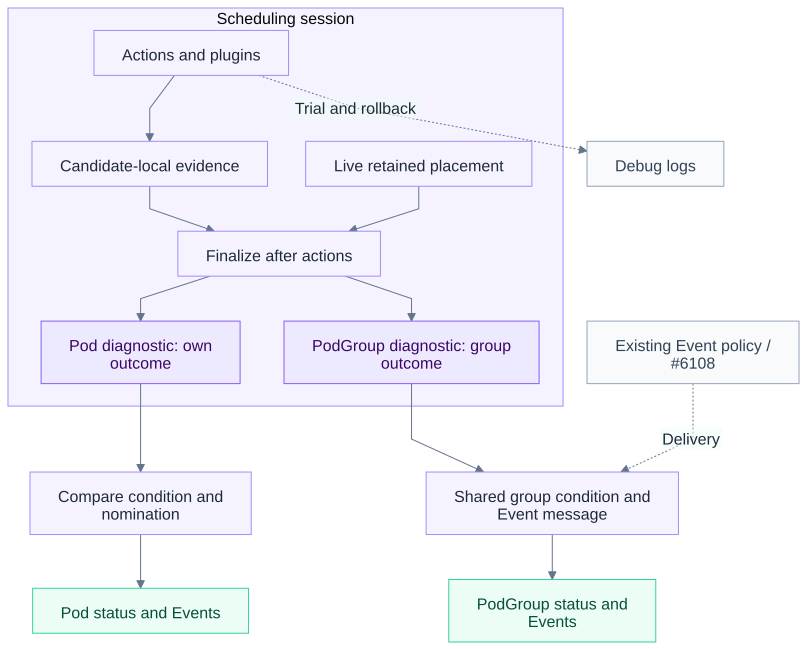
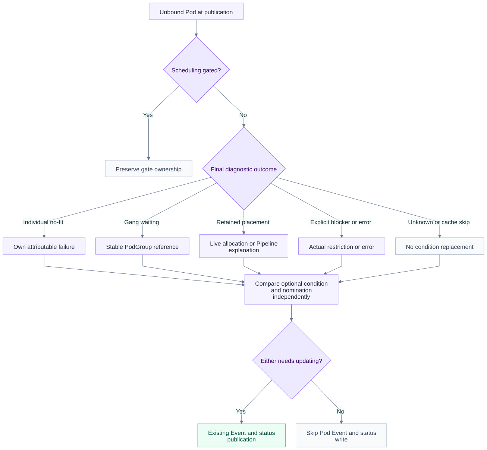
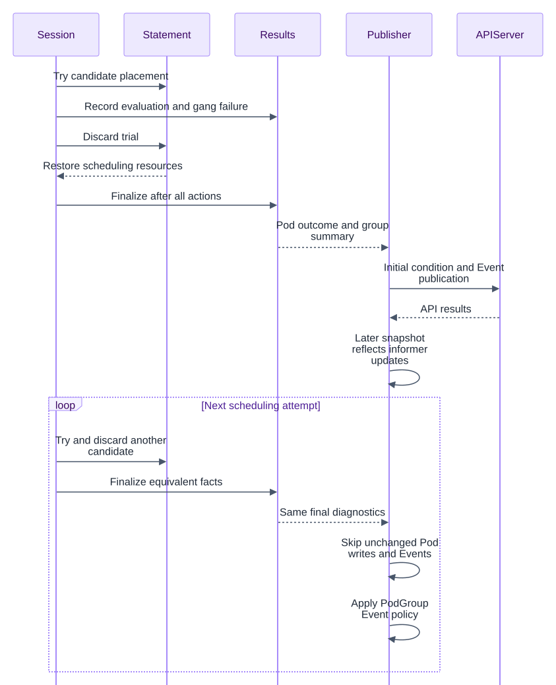

# Stable Scheduling Diagnostics for Pods and PodGroups

<!-- toc -->

- [Summary](#summary)
- [Motivation](#motivation)
  - [Current Behavior](#current-behavior)
  - [Goals](#goals)
  - [Non-Goals](#non-goals)
- [Proposal](#proposal)
  - [User Stories](#user-stories)
  - [Architecture](#architecture)
- [Design Details](#design-details)
  - [1. Pod Conditions and Events](#1-pod-conditions-and-events)
  - [2. PodGroup Conditions and Events](#2-podgroup-conditions-and-events)
  - [3. Diagnostic Types and Ownership](#3-diagnostic-types-and-ownership)
  - [4. Recording and Reducing Results](#4-recording-and-reducing-results)
  - [5. Session Finalization and Publication](#5-session-finalization-and-publication)
  - [6. Code Changes](#6-code-changes)
  - [7. kube-scheduler Practices](#7-kube-scheduler-practices)
- [Compatibility and Related Work](#compatibility-and-related-work)
- [Risks and Mitigations](#risks-and-mitigations)
- [Alternatives Considered](#alternatives-considered)
- [Test Plan](#test-plan)
- [Performance Validation](#performance-validation)
- [Implementation Plan and Open Questions](#implementation-plan-and-open-questions)
- [References](#references)

<!-- /toc -->

## Summary

**Draft for downstream discussion; implementation follows design agreement.**

Volcano exposes discarded scheduling attempts through Pod conditions and Events.
A candidate node chosen during HyperNode simulation can change on every attempt,
even though the Pod remains Pending and the gang blocker has not changed. The
resulting message changes trigger Pod status writes and watch traffic.

This proposal separates scheduling transactions from published diagnostics.
Actions record explicit evaluation results; the session reduces them into a final
diagnostic view. Pods report their own failure or a stable message that they are
waiting for their PodGroup. PodGroups report the gang decision and aggregate
HyperNode blockers. Candidate nodes, per-domain trial details and rollback progress
stay in debug logs.

The scope is the diagnostic ownership and message-churn portion of
[#6081](https://github.com/volcano-sh/volcano/issues/6081) and
[#6196](https://github.com/volcano-sh/volcano/issues/6196). Scheduling retries and
transaction behavior remain unchanged.

## Motivation

### Current Behavior

Consider a three-Pod gang. Pod A cannot satisfy its node affinity. Pod B finds a
candidate node but its placement is rolled back when the gang fails. Pod C is
skipped because the remaining tasks can no longer satisfy `minAvailable`.

| Object | Condition reason | Representative current message |
| --- | --- | --- |
| Pod A | `Unschedulable` | Its node-affinity fit error, potentially combined with group HyperNode details |
| Pod B | `Schedulable` for discarded Allocated; `Unschedulable` for Pipeline | `Pod ns/b can possibly be assigned to node-a, once minAvailable is satisfied` for the Allocated case; another attempt may name node-b |
| Pod C | `Unschedulable` | Whole `job.FitError()` summary when its own message is empty, potentially including A's error |
| PodGroup | `NotEnoughResources` | Group state plus pending-reason and tentative schedulability counts |

These examples omit unrelated suffixes. B exposes discarded placement choices,
C can inherit another member's failure, and the group summary can change with
trial history. A mixes individual and group scope when HyperNode detail is appended.

```text
Allocate / Pipeline / HyperNode simulation
  -> Statement.Discard(): save LastTransaction, undo operations
  -> TaskSchedulingReason(): prefer LastTransaction for reason/message
  -> gang.OnSessionClose(): construct PodGroup condition
  -> JobUpdater -> RecordJobStatusEvent()
  -> compare Pod condition and nomination
  -> FailedScheduling Event + Pods.UpdateStatus
```

Nomination already distinguishes a live Pipeline with eviction evidence from a
discarded trial; message construction does not. Gang close reporting also reads
`LastTransaction` for schedulable-task counts, and `FitError()` includes a histogram
derived from `TaskSchedulingReason()`. Removing only candidate names leaves other
trial-dependent reporting. The source links are in [References](#references).

The #6196 kind reproduction uses Volcano v1.16.0 and Kubernetes v1.34.0. It reports
message changes with empty nomination and no victim eviction. A separate
[HyperNode experiment](https://github.com/volcano-sh/volcano/issues/6196#issuecomment-6577306168)
reported 50 successful Pod status updates and 30 Pod Event writes in 30 seconds
with four rack HyperNodes and one three-Pod gang. These are existing reported
results, not measurements of this proposal.

An Event write changes an Event object. A persisted Pod status change produces
Pod watch traffic. Both matter, but they must be measured separately.

### Goals

- Keep Pod diagnostics stable when only discarded placement, candidate order or
  gang early-exit position changes.
- Attribute individual failures only to Pods whose evaluation establishes them.
- Give PodGroup conditions and Events one deterministic group summary.
- Preserve real blockers, nomination, gates and lifecycle reporting; retain
  simulation detail in debug logs.

### Non-Goals

- Changing gang eligibility, early exit, scoring, resource accounting, preemption,
  rollback/recovery, or when scheduling retries occur.
- Replacing the unschedulable job cache or using diagnostics to skip work.
- Adding CRD fields, public condition types, or another cross-session cache.
- Redoing #6106 deterministic selection, #6107 verbosity configuration, or #6108
  PodGroup Event deduplication.
- Fixing informer-lag duplicate requests or switching `UpdateStatus` to `Patch`.

## Proposal

Add a session-owned collector and a finalized diagnostic view on each session Job.
Actions record outcomes with explicit ownership and search scope. After actions
finish, the session reduces those outcomes before gang close callbacks run. The
condition and Event publishers consume this immutable view.

### User Stories

- **A gang repeatedly tries different nodes.** A Pending Pod keeps the same waiting
  condition while candidates change. An operator uses debug logs to inspect trials
  without generating Pod updates.
- **One member prevents the gang from starting.** That member exposes its own
  failure. Rolled-back and skipped members point to the PodGroup's aggregate blocker.
- **HyperNodes fail for different reasons.** The PodGroup reports distinct capacity
  and placement categories in a stable order. The last domain visited does not
  become every Pod's explanation.
- **Resources become available or preemption succeeds.** Real changes still update
  status and Events promptly, even if the previous failure message is unchanged.

### Architecture



Each candidate attempt owns a local result. Discarded candidates contribute failure
evidence to the reducer, while tentative placements stay in logs. A recovered winner
supplies its matching result. Neither Pod nor PodGroup rendering reads
`LastTransaction`.

A task result produces the Pod diagnostic; a group result produces the PodGroup
summary. They share a finalization boundary, not an error string. Existing
publishers keep their comparisons, nomination handling and lifecycle behavior.

## Design Details

The Go excerpts are proposed interfaces and pseudocode, with imports, routine
error handling and unrelated code omitted. They are not an implementation patch.
Mermaid sources are stored beside the figures as `.mmd` files.

### 1. Pod Conditions and Events

#### Proposed conditions

This section concerns unbound Pods. Existing detailed fit formatting still applies
to genuine individual failures.

A conclusively evaluated Pod with no feasible placement keeps
`PodScheduled=False, Reason=Unschedulable` and its own fit error. For example, an
affinity failure may say `No eligible node satisfies this Pod's node affinity.`
Do not append a different member's failure or a group-level capacity summary.

A Pod whose placement was discarded because the gang cannot proceed uses
`PodScheduled=False, Reason=Unschedulable` and the stable message
`Waiting for PodGroup ns/job to satisfy gang requirements.` The same output applies
to Pods skipped after gang early exit and to Pods never evaluated because group
capacity or topology screening rejected every applicable placement. The reason
change for discarded allocations is a proposal requiring agreement, as discussed
below.

Explicit blockers keep their own meaning. Queue/admission restrictions retain the
applicable existing reason and restriction text. Scheduling-gated Pods keep their
`SchedulingGated` condition without scheduler replacement. Actual scheduler or bind
errors remain `SchedulerError`, with the operational failure in the message.

A retained Pipeline with real nomination remains `PodScheduled=False` with reason
`Unschedulable`. Its message can say `Waiting for resources to be released on the
nominated node.` Other explicit blockers remain visible. A live allocation still
reported before dispatch keeps `Schedulable`, with `Placement selected; waiting for
binding.` If no new evaluation or explicit blocker exists, preserve the current
condition instead of inventing an all-nodes-unavailable result.

Retained-allocation reporting adds no new pre-binding write and does not delay binding.
Successful binding keeps its existing status/Event path. A retained Pipeline without
real nomination uses a node-free explanation such as `Waiting for resource release
and PodGroup ns/job readiness.` It must not publish a simulated node as a nomination.

#### Proposed Events

When the published scheduling condition changes, retain the
`Warning / FailedScheduling` Event and use the same final message as the condition.
A nomination-only change keeps the existing Event behavior, using the retained
result or current diagnostic. Nomination must be checked independently of text.

When another discarded trial produces identical condition and nomination inputs,
the existing no-change path skips both the Pod Event and status write. Binding,
eviction and genuine errors retain their existing Event owners, reasons and paths.

Do not add a `WaitingForPodGroup` Event reason or another Event cache. API failures
remain retryable. Since an Event may precede a failed status write, retries can
still repeat it; that differs from successful repeated writes caused by simulation.

#### Selecting the diagnostic



Apply this decision to finalized results. Nonempty `NodesFitErrors` does not prove
individual no-fit: several nodes may fail while another permits placement. A group
resource filter that prevents evaluation is not a Pod predicate failure.

#### Reason compatibility decision

A discarded `Allocated` snapshot currently produces `Schedulable`, whereas skipped
Pods and discarded Pipelines produce `Unschedulable`. Stable text alone cannot stop
writes if these reasons alternate.

Use `Unschedulable` for every **final gang-waiting** outcome and reserve
`Schedulable` for live retained allocations. This recommendation changes the
rolled-back allocation case and requires agreement against the earlier #6081
reason-compatibility requirement. Autoscaling consumers need regression coverage.
A strict-compatibility first patch can retain old reasons, but must state that
allocation-versus-skip reason churn remains unresolved.

### 2. PodGroup Conditions and Events

#### Proposed conditions

An unsatisfied gang keeps `Unschedulable=True` with reason `NotEnoughResources`.
The message describes the final group blocker, for example:

> Gang requirements are not satisfied. Blockers: member node affinity.

If the permitted HyperNode search is exhausted without a complete placement, the
same condition type and reason carry the aggregated domain explanation:

> No eligible HyperNode can satisfy the gang requirements. Blockers: insufficient HyperNode GPU capacity; unsatisfied member node affinity.

Enqueue/admission restrictions preserve the owning plugin's existing contract and
actual explanation. When the gang becomes ready, the existing `Scheduled=True`
path handles recovery and removes stale failure reporting. With no new group
evaluation, including a valid whole-Job cache skip, preserve the existing diagnostic
rather than rebuilding failure from empty evidence.

Retain existing condition types and reasons. Use one `GroupDiagnostic` message in
the gang condition and cache Event path, replacing their different prefixes and
speculative counters.

#### Proposed Events

For gang or HyperNode placement failures, retain `Warning / Unschedulable` and use
the same finalized group message as the condition. Recovery continues through
`Normal / Scheduled` with the existing readiness message. Enqueue/admission plugin
Events retain their source identity and explicit restriction.

Identical failures in later sessions produce the same content. Whether that Event
is suppressed or refreshed belongs to #6108 and downstream PR #29, including their
recovery, recurrence and source-aware delivery rules.

Without #6108 the current path can still submit unchanged PodGroup Events. Stable
content alone does not eliminate those API requests.

#### HyperNode aggregation

Use the same reducer for one domain and many domains. Sort and deduplicate typed
blocker keys from rejected attempts. Candidate identities, counts and traversal
order are not category keys.

For example, rack-A and rack-B may fail the group's GPU minimum resources while
rack-C fails a member's affinity. The group summary contains two categories:
insufficient aggregate HyperNode GPU capacity and unsatisfied member affinity.
Domain identities, quantities, tier counts and member-level details stay in logs.

Keep aggregate capacity distinct from per-node placement. A domain can have enough
total CPU but still lack a complete gang placement because resources are fragmented.
That is a per-node placement blocker, not the same category as failing the group's
minimum-resource filter.

The summary is a union of observed blockers, not a claim that every Pod or domain
failed every category. Group screening must not manufacture individual fit errors.
Only an exhausted permitted search supports the claim that no eligible domain can
place the gang. Early exit or operational failure must retain its actual outcome.
Successful candidates supersede failed alternatives.

An established placement's domain can appear publicly because it is a real
constraint; a simulated domain cannot. Unknown plugin failures retain plugin
identity and their actual explanation through a deterministic fallback rather than
an undifferentiated `other` category. Stable output means the same final facts
produce the same text; do not run extra scheduling searches just to collect errors.

#### Example across all four outputs

For A's affinity failure, B's rollback and C's early exit:

| Output | Object | Reason | Proposed message |
| --- | --- | --- | --- |
| Pod condition | A | `Unschedulable` | `No eligible node satisfies this Pod's node affinity.` |
| Pod Event | A | `FailedScheduling` | `No eligible node satisfies this Pod's node affinity.` |
| Pod condition | B and C | `Unschedulable` | `Waiting for PodGroup ns/job to satisfy gang requirements.` |
| Pod Event | B and C | `FailedScheduling` | The same waiting message, when publication is needed |
| PodGroup condition | ns/job | `NotEnoughResources` | `Gang requirements are not satisfied. Blockers: member node affinity.` |
| PodGroup Event | ns/job | `Unschedulable` | The same group message, with delivery governed separately |

B's trial node or rollback-versus-skip history does not alter the output. A's text
legitimately differs: consistent attribution does not require identical messages
for members with different actual outcomes.

### 3. Diagnostic Types and Ownership

Shared value types belong in `pkg/scheduler/api`, which framework and cache already
import. Mutable collection belongs to the session; the frozen publication view is
attached to its `JobInfo`.

```go
// api/scheduling_diagnostics.go (new; abbreviated)
type DiagnosticOutcome uint8

const (
    DiagnosticUnknown DiagnosticOutcome = iota
    DiagnosticNoFit
    DiagnosticGroupWaiting
    DiagnosticExplicitBlocker
    DiagnosticRetainedPlacement
    DiagnosticError
)

type SchedulingBlocker struct {
    Scope    string // pod, group capacity, or group placement
    Plugin   string
    Category string
    Resource v1.ResourceName // empty for non-resource failures
    // Attributable detail and established constraint scope omitted.
}

type TaskDiagnostic struct {
    Outcome   DiagnosticOutcome
    Condition *v1.PodCondition // nil means no diagnostic replacement
}

type GroupDiagnostic struct {
    Known    bool // false for unknown/no new evaluation
    Blockers []SchedulingBlocker
    Message  string // shared by condition and Event renderers
    // Final group outcome and search completeness omitted.
}

type JobSchedulingDiagnostics struct {
    Tasks map[TaskID]TaskDiagnostic
    Group GroupDiagnostic
}

// JobInfo gains a session-only view:
// Diagnostics *JobSchedulingDiagnostics
```

The collector additionally records evaluation scope/completeness, whether any
placement succeeded, why evaluation stopped and which candidate was retained.
These facts produce the view above; they cannot be inferred from error strings.

Candidate evidence belongs to one attempt under its parent. A child's failure
cannot overwrite the parent or winner. The mutable collector begins empty for
each session and never controls whether scheduling retries occur. Once finalized,
the Job's view is read-only through close callbacks and parallel publication.

`LastTransaction` remains part of transaction machinery for internal consumers;
it is no longer reporting evidence. Nomination continues to come from the existing
live transaction and Pod status path, independently of the diagnostic collector.

Do not carry mutable collection into scheduler-cache Jobs or the next snapshot.
Release it after publication. UID scoping prevents same-name recreation from
inheriting results. A valid unschedulable-cache skip supplies no new evaluation;
preserve the current diagnostic unless another action establishes a new result.

### 4. Recording and Reducing Results

#### Action integration

Record evidence where the decision occurs without changing the scheduling branch:

```go
// allocateResourcesForTasks, using a candidate-local collector (pseudocode)
if len(predicateNodes) == 0 {
    attempt.RecordNoFit(task.UID, scope, fitErrors)
    if !job.NeedContinueAllocating(subJob.UID) {
        attempt.StopForGang() // remaining unevaluated tasks wait for the group
        break               // existing early exit
    }
    continue
}
if err := alloc.allocateResourcesForTask(stmt, task, bestNode, job); err != nil {
    attempt.RecordError(task.UID, err)
    continue
}
attempt.RecordPlacementFound(task.UID, scope)
// Trial node and operation remain available in debug logs.
```

`RecordNoFit` describes the evaluated scope of this attempt. It becomes a public
individual failure only if the reducer establishes no placement over the permitted
scope. Pre-predicate failures may already be conclusive. Equivalent-role rejection
reuse keeps its existing validity requirements; publish the underlying cause,
not the optimization message `already predicated failed, skip`.

#### Nested trials and rollback

```go
// allocateForJob / allocateForSubJob (pseudocode)
attempt := diagnostics.BeginCandidate(job.UID, subJob.UID, scope)
stmt := allocateCandidate(attempt) // existing logic with result recording
result := attempt.Finish()        // evidence plus search completion

if stmt != nil {
    saved := framework.SaveOperations(stmt) // existing operation backup
    candidates.Save(saved, result)          // keep matching evidence
    stmt.Discard()                         // existing dry-run rollback
}
diagnostics.MergeCandidate(result)

// If there is a winner, select its result after successful recovery.
recovered := framework.NewStatement(ssn)
if err := recovered.RecoverOperations(winner.Statement); err == nil {
    diagnostics.SelectCandidate(winner.Result)
} else {
    diagnostics.RecordRecoveryError(err)
}
```

Failed attempts retain evidence even when no statement survives. A recovered
subjob remains tentative until its parent is settled: parent discard converts the
placement to group waiting. Successful final placement supersedes failed
alternatives; recovery failure remains an operational error. No changes to
`Discard()` or `RecoverOperations()` semantics are needed.

#### Reduction rules

Finding a placement overrides the claim that the Pod had no feasible node, even
if other nodes left fit errors behind. Individual no-fit requires a complete
evaluation of the permitted scope. Failure in just one candidate domain cannot
prove it when other scope remains unevaluated.

When gang failure discards a placement or stops further evaluation, the affected
member waits for its group. Group minimum-resource screening contributes a group
capacity blocker, never an invented Pod predicate failure. Keep incomplete,
scoped evidence on the group or in logs.

Later actions are reconciled against the final live disposition: retained progress
can supersede an earlier failure, while a genuine later error must remain visible.
Neither first-error-wins nor last-error-wins is sufficient. A valid cache skip
provides no new result and therefore preserves the existing diagnostic unless
another action establishes one.

Queue rejection, gates and operational errors remain explicit. Unknown does not
default to group waiting without a group decision preventing that Pod's progress.
This also covers disabled gang plugins and intentionally untouched tasks.

### 5. Session Finalization and Publication

#### Finalization boundary

Finalize after configured actions complete, before plugin close callbacks:

```go
// framework/framework.go (proposed ordering)
func CloseSession(ssn *Session) {
    ssn.FinalizeSchedulingDiagnostics() // new: immutable Job views, no API writes
    for _, plugin := range ssn.plugins {
        plugin.OnSessionClose(ssn)      // gang consumes the group view
    }
    closeSession(ssn)                   // existing JobUpdater/publication
}
```

Finalization initializes a diagnostic view for every session Job, including unknown
results, and reconciles evidence with live retained placements and final group
decisions. Plugins owning enqueue/admission diagnostics retain their
ownership. Missing results must not erase those conditions. Freeze the view before
parallel JobUpdater/task workers read it.

#### Rollback and unchanged retry sequence



The sequence assumes normal informer convergence. Scheduling attempts still run;
only redundant publication is skipped. PodGroup Event suppression in the final
step depends on #6108's separate delivery policy.

#### Pod publication

Replace `TaskSchedulingReason()`'s transaction-based formatting with finalized
conditions. Remove the whole-job fallback from the Pod publication path:

```go
// RecordJobStatusEvent, per-task portion (pseudocode)
if task.SchGated {
    return // preserve the existing gated condition
}
diagnostic := job.Diagnostics.Tasks[task.UID] // absent means no new condition
condition := diagnostic.Condition

// Existing #6066 rule: live Pipeline with actual eviction evidence.
// An empty result does not clear nomination through this path.
nominatedNode := liveNominationForPublication(task)
publishTaskDiagnostic(task, condition, nominatedNode)
```

`publishTaskDiagnostic` adapts `taskUnschedulable`, accepting an optional condition
so nomination can progress independently:

```go
updateCondition := condition != nil &&
    podConditionHaveUpdate(&pod.Status, condition)
updateNomination := nominatedNode != "" &&
    podNominatedNodeNameNeedUpdate(&pod.Status, nominatedNode)
if !updateCondition && !updateNomination {
    return nil
}
// Keep DeepCopy, condition/nomination updates, FailedScheduling recording,
// UpdatePodStatus, and existing nomination-cache synchronization.
// For nomination-only changes, retain the current/retained-result diagnostic.
// Return API errors; never mark a failed write as successfully published.
```

A nil result must not become an empty condition clearing the message. Binding/error
callers still supply explicit conditions through their own paths.

#### PodGroup publication

The gang plugin and cache publisher share the final message:

```go
// gang.OnSessionClose, inside the existing unschedulable branch
group := job.Diagnostics.Group
if group.Known {
    condition := &scheduling.PodGroupCondition{
        Type:    scheduling.PodGroupUnschedulableType,
        Status:  v1.ConditionTrue,
        Reason:  v1beta1.NotEnoughResourcesReason,
        Message: group.Message,
        // Existing transition metadata omitted.
    }
    ssn.UpdatePodGroupCondition(job, condition)
}

// RecordJobStatusEvent, group failure path (pseudocode)
// Known failures use the same message through the existing/#6108 entry point.
if group.Known {
    recordGroupFailure(job.PodGroup, group.Message)
}
```

For unknown results, preserve/reuse the existing diagnostic where appropriate;
do not emit an empty replacement. Preserve existing success and plugin paths.
Remove reporting-only tentative counts from `LastTransaction` and the pending
reason histogram where they encode discarded progress. Keep actual task phases
and configured minimum membership; do not change scheduling readiness logic.

Retain PodGroup comparison rules that ignore transition time/ID and Pod
`LastTransitionTime` behavior when condition status is unchanged. Attempt IDs and
timestamps must not enter messages. Pod processing must not be gated on whether
the PodGroup status changed.

### 6. Code Changes

Paths are relative to `pkg/scheduler/`. This is the implementation map; the PR
contains only the design and figures.

**Result types and formatting.** Add `api/scheduling_diagnostics.go` for the shared
values and rendering helpers. In `api/job_info.go`, add the session view, replace
`TaskSchedulingReason()` reporting and remove speculative inputs from `FitError()`.
Audit clone/snapshot behavior so the view does not leak across sessions. Reuse
attributable fit details from `api/unschedule_info.go` without redoing #6107 or
changing genuine detailed Pod counts.

**Collection and action calls.** `framework/session.go` owns the collector, and
`framework/framework.go` establishes the finalization boundary. Instrument
`actions/allocate/allocate.go` at evaluation, early exit, screening, candidate
discard and winner selection. `actions/preempt`, `actions/reclaim` and
`actions/backfill` contribute later outcomes where they supersede earlier evidence
or retain progress. Their scheduling, eviction and nomination decisions stay intact.

**Publication.** `plugins/gang/gang.go` consumes the shared group summary instead
of transaction-derived diagnostic counts. `cache/cache.go` removes the whole-job
Pod fallback and accepts an optional condition alongside independent nomination.
It retains existing comparisons and composes with #6108's Event delivery path.
Readiness, accounting and metrics remain separate from rendering.

**Transaction logging.** `framework/statement.go` retains rollback/recovery
semantics and other `LastTransaction` consumers. Only enrich debug logs where
existing messages lack the context needed to replace discarded-placement text.

Reuse V(3)/V(4) transaction/topology logs with session, Pod/PodGroup UID, action,
domain, trial node and discard cause. Keep expensive per-node detail behind higher
verbosity; avoid replacing API churn with unconditional logs.

### 7. kube-scheduler Practices

`handleSchedulingFailure()` receives explicit failure status and separate nomination
information. The direct `updatePod()` path compares condition and nomination
independently; its patch helper skips empty patches and retries selected API errors.
See the [v1.34.0 failure path](https://github.com/kubernetes/kubernetes/blob/v1.34.0/pkg/scheduler/schedule_one.go#L1043-L1170),
[patch helper](https://github.com/kubernetes/kubernetes/blob/v1.34.0/pkg/scheduler/util/utils.go#L101-L140),
and inspected [v1.37.1 path](https://github.com/kubernetes/kubernetes/blob/v1.37.1/pkg/scheduler/schedule_one.go#L1150-L1307).

Volcano should adopt the separation of failure from reservation state: explicit
outcomes replace `LastTransaction` as diagnostic evidence. Keep its existing
no-change comparisons, with stable inputs, and continue checking nomination
independently so unchanged text cannot suppress real preemption progress. API
errors must remain retryable rather than being hidden by publication suppression.

kube-scheduler still records `FailedScheduling` independently of whether a status
patch is needed. It is not a transition-only Event deduplication model. Changing
Volcano's transport to `Patch` would not remove actual message changes or their
watch traffic, so it remains outside this proposal.

## Compatibility and Related Work

The deterministic selection fix from #6106/#6127 remains in place wherever the
existing formatter is used. #6107 continues to own configurable fit-detail
verbosity, with genuine individual diagnostics detailed by default. Simulation
summaries use categories in both modes; agree on that boundary with its owner so
detail mode does not reintroduce discarded placements.

This proposal composes with #6108 and downstream PR #29 rather than adding another
Event cache. Preserve their source identity, recovery/recurrence, UID isolation and
refresh policy. Likewise, retain #6066's live Pipeline/eviction evidence and
nomination lifecycle.

The unschedulable job cache keeps its skip/wake policy. A skipped evaluation is
not a new failure, so it does not replace current diagnostics unless another action
establishes a result. The #6081 informer-lag work remains deferred; no synchronous
cache updates or last-written-status suppression are introduced.

The proposed reason change for a discarded allocation is the explicit compatibility
exception. Agree on it and test consumers before implementing it; the rest of the
existing condition reason vocabulary remains intact.

Simulation summaries exclude trial counts and identities. They do not promise
unchanged text when actual blockers or genuine detailed individual fit histograms
change.

## Risks and Mitigations

The main correctness risk is overstating partial evidence. Scope and completeness
must travel with each result, and nested attempts must keep statements paired with
their evidence until the parent outcome is settled. This prevents a failed child
from replacing a winning placement or becoming a global Pod failure.

Changing rolled-back allocations from `Schedulable` to `Unschedulable` may affect
consumers such as autoscaling. Treat it as a compatibility decision and verify the
affected behavior. Independently test nomination-only updates so stable condition
text never blocks actual preemption progress.

Category summaries lose per-candidate detail by design. Preserve meaningful
scope/resource distinctions and established constraints in public explanations;
keep trial detail available in debug logs. Freeze results before parallel
publication and audit cloning to prevent races or cross-session leakage.

Collection must not become a new scheduling bottleneck. Reduce candidate evidence
incrementally, reuse existing facts and avoid extra node evaluations just to
complete a diagnostic. Measure CPU and retained memory alongside write reduction.

## Alternatives Considered

- **Remove candidate names only.** Partial mitigation; prefix, reason,
  inherited-error and speculative group-counter churn remain.
- **Move every message to PodGroup.** Loses attributable Pod failures needed by
  users and integrations. Keep individual errors on Pods.
- **Report the last failed HyperNode.** Traversal-dependent and incomplete; reduce
  categories across relevant attempts instead.
- **Add a throttle or last-written-message cache.** Does not fix attribution and
  risks hiding changes or failed-write retries. #6108 owns its separate concern.
- **Delete `LastTransaction` or change rollback.** Unnecessarily changes transaction
  semantics. Remove diagnostic dependencies while preserving internal consumers.

## Test Plan

This design-only PR requires document/link/figure checks. Runtime implementation
requires focused tests and real-cluster reproduction. These are planned checks.

### Unit and Integration Tests

Test reduction with failure followed by success, complete and partial search
scope, gang early exit versus queue rejection, and valid equivalent-role reuse.
Nested cases must cover child success followed by parent discard, winner recovery,
recovery failure and later actions superseding earlier evidence.

Rendering tests should verify identical output for the same facts in different
orders, preserved scope/resource distinctions and exclusion of trial names/counts.
Publication tests cover all four outputs, nil-diagnostic preservation,
nomination-only changes, unchanged inputs and API-error retries. Lifecycle coverage
includes gates, cache skips, recurrence, UID recreation and immutable parallel reads.

### End-to-End Tests

Start with the #6196 Allocate/Pipeline reproduction on equal-score nodes. Confirm
that candidate changes stop producing additional Pod condition/nomination changes
and Pod Events after informer convergence. Then alternate one member between a
trial placement and gang early exit: its text must stay stable and, if the proposed
reason contract is accepted, its reason must too.

Use a three-member gang to check attribution: one affinity failure, one rolled-back
member and one skipped member. Only the failed member should carry no-fit. Extend
the workload to one and multiple HyperNodes, reorder candidates, exercise capacity,
fragmentation and affinity blockers, then provide a successful candidate. Verify
stable equivalent summaries, correct scope and removal of stale failure text.

Finally exercise real preemption through victim eviction, nomination, resource
release and binding. Cover scheduling gates, Queue restrictions and real API
failures to preserve explicit blockers and retries. Repeat with the unschedulable
cache enabled and disabled, recreate same-name objects and restart the scheduler
to check that diagnostics neither leak nor arise from skipped evaluation.

## Performance Validation

Re-run #6196 on the affected release and eventual patched build. Record exact
images/commits, actions/plugins, feature gates, manifests, observation windows and
completed attempts. Disable the unschedulable cache for the primary rollback
comparison so it cannot hide reporting, then enable it for compatibility coverage.

Count Pod status update/patch attempts by response code, then separately count
persisted condition/nomination changes and Pod watch notifications. Correlate
notifications with scheduler-owned fields so kubelet/controller writes are not
mistaken for regressions. In the unchanged reproducer, expect zero additional
simulation-induced Pod changes after initial publication and informer convergence.

Count actual Pod and PodGroup Event create/patch/update requests, not `Eventf()`
calls. Report group delivery with and without #6108 separately. PodGroup status
must not change solely because trial progress or candidate order changed while
the final facts stayed the same.

Measure scheduler CPU, memory, session latency and useful throughput at the #6081
scale. The reduction in API traffic must not come at the cost of scheduling
progress or excessive collector overhead.

Observe for at least 30 seconds after convergence and confirm continued trials in
logs. API errors and informer lag may still cause requests; conflicts do not
persist another Pod update. No new runtime measurements are claimed in this draft.

## Implementation Plan and Open Questions

1. Agree on the four output contracts, rolled-back allocation reason and #6107
   simulation-summary boundary.
2. Implement collection, action recording and finalization with nested-candidate
   and later-action precedence checks.
3. Switch publishers together; preserve transaction semantics and compose with
   existing #6108 delivery policy.
4. Verify the same real-cluster workloads before/after, then update the older
   [scheduling-reason design](scheduling-reason.md) and user guidance.

Decisions requiring alignment:

- Use `Unschedulable` for all gang-waiting outcomes, or retain legacy reasons in a
  partial mitigation and explicitly accept remaining reason churn?
- Use simulation category summaries in both verbosity modes while #6107 owns
  genuine individual fit-detail policy?
- Accept finalization before `OnSessionClose` and the action coverage in the
  code-change section as the implementation boundary?

## References

The structure follows the
[Unschedulable Job Cache design](https://github.com/volcano-sh/volcano/blob/8a05cdba9405e66a5f3bacf7234a98677f62c6ab/docs/design/unschedulable-job-cache.md).
Source analysis is pinned to upstream `8a05cdba9405e66a5f3bacf7234a98677f62c6ab`;
the older downstream base is only the document destination.

- [#6081 scope breakdown](https://github.com/volcano-sh/volcano/issues/6081#issuecomment-6263823420) — Separate message, Event and informer-lag workstreams.
- [Pod ownership discussion](https://github.com/volcano-sh/volcano/issues/6081#issuecomment-6577040419) — Rolled-back/skipped members refer to the group.
- [Explicit result and aggregation discussion](https://github.com/volcano-sh/volcano/issues/6196#issuecomment-6599802637) — Attribution, completeness and HyperNode categories.
- [Allocate candidate handling](https://github.com/volcano-sh/volcano/blob/8a05cdba9405e66a5f3bacf7234a98677f62c6ab/pkg/scheduler/actions/allocate/allocate.go#L455-L686) — Nested attempts and recovery.
- [Statement.Discard](https://github.com/volcano-sh/volcano/blob/8a05cdba9405e66a5f3bacf7234a98677f62c6ab/pkg/scheduler/framework/statement.go#L376-L398) — Snapshots before rollback.
- [TaskSchedulingReason](https://github.com/volcano-sh/volcano/blob/8a05cdba9405e66a5f3bacf7234a98677f62c6ab/pkg/scheduler/api/job_info.go#L981-L1022) — Pod message and nomination construction.
- [Gang close reporting](https://github.com/volcano-sh/volcano/blob/8a05cdba9405e66a5f3bacf7234a98677f62c6ab/pkg/scheduler/plugins/gang/gang.go#L228-L278) — Trial-derived counts and group conditions.
- [Job updater entry](https://github.com/volcano-sh/volcano/blob/8a05cdba9405e66a5f3bacf7234a98677f62c6ab/pkg/scheduler/framework/session.go#L541-L550) — Publication after close callbacks.
- [Pod publication](https://github.com/volcano-sh/volcano/blob/8a05cdba9405e66a5f3bacf7234a98677f62c6ab/pkg/scheduler/cache/cache.go#L1203-L1258) — Comparison and Event/status writes.
- [Group/task reporting](https://github.com/volcano-sh/volcano/blob/8a05cdba9405e66a5f3bacf7234a98677f62c6ab/pkg/scheduler/cache/cache.go#L1792-L1845) — Group Event and whole-job Pod fallback.
- [#6106](https://github.com/volcano-sh/volcano/issues/6106), [#6127](https://github.com/volcano-sh/volcano/pull/6127), [#6107](https://github.com/volcano-sh/volcano/issues/6107), [#6108](https://github.com/volcano-sh/volcano/issues/6108) — Existing workstreams.
- [Downstream PR #29](https://github.com/JesseStutler/volcano/pull/29), [#6066](https://github.com/volcano-sh/volcano/pull/6066) — Event delivery and nomination compatibility.
