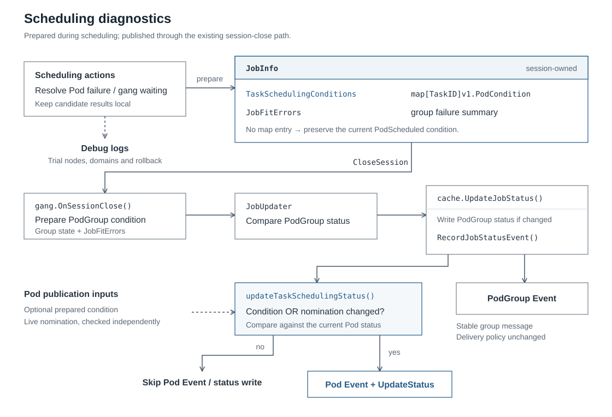
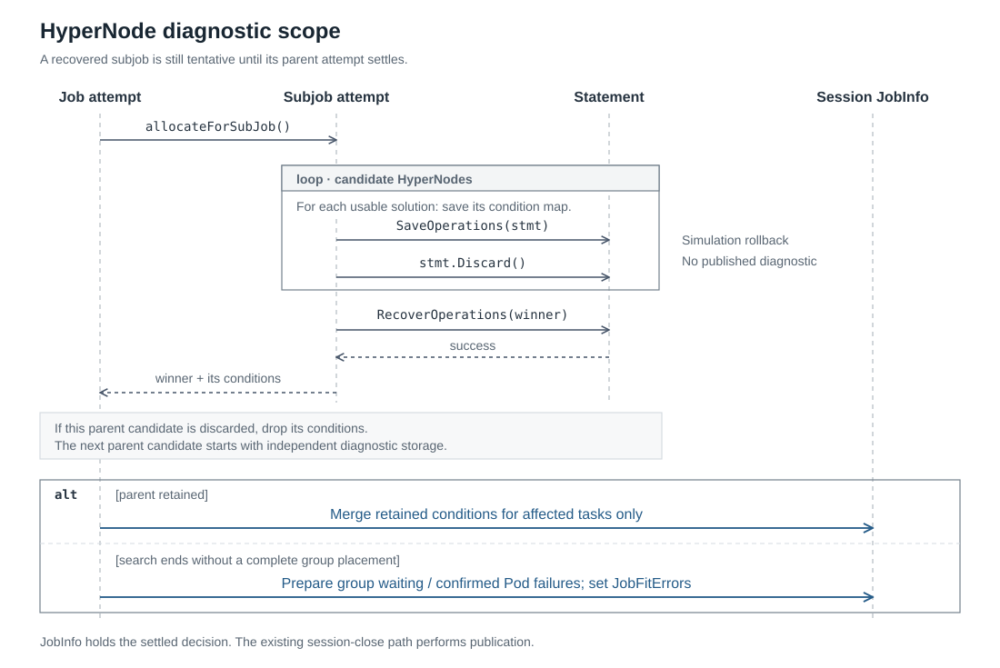

# Stable Pod and PodGroup Scheduling Diagnostics

<!-- toc -->

- [Summary](#summary)
- [Motivation](#motivation)
  - [Goals](#goals)
  - [Non-Goals](#non-goals)
- [Proposal](#proposal)
  - [User Stories](#user-stories)
  - [Pod and PodGroup Reporting](#pod-and-podgroup-reporting)
  - [Architecture](#architecture)
- [Design Details](#design-details)
  - [1. Condition Storage and Ownership](#1-condition-storage-and-ownership)
  - [2. Preparing Pod Conditions](#2-preparing-pod-conditions)
  - [3. HyperNode Attempts and Group Failures](#3-hypernode-attempts-and-group-failures)
  - [4. Status and Event Publication](#4-status-and-event-publication)
  - [5. Scheduler Integration](#5-scheduler-integration)
- [Compatibility](#compatibility)
- [Risks and Mitigations](#risks-and-mitigations)
- [Alternatives Considered](#alternatives-considered)
- [Test Plan](#test-plan)
- [Related Issues and References](#related-issues-and-references)

<!-- /toc -->

## Summary

Volcano can publish a different Pod condition and Event after every discarded
scheduling attempt, even when the Pod remains Pending and its blocker is unchanged.
HyperNode simulation makes temporary placements particularly visible in this path.

This design gives the existing scheduling actions responsibility for preparing
Pod conditions from their actual decisions. A session-local map carries those
conditions to the existing publisher. Group failures are summarized separately
for PodGroup conditions and Events; trial nodes and rollback details remain in
debug logs. Scheduling, nomination and transaction lifecycles stay in their
current components.

## Motivation

Three parts of the current reporting path expose temporary scheduling work:

1. `TaskSchedulingReason()` reads `LastTransaction` after rollback. A different
   trial node changes the Pod's message although it is still Pending. A discarded
   allocation can also alternate between `Schedulable` and `Unschedulable`.
2. `RecordJobStatusEvent()` falls back to the whole `job.FitError()` when a Pod has
   no message. A member skipped by gang early exit can therefore report another
   member's failure.
3. Gang close reporting and `FitError()` include trial-derived task counts.
   HyperNode diagnostics can also reflect the last attempted domain rather than
   why the group could not be placed.

Volcano already skips unchanged Pod conditions. These changing inputs defeat that
comparison and trigger `UpdateStatus` and `FailedScheduling` Events. Successful
Pod status changes then produce Pod watch traffic; Event writes are separate API
operations. The [existing HyperNode reproduction](https://github.com/volcano-sh/volcano/issues/6196#issuecomment-6577306168)
reported 50 successful Pod status updates and 30 Pod Event writes in 30 seconds.
Those are previously reported results, not measurements of this proposal.

### Goals

- Stop changes caused only by trial nodes, discarded placements or gang early exit
  from becoming Pod status updates.
- Keep individual Pod errors attributable and put group failures on PodGroup.
- Give conditions and Events consistent messages while preserving genuine changes,
  nomination and useful debug detail.

### Non-Goals

- Changing gang eligibility, early exit, scoring, retry policy or rollback.
- Replacing the unschedulable job cache or adding persistent diagnostic state.
- Changing fit-error selection, diagnostic verbosity controls or PodGroup Event
  deduplication, recurrence and refresh policy.
- Suppressing duplicate writes caused by stale informer snapshots.

## Proposal

### User Stories

- **Repeated gang rollback.** A member tries different nodes over several sessions.
  Its condition keeps the same group-waiting message; debug logs show the trials.
- **One member blocks the group.** The failing member reports its own error. Other
  members refer to their PodGroup instead of inheriting that error.
- **Different HyperNodes reject the workload.** The PodGroup explains the distinct
  capacity and placement blockers without depending on the last domain visited.
- **Preemption or a cluster change allows progress.** The real nomination, new
  failure or successful binding remains visible through the existing paths.

### Pod and PodGroup Reporting

A Pod reports its own failure or a stable reference to the PodGroup it is waiting
for. The PodGroup explains the group failure. Trial placements and rollback details
remain in scheduler debug logs.

For a three-member gang, assume A fails node affinity, B finds a placement that is
rolled back, and C is skipped after gang early exit:

| Object | Condition | Event | Message |
| --- | --- | --- | --- |
| Pod A | `PodScheduled=False`, reason `Unschedulable` | `Warning / FailedScheduling` | `No eligible node satisfies this Pod's node affinity.` |
| Pod B | `PodScheduled=False`, reason `Unschedulable` | `Warning / FailedScheduling` | `Waiting for PodGroup ns/job to satisfy gang requirements.` |
| Pod C | `PodScheduled=False`, reason `Unschedulable` | `Warning / FailedScheduling` | `Waiting for PodGroup ns/job to satisfy gang requirements.` |
| PodGroup ns/job | `Unschedulable=True`, reason `NotEnoughResources` | `Warning / Unschedulable` | `Gang requirements are not satisfied. Blockers: member node affinity.` |

The messages are illustrative; genuine Pod fit errors keep the existing detailed
formatter. Each object's condition and Event use the same explanation. B and C
remain stable if their trial node or evaluation order changes. A legitimately has
a different message because it has an individual failure.

Scheduling gates retain their existing condition. Queue restrictions and scheduler
errors keep their explicit explanation rather than being rewritten as gang
waiting. Real nomination, binding, eviction and recovery keep their existing
reporting paths. A live retained allocation may still use `Schedulable`; a
discarded placement is not a retained allocation.

**Reason compatibility:** using `Unschedulable` for rolled-back allocations changes
the existing `Schedulable` case and needs agreement, including autoscaling checks.
Keeping that legacy distinction would leave reason churn even after stabilizing
the message. No new public condition or Event reason is proposed.

### Architecture

Use the existing error producers and publication path. Pass a Kubernetes
`PodCondition` when an action has established what should be reported, and keep
nomination separate. There is no new diagnostic state machine or session
finalization phase.



The work falls into three existing modules. **Scheduling actions** decide which
Pod failed, which members are waiting, and whether a candidate was retained.
**JobInfo** carries the prepared Pod conditions and the group failure message for
the current session. **Gang and cache publication** turn those inputs into
conditions and Events, using existing change detection and nomination handling.

The order remains `OpenSession -> actions -> plugin OnSessionClose -> JobUpdater
-> cache publication`. No new callback or finalization pass is introduced. The
sections below describe each module's data, update rules and integration points.

## Design Details

### 1. Condition Storage and Ownership

#### Structure

kube-scheduler passes a scheduling failure and nomination information to
[`handleSchedulingFailure()`](https://github.com/kubernetes/kubernetes/blob/v1.34.0/pkg/scheduler/schedule_one.go#L1043-L1170),
which constructs `PodScheduled=False`. Its status updater accepts an optional
condition and checks nomination independently. The useful principle is explicit
reporting input, not reconstructing failure from an undone reservation.

Volcano publishes many Pods at session close rather than immediately after one
Pod's scheduling cycle. A small session-local map on `JobInfo` bridges that
difference using the existing Kubernetes type:

```go
// Relevant JobInfo fields; unrelated fields are omitted.
type JobInfo struct {
    // Existing scheduling error data.
    NodesFitErrors map[TaskID]*FitErrors
    JobFitErrors   string

    // Conditions prepared for this session's publication.
    // No entry means no replacement for the current PodScheduled condition.
    TaskSchedulingConditions map[TaskID]v1.PodCondition
}
```

Actions prepare conditions in memory; they do not write Pod status directly. The
map starts empty on each session snapshot and is not copied back into the shared
cache. It needs no custom outcome enum, validity flag, collector, or public API.

#### Lifetime and access

Initialize the map when creating a session Job, just as the session initializes
its fit-error storage. Snapshot/clone paths must not carry a previous session's
prepared conditions into a new attempt. The authoritative published condition
remains the one in `task.Pod.Status`.

During actions, the map contains only results accepted at the relevant scheduling
scope. Candidate-local maps remain owned by the allocation function until its
decision completes. At session close, actions have finished writing and the
existing parallel job/task publishers only read the values. Discard the map with
the session; `UpdateJobStatus` must not copy it into shared-cache Jobs.

The map stores condition values, not pointers into informer objects. Publishers
copy the selected condition before updating timestamps or Pod status. The
condition's timestamp is left to the existing updater, so retry time cannot
become another source of diagnostic changes.

### 2. Preparing Pod Conditions

#### Individual failure and gang waiting

Keep `NodesFitErrors` for its existing scheduling uses, including role-based
predicate reuse. Do not change that map's meaning just to simplify reporting.
Convert its errors to a Pod condition only at the point where the action has
established a final, attributable failure. For example, failures on some nodes do
not establish no-fit if another node permits placement.

The normal allocation failure branch prepares the condition as follows
(pseudocode; existing scheduling and error handling are omitted):

```go
// Only after the permitted search establishes no feasible node for this Pod.
job.TaskSchedulingConditions[task.UID] = v1.PodCondition{
    Type:    v1.PodScheduled,
    Status:  v1.ConditionFalse,
    Reason:  api.PodReasonUnschedulable,
    Message: fitErrors.Error(),
}
```

When the gang attempt fails, prepare the stable group-waiting condition for members
whose placements were discarded or whose evaluation was stopped by that gang
decision. Preserve independently established failures, gates and restrictions.
An untouched task, including a valid unschedulable-cache skip, gets no replacement
unless another action establishes a new result. Missing fit errors alone must not
be interpreted as group waiting.

#### Replacing a previous result

Conditions follow the current action's decision rather than error arrival order.
A later conclusive failure replaces an earlier condition for that Pod. A retained
allocation or Pipeline replaces stale no-fit text with its actual waiting state;
once the Pod moves to the binding path, remove the pending diagnostic and let the
existing binder own success or bind-error reporting.

Gang waiting is assigned only to members blocked by that gang decision. It must
not overwrite a confirmed individual failure or a queue/admission restriction.
Similarly, a rejected candidate cannot replace a retained candidate's condition.
This keeps precedence at the call sites that already know why scheduling stopped.

### 3. HyperNode Attempts and Group Failures

#### Candidate storage

`allocateForJob()` and `allocateForSubJob()` already own the candidate loops,
statement backups and winner recovery. Resolve diagnostic scope there, before
passing conditions to the publisher; do not add a generic reducer to `Session`.

The existing statement backups can be accompanied by plain maps for conditions;
there is no additional result hierarchy. For example, inside a candidate loop:

```go
// Allocation-local storage; use the existing candidate/domain keys.
conditionsByHyperNode := make(map[string]map[api.TaskID]v1.PodCondition)

// Save only after this candidate provides a usable solution.
stmtBackup[hyperNode.Name] = framework.SaveOperations(stmt)
conditionsByHyperNode[hyperNode.Name] = candidateConditions
stmt.Discard() // existing simulation rollback
```

This is an abbreviated storage example, not a change to the allocation algorithm.
Each saved map is independent of the next candidate's scratch data. After winner
recovery succeeds, merge its conditions only for the affected subjob/tasks; do not
replace conditions belonging to other members. An enclosing job attempt retains
ownership until its own decision completes: a recovered subjob is still tentative
until the parent is settled. Failed recovery remains an operational error.

The sequence below shows successful subjob recovery within a parent attempt. A
parent rollback drops the candidate's conditions; only the settled parent decision
reaches the session's `JobInfo` for later publication.



If no complete group placement is found, report group waiting for members without
a confirmed individual failure. A failure in one domain does not establish that
the Pod fails in every permitted domain. Publish an individual failure only when
the existing evaluation establishes it over the applicable scope; otherwise keep
the scoped explanation on the group and in logs. Do not evaluate extra nodes just
to obtain more diagnostic detail.

#### Group summary

Collect group failure categories in an allocation-local set using the existing
plugin/resource failure information. Sort and deduplicate before assigning the
group message to `JobFitErrors`. Read structured reasons before formatting; do not
strip node names or counts from already-rendered messages. This applies equally
to one domain and multiple domains.

For example, two domains failing aggregate GPU capacity and another failing
member affinity produce:

> No eligible HyperNode can satisfy the gang requirements. Blockers: insufficient HyperNode GPU capacity; unsatisfied member node affinity.

Keep insufficient aggregate domain capacity distinct from insufficient per-node
resources for a complete placement. Candidate identities, counts and traversal
order are log detail. An established placement's domain can still be named because
it is a real constraint. Unknown plugin failures retain their actual explanation.
Only an exhausted search supports the claim that no eligible domain works; early
exit and operational errors retain their own meaning.

### 4. Status and Event Publication

#### Pod conditions and Events

The cache helper needs only the task, an optional Kubernetes condition and the
existing nomination value. Its proposed signature makes those inputs explicit:

```go
// Replaces the message-oriented taskUnschedulable helper.
func (sc *SchedulerCache) updateTaskSchedulingStatus(
    task *api.TaskInfo,
    condition *v1.PodCondition,
    nominatedNodeName string,
) error
```

In `cache.RecordJobStatusEvent()`, read the prepared Pod condition instead of
calling the transaction-based `TaskSchedulingReason()`. Remove its whole-job
fallback for Pods. Adapt `taskUnschedulable()` to accept an optional condition,
while preserving its independent nomination handling:

```go
// Per-task publication, abbreviated. Scheduling-gated Pods are still skipped.
var condition *v1.PodCondition
if c, ok := job.TaskSchedulingConditions[task.UID]; ok {
    condition = &c
}
// Obtain nominatedNodeName from the existing live Pipeline/eviction path.
// An empty value does not clear an existing nomination through this path.

updateCondition := condition != nil &&
    podConditionHaveUpdate(&pod.Status, condition)
updateNomination := nominatedNodeName != "" &&
    podNominatedNodeNameNeedUpdate(&pod.Status, nominatedNodeName)
if !updateCondition && !updateNomination {
    return nil
}
// Keep the existing copy, Event, UpdateStatus, error handling and nomination sync.
```

For nomination-only updates, retain the current or prepared explanation rather
than synthesizing an empty message. A failed write remains retryable. Binding/error
callers continue to provide their explicit condition. `LastTransaction` may remain
for internal uses, but is no longer read to construct Pod or PodGroup diagnostics.

#### PodGroup conditions and Events

The gang plugin and cache publisher use one group-message formatter based on the
actual group state and `JobFitErrors`. Remove the reporting-only tentative count
in `gang.OnSessionClose()` and the trial-dependent pending-reason histogram in
`FitError()`. Keep configured minimum membership and actual task-phase facts.
Leave scheduling readiness and resource accounting unchanged.

Keep the group condition contract: an unschedulable gang uses
`Unschedulable=True` with reason `NotEnoughResources`; its warning Event uses
`Unschedulable` as the Event reason. Both use the same formatted explanation.
Readiness still follows the existing `Scheduled` condition and normal Event path.
Admission plugins keep ownership of their own restrictions and Event sources.

When the existing cache-skip path performs no new group evaluation, preserve the
current group diagnostic. An empty error string alone is not evidence of recovery.

Existing comparisons still control status writes. Unchanged Pod conditions and
nomination skip the Pod Event/status path. Stable PodGroup messages alone do not
suppress repeated Events; the Event publisher's delivery policy is unchanged.
kube-scheduler itself records failed-scheduling Events independently of its
no-op status check, so it is not an Event deduplication model to copy wholesale.

### 5. Scheduler Integration

The changes stay in four existing areas:

- **`api/job_info.go`:** add the native condition map for session publication,
  retire transaction-based Pod rendering, and simplify the group message. Keep
  snapshot initialization and shared-cache ownership explicit.
- **Allocation and related actions:** prepare conditions at final decision sites;
  keep HyperNode trial errors local and aggregate group categories in the existing
  loops. Reuse error detail from `api/unschedule_info.go`.
- **`plugins/gang/gang.go`:** use the shared group message instead of reconstructing
  trial progress from `LastTransaction`.
- **`cache/cache.go`:** accept optional Pod conditions, remove the group-to-Pod
  fallback, and preserve nomination and existing write comparisons.

Allocation covers the no-feasible-node branch, group screening, gang early exit,
candidate selection and parent rollback. Preempt and reclaim update conditions
when they retain a Pipeline or establish a new failure; they keep actual victim
eviction and nomination independent of text. Backfill replaces earlier pending
diagnostics when it makes progress. These action paths must be integrated together
so no later action leaves an obsolete condition queued for publication.

The gate and unschedulable-cache checks continue to skip work at their existing
locations. A cache skip does not create a new condition; if preemption still runs
and progresses, its result takes precedence. Reuse any valid equivalent-role fit
failure for reporting, but publish its underlying cause rather than the internal
optimization message that evaluation was skipped.

`framework.CloseSession()`, statement commit/discard/recovery and the unschedulable
job cache keep their current lifecycle. Existing transaction/topology logs carry
trial node, domain and rollback details at debug verbosity.

## Compatibility

Keep deterministic representative-error selection wherever the existing fit-error
formatter remains in use. Genuine Pod fit errors retain their diagnostic detail;
neither detailed nor summary formatting may reintroduce discarded placements.
PodGroup Event suppression, recurrence and refresh remain governed by the Event
publisher's delivery policy. Duplicate writes caused by stale informer snapshots
remain outside this design; no extra write-suppression cache is introduced.

The two decisions requiring agreement are the rolled-back allocation reason
change and the boundary between detailed Pod fit errors and PodGroup blocker
categories. The former can affect autoscaling consumers; the latter must preserve
genuine individual fit detail while keeping trial placements out of public
diagnostics.

## Risks and Mitigations

The main correctness risk is attributing a candidate-domain failure to a Pod over
a wider scope. Only the action that completed the permitted search may publish
individual no-fit; incomplete evidence remains group/log detail. Candidate maps
must stay separate through nested rollback and recovery, and later actions must
replace stale pending diagnostics when they progress.

The added storage is bounded by the current session's prepared conditions and
saved candidate solutions. Release failed candidate data after extracting its
group categories, avoid duplicating node-level errors, and measure overhead under
large gangs. API failures remain retryable; this design adds no last-written-object
cache that could suppress a write which never succeeded.

## Alternatives Considered

- **Remove trial node names only.** This leaves changing prefixes, reason switches,
  borrowed group errors and trial-derived group counts.
- **Infer everything in the publisher from transaction/error maps.** The publisher
  does not know whether an error belongs to a discarded candidate or whether the
  Pod was evaluated at all. Prepare the condition at the decision site instead.
- **Introduce a generic diagnostic state machine.** The native condition and
  existing allocation scopes are enough. A second lifecycle would duplicate
  decisions already owned by actions and statement recovery.

## Test Plan

### Unit and Integration Tests

Check condition-map initialization, snapshot isolation and nil-condition handling.
Exercise no-fit followed by a feasible placement, gang waiting without clobbering
explicit blockers, nested candidate selection and failed recovery. Verify later
action precedence, stable sorted group summaries and identical condition/Event
messages. Publisher coverage includes nomination-only changes, unchanged inputs,
API failure retries and the existing transition-time behavior.

### End-to-End Tests

Validate the implementation with:

- Repeated Allocate/Pipeline rollback: trial-node changes and trial-versus-skip
  alternation must stop changing Pod conditions after informer convergence.
- The A/B/C example, including failures on some nodes followed by placement on
  another, so residual fit errors cannot become an individual failure.
- Single/nested/multiple HyperNode attempts, parent rollback and winner recovery;
  equivalent final facts must produce the same summary regardless of order.
- Real preemption, nomination-only updates, binding, gates, Queue restrictions,
  API errors, cache skips and UID recreation, preserving existing behavior.

### Performance Validation

Compare affected and patched builds on a real cluster. Count successful Pod status
changes, status requests by response code, Pod watch notifications and Event API
requests separately. Confirm trials still run while unchanged diagnostic writes
stop, and measure added bookkeeping cost with large gangs and many HyperNode
candidates. Measure PodGroup message stability separately from Event delivery
frequency, since stable content alone does not suppress repeated Events. No new
cluster results are claimed by this documentation-only proposal.

## Related Issues and References

The design builds on the public [Pod ownership discussion](https://github.com/volcano-sh/volcano/issues/6081#issuecomment-6577040419)
and [HyperNode reporting proposal](https://github.com/volcano-sh/volcano/issues/6196#issuecomment-6599802637).
Source inspection is pinned to upstream `8a05cdba9405e66a5f3bacf7234a98677f62c6ab`:

- [TaskSchedulingReason](https://github.com/volcano-sh/volcano/blob/8a05cdba9405e66a5f3bacf7234a98677f62c6ab/pkg/scheduler/api/job_info.go#L981-L1022)
  and [allocation candidate loops](https://github.com/volcano-sh/volcano/blob/8a05cdba9405e66a5f3bacf7234a98677f62c6ab/pkg/scheduler/actions/allocate/allocate.go#L455-L686).
- [Gang condition construction](https://github.com/volcano-sh/volcano/blob/8a05cdba9405e66a5f3bacf7234a98677f62c6ab/pkg/scheduler/plugins/gang/gang.go#L228-L278),
  [Pod writes](https://github.com/volcano-sh/volcano/blob/8a05cdba9405e66a5f3bacf7234a98677f62c6ab/pkg/scheduler/cache/cache.go#L1203-L1258)
  and [group/task publication](https://github.com/volcano-sh/volcano/blob/8a05cdba9405e66a5f3bacf7234a98677f62c6ab/pkg/scheduler/cache/cache.go#L1792-L1845).
- Earlier designs: [Scheduling Reason](scheduling-reason.md) and
  [Unschedulable Job Cache](https://github.com/volcano-sh/volcano/blob/8a05cdba9405e66a5f3bacf7234a98677f62c6ab/docs/design/unschedulable-job-cache.md).
