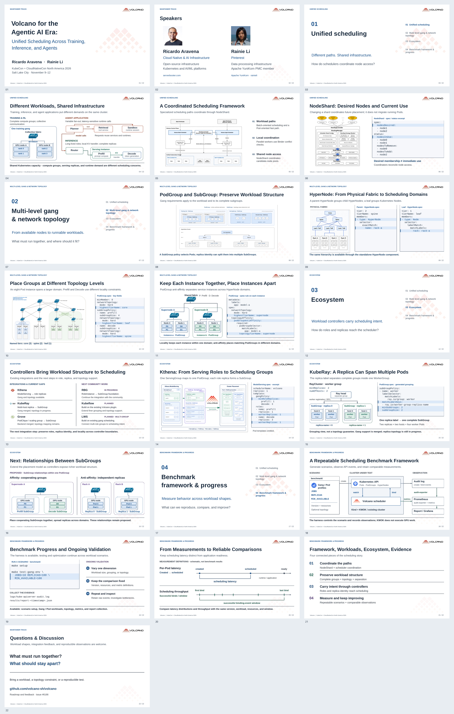

# Volcano KubeCon NA 2026

**Volcano for the Agentic AI Era: Unified Scheduling Across Training, Inference, and Agents**

讲者：**Ricardo Aravena · Rainie Li**

## 视觉修订版 · 2026-10-29

22 页，约 24–25 分钟正文 + 5 分钟问答。保留 Volcano 水印背景，补入讲者介绍和四张章节引导页。统一调度、分组、拓扑与 Kthena 沿用 EU / China 的原图；关键 API 加上精简 YAML。本轮按多级拓扑原图的画法调整 workload、实例分离和 SubGroup 关系：用交换机、节点、通信路径与分组边界讲清含义。YAML 全部展开，拓扑约束改用 `highestTierName`；生态页补上 RBG、Kubeflow 和 LWS multi-group 的后续工作。

- [PDF 预览](Volcano_KubeCon_NA_2026.pdf)
- [下载 PowerPoint](Volcano_KubeCon_NA_2026.pptx?raw=true)
- [整套缩略图](Volcano_KubeCon_NA_2026_preview.png)
- [重点页前后对照与参考](na2026/visual-review.md)
- [逐页大纲](Volcano_KubeCon_NA_2026_draft_outline.zh-CN.md)
- [素材来源与制作说明](na2026/)
- [下载图与源文件包](Volcano_KubeCon_NA_2026_sources.zip?raw=true)

讲者介绍暂依据公开资料，照片来自 Linux Foundation 讲者页；未填写 Ricardo 尚未确认的现任公司和正式职务。Benchmark 第 20 页仍讲测量口径，待选定实际结果后替换。

## 前一版与研究记录

- [带制作提示的初稿](Volcano_KubeCon_NA_2026_draft.pptx?raw=true)
- [详细研究与来源](Volcano_KubeCon_NA_2026_group_topology_outline.zh-CN.md)
