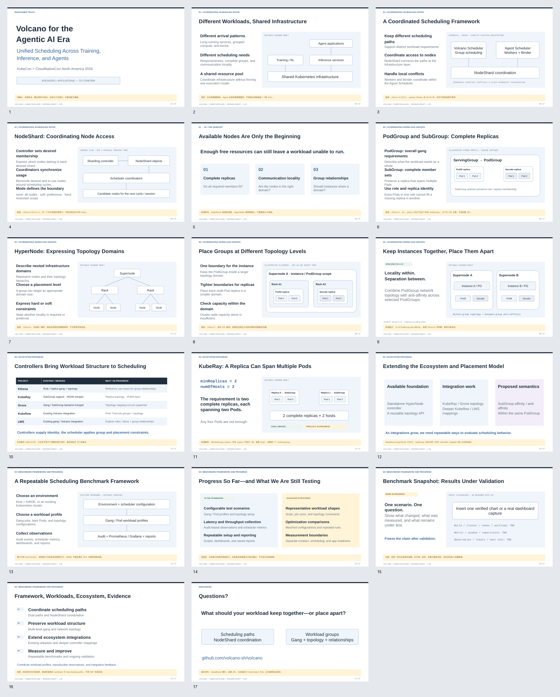

# Volcano KubeCon NA 2026 · Draft

**Volcano for the Agentic AI Era: Unified Scheduling Across Training, Inference, and Agents**

2026-10-29 更新。17 页草稿：25 分钟正文 + 5 分钟问答。英文上屏，中文制作与讲者备注。

四部分：统一调度 → 多级 Gang 与网络拓扑 → Ecosystem → Benchmark 框架与进展。Benchmark 结果页暂留占位，待选定正在验证的案例。

- [精简大纲](Volcano_KubeCon_NA_2026_draft_outline.zh-CN.md)
- [PDF 预览](Volcano_KubeCon_NA_2026_draft.pdf)
- [下载可编辑 PPT](Volcano_KubeCon_NA_2026_draft.pptx?raw=true)
- [完整缩略图](Volcano_KubeCon_NA_2026_draft_preview.png)
- [详细研究与来源](Volcano_KubeCon_NA_2026_group_topology_outline.zh-CN.md)

深蓝为拟上屏内容，浅蓝为图示草稿，浅黄为制作备注；紫色 Proposed 表示未来能力。当前为工作版式，未使用未经确认的官方模板。生态状态核对日期：2026-10-28。

