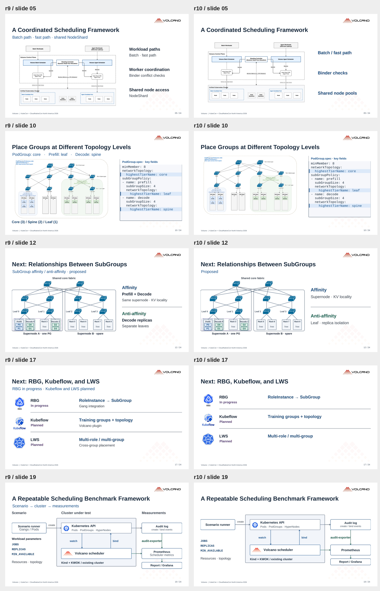
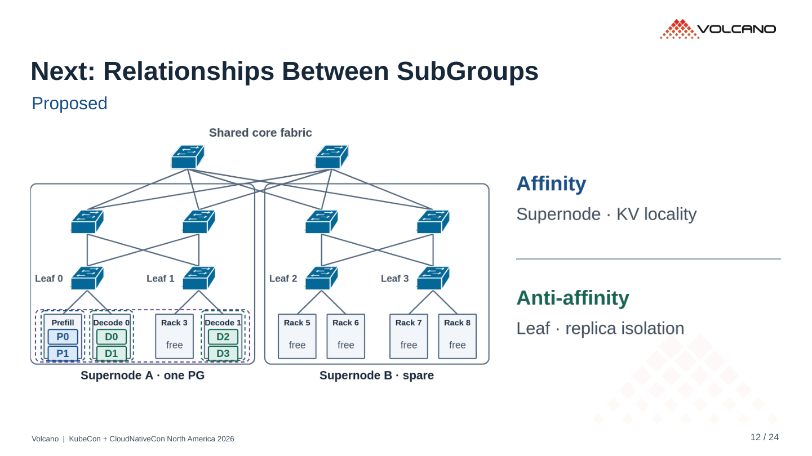

# r10 · 删掉重复的注释层

24 页。[PDF](../../../Volcano_KubeCon_NA_2026_r10.pdf) · [PowerPoint](../../../Volcano_KubeCon_NA_2026_r10.pptx?raw=true)

| 页 | r9 | r10 |
|---|---|---|
| 5 | 副标题 + 三组标题和解释 | 三个机制关键词 |
| 10 | 副标题复述三个层级，页底再列 tier | 图与 YAML 直接对照 |
| 12 | 两组各三行解释 | 关系 + 拓扑约束各两行 |
| 17 | 页顶汇总状态，项目下再加泛泛说明 | 每个项目只留状态与集成目标 |
| 19 | 三栏标题、模块名、模块下解释重复 | 模块名、必要事件与参数 |

保留 Proposed、Planned、In progress 等状态。原图内的标签保留，详细讲解放在备注。已检查 PDF、文字边界、连线、YAML 和二维码。

## r9 / r10 对照

左侧 r9，右侧 r10。

## 第 12 页

