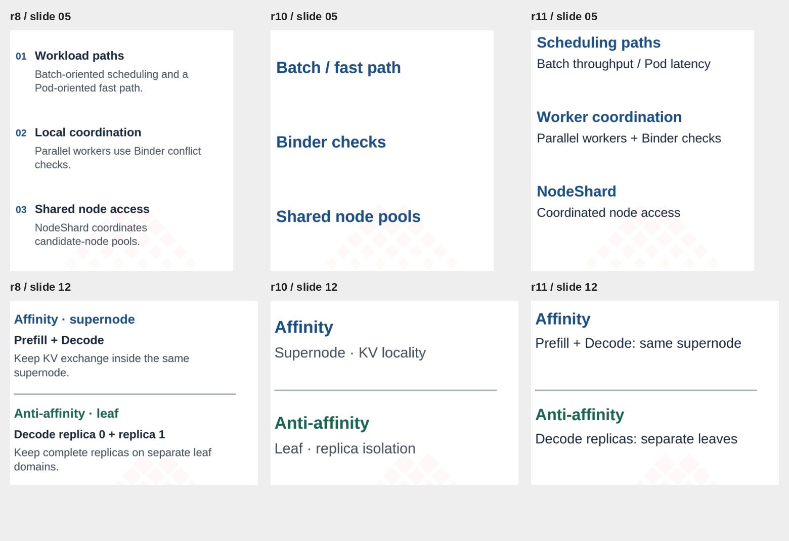
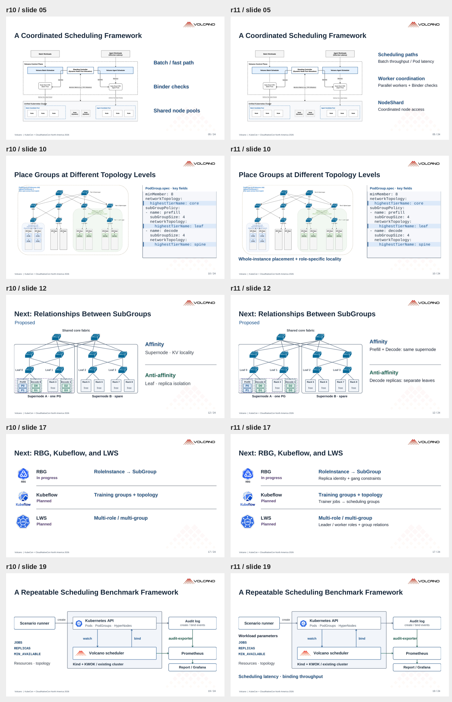
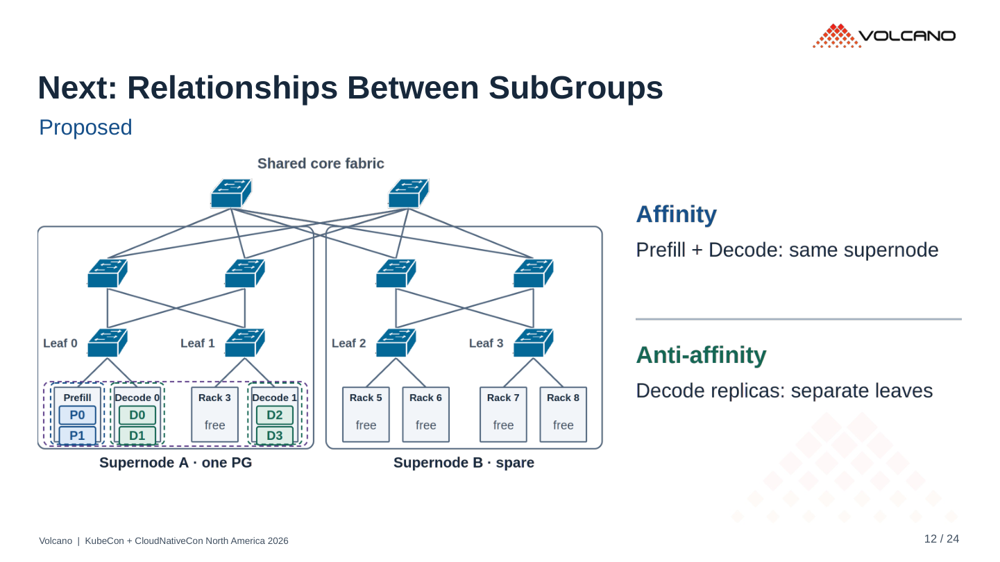

# r11 · 保留简短而具体的配图说明

24 页。[PDF](../../../Volcano_KubeCon_NA_2026_r11.pdf) · [PowerPoint](../../../Volcano_KubeCon_NA_2026_r11.pptx?raw=true)

每个重点保留一条短说明，包含对象和约束 / 机制。具体过程由 speaker 展开。

- NodeShard：Coordinated handoff · no Pod migration
- 多级拓扑：Whole-instance placement + role-specific locality
- SubGroup affinity：Prefill + Decode: same supernode
- SubGroup anti-affinity：Decode replicas: separate leaves
- KubeRay：Replica label → one complete SubGroup

图旁主标签约 20–23 pt，说明约 18–19 pt。已检查导出 PDF、文字边界、连线、YAML 和二维码。

## 配图说明局部对照

从左到右为 r8、r10、r11，截取第 5、12 页图旁区域。

## r10 / r11 整页对照

## 当前第 12 页

