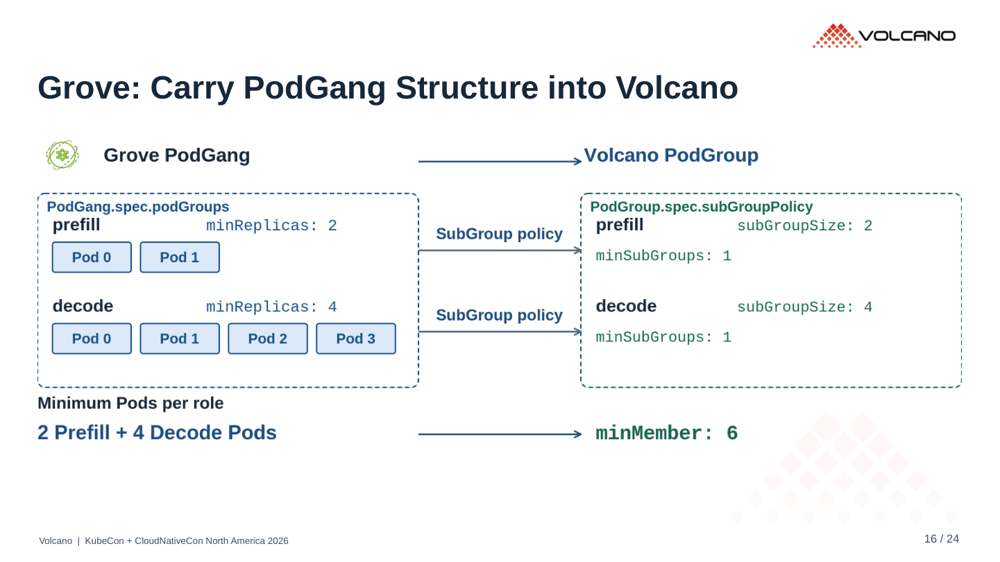
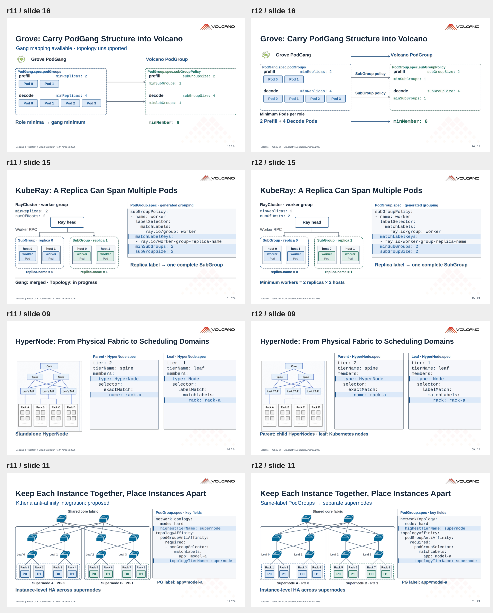

# r12 · 说明对应图中的关系

24 页。[PDF](../../../Volcano_KubeCon_NA_2026_r12.pdf) · [PowerPoint](../../../Volcano_KubeCon_NA_2026_r12.pptx?raw=true)

## Grove

移除 “Gang mapping available · topology unsupported”。图中直接标出：

- PodGang → PodGroup。
- Prefill / Decode role group → 各自的 SubGroup policy。
- 2 Prefill + 4 Decode Pods → minMember: 6。

## 其他对应调整

KubeRay 展示 replica label 分组与最小 worker 数；HyperNode 说明 parent / leaf 的成员类型；实例分离页说明同标签 PodGroup 的反亲和。实现状态和未支持项留在 speaker notes。生态推进状态保留在对应社区条目，后续 benchmark 页使用 Next 标题。

已检查 PDF、文字边界、连线和箭头、YAML、二维码。复用图与讲者资料保留。

## r11 / r12 对照

左侧 r11，右侧 r12。

