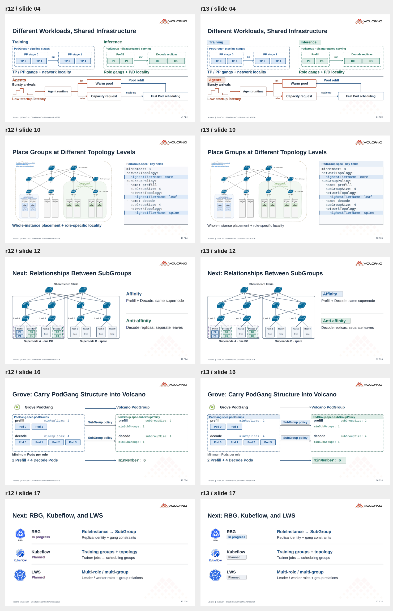
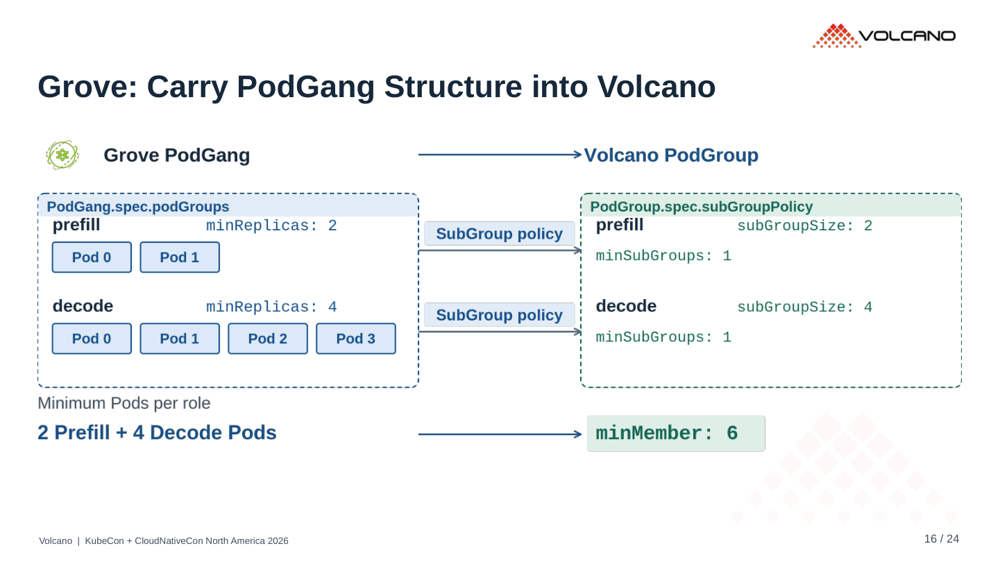
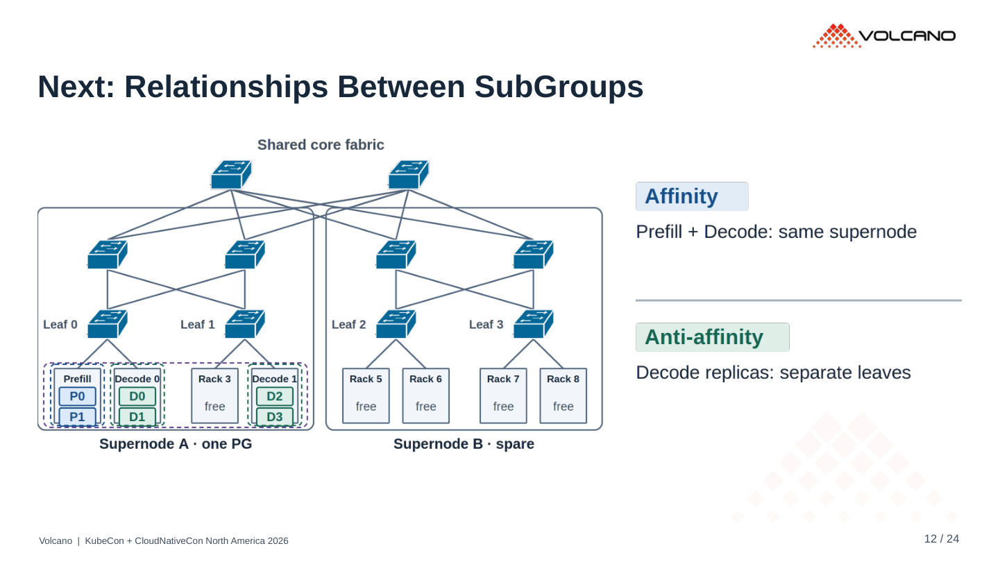

# r13 · 字体、对齐与标签底色

24 页。[PDF](../../../Volcano_KubeCon_NA_2026_r13.pdf) · [PowerPoint](../../../Volcano_KubeCon_NA_2026_r13.pptx?raw=true)

内容沿用 r12，本轮只做视觉调整：

- 正文页标题统一 30 pt，说明文字减少过度加粗，保留重点标签。
- Training / Inference / Agents、Affinity / Anti-affinity 使用小面积底色。
- Grove 的映射标识、API 栏目与结果值对齐，并使用对应的蓝 / 绿底色。
- YAML 统一标题栏、细边框和字段高亮。
- 生态推进状态用统一尺寸的标签呈现。

已核对正文、备注、原图与 r12 一致，见 [内容检查](content-check.json)。已检查 PDF、文字边界、渲染箭头与几何记录的一致性、YAML 和二维码。

## r12 / r13 对照

左侧 r12，右侧 r13。

## Grove

## SubGroup 关系

