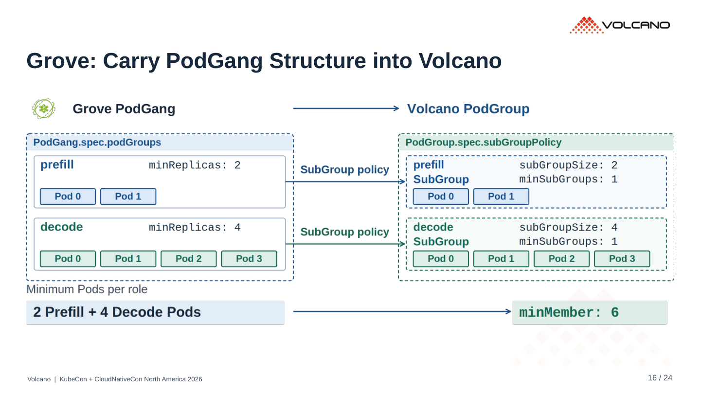
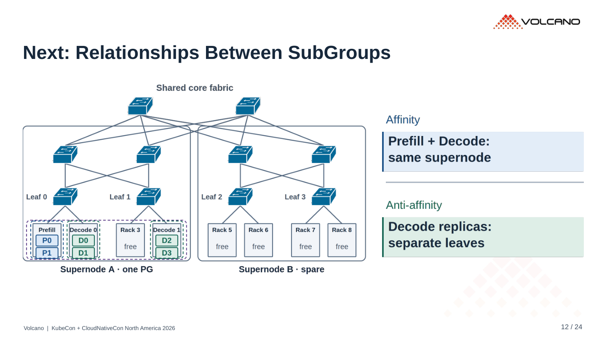
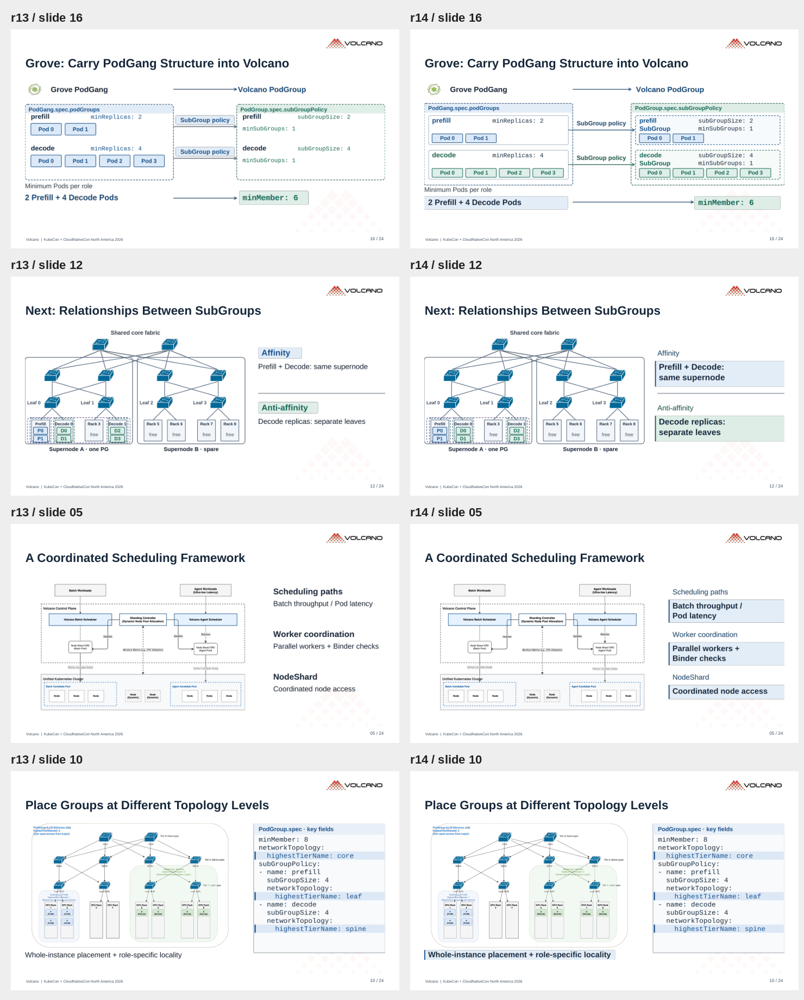

# r14 · 注释可读性与 Grove 布局

24 页。[PDF](../../../Volcano_KubeCon_NA_2026_r14.pdf) · [PowerPoint](../../../Volcano_KubeCon_NA_2026_r14.pptx?raw=true)

- 强调实际解释图的文字：32–34 px SVG 字号、加粗、局部底色和留白。
- 去掉 r13 给小标题加的装饰底色，避免重点错位。
- Grove 右侧显示完整的 Prefill / Decode SubGroup 与 Pod 成员。
- subGroupSize、minSubGroups 共用同一列，字段名和值保持等宽对齐。

已检查文字边界、箭头、YAML、PDF 与二维码。[内容和对齐检查](layout-check.json)。

## Grove

## 注释

## r13 / r14 对照

左侧 r13，右侧 r14。

