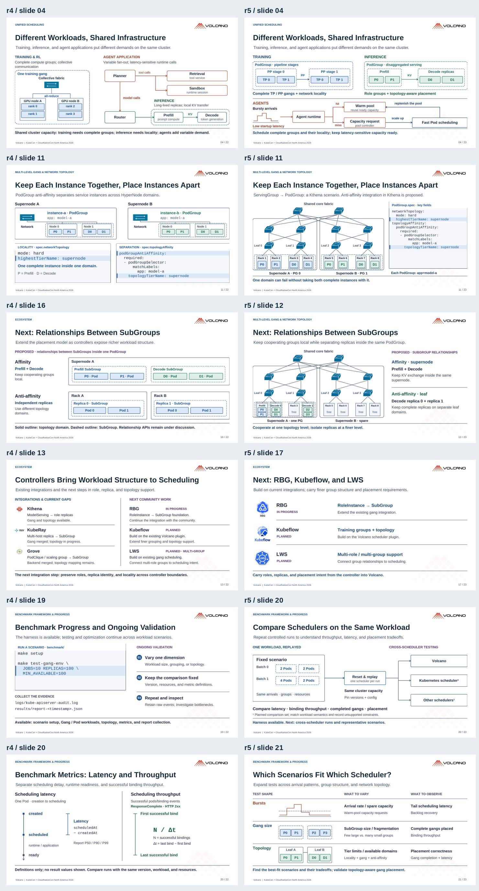
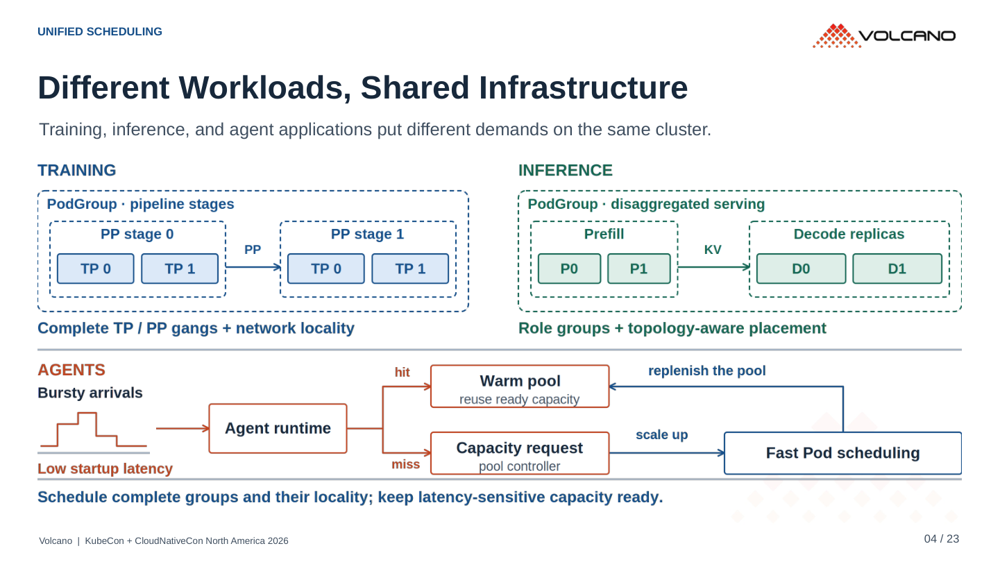
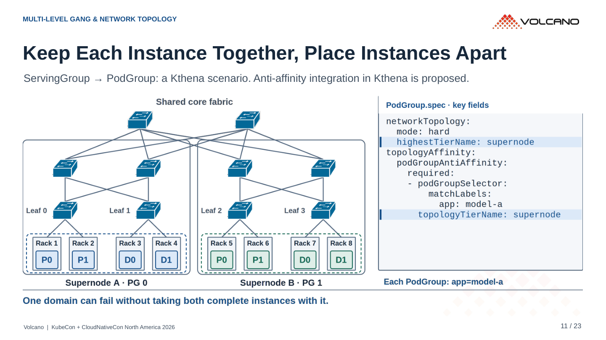
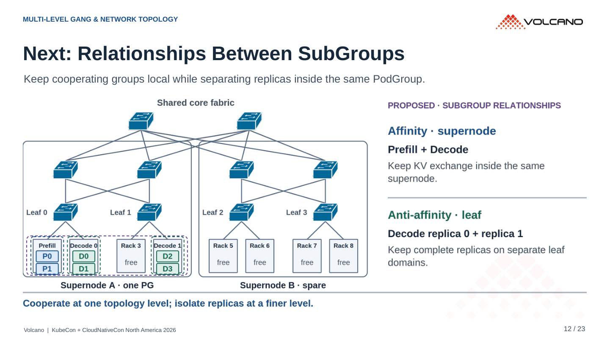
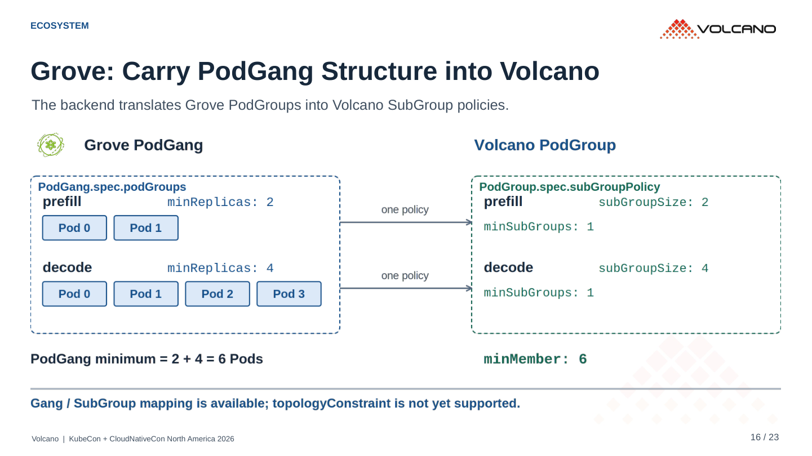
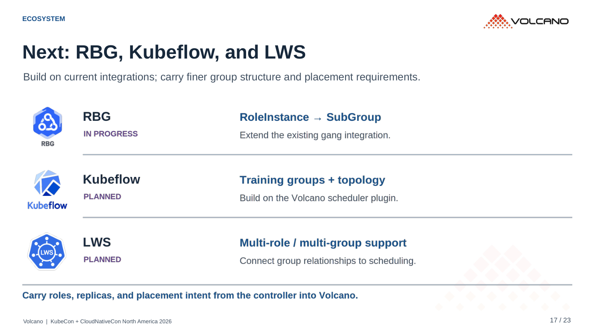
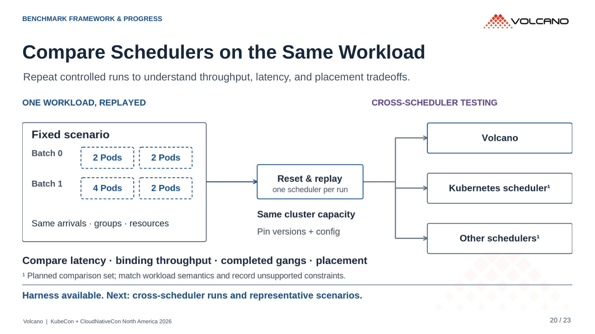
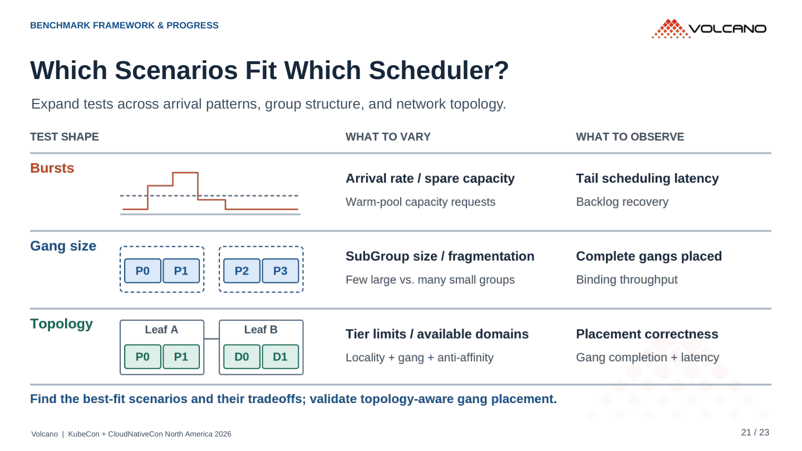

# r5 · 本轮修改预览

23 页。[PDF](../../../Volcano_KubeCon_NA_2026_r5.pdf) · [PowerPoint](../../../Volcano_KubeCon_NA_2026_r5.pptx?raw=true) · [逐页大纲](../../../Volcano_KubeCon_NA_2026_draft_outline.zh-CN.md)

这是 `/approve` 后的修改。第 10 页及其余保留的 EU / China 原图未替换。下表使用 **r5 页码**。

| 新页 | 原页 | 改动 |
|---|---|---|
| 2 | 2 | Ricardo 改为 Nunchux AI 的 AI Infrastructure Lead、CNCF TOC Alternate (GB) |
| 4 | 4 | Training、Inference 各自展示组结构；Agent 展示突发、预热池复用与补池调度 |
| 11 | 11 | 两份完整实例放在同一 fabric 的两个 Supernode；PG anti-affinity YAML |
| 12 | 16 | 移入第二章；沿用同一网络，展示 Supernode 亲和与 Leaf 反亲和 |
| 14–16 | 14–15、新增 | Kthena → KubeRay → Grove；Grove 独立讲 PodGang / SubGroup 映射 |
| 17 | 13 | 放到案例后，补 RBG / Kubeflow / LWS 官方 logo，精简为各社区下一步 |
| 20–21 | 19–20 | 改为多调度器横向比较与测试场景；口径和命令移入备注 |

Kthena 的 topology anti-affinity 接入仍是开放 proposal，Grove 当前 backend 不支持 topologyConstraint。正文与备注注明能力边界。Benchmark 不填虚构结果。

## 前后对照

左侧 r4，右侧 r5；页码调整已标出。点击图片可以放大。

## 重点页

### 2 · Speakers

### 4 · Workload demands

### 11 · Instance HA

### 12 · SubGroup relationships

### 16 · Grove

### 17 · Next communities

### 20 · Cross-scheduler comparison

### 21 · Test scenarios

已检查 PDF 版面、23 页备注、文字边界、流程箭头正交 / 对称性、连线与文字避让，以及 8 份 block-style YAML。六张旧图的原始 PNG 与 r4 字节一致。本轮没有运行集群 benchmark。
