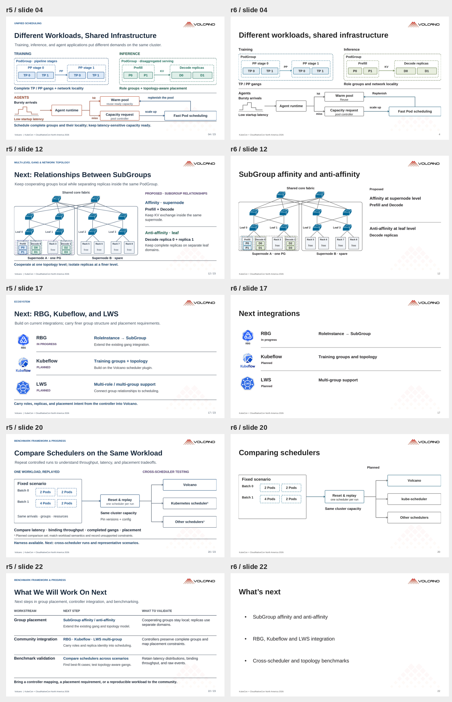
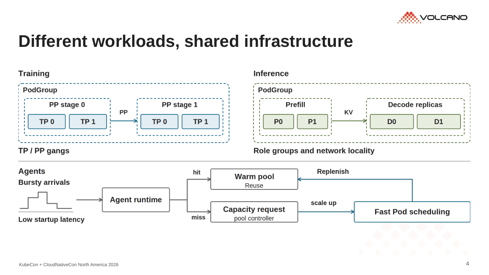
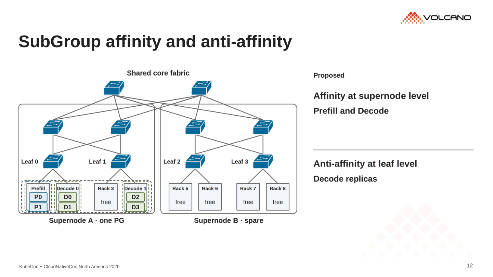
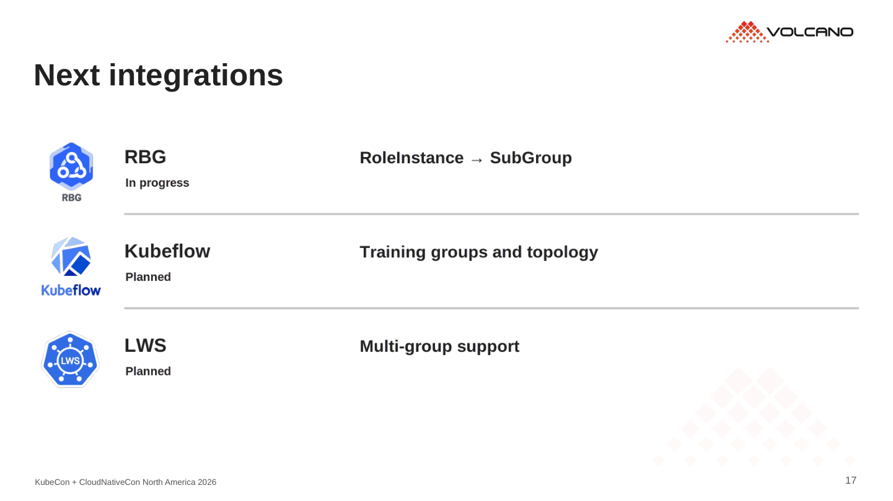
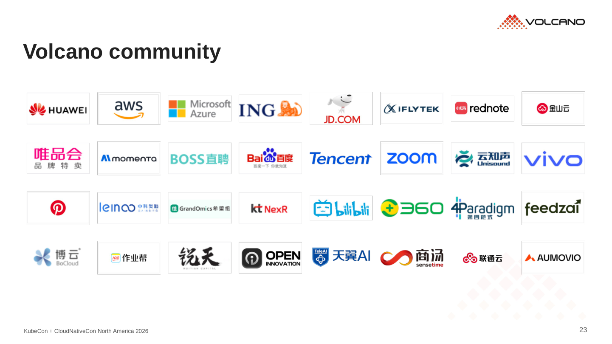
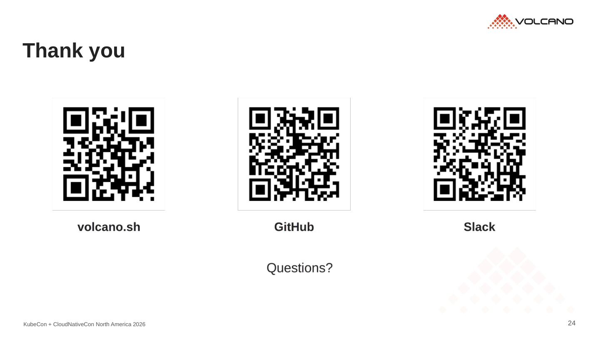

# r6 · 减少文字，补回社区材料

24 页。[PDF](../../../Volcano_KubeCon_NA_2026_r6.pdf) · [PowerPoint](../../../Volcano_KubeCon_NA_2026_r6.pptx?raw=true)

- 删除正文副标题、重复小字、页底总结句和全大写栏目名。解释放进讲者备注。
- 黑灰文字、白底，保留 Volcano 底板。角色与放置关系仍用颜色区分，YAML 改为灰底强调。
- 章节页只留章节号和标题，收尾路线改为三条要点。
- 第 23 页复用 China 第 25 页的 32 个社区用户 logo，第 24 页复用官网、GitHub、Slack 三个二维码。

## r5 / r6 对照

## 重点页

### 4 · Workloads

### 12 · SubGroup relationships

### 17 · Integrations

### 20 · Scheduler comparison

### 23 · Community

### 24 · Resources / Q&A

已检查文字边界、箭头和连线、PPT 内嵌图片、YAML 以及 PDF。三个二维码已从最终 PDF 渲染图中成功解码。保留原图和 YAML，也保留 Proposed / Planned 等必要状态。
