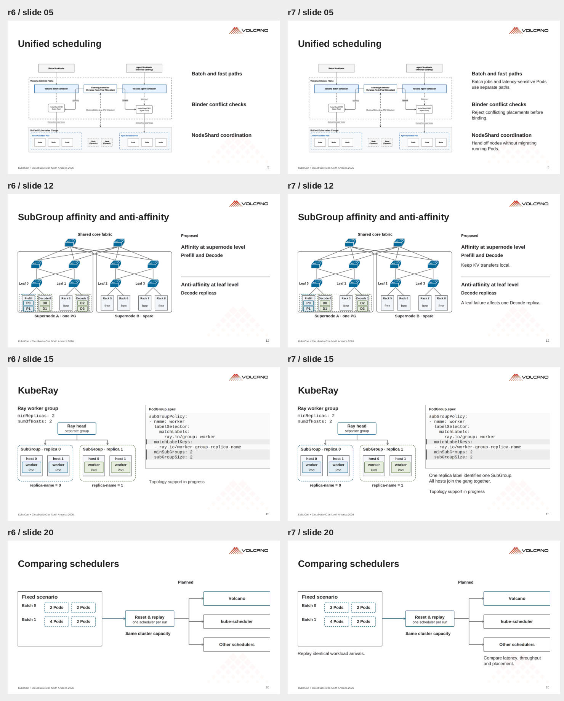
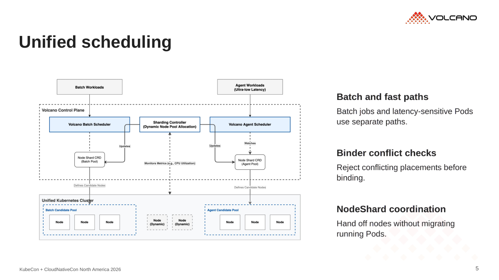
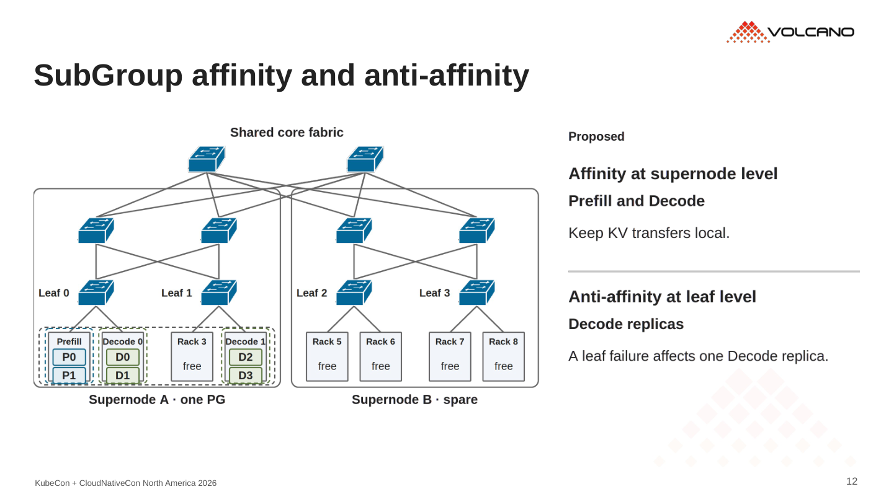
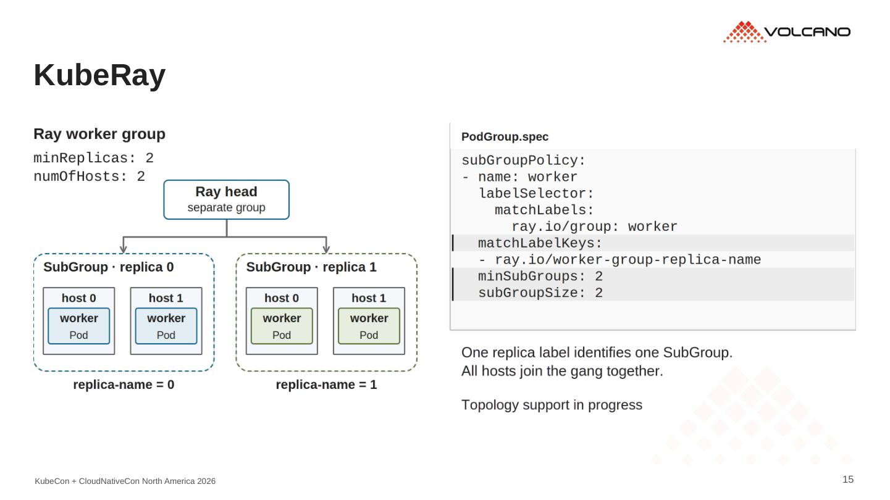
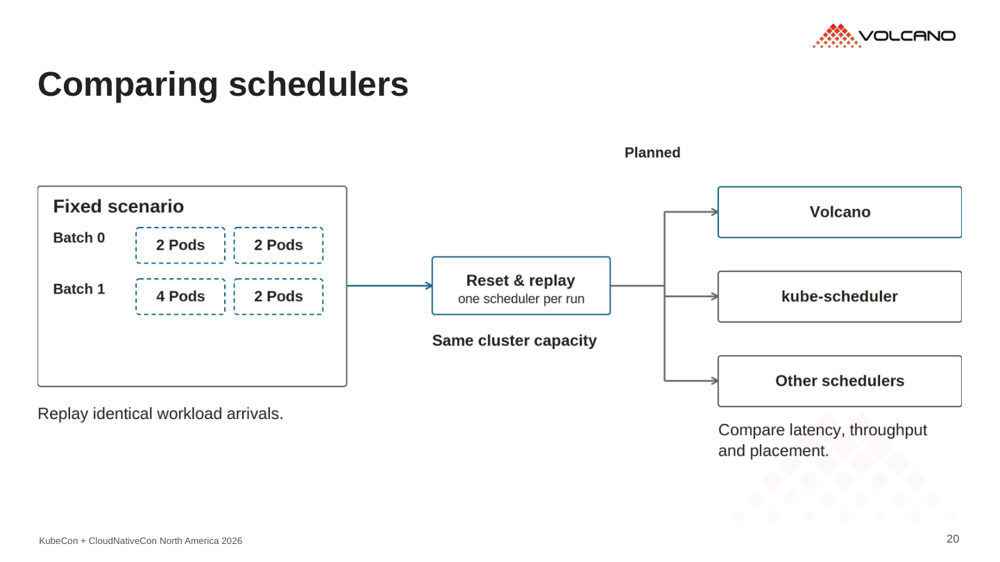

# r7 · 补回图旁解释

24 页。[PDF](../../../Volcano_KubeCon_NA_2026_r7.pdf) · [PowerPoint](../../../Volcano_KubeCon_NA_2026_r7.pptx?raw=true)

沿用 r6 的清爽版式，在图旁加一两句说明。解释紧贴对应关系，详细机制保留在备注里。

- 统一调度与 NodeShard：说明路径、冲突检查和节点交接。
- 分组与拓扑：说明完整副本、局部性和故障隔离。
- 生态：解释 controller 的分组如何映射到 Volcano。
- Benchmark：说明重放条件、场景变化及观察指标。

## r6 / r7 对照

## 重点页

已检查文字边界、连线避让和导出的 PDF。24 页顺序保持不变，社区用户与二维码页继续沿用。
