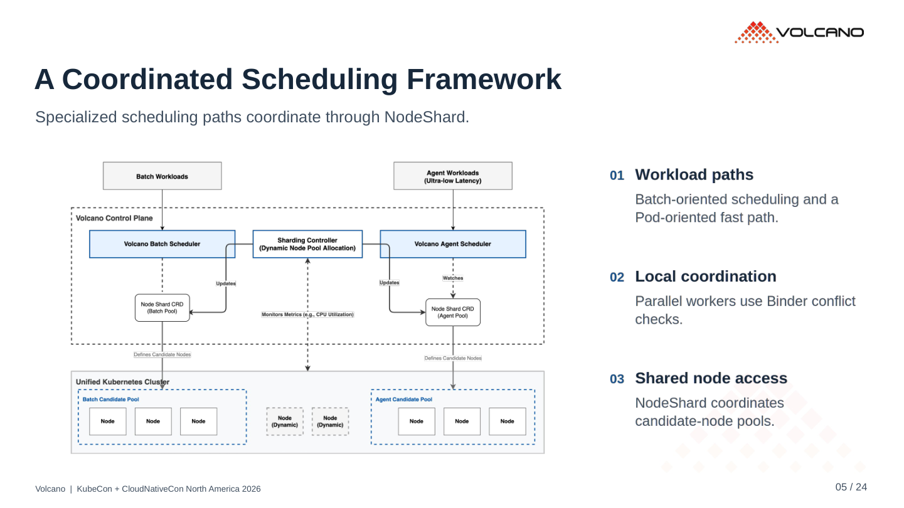
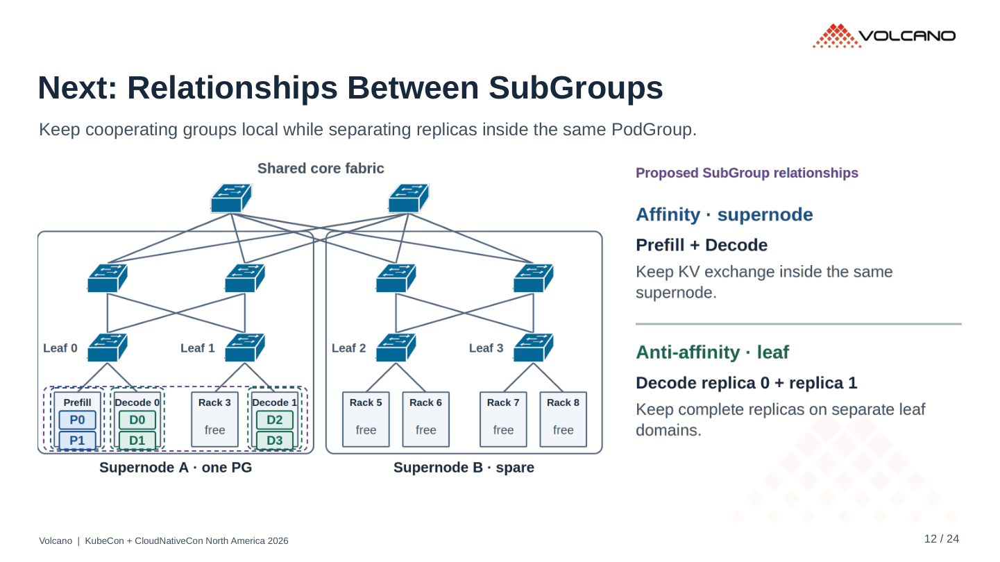
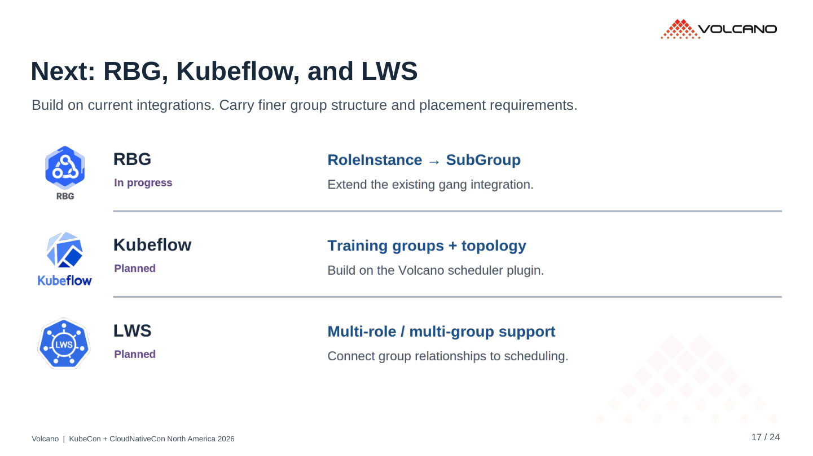
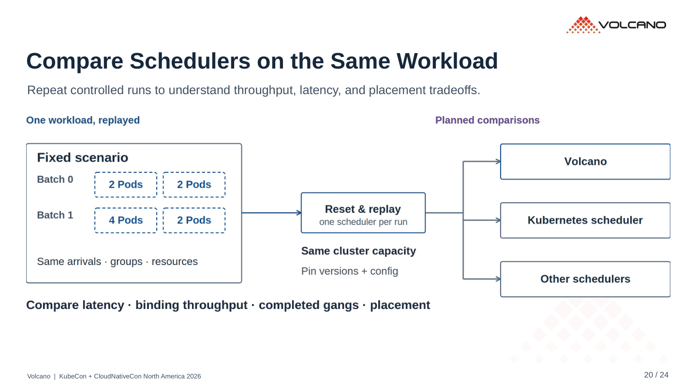
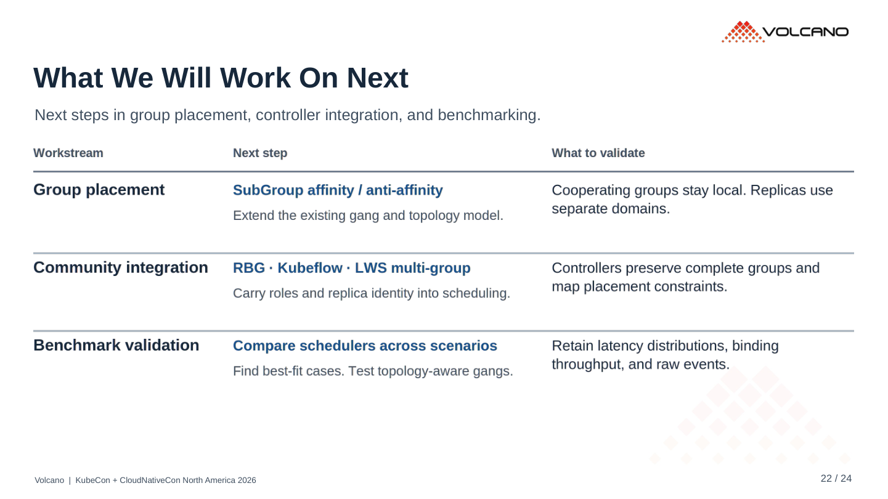

# r8 · 以 r5 为底稿轻量删减

24 页。[PDF](../../../Volcano_KubeCon_NA_2026_r8.pdf) · [PowerPoint](../../../Volcano_KubeCon_NA_2026_r8.pptx?raw=true)

底稿为 r5（`8f1d0bd11`）。正文副标题、配图解释及位置恢复为 r5，仅做以下调整：

- 删除第 4、12、17、19、20、22 页重复的页底总结。
- 将制作提示与比较口径脚注移到备注，保留能力状态。
- 移除页顶全大写章节标签与章节提问，栏目名改为正常大小写。
- 将分号拼接改为短句。
- 继续保留第 23、24 页社区用户 logo 和二维码。

## r5 / r8 对照

左侧 r5，右侧 r8。正文说明保留，主要变化在页边。

## 当前重点页

已检查 PDF 版面、文字边界、连线和 YAML。三个二维码从导出 PDF 渲染图中成功解码。
