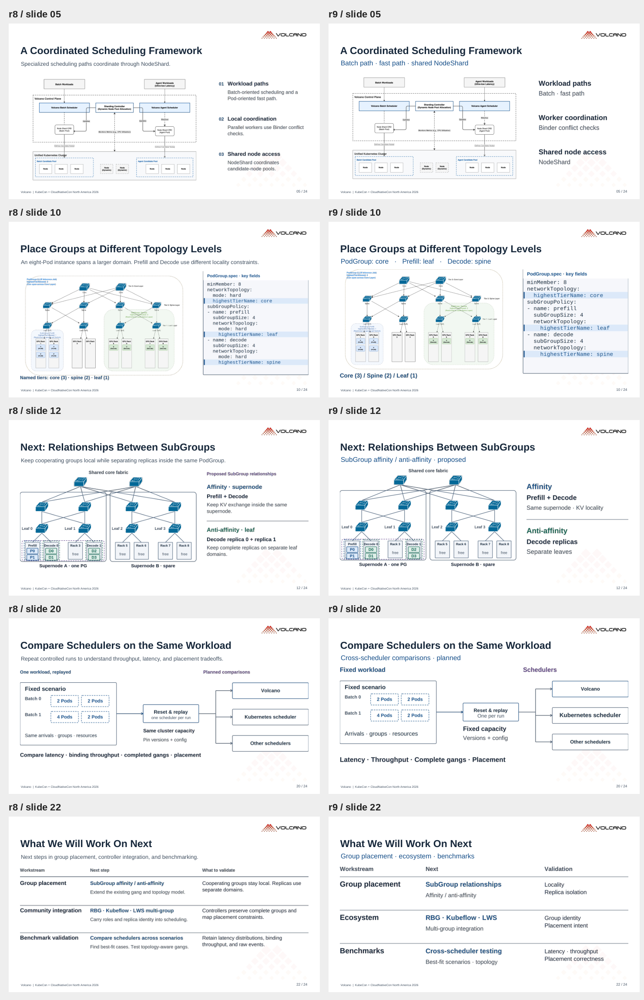
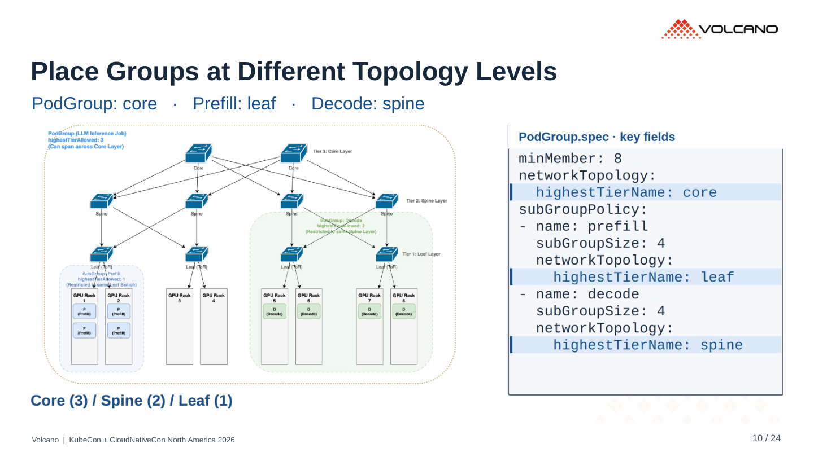
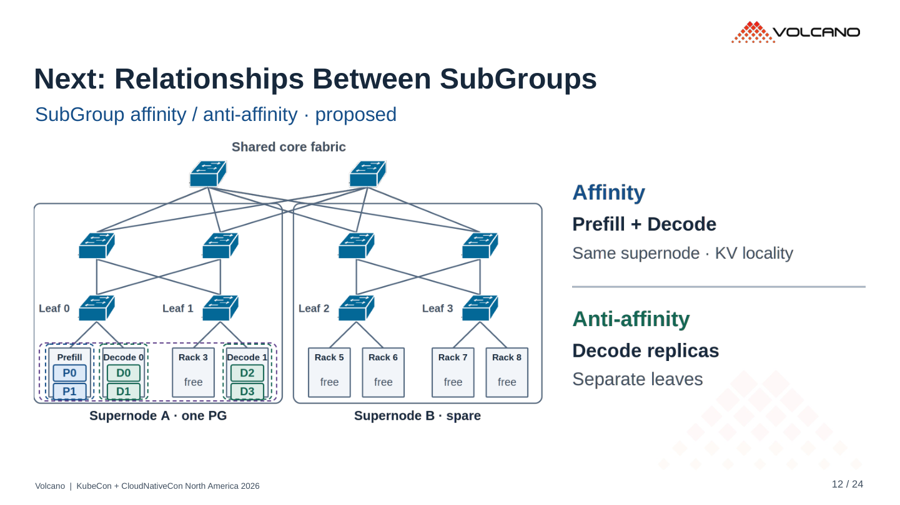
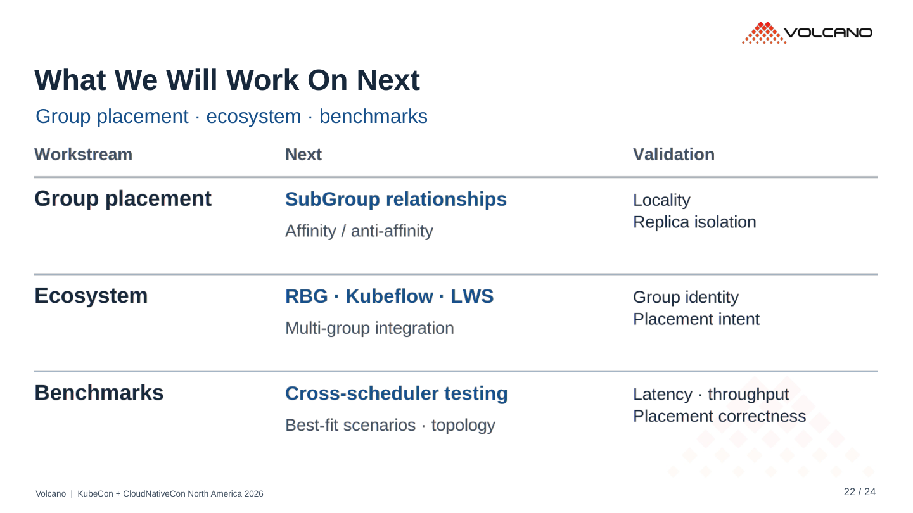

# r9 · 短标签与文字层级

24 页。[PDF](../../../Volcano_KubeCon_NA_2026_r9.pdf) · [PowerPoint](../../../Volcano_KubeCon_NA_2026_r9.pptx?raw=true)

- 第 10 页：去掉 “An eight-Pod instance…” 解释句，改为三个角色的拓扑层级。
- 第 5、12 页：图旁整段解释改为约束和机制短语，按对应对象分区。
- 第 17、20–22 页：保留集成状态和测试方向，用关键词组织。
- 副标题 21 pt，主要图旁标签约 20–23 pt。放大 YAML，省略第 10 页重复的 mode 字段；hard 模式说明保留在备注。
- 原 China / EU 图仍是原始位图，其中的小标签没有重绘。新增文字、YAML 在 SVG 中可编辑。

完整解释保留在演讲者备注。已检查文字边界、连线、YAML、导出的 PDF 版面和二维码。

## r8 / r9 对照

左侧 r8，右侧 r9。

## 重点页

