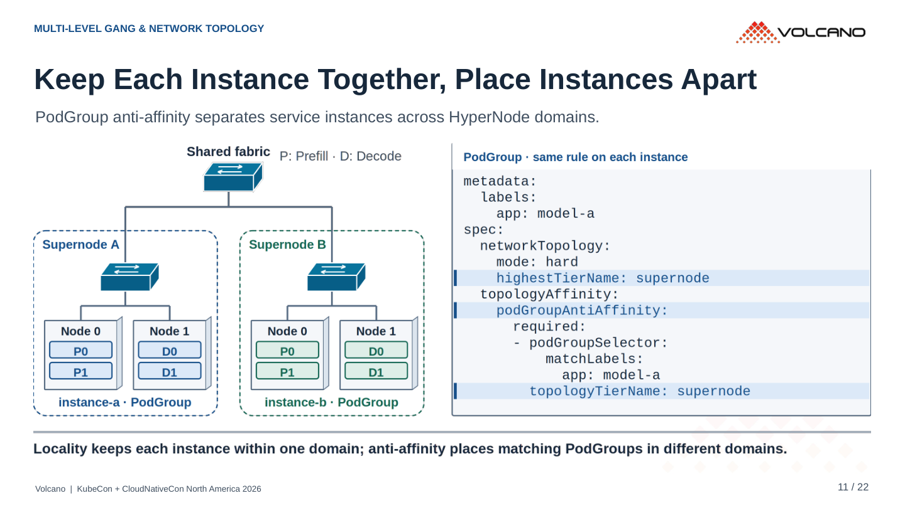
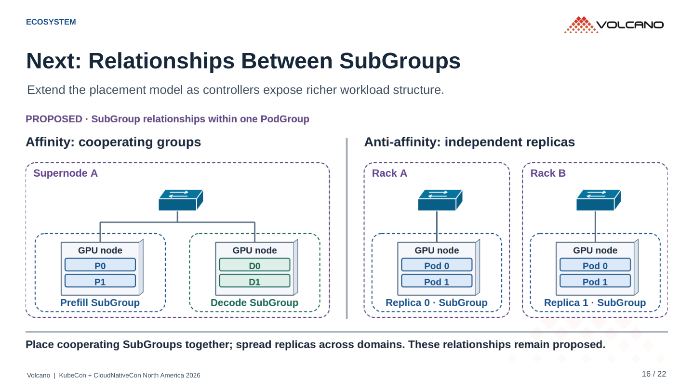
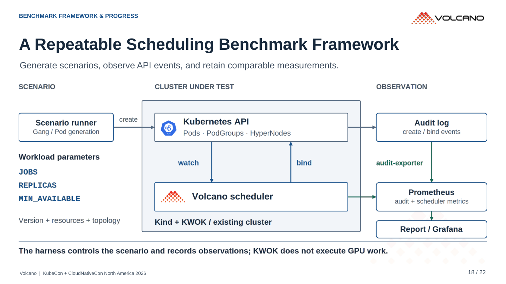
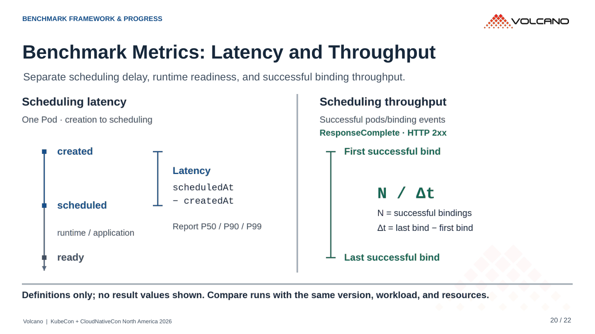
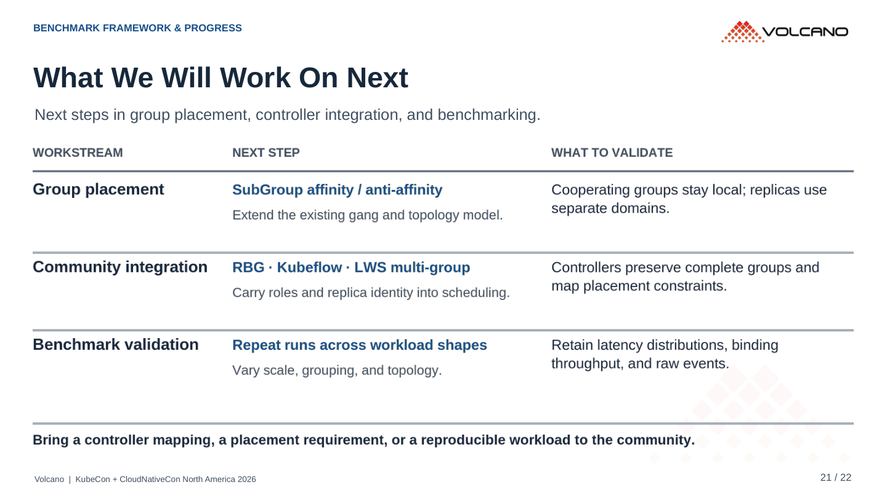

# 重点六页修订

本轮重点调整第 **4、11、16、18、20、21** 页的构图和连线。EU / China 原图继续保留。

| 页 | 调整 |
|---|---|
| 4 | Planner 到 Router 改为直线；工具调用采用短分叉，推理角色在同一轴线上 |
| 11 | 交换机上下端口共用中心线；两个 Supernode 与各自节点采用对称分叉 |
| 16 | 同域亲和用居中的一分二；跨域分离直接垂直连接，去掉小折弯 |
| 18 | API / scheduler 和 audit / metrics 分别对齐；箭头落在组件边缘，去掉挤在边界上的标签 |
| 20 | 改为竖向事件顺序、明确的统计区间与公式；不再画未标注的示意采样点 |
| 21 | 改为后续工作表：分组关系、社区接入、benchmark；每项列出要验证的行为 |

交换机连接点与分叉中心由同一组坐标生成。重新查看了六页 PDF 导出，检查端点、转折和文字间距；仍保留 SVG 编辑源与固定 PNG。

## 六页预览

### 4 · Workload characteristics

### 11 · Instance isolation

### 16 · SubGroup relationships

### 18 · Benchmark framework

### 20 · Measurement definitions

### 21 · Next work

## 前后对照

左侧上版，右侧本轮，依次为第 4、11、16、18、20、21 页。

