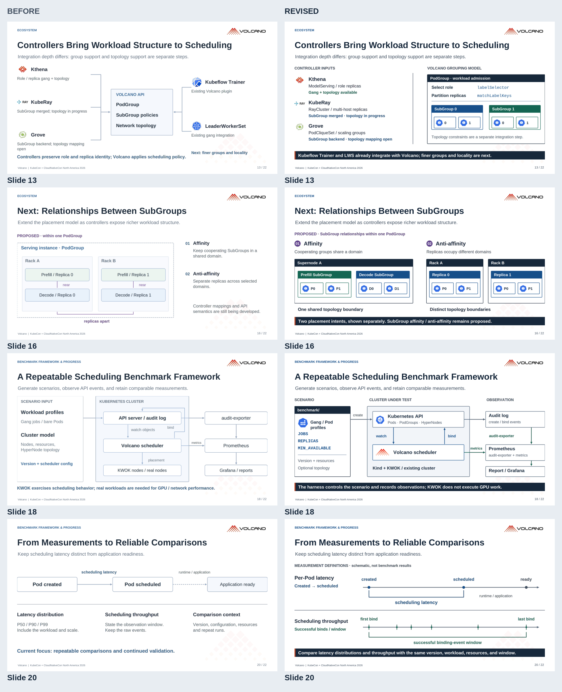

# 自画图视觉修订

保留 EU / China 存量图和 Volcano 水印。重做第 4、11、13、15、16、18–22 页的自画部分，并加深整套标题、说明、代码和关键线条。

## 参考了什么

- [NVIDIA Grove：组件关系与工作流图](https://developer.nvidia.com/blog/streamline-complex-ai-inference-on-kubernetes-with-nvidia-grove/)，Figure 1–2：用嵌套边界表达成员关系，区分资源对象、控制器和实际 Pod。本次借鉴到分组、KubeRay 和亲和性页。
- [KubeCon NA 2025：Benchmarking GenAI Foundation Model Inference Optimizations](https://static.sched.com/hosted_files/kccncna2025/c6/Kubecon%202025%20-%20Benchmarking%20GenAI%20Model%20Optimizations.pdf)，第 5–9、12、15 页：用时间轴解释阶段，用系统边界区分测试框架、被测对象与观测链路。本次借鉴到 benchmark 页。

借鉴的是表达方式，没有复制外部图，也没有加入模拟的性能结果。Pod、Job、Service 和 API 图标来自 [Kubernetes 官方图标集](https://github.com/kubernetes/community/tree/master/icons)。

## 主要变化

| 页 | 改动 |
|---|---|
| 4 | 展示训练 Gang、推理角色副本与请求突发三种实际形态 |
| 11 | Pod 位于 Node 内，Node 位于各自的 supernode；边界与 YAML 对应 |
| 13 | 控制器输入与 PodGroup / SubGroup 分组语义并排，移除汇聚箭头 |
| 15 | Pod 标出 replica identity，直接对照 `matchLabelKeys` 和组大小 |
| 16 | “同域亲和”和“跨域分离”分开示意，避免一条 near / apart 连线承担两种含义 |
| 18 | 执行路径与观测路径分开；watch / bind 各用一条垂直通道 |
| 19 | 实际运行命令、输出文件与正在验证的比较维度 |
| 20 | created / scheduled / ready 事件轴与成功 binding 的统计窗口 |

## 可读性

下表是相对白底计算的颜色对比度；不是会场投影实测。原始位图与低对比水印没有改色。

| 信息层 | 上版 | 新版 |
|---|---:|---:|
| 说明文字 | 4.92:1 | 8.36:1 |
| 主要连线 | 2.44:1 | 5.82:1 |
| 正文 | 13.98:1 | 14.97:1 |

新增连接线采用固定端点、水平或垂直路径；SVG 和 PNG 保持同一几何。已检查文字边界、关键标签与导出结果。YAML 仍是省略无关字段的片段。

## 重点页前后对照

左侧为上一版，右侧为本轮修订。依次为第 13、16、18、20 页。

