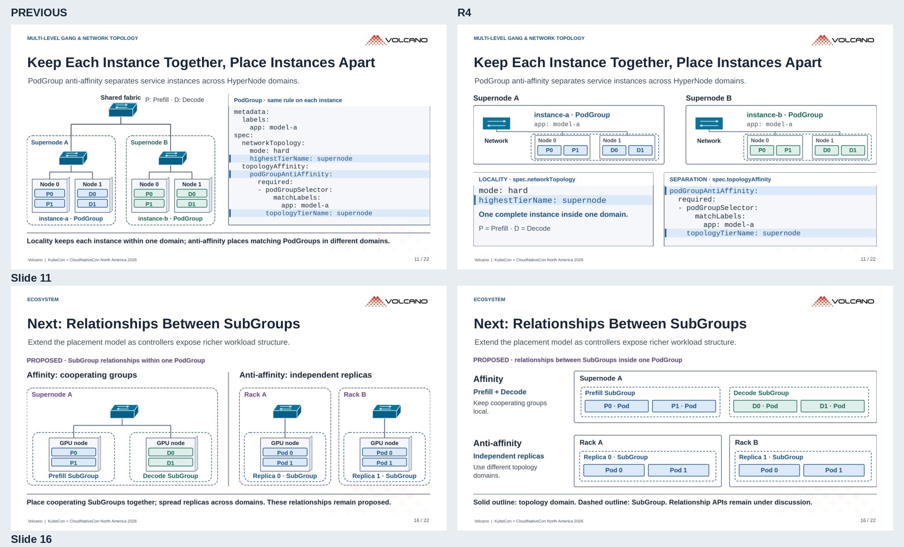

# r4 · 构图与连线修订

[查看 r4 六页大图](review/r4/README.md)。本轮另存了带 `r4` 文件名的 PPT / PDF，方便与上一版区分。

- **11**：上方完整展示两组放置，下方分别对照 locality 与 anti-affinity YAML；拓扑域、PodGroup、Node 三层边界分开。
- **16**：改为上下两组关系对照，去掉透视交换机与装饰性连接线。
- **4、18、20**：连线的箭头改为显式对称路径；第 4 页的网络与节点改为正视图。
- **21**：保留上轮新增的后续工作表。

六张 EU / China 原图保持不变。YAML 仍为精简片段，完整字段关系见 `examples/`。SVG 保留编辑源，PPT 使用固定 PNG。

