# Kubernetes 上游 PodGroup（WAS）与 Volcano 对比分析

[English](./k8s-workload-aware-scheduling-vs-volcano.md) | 简体中文

## 背景

kube-scheduler 以单个 Pod 为单位调度：每次从队列里取出一个 Pod，为它选一个节点。AI 训练、推理这类工作负载需要的是以一组 Pod 为单位的调度语义：

- 一组 Pod 要么全部调度成功，要么都不调度，即 gang 调度；
- 一组 Pod 要落在网络上相互靠近的节点上，即拓扑感知调度；
- 抢占时以整组为单位决策，而不是只为单个 Pod 腾出位置。

这些能力长期由 kube-scheduler 之外的项目提供，例如 Volcano、Kueue 和 scheduler-plugins 的 coscheduling 插件。各项目的 API 互不相同，Kubeflow、KubeRay、Spark Operator 等工作负载控制器需要分别适配。

从 v1.35 开始，Kubernetes 上游在 kube-scheduler 中原生支持按工作负载调度，这项工作称为 Workload-Aware Scheduling（WAS）。它在 `scheduling.k8s.io` 下新增了 `Workload`、`PodGroup`、`CompositePodGroup` 三个 API，并在其上实现了 gang 调度、拓扑感知调度（TAS，Topology-Aware Scheduling）和组级抢占（WAP，Workload-Aware Preemption）。原生的 Job、Deployment 以及 JobSet、LeaderWorkerSet 等控制器正在对接这套 API。

上游的 `PodGroup` 与 Volcano 的 `PodGroup` 同名，功能上有重叠，设计上差别不小。本文介绍上游 PodGroup 的 API 和 kube-scheduler 的调度流程，对比两者在 PodGroup、子组、TAS、WAP 上的差异，并给出 Volcano 兼容上游 PodGroup 的方案和工作量评估。

上游部分基于 Kubernetes v1.37.2 和 2026 年 11 月的 master 分支（v1.38 开发中），Volcano 部分基于当前 master 分支。

## 1. 上游 PodGroup：用法与 API

### 1.1 从一个例子开始

一个 4 个 Pod 的训练任务，要求 4 个 Pod 一起调度。在开启 `GenericWorkload` 和 `WorkloadWithJob` 两个 feature gate 的集群中，用户在原生 `Job` 上声明 `spec.scheduling`：

```yaml
apiVersion: batch/v1
kind: Job
metadata:
  name: train
spec:
  parallelism: 4
  completions: 4
  scheduling:
    schedulingPolicy:
      gang: {}          # 省略 minCount 时默认等于 parallelism
  template:
    ...
```

Job controller 据此创建一个 `Workload` 和一个 `PodGroup`，再创建 Pod，并在每个 Pod 上设置所属的 PodGroup（对象名仅作示意）：

```yaml
apiVersion: scheduling.k8s.io/v1beta1
kind: Workload
metadata:
  name: train
spec:
  podGroupTemplates:
  - name: workers
    schedulingPolicy:
      gang:
        minCount: 4
---
apiVersion: scheduling.k8s.io/v1beta1
kind: PodGroup
metadata:
  name: train-workers
spec:
  workloadRef:
    workloadName: train
    templateName: workers
  schedulingPolicy:       # 创建时从模板复制
    gang:
      minCount: 4
---
apiVersion: v1
kind: Pod
metadata:
  name: train-0
spec:
  schedulingGroup:
    podGroupName: train-workers
  ...
```

用户只写 `Job.spec.scheduling`，其余对象都由控制器生成：

- `Workload` 是模板，描述这个工作负载由哪些组构成、每种组的调度策略是什么。
- `PodGroup` 是按模板创建出来的一个具体的组，是 kube-scheduler 实际使用的对象。
- `pod.spec.schedulingGroup` 是 Pod 上的新字段，指向所属的 PodGroup，创建后不可修改。把它做成不可变字段，是为了避免 Pod 在调度过程中换组或退组。

JobSet、LeaderWorkerSet 这类多层结构的工作负载还会用到 `CompositePodGroup`，它把多个 PodGroup 组成一组，见第 3 节。这些对象之间的引用关系如下（箭头表示“引用”）：

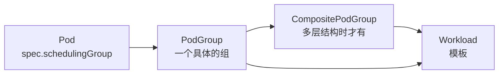

### 1.2 为什么分成 Workload 和 PodGroup 两层

`Workload` 和 `PodGroup` 是模板和实例的关系，一个模板可以对应多个 PodGroup。例如 Deployment 只有一个 Workload，每个 ReplicaSet 各有一个 PodGroup。

v1.35 时 PodGroup 只是 Workload 里的一个字段，v1.36 起拆成独立对象。KEP 给出的理由有三点：

- 生命周期不同。Workload 表达的是长期不变的意图，PodGroup 随副本的创建和删除而增减，两者写在一个对象里会把意图和运行时状态混在一起。
- 状态和资源需要挂在具体的组上。调度结果按组回写；组内共享的设备也需要以组为 owner，在组删除时一起释放。
- 规模。所有组的 spec 和 status 都写在一个对象里，会遇到 etcd 单对象大小限制和 status 更新的写冲突。

拆分之后两个对象的分工如下：

| | Workload | PodGroup |
|---|---|---|
| 内容 | 组的模板 | 一个具体的组：调度策略和调度状态 |
| 使用方 | 控制器、CLI 等工具 | kube-scheduler |
| kube-scheduler 是否读取 | 否 | 是 |
| status | 无 | 有 |
| 数量 | 每个工作负载一个 | 每个组一个 |

PodGroup 创建时把模板里的策略复制到自己的 spec 中，之后修改 Workload 只影响新建的 PodGroup。所以调度器只读 PodGroup 就能拿到全部调度信息。

### 1.3 PodGroup 的字段

1.1 的例子只用到了 `schedulingPolicy`。下面是一个用到全部主要字段的 PodGroup：

```yaml
apiVersion: scheduling.k8s.io/v1beta1
kind: PodGroup
metadata:
  name: train-workers
spec:
  workloadRef:
    workloadName: train
    templateName: workers
  schedulingPolicy:
    gang:
      minCount: 4
  schedulingConstraints:
    topology:
    - key: topology.kubernetes.io/zone
  disruptionMode:
    all: {}
  priorityClassName: high-priority
  resourceClaims:
  - name: gpu
    resourceClaimTemplateName: gpu-template
status:
  conditions:
  - type: PodGroupInitiallyScheduled
    status: "True"
```

| 字段 | 含义 | 创建后能否修改 |
|---|---|---|
| `workloadRef` | 来源 Workload 和模板名。可以不填，即独立的 PodGroup | 否 |
| `parentCompositePodGroupName` | 父 CompositePodGroup。为空表示没有上层组 | 否 |
| `schedulingPolicy` | `gang.minCount`：至少这么多 Pod 能调度才放行；`basic`：按组调度，但不要求同时成功 | 只有 `minCount` 可以 |
| `schedulingConstraints.topology` | 拓扑约束，最多一项，值是一个节点 label key，见第 4 节 | 否 |
| `disruptionMode` | 这个组被抢占时的单位：`single`（默认）按单个 Pod，`all` 按整组，见第 5 节 | 否 |
| `priorityClassName`、`priority`、`preemptionPolicy` | 组的优先级和抢占策略。组内 Pod 的优先级必须与组一致 | 否 |
| `resourceClaims` | 组内 Pod 共享的 DRA ResourceClaim，最多 4 项 | 否 |
| `status.conditions` | `PodGroupInitiallyScheduled`，由调度器写入 | — |

`PodGroupInitiallyScheduled` 表示这个组首次调度是否成功，置为 True 后不会回退。上游把 PodGroup 定位为初始放置的协调单元：`minCount` 只在调度时检查，之后 Pod 被驱逐或节点故障，由工作负载控制器负责恢复。

### 1.4 成熟度与启用方式

- 版本进展：v1.35 以 Alpha 引入；v1.36 把 PodGroup 拆成独立对象；v1.37 核心 API 升到 `v1beta1`；v1.38 中 CompositePodGroup、TAS、Job 集成升到 Beta，新增 Deployment 集成（Alpha）。GA 目标是 v1.39，CompositePodGroup 是 v1.40。
- 默认不开启：到 v1.38 为止，相关 feature gate 全部默认关闭，需要在 kube-apiserver、kube-controller-manager、kube-scheduler 上显式开启。
  - `GenericWorkload`：核心开关，包含 gang 调度和 WAP；
  - `TopologyAwareWorkloadScheduling`：TAS，依赖 `GenericWorkload`；
  - `CompositePodGroup`：多层嵌套，依赖以上两项；
  - `WorkloadWithJob`、`WorkloadWithDeployment`：Job、Deployment 集成；
  - `DRAWorkloadResourceClaims`：PodGroup 上的 `resourceClaims`。
- 非目标：KEP-4671 明确不在 kube-scheduler 中做多队列和公平性，并写明这部分继续由 Kueue 和 Volcano 提供。上游也不做拓扑的自动发现，不支持软拓扑约束。

## 2. kube-scheduler 调度流程：从单 Pod 到 PodGroup

### 2.1 回顾：经典单 Pod 调度流程

标准的 kube-scheduler 采用「同步 Scheduling Cycle（单协程）+ 异步 Binding Cycle（并发）」两阶段流水线：

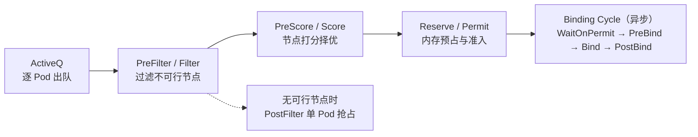

### 2.2 演进：PodGroup 调度流程（v1.37 / v1.38）

开启 `GenericWorkload` 后，带 `schedulingGroup` 的 Pod 不再走单 Pod 排队，而是以**根组**为单位进入队列，在单次调度周期内完成全组评估：

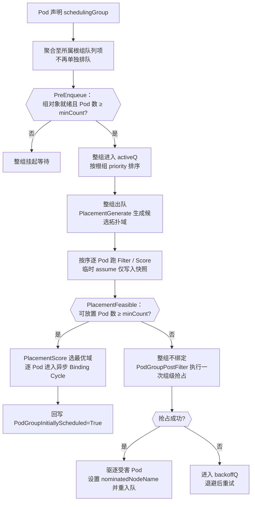

对比单 Pod 流程，核心变化体现在四点：

1. **四个新增框架扩展点**：
   - `PlacementGenerate`（内置 `TopologyPlacement`）：按拓扑约束生成候选节点子集。
   - `PlacementScore`（内置 `PodGroupPodsCount`、`NodeResourcesFit`）：对可行拓扑域打分。
   - `PlacementFeasible`（内置 `GangScheduling`）：逐 Pod 校验进度，若「已放置 + 未评估 < `minCount`」立即提前剪枝。
   - `PodGroupPostFilter`（内置 `DefaultPreemption`、`DynamicResources`）：整组失败后只触发一次组级抢占/清理。
2. **快照内试排、周期末回滚**：逐 Pod 的 Filter/Score 结果仅临时 assume 到快照中供后续 Pod 感知资源变化，不污染真实缓存；周期结束统一回滚后，再为分配成功的 Pod 各自发起异步绑定。
3. **仅决策层 all-or-nothing**：绑定仍是逐 Pod 异步执行，无组级绑定回滚；`PodGroupInitiallyScheduled` 置 `True` 后不再回退（后续驱逐恢复交给工作负载控制器）。
4. **单协程串行与贪心策略**：大组评估（Pod 数 × 候选域）会阻塞调度循环；逐 Pod 按固定顺序贪心决策、不回溯，且同层级内所有 Pod 必须共享相同的 `schedulerName`、优先级和抢占策略。

**v1.37 → v1.38 主要变化**：
- 移除 Gang 的 5 分钟 Permit 屏障，完全由公开扩展点 `PlacementFeasible` 驱动；
- `CompositePodGroup` 升 Beta（树深上限 4 → 5），补齐运行时整树校验、condition 回写与 finalizer 删除保护；
- 候选拓扑域支持按比例截断打分（`percentageOfPlacementsToScore`，下限 5%）、nominated placement 快速路径与多插件求交。

## 3. 上游 PodGroup / CompositePodGroup vs Volcano

### 3.1 PodGroup 核心对比

| 对比维度 | 上游 PodGroup（`scheduling.k8s.io`） | Volcano PodGroup（`scheduling.volcano.sh`） |
|---|---|---|
| 定位 | 纯粹的放置单元（只管单个工作负载） | 承载队列、准入与状态机的批作业调度载体 |
| Pod 关联 | 不可变字段 `pod.spec.schedulingGroup` | annotation `scheduling.k8s.io/group-name` |
| Gang 规则 | 单一 `minCount` | Job 级 `minMember` + 角色级 `minTaskMember` + 子组约束 |
| 队列与入队准入 | 无队列、无 `minResources`，控制器直接创建 Pod | 绑定 `queue`，经 `enqueue` 按 `minResources` 准入 |
| 调度驱动方式 | 事件驱动，单次弹出单个根组 | 周期性 Session，单快照内跨队列批量决策（`Statement` 事务） |
| 拓扑与子组 | 单节点 label key（硬约束）+ 独立 `CompositePodGroup` | HyperNode（`hard`/`soft`）+ 内嵌 `subGroupPolicy` |
| 抢占声明与 DRA | 声明式 `disruptionMode`、PodGroup 级 `resourceClaims` | 由 action/插件控制；仅支持 Pod 级 DRA |
| 状态语义 | 单向 `PodGroupInitiallyScheduled`（有 status 子资源） | 动态 `phase` + conditions + 计数（无 status 子资源） |

### 3.2 CompositePodGroup vs Volcano SubGroup

以两层推理服务为例：**2 个副本组 × 每组 4 个 Pod**，要求每组同机架（rack）、整体同可用区（zone），2 组均就绪才启动。

上游通过独立对象组成树状结构（最多 5 层）：

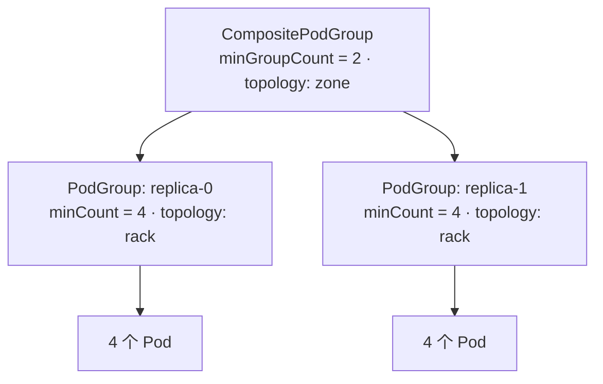

Volcano 在单 `PodGroup` 内通过 `subGroupPolicy` 按 label 划分子组（固定 2 层，无独立子组对象）：

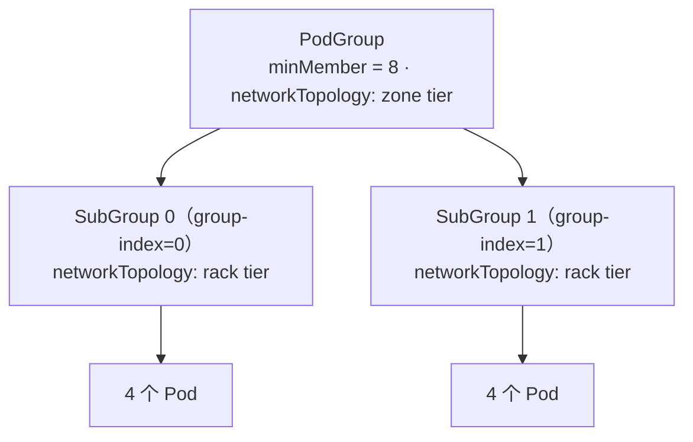

同一需求的 YAML 对比：

```yaml
# 上游：声明 Workload，由控制器展开为 1 个 CompositePodGroup + 2 个 PodGroup
apiVersion: scheduling.k8s.io/v1beta1
kind: Workload
metadata:
  name: serving
spec:
  compositePodGroupTemplates:
  - name: root
    schedulingPolicy: { gang: { minGroupCount: 2 } }
    schedulingConstraints:
      topology: [{ key: topology.kubernetes.io/zone }]
    podGroupTemplates:
    - name: replica
      schedulingPolicy: { gang: { minCount: 4 } }
      schedulingConstraints:
        topology: [{ key: topology.example.com/rack }]
```

```yaml
# Volcano：单 PodGroup 配合已有 HyperNode 层级
apiVersion: scheduling.volcano.sh/v1beta1
kind: PodGroup
metadata:
  name: serving
spec:
  queue: default
  minMember: 8
  networkTopology: { mode: hard, highestTierAllowed: 2 }   # tier 2 = zone
  subGroupPolicy:
  - name: replica
    subGroupSize: 4
    minSubGroups: 2
    labelSelector: { matchLabels: { app: serving } }
    matchLabelKeys: [group-index]
    networkTopology: { mode: hard, highestTierAllowed: 1 } # tier 1 = rack
```

**映射兼容性**：

| 上游结构 | Volcano 现有模型能否表达 |
|---|---|
| 单 `PodGroup` / 两层同构 `CompositePodGroup` | ✅ 直接对应（`minMember` / 单条 `subGroupPolicy`） |
| 两层异构 `CompositePodGroup`（全部子组必需） | ✅ 可表达（多条 `subGroupPolicy` 或 `minTaskMember`） |
| 两层异构且 `minGroupCount < 子组总数` | ❌ 无法精确表达（上游跨模板计数，Volcano 按 policy 计数） |
| 3 层及以上嵌套（如 `JobSet → ReplicatedJob → Job`） | ❌ 不支持（Volcano 固定两层） |

## 4. 拓扑感知调度：TAS 与 Volcano 网络拓扑

两者的目标相同：让一组 Pod 落在网络上相互靠近的节点上。差别在于拓扑怎么描述，以及候选域怎么搜索。

### 4.1 拓扑的描述方式

上游没有拓扑对象，直接使用节点 label。同一个 label 取值相同的节点构成一个域：

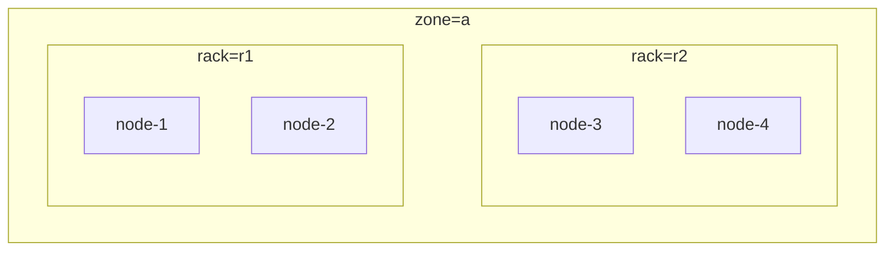

Volcano 用 HyperNode 把同样的拓扑显式建成一棵树，tier 越小越靠近节点。HyperNode 可以手工创建，也可以由控制器从 UFM 或节点 label 自动发现：

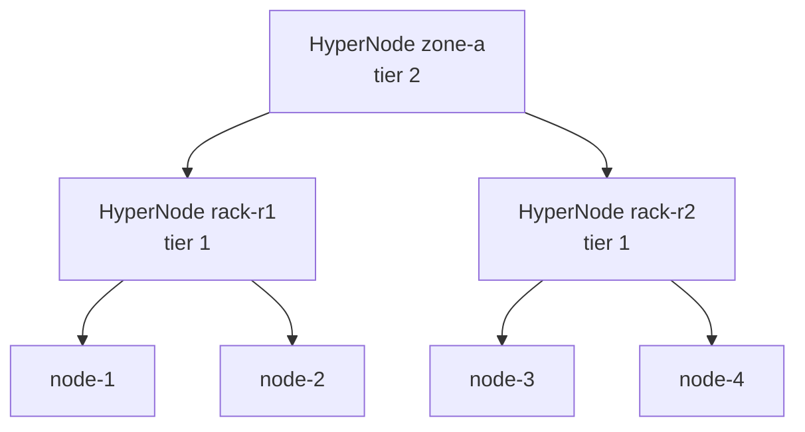

### 4.2 上游 TAS 的调度过程

PodGroup 里写一个节点 label key，最多一项：

```yaml
schedulingConstraints:
  topology:
  - key: topology.example.com/rack
```

它是硬约束：全组 Pod 必须落在这个 label 取值相同的节点上。调度过程如下：

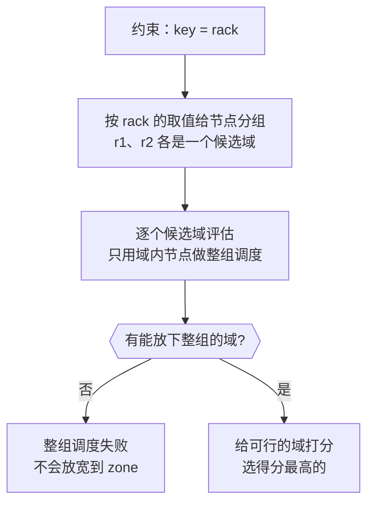

1. 生成候选域。`TopologyPlacement` 插件按这个 label 的取值给节点分组，每个取值是一个候选域。候选域都在同一层，比如全是 rack，彼此没有先后。没有这个 label 的节点不属于任何域。
2. 逐个评估。对每个候选域，把可用节点限制在域内，完整执行一遍第 2 节的整组调度：逐个 Pod 做 Filter 和 Score，再做 gang 检查。
3. 打分选域。在能放下整组的域里按得分选一个。默认有两个打分项：`PodGroupPodsCount`，能放下的 Pod 越多分越高；`NodeResourcesFit`，按 MostAllocated 策略，域内资源占用率越高分越高。
4. v1.37 会评估全部候选域。v1.38 在候选域很多时只评估一部分，比例由 `percentageOfPlacementsToScore` 控制，默认自适应，下限 5%。

另外两点：

- 组里已经有 Pod 在运行时，候选域只剩它们所在的那一个，新 Pod 只能进同一个域。
- 一个 PodGroup 只能写一层约束。多层约束要靠 CompositePodGroup 嵌套：父组写 `key: zone`，子组写 `key: rack`，子组在父组选定的 zone 内再选 rack。每一层都是硬约束。

### 4.3 Volcano 的调度过程

PodGroup 里写的是允许的最高层级，而不是某一层的 key：

```yaml
networkTopology:
  mode: hard
  highestTierAllowed: 2        # tier 2 对应 zone
```

含义是：全组 Pod 的最近公共 HyperNode 不能高于 tier 2。调度时从最低层开始逐层尝试：

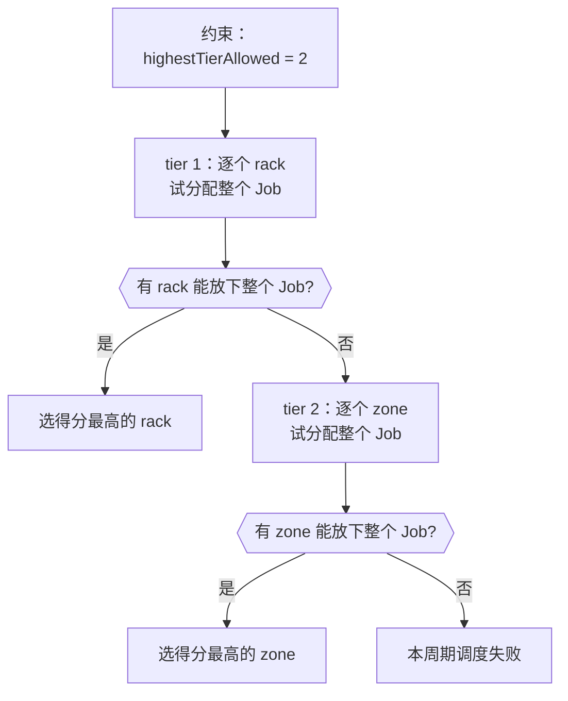

1. 候选 HyperNode 按 tier 分层，从 tier 1 到 `highestTierAllowed`。聚合空闲资源放不下 `minResources` 的 HyperNode 先被过滤掉。
2. 从最低层开始。对这一层的每个 HyperNode，只用它下面的节点为整个 Job 试分配一次，记录结果后撤销。
3. 这一层只要有 HyperNode 能放下整个 Job，就在其中选得分最高的，不再看更高的层。得分是 HyperNode 级的 binpack：放入这个 Job 后资源占用率越高分越高。
4. 这一层都放不下，才到上一层重复同样的过程。
5. `soft` 模式在内部按 `hard` 处理，只是把允许的最高层设成整个集群，所以同样是从低到高搜索，最差退到不限制拓扑。

子组上也可以写 `networkTopology`。调度器为 Job 选定 HyperNode 之后，在这个 HyperNode 内为每个子组再做一遍同样的逐层搜索。Job 已有 Pod 在运行时，搜索范围限定在已占用 HyperNode 的最近公共祖先之下。

### 4.4 差异：能否优先选更低的层级

用同一个需求来看：4 个 Pod 的任务，希望尽量在同一个机架，机架放不下时可以接受同一个可用区。

| 集群状态 | 上游 `key: rack` | 上游 `key: zone` | Volcano `hard`，最高到 zone |
|---|---|---|---|
| 有机架能放下 4 个 Pod | 同机架 | 同可用区，可能跨机架 | 同机架 |
| 没有机架能放下，可用区能放下 | 调度失败 | 同可用区 | 同可用区 |
| 可用区也放不下 | 调度失败 | 调度失败 | 调度失败；`soft` 模式会继续放宽到整个集群 |

上游表达不了这个需求，原因有两点：

- 候选域只有一层，没有“先试低层、再试高层”的搜索。写 `key: rack`，机架放不下就失败，不会放宽到可用区。
- 写 `key: zone` 时，约束只保证 4 个 Pod 在同一个可用区。域内的节点由普通的逐 Pod 打分决定，没有优先同机架的逻辑，Pod 可能分布在可用区内的多个机架上。

Volcano 按层级从低到高搜索，一份配置同时覆盖了“优先同机架”和“放不下再同可用区”。

| | 上游 TAS | Volcano |
|---|---|---|
| 拓扑来源 | 节点 label，不需要额外对象，不做自动发现 | HyperNode，手工创建或自动发现 |
| 约束写法 | 一个节点 label key | `highestTierAllowed` 或 `highestTierName` |
| 候选域 | 这个 label 的各个取值，都在同一层 | 允许范围内各层的 HyperNode |
| 搜索顺序 | 没有先后，评估后按得分选 | 从最低层到最高允许层，某一层有解即停 |
| 当前层放不下时 | 调度失败 | 放宽到上一层，直到最高允许层 |
| 软约束 | 不支持 | `soft` 模式，最差放宽到整个集群 |
| 域的打分 | 能放下的 Pod 数；域内资源占用率 | HyperNode 级 binpack |
| 多层约束 | CompositePodGroup 嵌套，每层一个 key | Job 级和子组级各一个 |
| 搜索开销 | 每个候选域跑一遍整组调度；v1.38 可只评估一部分 | 每个候选 HyperNode 试分配一次；先按空闲资源过滤 |

上游的方式更轻：节点有 label 就能用，不需要维护额外对象。Volcano 需要先有 HyperNode，换来的是按层级就近放置、软约束和拓扑自动发现。

## 5. 组级抢占：WAP 与 Volcano 的抢占和回收

### 5.1 上游 WAP 的过程

整组调度失败后，kube-scheduler 在同一个调度周期内执行一次组级抢占，入口是 `PodGroupPostFilter` 扩展点：

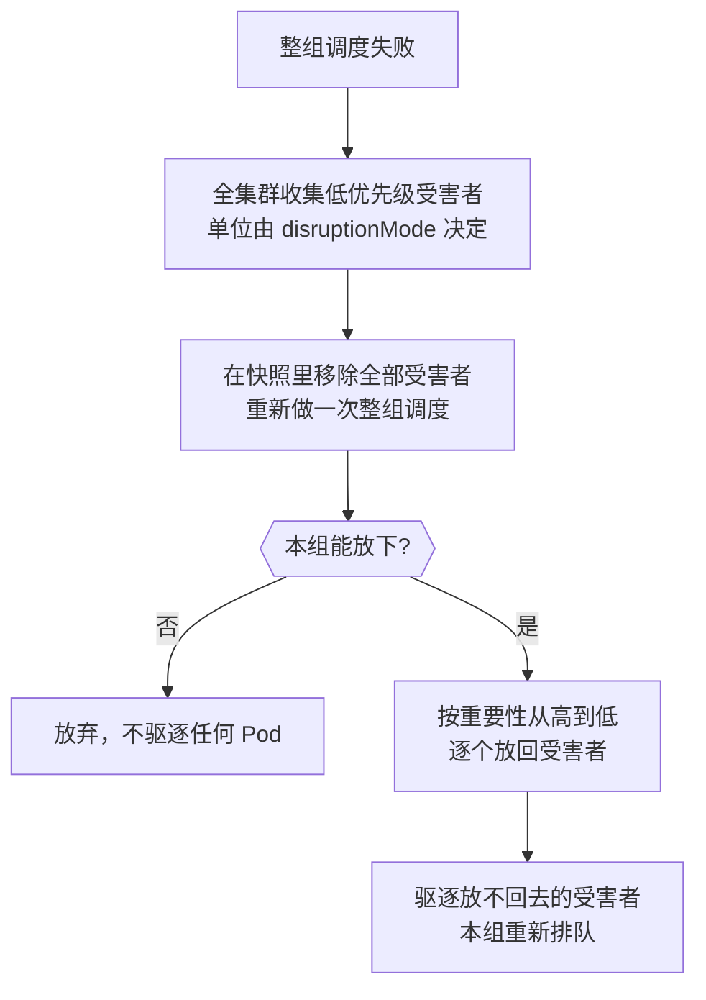

1. 收集受害者。范围是整个集群里优先级低于本组的 Pod。受害单位取决于受害方自己的 `disruptionMode`：
   - `single`（默认）：每个 Pod 是一个独立的受害者；
   - `all`：整个组是一个受害者，要么全部保留，要么全部驱逐。有嵌套时取最上层设置了 `all` 的那个组。
2. 全部移除再试排。在快照里把所有候选受害者移除，重新为本组执行一次整组调度，开启 TAS 时包括选域。仍然放不下就放弃。
3. 逐个放回。按重要性从高到低尝试把受害者放回原节点，放回后本组每个 Pod 在选定的节点上仍能通过 Filter，就保留这个受害者。重要性的比较顺序是：优先级高的更重要；同优先级下，整组比单个 Pod 更重要；组越大越重要；启动越早越重要。
4. 放不回去的就是最终的受害者，调度器删除它们的 Pod。本组的 Pod 记录 `nominatedNodeName` 后重新排队，等受害者退出后再调度。上一轮的受害者还没退出时，不会发起新一轮抢占。

这个过程里，受害方的 `minCount` 不参与判断。一个按默认 `single` 运行的 gang 组，会被当作若干个独立的 Pod，可能只被驱逐其中一部分，剩下的 Pod 继续运行但已经不足 `minCount`。只有受害方显式设置了 `disruptionMode: all`，它才不会被拆开。PDB 是尽力而为：会违反 PDB 的受害者优先尝试放回，但不保证不被驱逐。

### 5.2 Volcano 的过程

Volcano 的抢占和回收是独立的 action，按配置启用：

| action | 触发原因 | 受害者范围 | 受害单位 | 对受害方 gang 的处理 |
|---|---|---|---|---|
| `preempt` | 优先级 | 同队列 | 单个 task | 只驱逐超出 `minAvailable` 的部分，不打破 gang |
| `reclaim` | 队列配额 | 其他队列 | 单个 task | 同上 |
| `gangpreempt` | 优先级 | 同队列 | bundle | 先驱逐不影响 gang 的部分，不够时整体打破 |
| `gangreclaim` | 队列配额 | 其他队列 | bundle | 同上 |

`preempt` 和 `reclaim` 逐个 task 选受害者，由 gang 插件过滤：受害 Job 当前就绪的 Pod 数大于 `minAvailable` 时，才允许驱逐它的 task。所以这两个 action 不会让受害 Job 低于 `minAvailable`。`preempt` 不处理带网络拓扑约束的 Job，这类 Job 的抢占由 `gangpreempt` 负责。

`gangpreempt` 和 `gangreclaim` 以 bundle 为单位选受害者。`gangpreempt` 的过程如下：

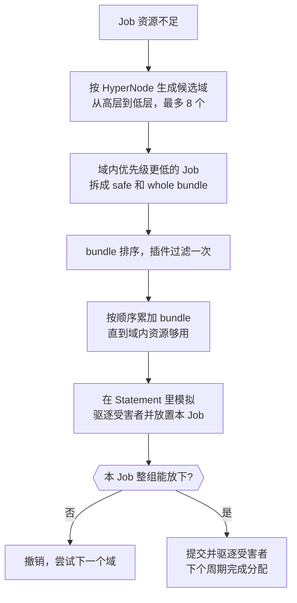

1. 候选域。按 HyperNode 划分，从高层到低层，范围大的域先试，最多 `maxDomains` 个，默认 8。集群里没有 HyperNode 时，整个集群是一个域。
2. 拆 bundle。域内同队列、可抢占、优先级低于抢占方的 Job 都是候选。每个受害 Job 在域内的 task 拆成两个 bundle：
   - safe bundle：驱逐之后受害 Job 仍然满足 gang。判断依据是三项都有富余：Job 级的 `minAvailable`、角色级的 `minTaskMember`、子组级的 `minSubGroups`。
   - whole bundle：其余的 task，驱逐它们会打破受害 Job 的 gang。
3. 排序。safe bundle 排在 whole bundle 之前；同类 bundle 之间按 Job 调度顺序的反序，优先级低的 Job 先被驱逐。
4. 插件过滤。`priority`、`capacity`、`pdb` 等插件对候选 task 过滤一次。whole bundle 只有全部 task 都被允许才保留。
5. 累加并模拟。按顺序累加 bundle，直到域内的空闲资源加上释放的资源够用，然后在 Statement 里模拟驱逐并为抢占方做放置。抢占方整个 Job 能放下才提交，否则撤销并尝试下一个域。

`gangreclaim` 的过程相同，区别在两处：受害者来自其他队列；排序时先比较队列的顺序，同一个队列内再比较收益代价比。收益是这个 bundle 在域内能释放、回收方用得上的资源，代价是受害 Job 的总资源，所以需要打破 gang 时，优先选规模小、并且集中在当前域内的 Job。

### 5.3 同一个场景下的结果

集群里没有空闲资源，每个节点只能放一个 Pod。有两个低优先级的 gang 任务：

- Job A：`minAvailable` 为 4，有 6 个 Pod 在运行，富余 2 个；
- Job B：`minAvailable` 为 4，有 4 个 Pod 在运行，没有富余。

高优先级的 Job P 需要 3 个 Pod 一起调度。

| 调度器 | 结果 |
|---|---|
| 上游 WAP，A、B 都是默认的 `single` | 驱逐 3 个 Pod。具体是哪 3 个，取决于 P 的 Pod 在试排时选中的节点，与 A、B 的 `minCount` 无关。B 可能被驱逐 1 到 3 个，剩余的 Pod 继续运行但不足 `minCount` |
| 上游 WAP，B 设置 `disruptionMode: all` | B 的 4 个 Pod 作为一个整体，要么都保留，要么都驱逐。A 的 Pod 仍然逐个处理 |
| Volcano `preempt` | 可驱逐的只有 A 富余的 2 个 Pod，不够 P 使用，P 的抢占不提交，不驱逐任何 Pod |
| Volcano `gangpreempt` | 先选 A 的 safe bundle（2 个），不够；再按 Job 的顺序加上一个 whole bundle（4 个）。共驱逐 6 个 Pod：一个 Job 整体被驱逐，另一个 Job 仍满足 gang |

### 5.4 对比

| | 上游 WAP | Volcano |
|---|---|---|
| 触发原因 | 优先级 | 优先级，以及队列配额 |
| 执行时机 | 整组调度失败后，同一周期内执行一次 | 独立的 action，按配置启用 |
| 抢占方 | 整组一次决策，放不下就不驱逐 | 整个 Job，放不下就不驱逐 |
| 受害单位 | 默认单个 Pod；`all` 时为整组 | task 或 bundle |
| 是否考虑受害方的 gang | 不看 `minCount`；只有 `all` 的组不会被拆开 | 考虑：先驱逐富余部分，再整体打破 |
| 受害者怎么确定 | 先全部移除，抢占方试排，再逐个放回 | 按顺序累加 bundle 到资源够用，再模拟放置 |
| 受害者的顺序 | 按重要性放回：优先级、整组优先于单个 Pod、组的大小、启动时间 | safe 先于 whole，再按 Job 或队列的顺序 |
| 搜索范围 | 全集群一次 | 按节点，或按 HyperNode 域 |
| PDB | 尽量保留，不保证 | `pdb` 插件直接过滤 |
| 抢占之后 | 抢占方 Pod 记录 `nominatedNodeName` | 记录 `NominatedHyperNode`，下个周期兑现 |

两边的共同点是抢占方按整组决策：整组放不下就不驱逐任何 Pod。差异主要有三点：

- 触发原因。上游只有优先级抢占。Volcano 还有跨队列回收，上游没有队列，也就没有对应的机制。
- 受害方的 gang。上游默认不保护，由受害方通过 `disruptionMode: all` 自己声明。Volcano 把受害 Job 的 gang 作为选择和排序受害者的依据，默认先驱逐不影响 gang 的部分。
- 受害者数量。上游有“放回”这一步，最终驱逐的是放不回去的最小集合。Volcano 的 gang action 按 bundle 累加，没有放回，驱逐的 Pod 可能多于最小所需，换来的是被驱逐的 Job 更少被拆散。

Volcano 没有与 `disruptionMode: all` 完全对应的能力：whole bundle 只包含受害 Job 在当前域内的 task，而上游的 `all` 作用于这个组在全集群的所有 Pod。

## 6. Volcano 的优势与短板

| 维度 | Volcano 的优势（上游没有或不做） | Volcano 的短板（上游已具备） |
|---|---|---|
| 多租户与队列 | 完整的 Queue 体系：配额、公平性、跨队列回收。上游明确列为非目标 | — |
| 资源准入与状态 | `minResources` 入队准入；反映当前状态的 `phase`；角色级的 `minTaskMember` | PodGroup 没有 status 子资源，调度器整对象更新 |
| 层级嵌套 | 单个对象即可表达两层结构 | 固定两层，不支持三层及以上的嵌套，上游最多 5 层 |
| 网络拓扑 | 按层级从低到高搜索，优先放在更低的层级；支持 `soft` 软约束；HyperNode 可自动发现 | 需要先有 HyperNode，不如节点 label 开箱即用 |
| 抢占 | 选择受害者时考虑对方的 gang；支持跨队列回收 | 没有声明式的 `disruptionMode`；按 bundle 驱逐，驱逐的 Pod 可能多于最小所需 |
| 设备与生态 | — | 不支持 PodGroup 级 DRA；不识别 `pod.spec.schedulingGroup` |

PodGroup 级 DRA 指上游 PodGroup 上的 `resourceClaims` 字段。DRA（Dynamic Resource Allocation）通常由每个 Pod 各自引用 ResourceClaim 来申请 GPU 等设备。这个字段把 ResourceClaim 声明在 PodGroup 上：每个 PodGroup 生成一份 ResourceClaim，组内所有 Pod 共享同一份设备分配，它随 PodGroup 创建和删除。Volcano 目前只支持 Pod 级的 ResourceClaim。

## 7. Volcano 兼容上游 PodGroup：方案与工作量

### 7.1 现状

Volcano 虽已编译上游 `PodGroup` 类型，但 `PodGroupStates` / `PodGroupManager` 均为空实现；调度器 `getJobID` 仅读取 `scheduling.k8s.io/group-name` annotation，未读取 `pod.spec.schedulingGroup`，也无 informer 和 RBAC。直接提交带 `schedulingGroup` 的 Pod 给 Volcano，会被退化为 `minMember=1` 的逐 Pod 调度。

### 7.2 两种实现方案

**方案 A（`pg-controller` 镜像转换）**：controller watch 上游对象，生成镜像 Volcano PodGroup 并补充 annotation / 子组 label，调度后回写上游状态。调度器基本无改动。

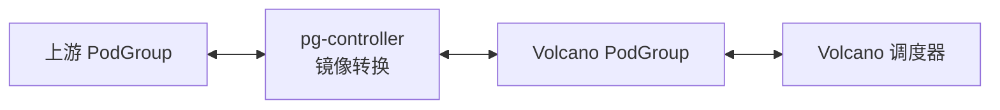

**方案 B（调度器原生支持）**：Scheduler Cache 直接 watch 上游对象并构建 `JobInfo`，调度器直接回写状态。


| 对比维度 | 方案 A：Controller 镜像转换 | 方案 B：调度器原生支持 |
|---|---|---|
| 调度器改动 | 极小（隔离上游 API 变动风险） | 大（44 个核心非测试文件引用现有 PodGroup） |
| 能力上限 | 覆盖扁平 Gang 与两层子组 | 可配合 SubJob 递归化支持任意层级与 PodGroup 级 DRA |
| 数据一致性 | 存在双对象同步延迟与命名防冲突 | 单一数据源，无额外对象 |

### 7.3 关键语义映射

| 缺口 | 推荐处理 |
|---|---|
| 队列与 `minResources` | 沿用 `scheduling.volcano.sh/queue-name`（缺省 `default`）；controller 汇总已创建 Pod 资源填充 `minResources` |
| 资源同名 | 同为 `podgroups`；方案 A 镜像对象加统一前缀防冲突 |
| `disruptionMode` | `all`：不为该 Job 生成 safe bundle，并把它在域外的 task 一起纳入 whole bundle；`single`：保持 Volcano 默认的 gang 保护 |
| 拓扑 label key | 结合 HyperNode `label` 发现器建立 label key → tier 映射（与 [#6161](https://github.com/volcano-sh/volcano/issues/6161) 一致） |
| 不支持结构与版本隔离 | 仅适配 `v1beta1+`，通过 API Discovery 探测并置于默认关闭的 Volcano gate 后；3 层+ 或跨模板计数明确写 condition 拒绝 |

### 7.4 分阶段工作量与建议

> 注：按熟悉 Volcano 调度器的工程师计（含单测、e2e、集群验证与文档，不含评审周期）。上游 GA 前每个 K8s 版本预计另需 1–2 人周跟进变更。

| 阶段 | 范围 | 推荐方案 | 预估工作量 | 建议时机 |
|---|---|---|---|---|
| **阶段 1** | 识别 `schedulingGroup`、`minCount`、优先级、队列与状态回写（覆盖原生 Job / Deployment） | 方案 A | **4–6 人周** | **近期可落地**（默认关 gate，低风险试点） |
| **阶段 2** | 补齐 `disruptionMode`、拓扑映射与两层 `CompositePodGroup`（覆盖主流 LWS / JobSet） | 方案 A | **累计 12–20 人周** | 视用户采用上游 API 需求推进 |
| **阶段 3** | 任意层级（SubJob 递归化）+ PodGroup 级 DRA（与 kube-scheduler 全面对齐） | 方案 B（从头实现） | **33–51 人周（8–12 人月）** | 待上游 GA（v1.39+）且生态格局明朗后评估 |

*不建议用上游 PodGroup 替代 Volcano PodGroup（会丢失队列、准入、软拓扑等核心能力）。建议持续跟踪 JobSet、LWS、Kubeflow Trainer、KubeRay、Spark Operator 以及 Kueue（[kubernetes-sigs/kueue#8871](https://github.com/kubernetes-sigs/kueue/issues/8871)）的集成进展。*

## 8. 参考资料

- **上游 KEP**：[KEP-4671 Gang Scheduling](https://github.com/kubernetes/enhancements/tree/master/keps/sig-scheduling/4671-gang-scheduling)、[KEP-6012 CompositePodGroup](https://github.com/kubernetes/enhancements/tree/master/keps/sig-scheduling/6012-composite-podgroup-api)、[KEP-5732 TAS](https://github.com/kubernetes/enhancements/tree/master/keps/sig-scheduling/5732-topology-aware-workload-scheduling)、[KEP-5710 WAP](https://github.com/kubernetes/enhancements/tree/master/keps/sig-scheduling/5710-workload-aware-preemption)、[KEP-6089 Controller APIs](https://github.com/kubernetes/enhancements/tree/master/keps/sig-scheduling/6089-was-controller-apis)、[KEP-5547 Job Integration](https://github.com/kubernetes/enhancements/tree/master/keps/sig-apps/5547-integrate-workload-with-job)
- **官方博客**：[Kubernetes v1.37: Advancing Workload-Aware Scheduling](https://kubernetes.io/blog/2026/09/08/kubernetes-v1-37-advancing-workload-aware-scheduling/)
- **Volcano 设计文档**：[Network Topology Aware Scheduling](../design/Network%20Topology%20Aware%20Scheduling.md)、[gang-aware-eviction-design](../design/gang-aware-eviction-design.md)
- **核心代码入口**：
  - Kubernetes：`staging/src/k8s.io/api/scheduling/v1beta1/types.go`、`pkg/scheduler/schedule_one_podgroup.go`、`pkg/scheduler/framework/plugins/gangscheduling/`、`pkg/scheduler/framework/preemption/podgrouppreemption.go`
  - Volcano：`staging/src/volcano.sh/apis/pkg/apis/scheduling/v1beta1/types.go`、`pkg/scheduler/api/job_info.go`（`getJobID`）、`pkg/controllers/podgroup/`、`pkg/scheduler/actions/gangpreempt/`
