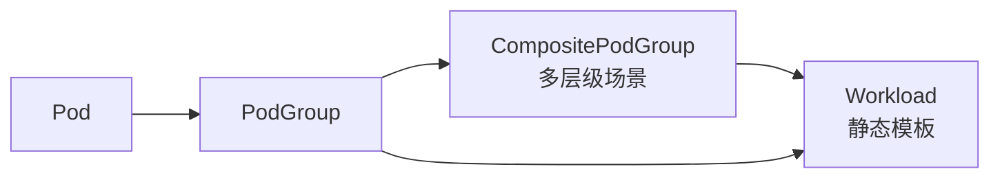
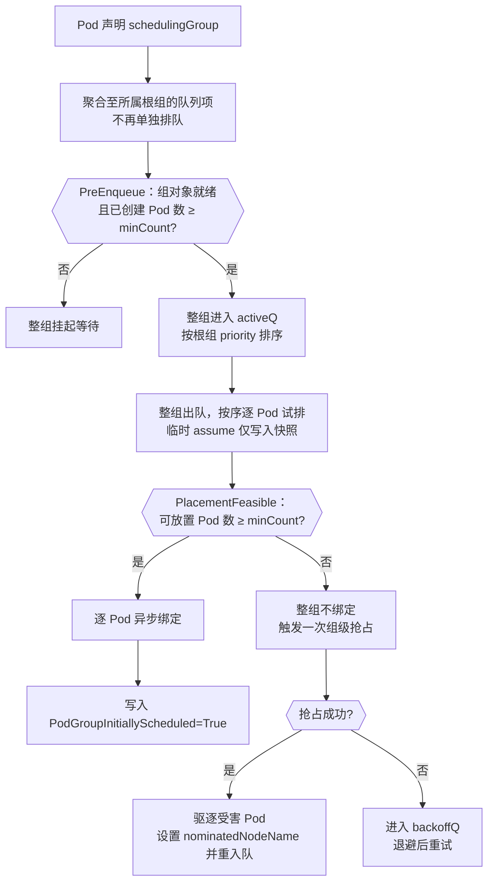
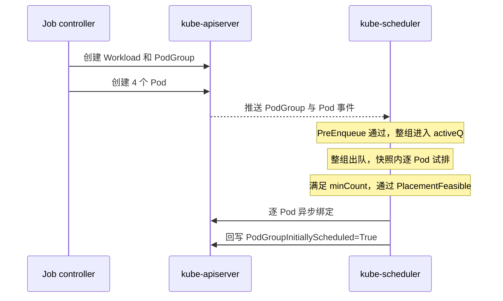
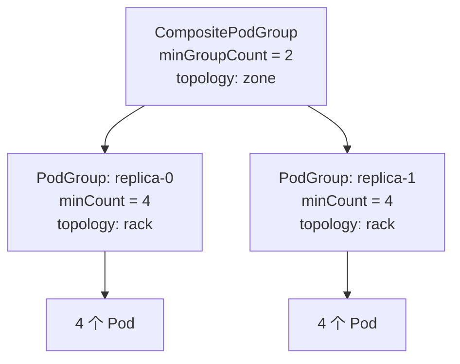
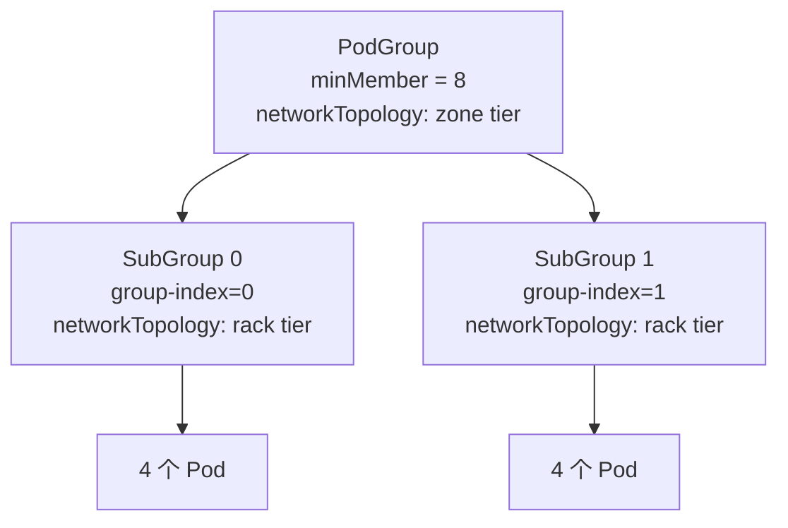
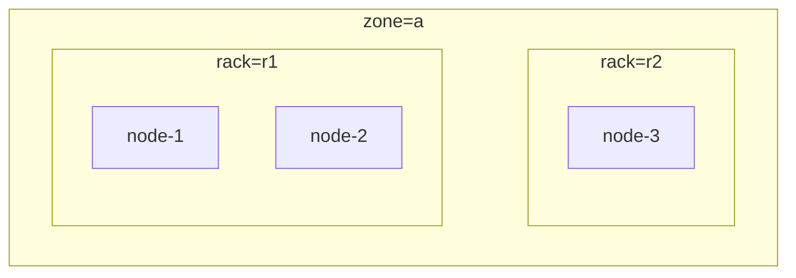
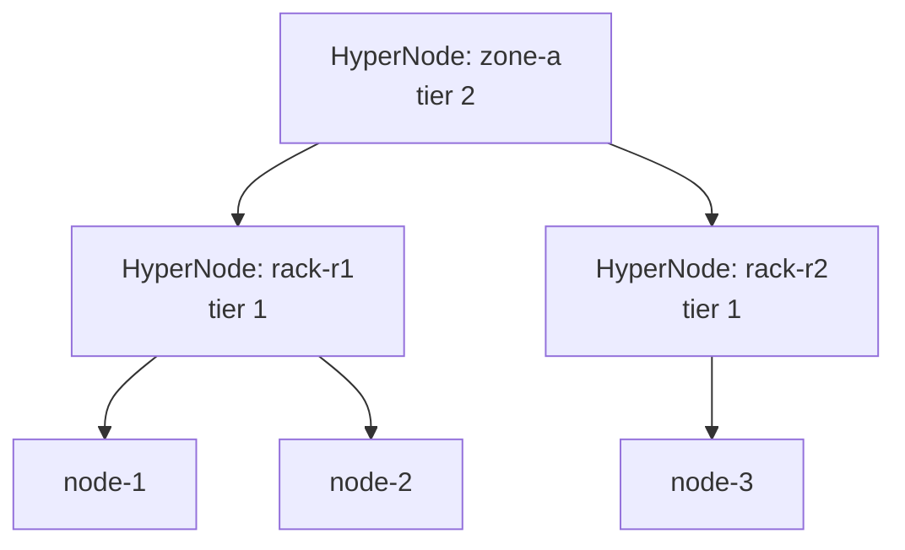
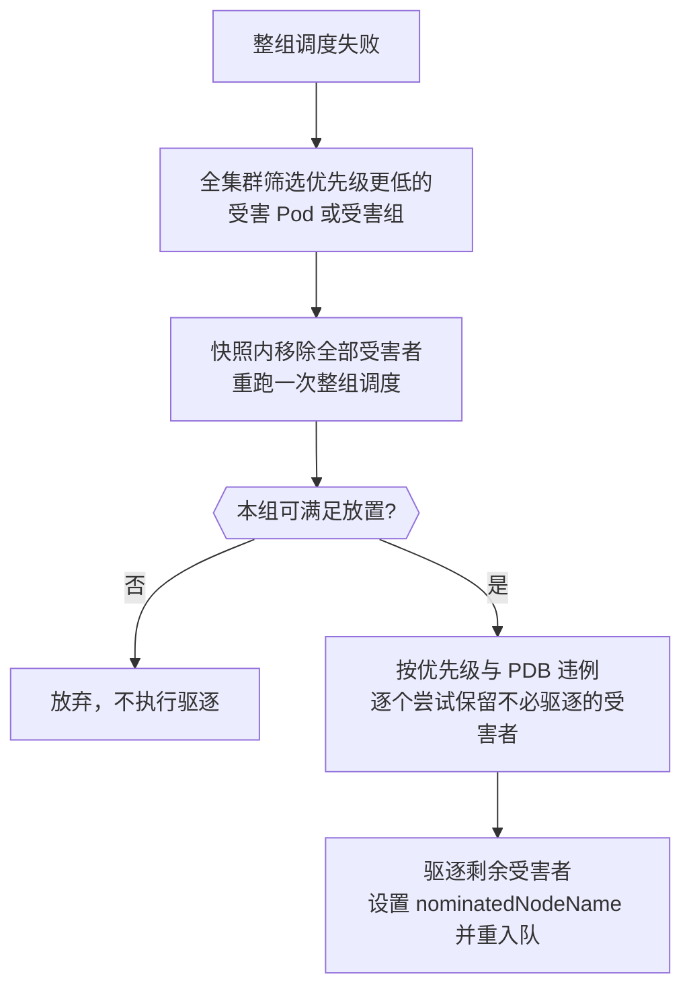
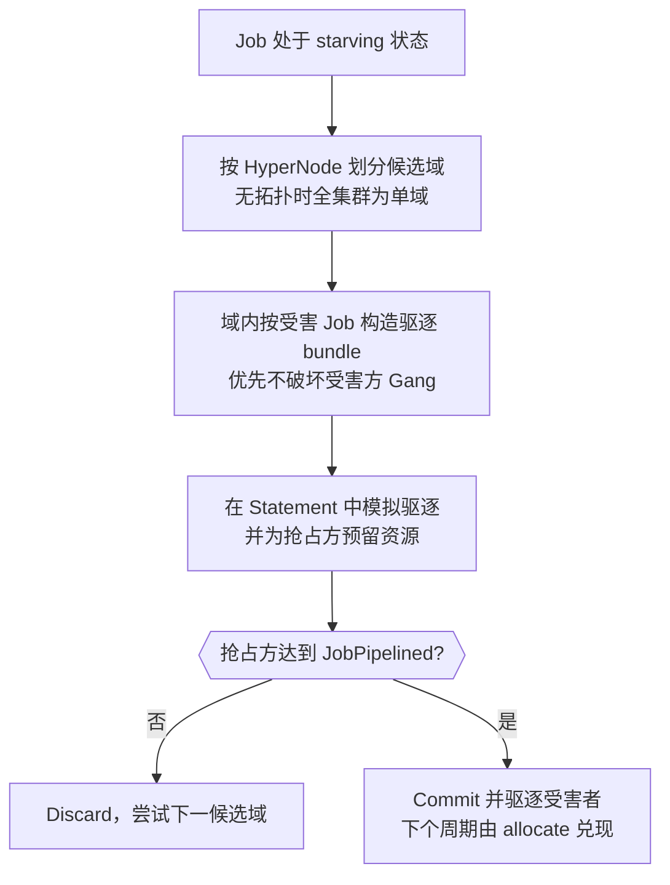
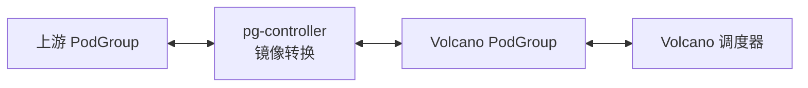

# Kubernetes 上游 PodGroup 与 Volcano 对比分析

[English](./k8s-workload-aware-scheduling-vs-volcano.md) | 简体中文

## 背景

Kubernetes 自 v1.35 起在 kube-scheduler 中推进 Workload-Aware Scheduling（WAS），并引入了 `scheduling.k8s.io` API 组下的原生 `PodGroup`，以补齐 kube-scheduler 在工作负载级调度（Gang、拓扑感知、组级抢占）上的能力。该 API 与 Volcano PodGroup 同名且职责有交集，但在定位与模型上差异显著。

> 说明：上游内容基于 Kubernetes v1.37.2 及 2026 年 11 月的 master 分支（v1.38 开发中）；Volcano 部分基于当前 master 分支。

## 1. 上游 PodGroup 现状

### 1.1 API 模型与分层设计

以一个 4 Pod 的 Gang 训练任务为例。在开启 `GenericWorkload` 与 `WorkloadWithJob`（若使用拓扑约束还需开启 `TopologyAwareWorkloadScheduling`）的集群中，用户可在原生 `Job` 中直接声明 `spec.scheduling`：

```yaml
apiVersion: batch/v1
kind: Job
metadata:
  name: train
spec:
  parallelism: 4
  completions: 4
  scheduling:
    schedulingPolicy:
      gang: {}          # 省略 minCount 时默认等于 parallelism
  template:
    ...
```

Job controller 会据此依次创建 `Workload`、`PodGroup` 和 `Pod`，并通过 `pod.spec.schedulingGroup` 建立关联（对象名仅作示意）：

```yaml
apiVersion: scheduling.k8s.io/v1beta1
kind: Workload
metadata:
  name: train
spec:
  podGroupTemplates:
  - name: workers
    schedulingPolicy:
      gang:
        minCount: 4
---
apiVersion: scheduling.k8s.io/v1beta1
kind: PodGroup
metadata:
  name: train-workers
spec:
  workloadRef:
    workloadName: train
    templateName: workers
  schedulingPolicy:       # 创建时从模板复制，不随 Workload 动态更新
    gang:
      minCount: 4
---
apiVersion: v1
kind: Pod
metadata:
  name: train-0
spec:
  schedulingGroup:
    podGroupName: train-workers
  ...
```

上述对象均由工作负载控制器创建，引用关系如下（箭头表示引用）：



**为什么要拆分为 `Workload` 与 `PodGroup` 两层？**

上游采用类似 `Deployment`（模板）与 `ReplicaSet`（实例）的「意图层 / 运行时层」分离架构：

- **`Workload`（静态调度模板层）**：由最顶层工作负载控制器（Job、Deployment、JobSet、LWS 等）编译生成，描述整个工作负载包含哪些组模板（`podGroupTemplates` / `compositePodGroupTemplates`），并通过 `spec.controllerRef` 指向业务工作负载。它没有 `status`，kube-scheduler 也不 watch 它，主要面向**控制器、CLI 以及上层队列/编排系统（如 Kueue）**提供统一的工作负载调度抽象，使外围生态无需逐一适配各类 CRD 即可识别工作负载结构。
- **`PodGroup`（运行时调度实例层）**：调度器真正消费的对象，对应一次具体的组调度实例（同一 `Workload` 模板在扩缩容、滚动升级或重建时可实例化出多个 `PodGroup`）。创建时将模板中的策略直接复制到 `PodGroup.spec`（修改 `Workload` 只影响新建实例，不扰动存量组），使每个 `PodGroup` 成为自包含的调度与状态单元：
  - 避免把所有运行态与状态回写堆在单一 `Workload` 上，规避大对象写竞争与 etcd 单对象体积上限；
  - 可作为组级附属资源（如 DRA `ResourceClaim`）的独立 Owner，配合 `PodGroupProtection` finalizer 在组内 Pod 全部终止后自动清理与释放设备。
- **`CompositePodGroup`**：多层级工作负载的父级运行时节点，将多个 `PodGroup` 或子 `CompositePodGroup` 组织成树（见第 4 节）。
- **`pod.spec.schedulingGroup`**：Pod 指向 `PodGroup` 的不可变字段。相比 label/annotation 或 `PodGroupSelector`，不可变字段从 API 层禁止 Pod 在调度中途切换或脱离所属组，避免成员动态变动引入的一致性边界问题。

此外，面向工作负载 API 的公共嵌入结构（如 `Job.spec.scheduling`）在 v1.38 中直接进入 `scheduling.k8s.io/v1`（KEP-6089），以便已 GA 的 `batch/v1` Job 及生态控制器复用统一的声明格式。

### 1.2 术语对照

| 上游术语 | 含义 | Volcano 对应能力 |
|---|---|---|
| WAS | Workload-Aware Scheduling，工作负载级调度体系 | Volcano 批调度模型 |
| `Workload` | 工作负载调度模板 | 无独立对象（内嵌于工作负载 spec） |
| `PodGroup` | 运行时组调度单元 | `PodGroup`（`scheduling.volcano.sh`） |
| `CompositePodGroup` | 多层嵌套的父级组对象 | `PodGroup.spec.subGroupPolicy` |
| TAS | Topology-Aware Scheduling，拓扑感知调度 | Network Topology Aware Scheduling（HyperNode） |
| WAP | Workload-Aware Preemption，组级抢占 | `preempt` / `reclaim` 及 `gangpreempt` / `gangreclaim` |

### 1.3 版本进展与 Feature Gate

| 版本 | 阶段 | 核心演进 |
|---|---|---|
| v1.35 | Alpha | 引入 `v1alpha1` Workload API，`PodGroup` 内嵌于 `Workload` |
| v1.36 | Alpha | `v1alpha2` 将 `PodGroup` 拆为独立对象，Pod 改用 `schedulingGroup`；引入 TAS、WAP 与 Job 集成 |
| v1.37 | Beta | 核心 API 升至 `v1beta1`；`PodGroup` 作为整体入队调度；新增 `CompositePodGroup`（Alpha，`v1alpha3`） |
| v1.38（开发中） | Beta | `CompositePodGroup`、TAS、Job 集成升至 Beta；新增 Deployment 集成（Alpha）；公共嵌入类型进入 `scheduling.k8s.io/v1` |
| v1.39（计划） | GA | `PodGroup`、TAS、WAP 目标 GA；`CompositePodGroup` 目标 v1.40 |

截至 v1.38，**所有 WAS 核心功能相关的 Feature Gate 均仍为默认关闭（`default: false`）**，没有任何一项工作负载调度能力默认生效；对应调度插件（`GangScheduling`、`TopologyPlacement`、`PodGroupPodsCount`）也仅在对应 gate 显式开启后才会注册到默认 Profile：

| Feature Gate | v1.37 | v1.38（开发中） | 默认值（v1.38） | 依赖关系与说明 |
|---|---|---|---|---|
| `GenericWorkload` | Beta | Beta | **`false`（需显式开启）** | 核心开关；v1.37 起已合并原 `GangScheduling` 与 `WorkloadAwarePreemption` |
| `TopologyAwareWorkloadScheduling` | Alpha | Beta | **`false`（需显式开启）** | 拓扑感知调度（TAS），依赖 `GenericWorkload` |
| `CompositePodGroup` | Alpha | Beta | **`false`（需显式开启）** | 多层级组模型，同时依赖 `GenericWorkload` 与 `TopologyAwareWorkloadScheduling` |
| `DRAWorkloadResourceClaims` | Beta | Beta | **`false`（需显式开启）** | PodGroup 级共享 DRA ResourceClaim |
| `WorkloadWithJob` | Alpha | Beta | **`false`（需显式开启）** | 原生 Job controller 集成，依赖 `GenericWorkload`（`v1.38.0-beta.0` 中仍为 Alpha） |
| `WorkloadWithDeployment` | — | Alpha | **`false`（需显式开启）** | Deployment / ReplicaSet 集成，依赖 `GenericWorkload`；Gang 场景要求 `strategy.type: Recreate` |
| `PodGroupPreemptionPolicy` | Alpha（`false`） | 已移除 | **直接生效（随 `GenericWorkload`）** | v1.38 移除独立 gate，开启 `GenericWorkload` 后 `PodGroup.spec.preemptionPolicy` 直接生效 |
| `SchedulerPreQueueingHints` | Alpha（`false`） | Beta | **`true`（默认开启）** | 调度队列通用预入队优化（非 WAS 开关），v1.38 已默认开启 |

需在 kube-apiserver、kube-controller-manager 和 kube-scheduler 上显式启用上述 `default: false` 的 gate 才能使用对应能力。此外，核心 API 在 v1.35 至 v1.37 间经历了两次不兼容变更（`workloadRef` → `schedulingGroup`、`v1alpha2` → `v1alpha3` 且无版本转换），GA 目标也在 2026 年 11 月从 v1.38 推迟至 v1.39。

### 1.4 范围边界（非目标）

KEP-4671 将队列与公平性明确划为非目标：

> Bring fairness or multiple workload queues in kube-scheduler. Kueue and Volcano.sh will continue to provide this.

kube-scheduler 内部仍维持单一优先级队列，不提供多租户队列、配额管理与跨队列回收。此外，上游不提供拓扑自动发现（依赖节点 label），目前也不支持软拓扑约束（preferred）。

## 2. kube-scheduler 的 PodGroup 调度流程

### 2.1 调度流程

以 1.1 中 4 Pod 的 Gang 任务为例，开启 `GenericWorkload` 后，kube-scheduler 的组调度流程如下：



关键执行步骤：

1. **入队聚合**：带 `schedulingGroup` 的 Pod（无论策略为 `basic` 或 `gang`）不再单独排队，而是并入所属根组（独立 `PodGroup` 或 `CompositePodGroup` 树根）的队列项。队列项按根组优先级排序，同优先级按时间戳排序。
2. **PreEnqueue 门禁**：要求 `PodGroup` 及其全部祖先对象已存在、已创建 Pod 数达到 `minCount`，且无成员被 scheduling gate 阻塞，满足后整组进入 `activeQ`。
3. **快照试排与剪枝**：整组出队后，调度器按固定顺序对每个 Pod 执行 Filter / Score，并在快照中临时 assume 以供后续 Pod 感知资源扣减（不修改真实缓存，周期末统一回滚）。每评估完一个 Pod 即调用 `PlacementFeasible`；若「已放置 + 未评估 < `minCount`」，立即提前终止。
4. **绑定与抢占**：满足 `minCount` 时，各已分配 Pod 各自进入异步 binding cycle，并回写 `PodGroupInitiallyScheduled=True`（若 `minCount < 总 Pod 数`，可放置的部分先绑定，其余重新入队；已运行的组成员计入 `minCount`）；不满足则整组不绑定，执行一次组级抢占（见第 6 节），仍无解则进入 `backoffQ`（退避上限 `podMaxBackoff × √组内Pod数`，默认 `podMaxBackoff` 为 10s）。

上游为此在调度框架中新增了四个扩展点：

| 扩展点 | 职责 | 内置插件 |
|---|---|---|
| `PlacementGenerate` | 按约束生成候选拓扑域（节点子集） | `TopologyPlacement` |
| `PlacementScore` | 对可行的候选拓扑域打分 | `PodGroupPodsCount`、`NodeResourcesFit` |
| `PlacementFeasible` | 判断当前试排进度是否满足组策略（提前剪枝） | `GangScheduling` |
| `PodGroupPostFilter` | 整组调度失败后执行一次组级后处理 | `DefaultPreemption`、`DynamicResources` |

正常调度场景的组件交互时序如下：



实现层面需注意五点约束与局限：

- **无组级绑定回滚**：all-or-nothing 仅覆盖调度决策阶段，绑定仍为逐 Pod 异步执行，单个成员绑定失败不会撤销其余成员。
- **状态单向不可逆**：上游将 `PodGroup` 定位为**初始放置**的协调机制而非持续副本控制器——`minCount` 仅在调度期校验，`PodGroupInitiallyScheduled` 一旦置为 `True` 不再回退；后续驱逐或节点故障后的恢复仍交由工作负载控制器处理。
- **单协程串行评估**：大组评估（Pod 数 × 候选拓扑域，抢占时还需重跑）在单协程调度循环内完成，可能阻塞同集群其他调度。
- **贪心不回溯与同质约束**：按固定顺序逐 Pod 决策，异构组不保证一定找到可行解；且同一层级内所有 Pod 必须使用相同的 `schedulerName`、优先级与抢占策略。
- **DRA 组合限制**：`DynamicResources` 的 `PodGroupPostFilter` 暂不支持带拓扑约束的 `PodGroup` 以及 `CompositePodGroup`。

### 2.2 v1.37 与 v1.38 的主要差异

两个版本的主流程一致，v1.38（开发版）重点在精简过渡机制与扩展搜索性能：

| 变更项 | v1.37 | v1.38（开发中） |
|---|---|---|
| Gang 实现机制 | 除试排校验外，仍保留 5 分钟超时的 Permit 等待屏障 | 移除 Permit 屏障，完全由公开可配置的 `PlacementFeasible` 扩展点驱动 |
| `CompositePodGroup` | Alpha（仅 `v1alpha3`），最大树深 4 层，无状态与删除保护 | 升至 Beta（进入 `v1beta1`），最大树深扩至 5 层，补齐整树运行时校验（`PodGroupError`/`CompositePodGroupError`）、condition 回写与 finalizer 保护 |
| 候选拓扑域搜索 | 评估全部候选域；仅使用首个 `PlacementGenerate` 插件 | 新增 `percentageOfPlacementsToScore`（自适应截断，下限 5%）、随机打散、nominated placement 快速路径及多插件结果求交 |
| 抢占与框架结构 | 逻辑集中在 `schedule_one_podgroup.go` | 拆出 `algorithm_podgroup.go`，抽象 `PreemptionManager` 与 `RankNodes` |
| 工作负载集成 | `WorkloadWithJob`（Alpha） | `WorkloadWithJob`（Beta，suspend 时删除 PodGroup）、`WorkloadWithDeployment`（Alpha） |
| `preemptionPolicy` | 受 `PodGroupPreemptionPolicy` feature gate 控制 | 移除 `PodGroupPreemptionPolicy` gate，字段直接生效 |

## 3. 上游 PodGroup 与 Volcano PodGroup 对比

### 3.1 字段与语义对比

两者虽同名，但定位不同：上游 `PodGroup` 是纯粹的放置单元，而 Volcano `PodGroup` 同时承载多租户队列、资源入队准入与完整生命周期状态机。

| 对比维度 | 上游 PodGroup（`scheduling.k8s.io/v1beta1`） | Volcano PodGroup（`scheduling.volcano.sh/v1beta1`） |
|---|---|---|
| Pod 关联方式 | `pod.spec.schedulingGroup`（不可变字段） | annotation `scheduling.k8s.io/group-name` |
| Gang 粒度 | 单一 `schedulingPolicy.gang.minCount` | `minMember` + 角色级 `minTaskMember` + 子组级约束 |
| 队列与入队准入 | 无队列、无 `minResources`，控制器直接创建 Pod | 绑定 `queue`，经 `enqueue` 按 `minResources` 准入 |
| 优先级与抢占声明 | `priorityClassName` / `priority` / `preemptionPolicy` | `priorityClassName`、`volcano.sh/preemptable` |
| 拓扑约束 | `schedulingConstraints.topology`（单节点 label key，仅硬约束） | `networkTopology`（基于 HyperNode，支持 hard / soft） |
| 层级子组 | 独立 `CompositePodGroup` 对象树 | 内嵌 `subGroupPolicy` |
| 受害单元声明 | `disruptionMode`（`single` / `all`） | 无声明字段（由抢占/回收插件与 action 控制） |
| PodGroup 级 DRA | `resourceClaims`（最多 4 项） | 暂不支持（仅支持 Pod 级 ResourceClaim） |
| 状态语义 | 单向 condition `PodGroupInitiallyScheduled`（有 status 子资源） | 动态 `phase`、conditions 与 Pod 计数（无 status 子资源） |
| 可变性与保护 | 仅 `minCount` 可变；有删除保护 finalizer | spec 可修改；依赖 `ownerReference` 清理 |

关于两项上游特有字段的说明：

- **`disruptionMode`**：声明该组作为被抢占方时的驱逐粒度（`single` 为单 Pod，`all` 为整组），详见第 6 节。
- **`resourceClaims`（PodGroup 级 DRA）**：需开启 `DRAWorkloadResourceClaims` feature gate。常规 DRA（Dynamic Resource Allocation）由各 Pod 各自声明 ResourceClaim 申请设备；该字段允许在 `PodGroup` 上声明共享的 ResourceClaim（按组生成并随组生命周期清理），使组内所有 Pod 共享同一份设备分配（并突破单 Claim `reservedFor` 256 个 Pod 的限制）。

### 3.2 调度机制对比

| 对比维度 | kube-scheduler | Volcano Scheduler |
|---|---|---|
| 调度驱动方式 | 事件驱动，逐次从队列弹出单个根组决策 | 周期性 Session，单次快照内按队列与 Job 顺序批量决策 |
| 事务提交机制 | 快照内临时 assume，周期末回滚后再逐 Pod 绑定 | `Statement` 事务（`JobReady` 时 Commit，否则 Discard） |
| 抢占触发时机 | 组调度失败后同周期内联执行一次 | 独立 `preempt` / `reclaim` / `gangpreempt` / `gangreclaim` action |
| 失败重试策略 | 进入 `backoffQ` 退避后重试（暂不支持组级 queueing hints） | 下个 Session 重试（可结合 unschedulable cache 跳过） |
| 绑定语义 | 逐 Pod 异步绑定，无组级回滚 | 逐 Pod 异步绑定，无组级回滚 |

核心差异在于**事件驱动的单组循环**与**周期性 Session 批处理**的架构路线：后者使 Volcano 能在单轮快照内跨队列权衡配额、公平性与回收，而前者聚焦单工作负载的低延迟放置决策。

## 4. CompositePodGroup 与 Volcano SubGroup

以典型的两层推理服务为例：2 个副本组、每组 4 个 Pod；要求每个副本组内 4 个 Pod 落在同一机架（rack），整体落在同一可用区（zone），且 2 个副本组全部就绪才启动。

上游通过独立对象组成树状层级（叶子为 `PodGroup`，上层为 `CompositePodGroup`）：



Volcano 在单个 `PodGroup` 内通过 `subGroupPolicy` 按 Pod label 划分子组，无独立子组对象：



对应 YAML 写法对比如下。上游声明 `Workload` 模板，由控制器展开为 1 个 `CompositePodGroup` 与 2 个 `PodGroup`：

```yaml
apiVersion: scheduling.k8s.io/v1beta1
kind: Workload
metadata:
  name: serving
spec:
  compositePodGroupTemplates:
  - name: root
    schedulingPolicy:
      gang:
        minGroupCount: 2
    schedulingConstraints:
      topology:
      - key: topology.kubernetes.io/zone
    podGroupTemplates:
    - name: replica
      schedulingPolicy:
        gang:
          minCount: 4
      schedulingConstraints:
        topology:
        - key: topology.example.com/rack
```

Volcano 使用单个 `PodGroup`（需集群已配置对应层级的 HyperNode）：

```yaml
apiVersion: scheduling.volcano.sh/v1beta1
kind: PodGroup
metadata:
  name: serving
spec:
  queue: default
  minMember: 8
  networkTopology:
    mode: hard
    highestTierAllowed: 2        # 假设 tier 2 对应可用区
  subGroupPolicy:
  - name: replica
    subGroupSize: 4
    minSubGroups: 2
    labelSelector:
      matchLabels:
        app: serving
    matchLabelKeys:
    - group-index
    networkTopology:
      mode: hard
      highestTierAllowed: 1      # 假设 tier 1 对应机架
```

两种层级模型的核心差异：

- **嵌套深度**：`CompositePodGroup`（需开启 `CompositePodGroup`、`GenericWorkload` 与 `TopologyAwareWorkloadScheduling`）支持递归嵌套（v1.37 上限 4 层，master 扩至 5 层），可直接表达 `JobSet → ReplicatedJob → Job` 等三层结构；Volcano 固定为两层。
- **子组异构性**：上游建议将不同角色（如 Driver 与 Workers）拆分为独立的同构 `PodGroup` 挂在同一 `CompositePodGroup` 下，各自设置 `minCount`、拓扑与 `disruptionMode`，同时控制贪心调度与多层拓扑搜索的复杂度；Volcano 同一 `subGroupPolicy` 下各子组大小固定为 `subGroupSize`，异构子组需拆分多条 policy。
- **最小子组计数语义**：上游 `minGroupCount` 跨模板统一计数父节点下全部子组；Volcano `minSubGroups` 按每条 policy 独立计数。
- **优先级与抢占约束**：上游整棵树的优先级必须一致，且 `disruptionMode: all` 的父节点下不允许嵌套 `single` 的子节点；Volcano 无声明式 `disruptionMode` 字段。

上游结构映射到 Volcano 现有模型的可行性如下：

| 上游层级结构 | Volcano 现有模型兼容性 |
|---|---|
| 单个 `PodGroup` | 支持，`minCount` 映射为 `minMember` |
| 单层 `CompositePodGroup` + 同构子 `PodGroup` | 支持，映射为单条 `subGroupPolicy` |
| 单层 `CompositePodGroup` + 异构子 `PodGroup`（全部必需） | 支持，按模板拆分为多条 policy 或配合 `minTaskMember` |
| 单层 `CompositePodGroup` + 异构子 `PodGroup`（仅需部分子组） | 无法精确表达（跨模板计数差异） |
| 三层及以上嵌套 | 不支持 |

## 5. 拓扑感知调度（TAS）对比

上游 TAS（需开启 `TopologyAwareWorkloadScheduling` 与 `GenericWorkload`）不引入拓扑 CRD，直接以节点 label 取值划分候选域。`PodGroup` 指定单个 label key，表示全组 Pod 必须落在同一 label 取值下；调度器遍历各候选取值域试排，并在可行域中选出得分最高者（由 `PodGroupPodsCount` 与 `NodeResourcesFit` MostAllocated 打分）。



Volcano 则通过显式的 HyperNode 树建模，支持 `hard`/`soft` 约束与自底向上查找最低可行层级：



| 对比维度 | 上游 TAS | Volcano Network Topology |
|---|---|---|
| 拓扑来源 | 节点 label（无额外对象） | HyperNode CRD（支持手工维护或 `ufm`/`label` 自动发现） |
| 约束语法 | 单一节点 label key | `highestTierAllowed` / `highestTierName` |
| 约束模式 | 仅硬约束 | `hard` / `soft` |
| 多层约束 | 通过 `CompositePodGroup` 逐层声明 | Job 级与 SubGroup 级两层 |
| 选域策略 | 评估各取值域，取最高分（v1.38 支持按比例截断） | 从最低 tier 向上搜索，找到首个可行层级即停止 |
| 已有运行成员时 | 新增 Pod 被限制在已占用的拓扑域内 | 收敛至已分配 HyperNode 的最近公共祖先范围内 |

上游方案足够轻量，节点有 label 即可启用，但只能表达单一维度的硬约束；Volcano 维护成本更高，但支持就近优选、软约束兜底与自动发现。两者在兼容上的主要障碍在于约束表达不直接互通：上游给 label key，Volcano 消费 tier，需要建立 label key 到 HyperNode tier 的映射（见 7.4）。

## 6. 抢占对比（WAP）

上游 WAP（Workload-Aware Preemption，自 v1.37 起已并入 `GenericWorkload`，不再设独立 feature gate）在整组调度失败后于同一调度周期内通过 `PodGroupPostFilter` 触发，每组仅执行一次：



Volcano 除原有的 `preempt`/`reclaim` 外，已提供组级驱逐 action（`gangpreempt`/`gangreclaim`）。以 `gangpreempt` 为例：



两者都保证「抢占方按整组决策，无法满足时不触发部分驱逐」，主要差异如下：

| 对比维度 | 上游 WAP | Volcano 抢占 / 回收 |
|---|---|---|
| 触发驱动 | 仅优先级 | 优先级（抢占）+ 队列配额（跨队列回收） |
| 受害单元 | 由 `disruptionMode` 决定：`single`（单 Pod）或 `all`（最高 `all` 祖先整组） | `preempt`/`reclaim` 为单 Task；`gang*` action 为 safe/whole bundle |
| 默认是否保护受害方 Gang | **否**（默认 `single`，允许拆散运行中的 Gang） | **是**（默认保护 `minAvailable`） |
| 搜索范围 | 全集群（开启 TAS 时重跑带 placement 的调度） | 按节点；`gang*` action 按 HyperNode 域 |
| 优先级来源 | 取 `PodGroup.spec.priority`（忽略 Pod 自身优先级），整树须一致 | Job 取 PodGroup 优先级，内部 Task 使用各自优先级 |
| 受害者终止中 | 保持原有 `nominatedNodeName` 等待，不发起新一轮抢占 | 下个 Session 由 `allocate` 走 nomination 快速路径 |
| PDB 处理 | 尽力而为（优先保留，不硬拦截） | 由 `pdb` 插件过滤 |

两处核心行为差异值得在兼容设计时特别注意：

- **队列回收**：上游没有多租户队列，因此只有基于优先级的抢占，没有对应 Volcano `reclaim` 的能力。
- **受害方默认策略相反**：上游默认允许拆散低优先级 Gang（需显式声明 `disruptionMode: all` 才会整组驱逐），而 Volcano 默认保护受害 Job 的 `minAvailable`，仅在显式允许 whole bundle 时才整组驱逐。

## 7. Volcano 兼容上游 PodGroup 评估

### 7.1 现状

Volcano 当前未对接上游 `PodGroup`：

- 虽然依赖的 Kubernetes 库已包含上游类型，但 `pkg/scheduler/plugins/util/k8s/snapshot.go` 与 `framework.go` 中相关接口（`PodGroupStates`、`PodGroupManager`）均为空占位实现。
- 调度器关联 Pod 与 Job 的唯一入口 `getJobID` 只读取 `scheduling.k8s.io/group-name` annotation，未读取 `pod.spec.schedulingGroup`，也未注册上游资源的 informer 与 RBAC。
- 若直接向 Volcano 提交带 `schedulingGroup` 的 Pod，`pg-controller` 会将其视为普通 Pod 并生成 `minMember=1` 的 Volcano PodGroup，上游的 Gang、拓扑与抢占语义均不生效。

### 7.2 兼容阶段与范围

由于上游缺失 `queue`、`minResources`、`minTaskMember`、软拓扑与完整状态机，**不考虑用上游 PodGroup 取代 Volcano PodGroup**。兼容按三阶段渐进划分，每阶段均可独立交付：

| 阶段 | 兼容范围 | 可承接的工作负载 |
|---|---|---|
| 阶段 1 | 识别 `schedulingGroup`，支持 `minCount`、优先级与 `PodGroupInitiallyScheduled` 状态回写 | 开启 `spec.scheduling` 的原生 Job / Deployment |
| 阶段 2 | 补齐 `disruptionMode`、`preemptionPolicy`、拓扑 label key 映射与两层 `CompositePodGroup` | LeaderWorkerSet、JobSet 的主流两层用法 |
| 阶段 3 | 支持任意层级 `CompositePodGroup` 与 PodGroup 级 DRA | 全部使用上游 WAS API 的工作负载 |

### 7.3 架构方案对比

**方案 A（Controller 镜像转换）**：由 `pg-controller` watch 上游对象，生成镜像 Volcano PodGroup 并为 Pod 补充 `group-name` annotation（及子组 label），调度后单向回写上游 status。调度器核心基本不变。



**方案 B（调度器原生支持）**：Scheduler Cache 直接 watch 上游对象并转换为内部 `JobInfo`，由调度器直接回写上游 status。


| 对比维度 | 方案 A：Controller 镜像转换 | 方案 B：调度器原生支持 |
|---|---|---|
| 调度器改动范围 | 极小 | 较大（Cache、JobInfo、状态同步、队列指标） |
| 额外对象开销 | 每个上游组额外生成一个 Volcano PodGroup | 无 |
| 数据一致性 | 存在双对象同步延迟 | 单一数据源 |
| 层级上限 | 受限于两层 `subGroupPolicy` | 配合 SubJob 递归化可支持任意层级 |
| PodGroup 级 DRA | 不支持 | 支持（需实现 `PodGroupManager`） |

上游 API 仍处于 Beta、默认关闭且有变更历史，前期采用**方案 A** 可将 API 变动隔离在 controller 层，避免调度器核心频繁返工。

### 7.4 关键设计问题

- **队列来源**：上游无队列字段，沿用 Volcano 普通 Pod 规则，读取 Pod 或上层工作负载的 `scheduling.volcano.sh/queue-name` annotation，缺省归入 `default` 队列。
- **`minResources` 计算**：上游无此字段，controller 可依据已创建 Pod 的资源请求汇总填充，以配合 Volcano 的 `enqueue` 准入。
- **资源名冲突**：两者资源名均为 `podgroups`，`kubectl get podgroups` 存在歧义；方案 A 镜像生成的 Volcano PodGroup 需加统一前缀避免与已有对象同名。
- **`disruptionMode` 映射**：`all` 可复用 Volcano 组级驱逐的整组驱逐语义（禁用 safe bundle）；`single` 意为「允许拆散」而非强制，保持 Volcano 默认的 Gang 保护行为即可。
- **拓扑 label key 映射**：在 HyperNode `label` 自动发现基础上补充 label key → tier 的映射配置，方向与 [#6161](https://github.com/volcano-sh/volcano/issues/6161) 一致。
- **不支持的结构处理**：三层以上嵌套及跨模板部分计数的 `minGroupCount` 在阶段 2 应明确拒绝并在上游 PodGroup status 中写入原因，避免静默降级。
- **集群版本与开关隔离**：仅适配 `v1beta1` 及以上；启动时通过 API Discovery 探测上游 API 是否存在，整体能力置于默认关闭的 Volcano feature gate 之后。

### 7.5 工作量估算

以下按熟悉 Volcano 调度器的工程师计（单位：人周），包含单元测试、e2e 测试、集群验证与文档，不含社区评审周期。

| 兼容目标 | 方案 | 预估工作量 |
|---|---|---|
| 阶段 1：原生 Job Gang 调度生效 | A | 4–6 人周 |
| 阶段 2：补齐抢占语义、拓扑映射与两层子组 | A | 累计 12–20 人周 |
| 阶段 3：调度器原生支持（任意层级 + PodGroup 级 DRA） | B | 33–51 人周（约 8–12 人月） |

*注：阶段 3 为按方案 B 从头实现的工作量，并非阶段 2 基础上的增量。此外，上游 API GA 前每个 Kubernetes 版本预计需 1–2 人周跟进变更。*

分项拆解（人周）：

| 工作项 | 方案 A | 方案 B |
|---|---|---|
| 基础设施：API Discovery、informer、RBAC、feature gate、e2e 环境 | 1–2 | 1–2 |
| 扁平 PodGroup：Pod 关联、`minCount`、优先级、队列来源、状态回写 | 3–4 | 6–8 |
| `preemptionPolicy`、`disruptionMode` 接入抢占与回收 | 2–4 | 2–4 |
| 拓扑 label key 到 HyperNode tier 映射 | 2–3 | 2–3 |
| 无 HyperNode 时直接按节点 label 构建域 | 可选 | 3–4 |
| 两层 `CompositePodGroup` 映射至 `subGroupPolicy` | 3–5 | 4–6 |
| 任意层级支持：SubJob 模型递归化 | 不适用 | 10–16 |
| PodGroup 级 DRA（实现 `PodGroupManager` / `PodGroupState`） | 不适用 | 4–6 |
| 用户文档与语义差异说明 | 1–2 | 1–2 |

方案 B 成本高的两项主因：
- 调度器核心有 44 个非测试文件直接引用 Volcano PodGroup，切换为多来源后需逐一审计适配。
- 任意层级需将现有两层 SubJob 改造为递归树结构，波及 `allocate`、`gang`、`network-topology-aware` 与组级驱逐。

### 7.6 演进建议

- **短期**：以默认关闭的 feature gate 落地阶段 1（方案 A），低成本承接原生 `Job.spec.scheduling` 并叠加 Volcano 队列能力。
- **中期**：结合实际用户需求（如通过上游 API 运行 LeaderWorkerSet / JobSet）推进阶段 2。
- **长期**：待上游 API GA（目前目标 v1.39）且生态格局明朗后，再决定是否投入方案 B。

生态侧需持续跟踪 JobSet、LeaderWorkerSet、Kubeflow Trainer、KubeRay 与 Spark Operator 的集成进度——若上游 WAS API 逐步成为这些工作负载的默认声明方式，Volcano 具备兼容能力即可避免它们退化为逐 Pod 调度。Kueue 的同类集成计划可作为参照：[kubernetes-sigs/kueue#8871](https://github.com/kubernetes-sigs/kueue/issues/8871)。

## 8. 总结

- **定位互补**：上游 WAS 只做单工作负载的放置（Gang、硬拓扑、优先级抢占）；多租户队列、配额公平性与跨队列回收仍由 Volcano / Kueue 承担。
- **成熟度尚早**：上游核心 API 处于 `v1beta1`，但截至 v1.38 所有相关 feature gate 仍默认关闭，GA 至少在 v1.39。
- **能力差异**：Volcano 已覆盖上游绝大部分能力并具备队列准入、软拓扑与回收优势；上游独有的三项能力是三层以上嵌套、声明式 `disruptionMode` 和 PodGroup 级 DRA。
- **适配策略**：Volcano 目前未识别 `pod.spec.schedulingGroup`；建议先通过 `pg-controller` 镜像转换低成本完成扁平 Gang（4–6 人周）与两层对齐（12–20 人周），待上游 GA 后再评估调度器原生化（8–12 人月）。

## 参考资料

上游设计文档：

- [KEP-4671 Gang Scheduling](https://github.com/kubernetes/enhancements/tree/master/keps/sig-scheduling/4671-gang-scheduling)（Workload 与 PodGroup API）
- [KEP-6012 CompositePodGroup API](https://github.com/kubernetes/enhancements/tree/master/keps/sig-scheduling/6012-composite-podgroup-api)
- [KEP-5732 Topology-aware workload scheduling](https://github.com/kubernetes/enhancements/tree/master/keps/sig-scheduling/5732-topology-aware-workload-scheduling)
- [KEP-5710 Workload-aware preemption](https://github.com/kubernetes/enhancements/tree/master/keps/sig-scheduling/5710-workload-aware-preemption)
- [KEP-6089 WAS Controller APIs](https://github.com/kubernetes/enhancements/tree/master/keps/sig-scheduling/6089-was-controller-apis)（`Job.spec.scheduling` 等公共类型）
- [KEP-5547 Integrate Workload APIs with Job controller](https://github.com/kubernetes/enhancements/tree/master/keps/sig-apps/5547-integrate-workload-with-job)
- [Kubernetes v1.37: Advancing Workload-Aware Scheduling](https://kubernetes.io/blog/2026/09/08/kubernetes-v1-37-advancing-workload-aware-scheduling/)

Volcano 相关文档：

- [Network Topology Aware Scheduling](../design/Network%20Topology%20Aware%20Scheduling.md)
- [gang-aware-eviction-design](../design/gang-aware-eviction-design.md)

相关代码入口：

| 模块 | 路径 |
|---|---|
| 上游 PodGroup API 定义 | kubernetes：`staging/src/k8s.io/api/scheduling/v1beta1/types.go` |
| 上游组调度周期 | kubernetes：`pkg/scheduler/schedule_one_podgroup.go` |
| 上游 Gang 校验插件 | kubernetes：`pkg/scheduler/framework/plugins/gangscheduling/` |
| 上游组级抢占 | kubernetes：`pkg/scheduler/framework/preemption/podgrouppreemption.go` |
| Volcano PodGroup API 定义 | volcano：`staging/src/volcano.sh/apis/pkg/apis/scheduling/v1beta1/types.go` |
| Volcano Pod 归属映射 | volcano：`pkg/scheduler/api/job_info.go`（`getJobID`） |
| Volcano PodGroup 自动创建 | volcano：`pkg/controllers/podgroup/` |
| Volcano 组级驱逐 | volcano：`pkg/scheduler/actions/gangpreempt/`、`gangreclaim/` |
