# Kubernetes 上游 PodGroup 与 Volcano 的对比

[English](./k8s-workload-aware-scheduling-vs-volcano.md) | 简体中文

Kubernetes 从 v1.35 开始在 kube-scheduler 里做“按工作负载调度”，社区把这项工作叫做 Workload-Aware Scheduling（下文简称 WAS）。它带来了一个新的 `PodGroup` API，和 Volcano 的 PodGroup 同名，要解决的问题也有不少重叠。

这篇文档想讲清楚四件事：

1. 上游现在做到了哪一步；
2. kube-scheduler 是怎么调度一个 PodGroup 的；
3. 它和 Volcano 的做法差在哪里，包括子组、拓扑感知调度和抢占；
4. Volcano 如果要兼容上游 PodGroup，该怎么做，要多少工作量。

文中上游的内容以 Kubernetes v1.37.2 和 2026 年 11 月的 master 分支（v1.38 开发中）为准，Volcano 以当前 master 为准。

## 先说结论

- 上游只解决“一个工作负载的 Pod 怎么放”，也就是 gang、拓扑约束和组级抢占。队列、配额、公平性都不做，KEP 里写明这些继续由 Kueue 和 Volcano 提供。
- 上游的 API 已经是 `v1beta1`，但直到 v1.38，相关的 feature gate 仍然全部默认关闭。GA 最早在 v1.39。
- 上游已有的能力 Volcano 基本都有，而且多出队列、入队准入、软拓扑和跨队列回收。反过来，上游有三样东西 Volcano 目前没有：超过两层的组嵌套、声明式的抢占单元（`disruptionMode`）、组级 DRA。
- Volcano 现在不识别上游 PodGroup。带 `schedulingGroup` 的 Pod 交给 Volcano 调度时，会被当成普通 Pod。
- 兼容可以分步做。先在 controller 里把上游 PodGroup 转换成 Volcano PodGroup，4–6 人周可以让原生 Job 的 gang 在 Volcano 上生效。让调度器直接支持上游对象需要 8–12 人月，建议等上游 GA 之后再决定。

## 1. 上游做了什么

### 1.1 从一个例子看起

假设有一个 4 个 Pod 的训练任务，要求 4 个 Pod 要么一起调度，要么都不调度。在开启了相关 feature gate 的 v1.38 集群里，用户只需要在 Job 上多写一段 `scheduling`：

```yaml
apiVersion: batch/v1
kind: Job
metadata:
  name: train
spec:
  parallelism: 4
  completions: 4
  scheduling:
    schedulingPolicy:
      gang: {}          # 不写 minCount 时，默认等于 parallelism
  template:
    ...
```

Job controller 看到这段配置后，会先创建一个 Workload 和一个 PodGroup，再创建 Pod，并在每个 Pod 上填好它属于哪个 PodGroup（下面的对象名仅作示意）：

```yaml
apiVersion: scheduling.k8s.io/v1beta1
kind: Workload
metadata:
  name: train
spec:
  podGroupTemplates:
  - name: workers
    schedulingPolicy:
      gang:
        minCount: 4
---
apiVersion: scheduling.k8s.io/v1beta1
kind: PodGroup
metadata:
  name: train-workers
spec:
  workloadRef:
    workloadName: train
    templateName: workers
  schedulingPolicy:       # 从模板里复制过来
    gang:
      minCount: 4
---
apiVersion: v1
kind: Pod
metadata:
  name: train-0
spec:
  schedulingGroup:
    podGroupName: train-workers
  ...
```

这里出现了三个新东西：

- `Workload` 是模板，描述这个工作负载由哪些组构成。它只给控制器用，kube-scheduler 不读它。
- `PodGroup` 是调度器真正使用的对象，代表一组要一起调度的 Pod。它的 spec 基本不可变，创建后只有 `minCount` 可以修改。
- `pod.spec.schedulingGroup` 是 Pod 上的新字段，指向所属的 PodGroup，创建后不能修改。

如果工作负载有多层结构，比如 JobSet 或 LeaderWorkerSet，还会用到第四个对象 `CompositePodGroup`，用来把多个 PodGroup 再组成一组。这部分放在第 4 节讲。

这些对象都由工作负载的控制器创建。它们之间的引用关系如下，箭头表示“引用”：

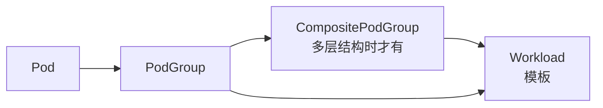

### 1.2 和 Volcano 的名字对照

上游的几个缩写在后文会反复出现，先对一下：

| 上游 | 含义 | Volcano 里对应的东西 |
|---|---|---|
| WAS | 按工作负载调度这一整套工作的统称 | Volcano 的批调度模型 |
| `Workload` | 工作负载的静态模板 | 没有单独的对象 |
| `PodGroup` | 一组一起调度的 Pod | `PodGroup` |
| `CompositePodGroup` | 由多个 PodGroup 组成的组 | `PodGroup` 里的 `subGroupPolicy` |
| TAS | 拓扑感知调度 | 网络拓扑感知调度，基于 HyperNode |
| WAP | 组级抢占 | `preempt`、`reclaim`，以及组级的 `gangpreempt`、`gangreclaim` |

### 1.3 现在到哪一步了

| 版本 | 状态 | 主要变化 |
|---|---|---|
| v1.35 | Alpha | 首次引入 Workload API，PodGroup 还只是 Workload 里的一个字段 |
| v1.36 | Alpha | PodGroup 拆成独立对象，Pod 改用 `schedulingGroup` 关联；加入 TAS、WAP 和 Job 集成 |
| v1.37 | Beta | API 升到 `v1beta1`；PodGroup 开始整组排队、整组调度；新增 CompositePodGroup（Alpha） |
| v1.38（开发中） | Beta | CompositePodGroup、TAS、Job 集成升到 Beta；新增 Deployment 集成（Alpha） |
| v1.39（计划） | GA | PodGroup、TAS、WAP 计划 GA；CompositePodGroup 计划在 v1.40 |

有两点会影响我们怎么跟进。

一是 API 还不稳定。从 v1.35 到 v1.37 发生过两次不兼容变更，GA 时间也在 2026 年 11 月从 v1.38 推迟到了 v1.39。

二是默认不开启。到 v1.38 为止，这套功能涉及的 feature gate（`GenericWorkload`、`TopologyAwareWorkloadScheduling`、`CompositePodGroup`、`WorkloadWithJob` 等）全部默认关闭，需要在 kube-apiserver、kube-controller-manager 和 kube-scheduler 上手动打开。

### 1.4 上游明确不做的事

上游把边界划得很清楚。KEP-4671 的非目标里有这样一条：

> Bring fairness or multiple workload queues in kube-scheduler. Kueue and Volcano.sh will continue to provide this.

也就是说，kube-scheduler 内部仍然只有一个按优先级排序的调度队列，没有租户队列，没有配额，也没有跨队列的资源回收。

除此之外，上游也不做拓扑的自动发现，拓扑信息只能来自节点 label；目前也不支持“尽量靠近”这样的软拓扑约束。

## 2. kube-scheduler 怎么调度一个 PodGroup

### 2.1 流程

继续用上面 4 个 Pod 的例子。

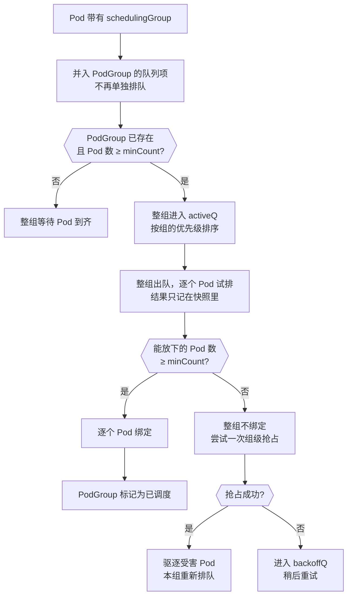

分步来看：

1. 排队。只要 Pod 带了 `schedulingGroup`，它就不再单独排队，而是并入所属 PodGroup 的队列项。队列里的一项对应一个 PodGroup，有嵌套时对应整棵树的根。组与组之间按组的优先级排序，优先级相同再比时间。
2. 等 Pod 到齐。进入调度之前有一道检查：PodGroup 对象必须已经存在，并且已创建的 Pod 数要达到 `minCount`。例子里就是等 4 个 Pod 都创建出来。
3. 试排。调度器把整组取出，按固定顺序为每个 Pod 跑一遍普通的 Filter 和 Score，选出节点。结果只记在这一轮的快照里：后面的 Pod 能看到前面的 Pod 占了哪些资源，但真正的调度缓存不动。
4. 检查 gang。每排完一个 Pod 检查一次。如果剩下的 Pod 即使全都能放下，总数也到不了 `minCount`，就提前结束。
5. 绑定或抢占。数量够了，就为每个 Pod 各自发起绑定，并把 PodGroup 的 `PodGroupInitiallyScheduled` condition 置为 True。数量不够，这一组一个 Pod 都不绑定，转而尝试一次组级抢占（见第 6 节）；抢占也不成，整组进入 backoffQ 稍后重试。

有几个细节值得知道：

- gang 保证的是调度决策整组做出。绑定仍然是逐个 Pod 异步进行的，从代码看，没有“某个 Pod 绑定失败就撤回其他 Pod”的逻辑。
- `minCount` 只在调度时检查。调度成功以后，即使有 Pod 被驱逐，`PodGroupInitiallyScheduled` 也不会变回 False。
- 调度循环是单协程的。一个大组试排期间，其他 Pod 和组都要等。
- 试排是贪心的，顺序固定，不回溯。组里的 Pod 规格不一样时，有可能存在可行的放法却排不出来。

### 2.2 v1.37 和 v1.38 的区别

两个版本的主流程一样，上面的图对两者都适用。区别主要在下面几处：

| | v1.37 | v1.38（开发中） |
|---|---|---|
| gang 的实现 | 试排检查之外，还保留了 Permit 阶段的等待，超时 5 分钟 | 去掉 Permit 等待，只靠试排时的检查 |
| CompositePodGroup | Alpha，最多 4 层 | Beta，最多 5 层，补上了状态和删除保护 |
| 候选拓扑域 | 全部评估 | 域很多时只评估一部分 |
| 工作负载集成 | Job（Alpha） | Job（Beta）、Deployment（Alpha） |
| `preemptionPolicy` 字段 | 需要单独的 feature gate | 直接可用 |

## 3. 上游 PodGroup 和 Volcano PodGroup

### 3.1 同一个任务在 Volcano 里

用 Volcano Job 提交同样的任务时，Volcano Job controller 创建的 PodGroup 大致是这样，Pod 通过 annotation 关联它：

```yaml
apiVersion: scheduling.volcano.sh/v1beta1
kind: PodGroup
metadata:
  name: train
spec:
  queue: default
  minMember: 4
  minResources:
    cpu: "16"
    memory: 64Gi
---
apiVersion: v1
kind: Pod
metadata:
  name: train-worker-0
  annotations:
    scheduling.k8s.io/group-name: train
spec:
  schedulerName: volcano
  ...
```

和 1.1 里的上游 PodGroup 对比，差别主要有四处。

- Volcano 的 PodGroup 必须属于一个 Queue，调度时先按队列的配额和公平性决定轮到谁。上游没有队列。
- Volcano 有入队准入。PodGroup 创建后是 Pending 状态，调度器确认队列里放得下 `minResources` 之后才把它置为 Inqueue，Volcano Job 的 Pod 也是在这之后才创建的。上游没有这一步，控制器直接创建 Pod。
- gang 的粒度不同。上游只有一个 `minCount`。Volcano 除了 `minMember`，还可以用 `minTaskMember` 要求每种角色的最少数量，比如“至少 1 个 ps 和 2 个 worker”。
- 状态的含义不同。上游只记录“是否曾经调度成功”。Volcano 的 `phase` 反映的是当前状态（Pending、Inqueue、Running 等），每个调度周期都会重新计算。

Volcano 这边的对象关系如下，实线是“创建”，虚线是“引用”。和 1.1 的图相比，少了 Workload 和 CompositePodGroup，多了 Queue 和 HyperNode：

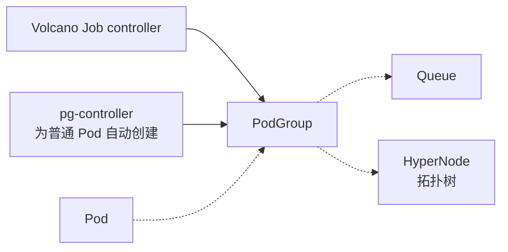

### 3.2 字段对照

| 含义 | 上游 PodGroup | Volcano PodGroup |
|---|---|---|
| Pod 如何关联 | `pod.spec.schedulingGroup` | annotation `scheduling.k8s.io/group-name` |
| 最少 Pod 数 | `schedulingPolicy.gang.minCount` | `minMember` |
| 每种角色的最少数 | 无 | `minTaskMember` |
| 最少资源量 | 无 | `minResources` |
| 队列 | 无 | `queue` |
| 优先级 | `priorityClassName`、`preemptionPolicy` | `priorityClassName` |
| 拓扑约束 | `schedulingConstraints.topology` | `networkTopology` |
| 子组 | 独立的 CompositePodGroup 对象 | `subGroupPolicy` |
| 被抢占时的单元 | `disruptionMode` | 无 |
| 组级 DRA | `resourceClaims` | 无 |
| 状态 | condition `PodGroupInitiallyScheduled` | `phase`、conditions、Pod 计数 |
| 创建后能否修改 | 只有 `minCount` 可以 | 可以 |

### 3.3 调度过程的差别

还是那个 4 个 Pod 的任务，资源充足。上游的过程是：

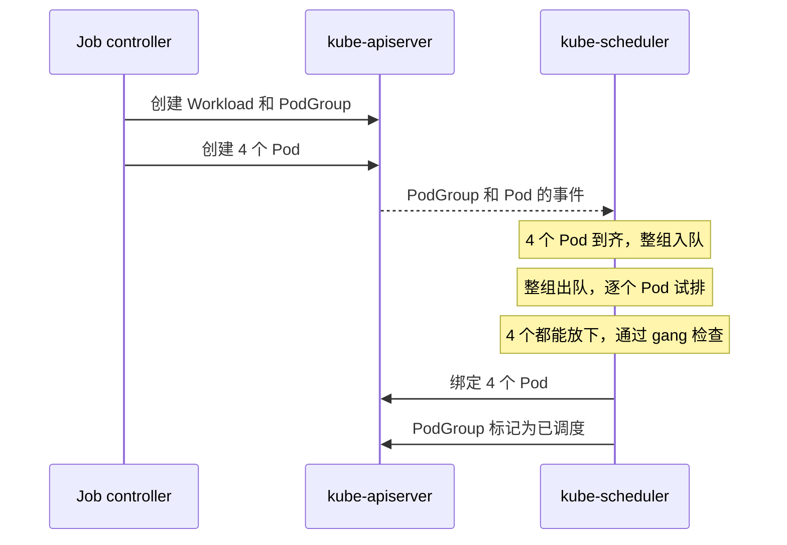

Volcano 的过程是：

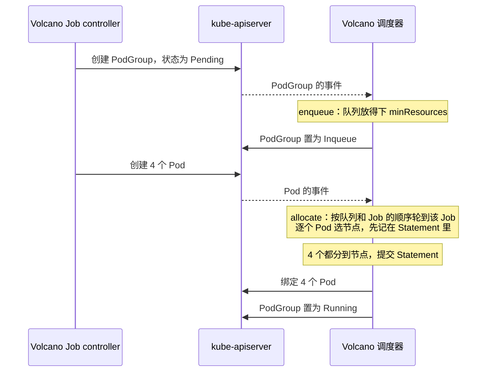

两边最大的不同是调度的节奏。kube-scheduler 是事件驱动的，每次从队列里取出一个组，为它做完决策再取下一个。Volcano 是周期性的，每个周期对集群做一次快照，按队列顺序和 Job 顺序处理快照里的所有 Job，所以它可以在队列之间权衡公平性和配额。

另外还有两点不同：

- 资源不够时，上游在同一轮里马上尝试抢占。Volcano 把抢占和回收放在 allocate 之后单独的 action 里，是否启用由配置决定。
- 调度失败后，上游把这个组放进 backoffQ 等待重试。Volcano 不需要单独的重试队列，下一个周期会重新处理所有未调度的 Job。

两边也有相同的地方：都是先在快照上把整组排完，确认满足 gang 再提交；绑定都是逐个 Pod 异步进行的。

## 4. CompositePodGroup 和 Volcano 的 SubGroup

LeaderWorkerSet、JobSet 这类工作负载有两层结构。举个例子：一个推理服务有 2 个副本，每个副本 4 个 Pod。要求每个副本内部的 4 个 Pod 一起调度并放在同一个机架，整个服务在同一个可用区，2 个副本都就绪才算成功。

两边对这种结构的建模方式不同。

上游用独立的对象。每个副本是一个 PodGroup，上面再套一个 CompositePodGroup：

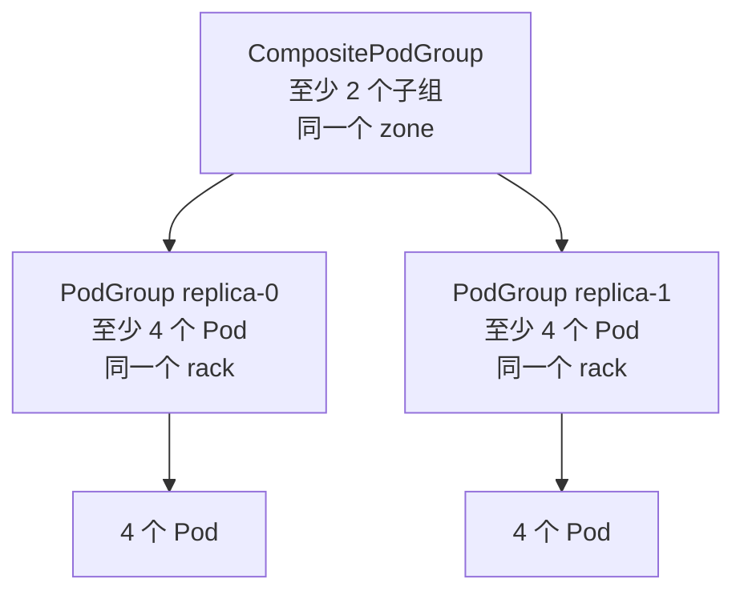

Volcano 只用一个 PodGroup，在 `subGroupPolicy` 里说明怎么按 Pod 的 label 把 Pod 分成子组，例子里是每 4 个 Pod 一个子组、至少 2 个子组。子组没有自己的对象：

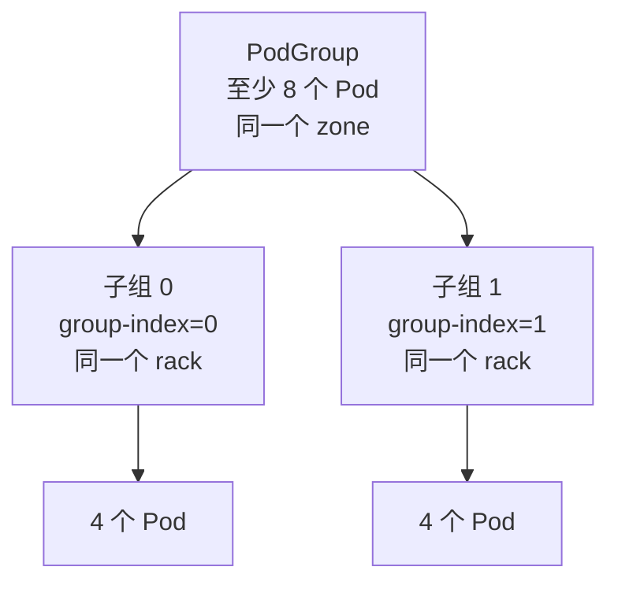

写成 YAML，上游是一个 Workload 模板，控制器再根据它创建 1 个 CompositePodGroup 和 2 个 PodGroup：

```yaml
apiVersion: scheduling.k8s.io/v1beta1
kind: Workload
metadata:
  name: serving
spec:
  compositePodGroupTemplates:
  - name: root
    schedulingPolicy:
      gang:
        minGroupCount: 2
    schedulingConstraints:
      topology:
      - key: topology.kubernetes.io/zone
    podGroupTemplates:
    - name: replica
      schedulingPolicy:
        gang:
          minCount: 4
      schedulingConstraints:
        topology:
        - key: topology.example.com/rack
```

Volcano 是一个 PodGroup，前提是集群里已经有对应层级的 HyperNode：

```yaml
apiVersion: scheduling.volcano.sh/v1beta1
kind: PodGroup
metadata:
  name: serving
spec:
  queue: default
  minMember: 8
  networkTopology:
    mode: hard
    highestTierAllowed: 2        # 假设第 2 层对应可用区
  subGroupPolicy:
  - name: replica
    subGroupSize: 4
    minSubGroups: 2
    labelSelector:
      matchLabels:
        app: serving
    matchLabelKeys:
    - group-index                # 取值相同的 Pod 属于同一个子组
    networkTopology:
      mode: hard
      highestTierAllowed: 1      # 假设第 1 层对应机架
```

两种模型的差别有三点。

- 层数。上游可以继续嵌套，CompositePodGroup 的子节点可以还是 CompositePodGroup，v1.37 最多 4 层，master 上是 5 层。JobSet → ReplicatedJob → Job 这样的三层结构可以直接表达。Volcano 固定是两层。
- 子组的大小。上游每个子组是独立对象，`minCount` 可以各不相同。Volcano 同一条 policy 下的子组大小相同，要表达不同大小的子组得写多条 policy。
- “至少几个子组”的算法。上游的 `minGroupCount` 对父节点下的所有子组统一计数。Volcano 的 `minSubGroups` 是每条 policy 各算各的。

所以上游的结构不是都能用 Volcano 现有的模型表达：

| 上游的结构 | Volcano 现有模型能否表达 |
|---|---|
| 单个 PodGroup | 能，`minCount` 对应 `minMember` |
| 一个 CompositePodGroup 下挂若干相同的 PodGroup | 能，对应一条 `subGroupPolicy` |
| 一个 CompositePodGroup 下挂不同的 PodGroup，全部必需 | 能，每种 PodGroup 对应一条 policy |
| 同上，但只要求其中任意几个 | 不能精确表达 |
| 三层及以上 | 不能 |

## 5. 拓扑感知调度（TAS）

两边想达到的效果一样：让一组 Pod 落在网络上相互靠近的节点上。区别在拓扑怎么描述。

上游没有拓扑对象，直接用节点 label。PodGroup 里写一个 label key，意思是“全组 Pod 必须落在这个 label 取值相同的节点上”。调度时，这个 label 的每个取值是一个候选域，调度器把每个域都试排一遍，在放得下的域里选得分最高的。

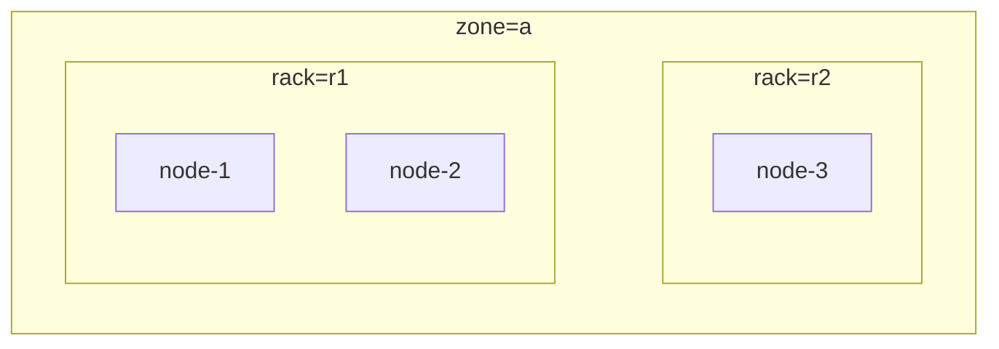

Volcano 用 HyperNode 这个 CRD 把拓扑显式地建成一棵树，PodGroup 里写的是“最高允许到第几层”。调度时从最低层开始找，找到能放下整组的最低一层就停。

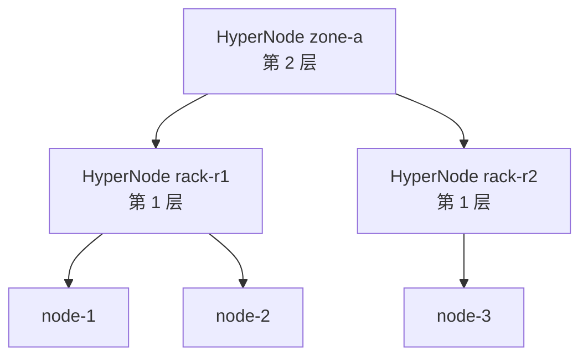

| | 上游 TAS | Volcano |
|---|---|---|
| 拓扑从哪来 | 节点 label | HyperNode，可以手工创建，也可以从 UFM 或节点 label 自动发现 |
| 约束怎么写 | 一个 label key | `highestTierAllowed` 或 `highestTierName` |
| 硬约束和软约束 | 只有硬约束 | 都支持 |
| 多层约束 | 靠 CompositePodGroup 嵌套，每层一个 key | Job 级和子组级各一个 |
| 怎么选域 | 逐个域试排，取得分最高的 | 从最低层往上找，能放下就停 |

上游的做法轻，节点有 label 就能用，不需要维护额外的对象，代价是只能表达“必须在同一个域里”。Volcano 需要先有 HyperNode，但能表达“尽量近，实在不行再放宽一层”。

对兼容来说，麻烦在于两边的写法不一样：上游给的是 label key，Volcano 要的是层级，中间需要一层映射，7.4 会再提到。

## 6. 抢占（WAP）

上游的组级抢占发生在整组调度失败之后，而且一组只做一次：

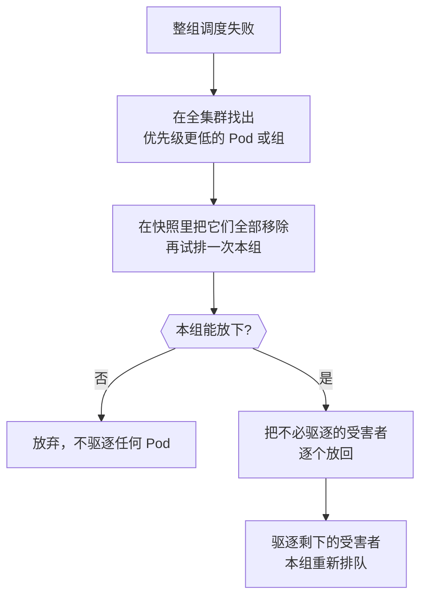

Volcano 的抢占是独立的 action。除了原有的 `preempt` 和 `reclaim`，现在还有组级的 `gangpreempt` 和 `gangreclaim`。以 `gangpreempt` 为例：

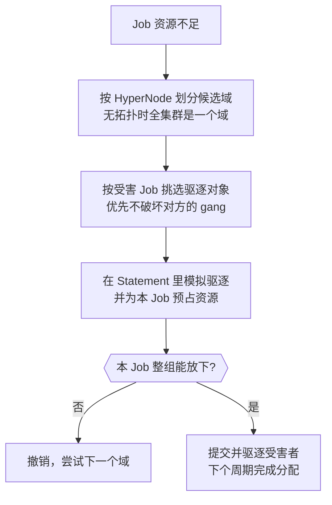

两边的思路是一致的：先在快照里模拟，确认抢占方整组放得下，才真正驱逐。不同之处如下：

| | 上游 WAP | Volcano |
|---|---|---|
| 触发原因 | 优先级 | 优先级，以及队列配额 |
| 受害单位 | 单个 Pod 或整组，由 `disruptionMode` 决定 | 单个 Pod；组级 action 下以受害 Job 为单位 |
| 默认是否保护受害方的 gang | 否 | 是 |
| 搜索范围 | 全集群 | 按节点；组级 action 按 HyperNode 域 |
| 执行时机 | 调度失败后立即执行 | 独立的 action，按配置启用 |

其中两点需要多说几句。

第一，Volcano 多一种抢占原因。上游只有“高优先级抢低优先级”。Volcano 还有跨队列回收：一个队列用的资源超过了它应得的份额，别的队列需要时可以收回来。上游没有队列，自然也没有这一项。

第二，两边对受害方的默认态度相反。上游的 `disruptionMode` 默认是 `single`，受害单位是单个 Pod，一个正在运行的 gang 可能被抢走一部分 Pod；想让它“要抢就整组一起抢”，需要显式写成 `all`。Volcano 默认保护受害 Job，驱逐不会让它的 Pod 数低于 `minAvailable`，只有显式允许时才会把整个 Job 一起驱逐。

## 7. Volcano 兼容上游 PodGroup

### 7.1 现状

Volcano 现在不识别上游 PodGroup。调度器判断 Pod 属于哪个 Job 时只看 annotation `scheduling.k8s.io/group-name`，不读 `pod.spec.schedulingGroup`，也没有 watch 上游的 PodGroup。

所以，如果把 1.1 里那个 Job 的 `schedulerName` 改成 `volcano`，按现在的代码，这些 Pod 会被当成普通 Pod 处理：pg-controller 为它们创建一个 `minMember=1` 的 Volcano PodGroup，4 个 Pod 逐个调度，gang 不生效。

### 7.2 兼容到什么程度

可以分三步，每一步都能独立交付：

| | 做到什么 | 能支持的工作负载 |
|---|---|---|
| 第一步 | 识别 `schedulingGroup`，支持 `minCount` 和优先级，回写上游 PodGroup 的状态 | 带 `spec.scheduling` 的原生 Job 和 Deployment |
| 第二步 | 支持 `disruptionMode`、拓扑约束和两层 CompositePodGroup | LeaderWorkerSet、JobSet 的常见用法 |
| 第三步 | 任意层数的 CompositePodGroup、组级 DRA | 所有使用上游 API 的工作负载 |

用上游 PodGroup 替换 Volcano PodGroup 不在考虑范围内。上游没有 `queue`、`minResources`、`minTaskMember` 这些字段，替换意味着丢功能。

### 7.3 两种做法

做法 A 是在 controller 里做转换。pg-controller watch 上游的 PodGroup，为它生成一个对应的 Volcano PodGroup，并给 Pod 打上 `group-name` annotation；调度完成后再把状态写回上游 PodGroup。调度器基本不用改。

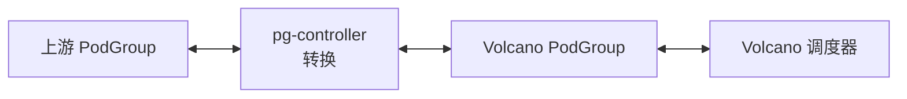

做法 B 是让调度器直接读上游对象。调度器的 cache watch 上游 PodGroup，把它直接转成内部的 JobInfo，并由调度器回写状态。

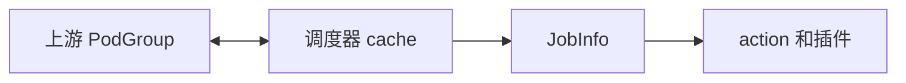

| | 做法 A：controller 转换 | 做法 B：调度器直接支持 |
|---|---|---|
| 调度器改动 | 很少 | 多，涉及 cache、JobInfo、状态回写、队列统计 |
| 额外对象 | 每个上游 PodGroup 多一个 Volcano PodGroup | 没有 |
| 一致性 | 两个对象之间有同步延迟 | 只有一份数据 |
| 能支持的层数 | 两层 | 把子组改成递归结构后可以支持任意层数 |
| 组级 DRA | 做不了 | 可以 |

建议先用做法 A。上游 API 还在 Beta，默认关闭，而且已经变过两次。把适配逻辑放在 controller 里，上游再变的时候调度器不用跟着改。

### 7.4 需要先定下来的问题

无论用哪种做法，下面几个问题都要先有答案。

**队列从哪来。** 上游 PodGroup 没有队列字段。可以沿用现在处理普通 Pod 的做法：读 Pod 或上层工作负载上的 `scheduling.volcano.sh/queue-name` annotation，没有就进 default 队列。

**`minResources` 怎么算。** 上游没有这个字段，而 Volcano 的入队准入要用它。可以由 controller 按已创建的 Pod 的资源请求累加出来。

**同名问题。** 两种 PodGroup 的资源名都是 `podgroups`，`kubectl get podgroups` 会有歧义。做法 A 生成的 Volcano PodGroup 也不能和用户已有的 PodGroup 重名，需要一个命名规则。

**`disruptionMode` 怎么对应。** `all` 要求整组一起被驱逐，Volcano 的组级驱逐已经能以 Job 为单位驱逐，可以在这个基础上实现。`single` 表示“允许拆散”，而不是“必须拆散”，所以可以保留 Volcano 现在保护受害 Job 的行为。

**拓扑 label key 怎么对应到 HyperNode 的层级。** HyperNode 已经可以从节点 label 自动生成，还缺一份“label key 对应第几层”的映射。这和 [#6161](https://github.com/volcano-sh/volcano/issues/6161) 想解决的问题是同一个方向。

**表达不了的结构怎么办。** 三层以上的嵌套、只要求其中任意几个子组的 `minGroupCount`，Volcano 现有模型表达不了。建议明确拒绝，并在上游 PodGroup 的状态里写明原因，不要悄悄按别的语义调度。

**集群里没有上游 API 怎么办。** 这套 API 只在开了 feature gate 的 v1.37 及以上集群里存在。Volcano 启动时要先探测，并把这部分功能放在 Volcano 自己的 feature gate 后面，默认关闭。

### 7.5 工作量

单位是人周，按熟悉 Volcano 调度器的工程师估算，包含单元测试、e2e 测试和文档，不含社区评审的时间。

| 目标 | 做法 | 工作量 |
|---|---|---|
| 第一步：原生 Job 的 gang 在 Volcano 上生效 | A | 4–6 人周 |
| 第二步：加上抢占语义、拓扑约束和两层子组 | A | 累计 12–20 人周 |
| 第三步：调度器直接支持，任意层数和组级 DRA | B | 33–51 人周，约 8–12 人月 |

第三步的数字是按做法 B 从头实现算的，不是在前两步基础上的增量。

各项工作的拆分如下：

| 工作项 | 做法 A | 做法 B |
|---|---|---|
| 基础设施：探测上游 API、informer、RBAC、feature gate、e2e 环境 | 1–2 | 1–2 |
| 单个 PodGroup：Pod 关联、`minCount`、优先级、队列、状态回写 | 3–4 | 6–8 |
| `preemptionPolicy`、`disruptionMode` 接入抢占和回收 | 2–4 | 2–4 |
| 拓扑 label key 到 HyperNode 层级的映射 | 2–3 | 2–3 |
| 没有 HyperNode 时直接按节点 label 划分域 | 不做 | 3–4 |
| 两层 CompositePodGroup 对应到 `subGroupPolicy` | 3–5 | 4–6 |
| 任意层数：把子组改成递归结构 | 做不了 | 10–16 |
| 组级 DRA | 做不了 | 4–6 |
| 用户文档 | 1–2 | 1–2 |

做法 B 贵在两处。一是调度器里直接使用 Volcano PodGroup 的地方很多，非测试代码有 44 个文件，每一处都要确认换成上游对象后是否成立。二是任意层数需要把现在两层的子组模型改成递归的，allocate、gang、网络拓扑和组级驱逐都要跟着改。

另外还有持续的成本：上游 API 到 GA 之前，每个 Kubernetes 版本预计需要 1–2 人周跟进变更。

### 7.6 建议

现在可以做第一步，放在 feature gate 后面，默认关闭。投入不大，能让带 `spec.scheduling` 的原生 Job 在 Volcano 上按 gang 调度，同时用上 Volcano 的队列。

第二步看需求。如果有用户用上游 API 跑 LeaderWorkerSet 或 JobSet，并且希望由 Volcano 调度，再往下做。

第三步等上游 GA 之后再评估。现在投入的风险在于 API 还会变，而且默认关闭期间真正用到它的集群不多。

需要持续关注的是生态的走向。JobSet、LeaderWorkerSet、Kubeflow Trainer、KubeRay、Spark Operator 都在对接上游的 Workload API。如果它们以后默认用上游 API 来声明 gang，Volcano 又不识别，这些工作负载在 Volcano 上就只能逐个 Pod 调度。Kueue 也在做类似的集成，可以参考它的计划：[kubernetes-sigs/kueue#8871](https://github.com/kubernetes-sigs/kueue/issues/8871)。

## 参考资料

上游的设计文档：

- [KEP-4671 Gang Scheduling](https://github.com/kubernetes/enhancements/tree/master/keps/sig-scheduling/4671-gang-scheduling)：Workload 和 PodGroup API
- [KEP-6012 CompositePodGroup API](https://github.com/kubernetes/enhancements/tree/master/keps/sig-scheduling/6012-composite-podgroup-api)
- [KEP-5732 Topology-aware workload scheduling](https://github.com/kubernetes/enhancements/tree/master/keps/sig-scheduling/5732-topology-aware-workload-scheduling)
- [KEP-5710 Workload-aware preemption](https://github.com/kubernetes/enhancements/tree/master/keps/sig-scheduling/5710-workload-aware-preemption)
- [KEP-6089 WAS Controller APIs](https://github.com/kubernetes/enhancements/tree/master/keps/sig-scheduling/6089-was-controller-apis)：`Job.spec.scheduling` 等字段的来源
- [KEP-5547 Integrate Workload APIs with Job controller](https://github.com/kubernetes/enhancements/tree/master/keps/sig-apps/5547-integrate-workload-with-job)
- [Kubernetes v1.37: Advancing Workload-Aware Scheduling](https://kubernetes.io/blog/2026/09/08/kubernetes-v1-37-advancing-workload-aware-scheduling/)（官方博客）

Volcano 的设计文档：

- [Network Topology Aware Scheduling](../design/Network%20Topology%20Aware%20Scheduling.md)
- [gang-aware-eviction-design](../design/gang-aware-eviction-design.md)

想看代码可以从这几处开始：

| 内容 | 位置 |
|---|---|
| 上游 PodGroup 的 API 定义 | kubernetes：`staging/src/k8s.io/api/scheduling/v1beta1/types.go` |
| 上游的整组调度 | kubernetes：`pkg/scheduler/schedule_one_podgroup.go` |
| 上游的 gang 检查 | kubernetes：`pkg/scheduler/framework/plugins/gangscheduling/` |
| 上游的组级抢占 | kubernetes：`pkg/scheduler/framework/preemption/podgrouppreemption.go` |
| Volcano PodGroup 的 API 定义 | volcano：`staging/src/volcano.sh/apis/pkg/apis/scheduling/v1beta1/types.go` |
| Volcano 判断 Pod 属于哪个 Job | volcano：`pkg/scheduler/api/job_info.go` 里的 `getJobID` |
| Volcano 为普通 Pod 创建 PodGroup | volcano：`pkg/controllers/podgroup/` |
| Volcano 的组级驱逐 | volcano：`pkg/scheduler/actions/gangpreempt/`、`gangreclaim/` |
