# Kubernetes 上游 Workload-Aware Scheduling 与 Volcano 对比分析

[English](./k8s-workload-aware-scheduling-vs-volcano.md) | 简体中文

> 基于 Kubernetes v1.37 / v1.38（开发版）、SIG Scheduling KEP 及 Volcano 主干代码整理，聚焦架构对比、调度机制与 Volcano 兼容评估。

**目录**

- [1. 核心结论与术语对照](#1-核心结论与术语对照)
- [2. 上游 PodGroup 现状与演进](#2-上游-podgroup-现状与演进)
- [3. kube-scheduler 的 PodGroup 调度流程（v1.37 vs v1.38）](#3-kube-scheduler-的-podgroup-调度流程v137-vs-v138)
- [4. 上游 PodGroup vs Volcano PodGroup](#4-上游-podgroup-vs-volcano-podgroup)
- [5. CompositePodGroup vs Volcano SubGroup](#5-compositepodgroup-vs-volcano-subgroup)
- [6. TAS（拓扑感知调度）对比](#6-tas拓扑感知调度对比)
- [7. WAP（组级抢占）与 Volcano 抢占回收对比](#7-wap组级抢占与-volcano-抢占回收对比)
- [8. Volcano 兼容上游 PodGroup：方案与工作量评估](#8-volcano-兼容上游-podgroup方案与工作量评估)
- [9. 参考资料](#9-参考资料)

---

## 1. 核心结论与术语对照

### 核心结论

- **定位互补而非替代**：Kubernetes 上游 WAS（Workload-Aware Scheduling）只解决**单个工作负载如何放置**（Gang、拓扑约束、组级抢占）。**多租户队列、配额、公平性与跨队列回收是明确的非目标**，KEP 明确指出这部分继续由 Volcano / Kueue 提供。
- **上游仍在 Beta，尚未默认启用**：`Workload` 与 `PodGroup` 在 v1.37 进入 `v1beta1`，`CompositePodGroup` 与 TAS 在 v1.38 进入 Beta，但**所有相关 Feature Gate 均默认关闭**。核心 API 的 GA 目标已推迟至 v1.39，`CompositePodGroup` 目标为 v1.40。
- **设计差异大，不能直接互换**：上游采用「不可变对象树 + 节点 Label 拓扑域」；Volcano 采用「带队列和准入语义的 PodGroup + 两层 SubGroup + HyperNode 拓扑树」，在队列治理、软拓扑约束和受害方 Gang 保护上能力更完整。
- **兼容建议「先外围、后原生」**：Volcano 当前尚未对接上游 `PodGroup` 和 `pod.spec.schedulingGroup`。建议在上游 GA 前通过 **Controller 镜像转换**优先覆盖扁平 Gang（4–6 人周）和两层拓扑/子组（12–20 人周），待 API GA 与生态稳定后再评估调度器原生全量支持（8–12 人月）。

### 术语对照

上游与 Volcano 的命名不同，核心概念对应关系如下：

| 上游概念 | 作用 | Volcano 对应能力 |
|---|---|---|
| **WAS**（Workload-Aware Scheduling） | 以工作负载为单位进行调度的整体体系 | Volcano 批调度模型（PodGroup / Job / Queue） |
| **Workload** | 静态模板，描述工作负载由哪些组构成 | 无独立对象，定义在 Volcano Job 等工作负载 spec 中 |
| **PodGroup**（`scheduling.k8s.io`） | 一组 Pod 的运行时调度单元 | **PodGroup**（`scheduling.volcano.sh`） |
| **CompositePodGroup**（CPG） | 由多个 PodGroup 或子 CPG 组成的层级组 | `PodGroup.spec.subGroupPolicy`（SubGroup） |
| **TAS**（Topology-Aware Scheduling） | 拓扑感知放置 | Network Topology Aware Scheduling（HyperNode） |
| **WAP**（Workload-Aware Preemption） | 组级抢占 | `preempt` / `reclaim` 与 `gangpreempt` / `gangreclaim` |

---

## 2. 上游 PodGroup 现状与演进

> **一句话总结**：Kubernetes 自 v1.35 起通过 WAS 体系原生引入工作负载级调度；经过两次不兼容的 API 演进后，核心能力在 v1.37–v1.38 进入 Beta，但所有 Feature Gate 仍默认关闭。

### 2.1 演进时间线与成熟度

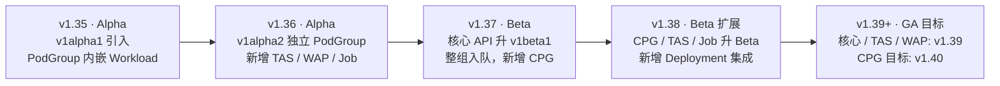

当前成熟度有三个关键信号：

1. **API 经历过两轮大改**：Pod 关联字段从 `workloadRef` 改为 `schedulingGroup`，`v1alpha2` 升级 `v1alpha3` 时未提供版本转换；直到 v1.37 进入 `v1beta1` 才基本定型。
2. **GA 节奏偏谨慎**：核心 API、TAS、WAP 的 GA 目标在 2026 年 11 月从 v1.38 推迟到 v1.39，v1.38 继续停留在 Beta。
3. **默认全部关闭**：在 v1.37 和 v1.38 中，使用这套能力仍需在 apiserver、controller-manager、scheduler 上显式打开 Feature Gate。

| Feature Gate | v1.37 | v1.38 | 说明 |
|---|---|---|---|
| `GenericWorkload` | Beta（默认关） | Beta（默认关） | 核心开关，已合入 Gang 与 WAP |
| `TopologyAwareWorkloadScheduling` | Alpha | Beta（默认关） | 拓扑感知放置（TAS） |
| `CompositePodGroup` | Alpha | Beta（默认关） | 多层级组模型，依赖前两项 |
| `DRAWorkloadResourceClaims` | Beta（默认关） | Beta（默认关） | PodGroup 级共享 DRA Claim |
| `WorkloadWithJob` | Alpha | Beta（默认关） | 原生 Job 自动生成 PodGroup |
| `WorkloadWithDeployment` | — | Alpha | Deployment / ReplicaSet 集成 |

### 2.2 对象模型与职责边界

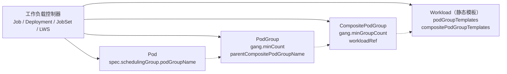

*实线表示创建关系，虚线表示引用关系。*

上游对象设计围绕三个核心原则展开：

- **模板与运行时解耦**：工作负载控制器按 `Workload → PodGroup → Pod` 的顺序创建对象。`Workload` 只做声明模板，**kube-scheduler 不 watch 它**，调度器只消费运行时的 `PodGroup`、`CompositePodGroup` 和 `Pod.spec.schedulingGroup`。
- **PodGroup 极简且基本不可变**：仅包含放置决策必需的字段——`schedulingPolicy`（`basic` 或 `gang.minCount`）、`schedulingConstraints.topology`（最多 1 个节点 Label Key）、`disruptionMode`（`single` / `all`）、优先级与抢占策略、最多 4 个共享 DRA `resourceClaims`。全 spec 中**只有 `minCount` 可修改**；status 仅回写 `PodGroupInitiallyScheduled` condition（首次调度成功后永久为 `True`，不再回退）。
- **面向生态开放，明确划出边界**：
  - **生态接入**：`scheduling.k8s.io/v1` 提供公共嵌入结构体（如 `Job.spec.scheduling`）；除原生 Job / Deployment 外，KEP-6089 同步规划了 JobSet、LeaderWorkerSet、Kubeflow Trainer、Spark Operator、KubeRay 等控制器的集成。
  - **明确非目标**：KEP-4671 / 5732 / 5710 / 6012 明确不做**多租户队列、公平性、资源配额、拓扑自动发现、软拓扑约束（preferred）以及被抢占后的重调度**——上游调度器内部仍然只有单一优先级队列。

---

## 3. kube-scheduler 的 PodGroup 调度流程（v1.37 vs v1.38）

> **一句话总结**：从 v1.37 起，带 `schedulingGroup` 的 Pod 不再逐个排队，而是按根组整体入队、在单个调度周期内完成全组评估与放置决策，不满足 `minCount` 时整组不绑定并只触发一次组级抢占。

### 3.1 端到端调度流程

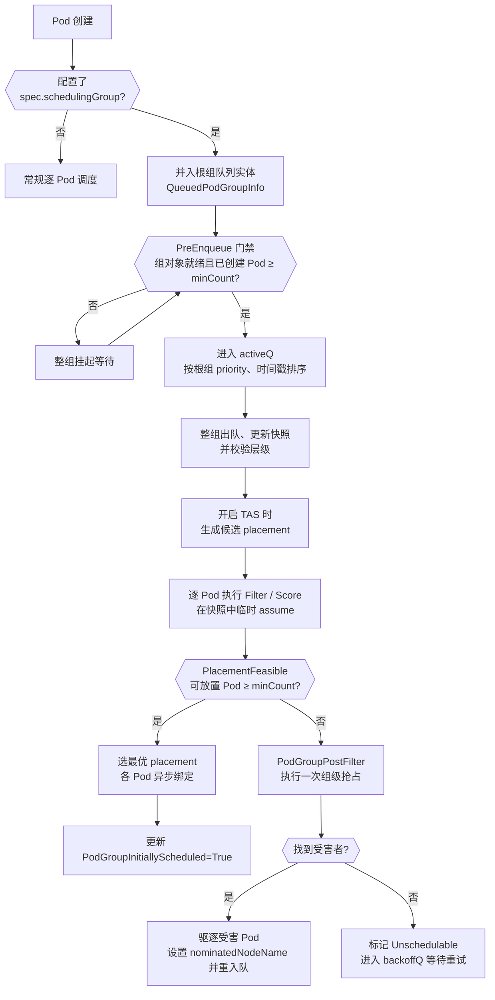

整条链路可以拆为四个关键环节理解：

1. **整组入队与 PreEnqueue 门禁**：无论策略是 `basic` 还是 `gang`，只要 Pod 带 `spec.schedulingGroup`，就会并入其根组（独立 PodGroup 或 CPG 树根）对应的 `QueuedPodGroupInfo`。只有当 PodGroup 及其所有祖先已创建、且已创建的 Pod 数量达到 `minCount`（且无 Pod 被 scheduling gate 阻塞）时，整组才进入 `activeQ`。
2. **单周期沙盒评估与剪枝**：调度循环为单协程。出队后按固定顺序逐个 Pod 跑完整的 Filter / Score，并在快照中临时 assume 供后续 Pod 感知资源变化，周期结束时统一回滚，不污染真实缓存。每评估一个 Pod 都会调用 `GangScheduling.PlacementFeasible`：若「已放置 + 未评估 < `minCount`」则提前终止，避免无效计算。
3. **决策、绑定与退避重试**：满足 `minCount` 时选择得分最高的 placement，为成功分配的 Pod 各自发起异步 binding cycle（all-or-nothing 保障的是调度决策，绑定阶段无组级回滚）；若 `minCount < 总 Pod 数`，可放置的部分先绑定，其余重新入队。整组失败时先走一次组级抢占，仍无解则进入 `backoffQ`（退避上限 `podMaxBackoff × √Pod数`，目前尚未支持 PodGroup 级 queueing hints）。
4. **四个新增调度扩展点**：
   - `PlacementGenerate`：生成候选节点子集（内置 `TopologyPlacement`）。
   - `PlacementScore`：为可行 placement 打分（内置 `PodGroupPodsCount`、`NodeResourcesFit`）。
   - `PlacementFeasible`：判断当前进度是否满足组策略（内置 `GangScheduling`）。
   - `PodGroupPostFilter`：整组无解时触发一次（内置 `DefaultPreemption`、`DynamicResources`）。

### 3.2 正常调度时序（v1.38）

以 `gang.minCount = N`、资源充足的场景为例：

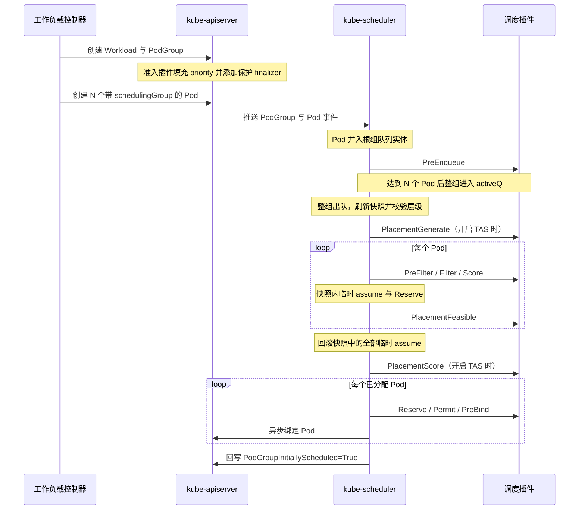

### 3.3 v1.37 到 v1.38 的关键演进

v1.38 的核心工作集中在**去掉过渡设计、提升大规模性能、补齐层级能力与完善控制器生态**：

| 演进方向 | v1.37 | v1.38（开发版） |
|---|---|---|
| **Gang 机制简化** | 保留固定 5 分钟超时的 Permit 屏障；`PlacementFeasible` 为内部钩子 | **移除 Permit 屏障**，完全由公开可配置的 `PlacementFeasible` 扩展点驱动 |
| **Placement 搜索性能** | 评估全部候选域；只调用首个 `PlacementGenerate` 插件 | 新增 **`percentageOfPlacementsToScore`**（自适应截断，下限 5%）、随机打散、nominated placement 快速路径、多插件结果求交 |
| **CompositePodGroup 完善** | Alpha（仅 `v1alpha3`），树深上限 4，无状态回写和删除保护 | 升 **Beta（进入 `v1beta1`）**，树深上限扩至 **5**，补齐整树层级校验、condition 回写与 finalizer 保护 |
| **抢占与框架重构** | 逻辑集中在 1400+ 行的单文件中 | 拆分 `algorithm_podgroup.go`，抽象 `PreemptionManager` 与 `RankNodes`；移除 `PodGroupPreemptionPolicy` gate |
| **工作负载集成** | Job 集成 Alpha；公共嵌入类型位于 `v1alpha3` | Job 集成升 **Beta**（suspend 时删除 PodGroup），新增 Deployment 集成（Alpha）；公共嵌入类型进入 `scheduling.k8s.io/v1` |

> **当前实现的几个已知局限**
> - **单协程阻塞风险**：一个大组的完整评估（Pod 数 × 候选 placement，抢占时还需重跑）都在单协程周期内完成，可能拖慢同集群其他调度。
> - **贪心无回溯**：按固定顺序逐 Pod 决策，异构工作负载不保证一定找到可行解；且同层级内所有 Pod 必须共享相同的 `schedulerName`、优先级和抢占策略。
> - **运行时与生态能力尚不完整**：Gang 仅在调度决策期生效；DRA 组级 PostFilter 暂不支持带拓扑约束的 PodGroup 和 CPG；尚无 Cluster Autoscaler 组级集成。

---

## 4. 上游 PodGroup vs Volcano PodGroup

> **一句话总结**：两者虽同名，但定位截然不同——上游 PodGroup 是纯粹的「放置单元」，Volcano PodGroup 是承载多租户队列、资源准入、状态机与网络拓扑的「批作业调度载体」。

### 4.1 架构模型对比

上游模型见 [2.2 节](#22-对象模型与职责边界)，Volcano 的对象关系如下：

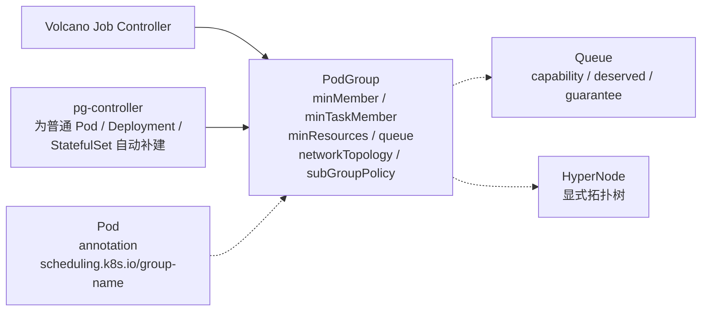

*实线表示创建关系，虚线表示引用关系。*

最直观的三个结构差异：

1. **是否绑定队列**：Volcano PodGroup 天然归属某个 `Queue`，参与配额与公平共享；上游没有队列概念。
2. **层级表达方式**：上游拆分出 `Workload` 和独立的 `CompositePodGroup` 对象树；Volcano 单对象内嵌 `subGroupPolicy`。
3. **Pod 关联方式**：上游通过不可变的 `pod.spec.schedulingGroup` 原生字段关联；Volcano 通过 `scheduling.k8s.io/group-name` annotation 关联。

### 4.2 核心字段与语义对比

| 维度 | 上游 PodGroup（`scheduling.k8s.io/v1beta1`） | Volcano PodGroup（`scheduling.volcano.sh/v1beta1`） |
|---|---|---|
| **Pod 关联** | `pod.spec.schedulingGroup.podGroupName`（不可变） | annotation `scheduling.k8s.io/group-name` |
| **Gang 判定** | 单一 `schedulingPolicy.gang.minCount` | 三重校验：Job 级 `minMember` + 角色级 `minTaskMember` + 子组级 `subGroupSize` / `minSubGroups` |
| **资源与入队准入** | 无 `minResources`，无入队准入，控制器直接创建 Pod | `enqueue` action 按 `minResources` 与队列容量将状态从 `Pending` 置为 `Inqueue`；Volcano Job 在入队后才创建 Pod |
| **队列与排序** | 单一队列，按根组优先级 + 时间戳排序 | Queue 顺序 → Job 顺序（priority / gang / drf / sla 等插件）→ SubJob → Task |
| **拓扑约束** | 1 个节点 Label Key，仅硬约束 | 基于 HyperNode 的 `networkTopology`，支持 `hard` / `soft` 及组间反亲和 `topologyAffinity` |
| **抢占声明** | `disruptionMode: single / all`、`preemptionPolicy` | 由抢占/回收 action 与插件控制，`volcano.sh/preemptable` 控制是否可被抢占 |
| **组级 DRA** | 支持 `resourceClaims[]`（最多 4 个） | 暂不支持 |
| **状态语义** | 仅记录「是否曾调度成功」（`PodGroupInitiallyScheduled`，有 status 子资源） | 完整生命周期 `phase`（Pending / Inqueue / Running / Unknown / Completed）+ condition + Pod 计数（无 status 子资源，整对象 Update） |
| **可变性与保护** | 仅 `minCount` 可变；有 finalizer 保护直到 Pod 全终止 | 字段可修改；依赖 `ownerReference` 清理 |

### 4.3 调度执行模型对比

Volcano 调度一个 Gang Volcano Job 的完整时序如下（对于普通 Pod，则先有 Pod 再由 `pg-controller` 补建 PodGroup）：

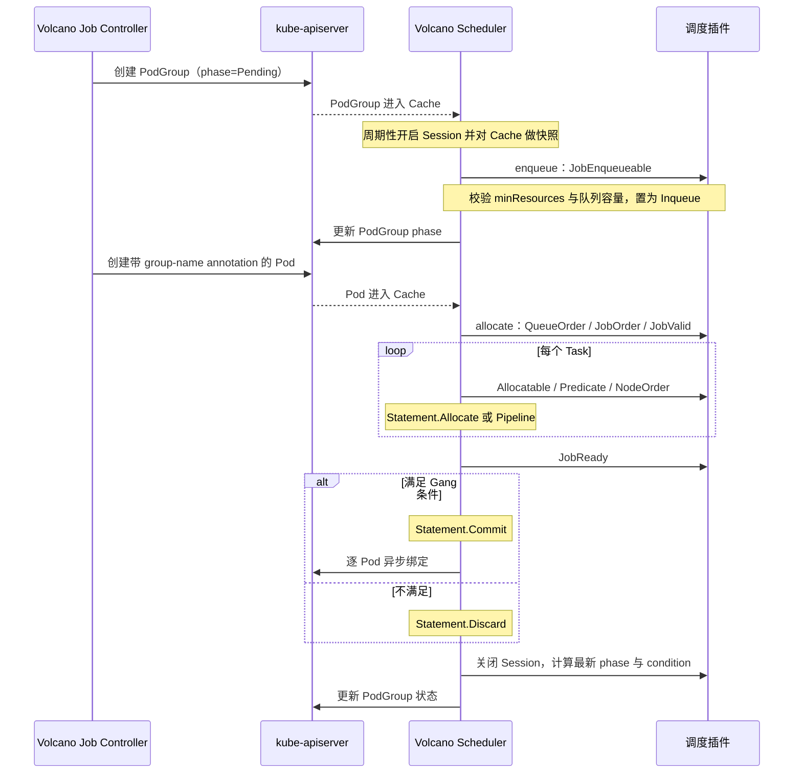

| 维度 | kube-scheduler | Volcano Scheduler |
|---|---|---|
| **调度触发** | 事件驱动，每次出队处理一个根组 | 周期性 Session，单次快照内批量处理多个队列与 Job |
| **事务机制** | 快照内临时 assume，周期末全部回滚后再逐 Pod 绑定 | `Statement`（Allocate / Pipeline / Evict），满足 `JobReady` 则 Commit，否则 Discard |
| **抢占时机** | 同一调度周期内直接执行一次组级抢占 | 由 `preempt` / `reclaim` / `gangpreempt` / `gangreclaim` 等独立 Action 分阶段处理 |
| **资源预留** | Pod 级 `nominatedNodeName` | Session 内 Pipelined 预占未来释放资源，并配合 `nominatedNodeName` 与 `NominatedHyperNode` |
| **失败重试** | 进入 `backoffQ` 退避后重新入队 | 下个 Session 重新评估，可借 unschedulable-job cache 跳过 |
| **绑定语义** | 逐 Pod 异步绑定，无组级回滚 | 逐 Pod 异步绑定，无组级回滚 |

---

## 5. CompositePodGroup vs Volcano SubGroup

> **一句话总结**：上游用「独立对象树（最多 5 层）」支持任意嵌套和多角色拓扑；Volcano 用「单对象内嵌 `subGroupPolicy`（固定 2 层）」降低对象管理成本。两层场景大多可互转，三层及以上 Volcano 暂无法表达。

### 5.1 层级结构直观对比

上游通过独立的 `CompositePodGroup` 与 `PodGroup` 组成树状结构（叶子节点为 PodGroup，v1.38 支持最多 5 层）：

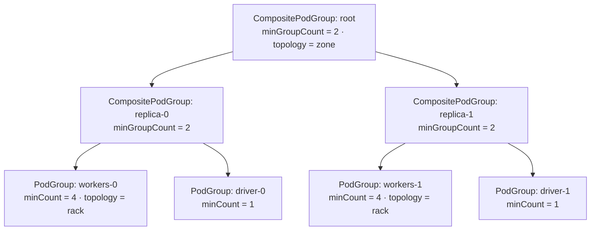

Volcano 在单个 PodGroup 内通过 `subGroupPolicy` 按 Pod Label 划分出固定两层结构（上图的三层结构无法直接表达，两层形态如下）：

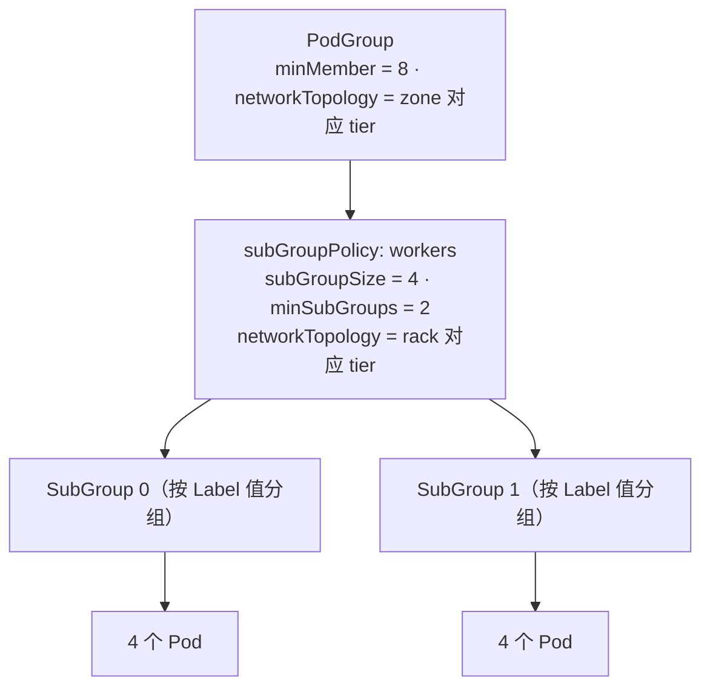

### 5.2 同一需求的 YAML 实战对比

> **场景**：部署 2 个副本组，每组 4 个 Pod；要求每组内 Pod 落在同一个机架（rack），整体落在同一个可用区（zone），2 个组全部就绪才启动。

**上游写法**（先声明 `Workload`，由控制器展开为 1 个 `CompositePodGroup` + 2 个 `PodGroup`）：

```yaml
apiVersion: scheduling.k8s.io/v1beta1
kind: Workload
metadata:
  name: serving
spec:
  compositePodGroupTemplates:
  - name: root
    schedulingPolicy:
      gang:
        minGroupCount: 2
    schedulingConstraints:
      topology:
      - key: topology.kubernetes.io/zone
    podGroupTemplates:
    - name: replica
      schedulingPolicy:
        gang:
          minCount: 4
      schedulingConstraints:
        topology:
        - key: topology.example.com/rack
```

**Volcano 写法**（单个 `PodGroup` 完成定义，依赖集群已配置对应层级的 HyperNode）：

```yaml
apiVersion: scheduling.volcano.sh/v1beta1
kind: PodGroup
metadata:
  name: serving
spec:
  queue: default
  minMember: 8
  networkTopology:
    mode: hard
    highestTierAllowed: 2        # tier 2 对应可用区
  subGroupPolicy:
  - name: replica
    subGroupSize: 4
    minSubGroups: 2
    labelSelector:
      matchLabels:
        app: serving
    matchLabelKeys:
    - group-index                # 同值 Pod 归入同一子组
    networkTopology:
      mode: hard
      highestTierAllowed: 1      # tier 1 对应机架
```

### 5.3 核心差异与映射可行性

| 维度 | CompositePodGroup | Volcano PodGroup + SubGroup |
|---|---|---|
| **形态与层数** | 独立 API 对象树，最多 5 层（v1.37 为 4 层） | PodGroup 内嵌列表，固定 2 层 |
| **子组划分** | 每个子组独立对象，Pod 显式引用 | `labelSelector` 圈选后按 `matchLabelKeys` 自动分组 |
| **父 / 子 Gang 计数** | 父级 `minGroupCount` 跨模板统一计数；各叶子 `minCount` 可独立设置 | 每个 policy 各自计 `minSubGroups`；同 policy 下子组大小固定为 `subGroupSize` |
| **多层拓扑** | 每一层可配一个 Label Key，自上而下逐层收窄 | Job 级与 SubGroup 级各配一个 `networkTopology` |
| **优先级与抢占单元** | 整棵树优先级必须一致；每层可设 `disruptionMode`（`all` 下不可嵌套 `single`） | Job 取 PodGroup 优先级，SubJob 取内部最高 Task 优先级；无 `disruptionMode` 字段 |
| **调度策略** | 单周期自上而下递归评估，兄弟按创建时间顺序、不回溯 | 先选 Job 级 HyperNode，再逐个为 SubJob 试分配并取得分最高者 |

**上游结构能否映射到 Volcano 现有模型？**

| 上游结构形态 | 映射可行性 | 说明 |
|---|---|---|
| 单个 PodGroup（`gang` / `basic`） | ✅ 完全支持 | `minCount` 直接对应 `minMember` |
| 1 个 CPG + 同模板的多个 PodGroup | ✅ 完全支持 | 对应单个 `subGroupPolicy`（`subGroupSize = minCount`，`minSubGroups = minGroupCount`） |
| 1 个 CPG + 多模板 PodGroup 且全部必需 | ✅ 完全支持 | 按模板拆成多个 policy，或结合 `minTaskMember` |
| 1 个 CPG + 多模板且 `minGroupCount < 子组总数` | ⚠️ 部分支持 | 上游是「跨模板任选若干子组」，Volcano 只能按 policy 分别计数 |
| 3 层及以上（如 JobSet → ReplicatedJob → Job） | ❌ 暂不支持 | 需将 Volcano SubGroup 扩展为递归树模型 |
| 每层差异化的 `disruptionMode` | ❌ 暂不支持 | Volcano 暂无对应声明式字段 |

---

## 6. TAS（拓扑感知调度）对比

> **一句话总结**：上游 TAS 依赖节点 Label 定义「同域硬约束」，零额外资源、上手极轻；Volcano 维护显式 HyperNode 拓扑树，换取了软/硬约束、层级就近优选与拓扑自动发现能力。

### 6.1 拓扑建模方式对比

上游没有拓扑对象，节点上相同的 Label 取值即隐式构成一个候选 placement：

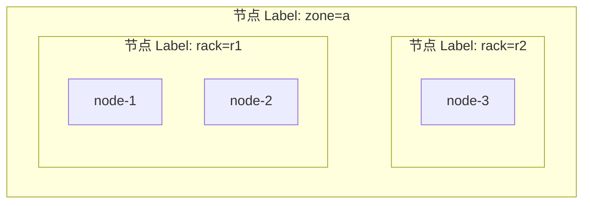

Volcano 使用显式的 HyperNode CRD 构建拓扑树（tier 越小越贴近物理节点）：

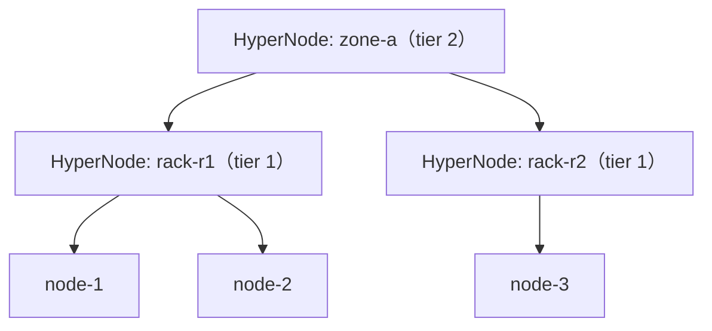

### 6.2 核心能力对比

| 维度 | 上游 TAS | Volcano Network Topology Aware Scheduling |
|---|---|---|
| **拓扑来源** | 节点 Label，无需维护额外对象 | HyperNode CRD（支持节点名、正则、Label 选择） |
| **拓扑自动发现** | 不支持（明确非目标） | HyperNode Controller 原生支持 `ufm` 与 `label` 发现器 |
| **约束表达** | 指定 1 个 Label Key：全组 Pod 必须落在同一取值域内 | `highestTierAllowed` / `highestTierName`：全组最近公共祖先不高于指定层级 |
| **硬 / 软约束** | **仅硬约束**（软约束留待后续） | 同时支持 **`hard` 与 `soft`** |
| **多层拓扑** | 依赖 CompositePodGroup 逐层嵌套 | Job 级 + SubGroup 级两层配合 |
| **搜索与剪枝** | 逐个 Label 取值域评估；v1.38 支持按比例截断 | 从最低 tier 向上逐层尝试，**找到可行最低层级即停止**（天然优选最紧凑拓扑） |
| **打分策略** | `PodGroupPodsCount`（放下越多越好）+ `NodeResourcesFit`（MostAllocated） | HyperNode 级 binpack + 基于拓扑层级的节点打分 |
| **已运行成员约束** | 新 Pod 只能进入已占用的 Label 域 | 自动收敛至已分配 HyperNode 的最近公共祖先范围内 |
| **与抢占结合** | 组级抢占时重跑带 placement 的调度算法 | `gangpreempt` / `gangreclaim` 按 HyperNode 域搜索（传统 `preempt` 会跳过带拓扑的抢占方） |

> **选型取舍**：如果集群仅需基于现有节点 Label 约束「同机架 / 同可用区」，上游 TAS 接入成本更低；若面临大规模 AI 训练常见的多级交换机拓扑、软约束兜底或 IB/UFM 自动发现，Volcano 的 HyperNode 体系优势明显。

---

## 7. WAP（组级抢占）与 Volcano 抢占回收对比

> **一句话总结**：双方都实现了「抢占方按整组决策、凑不够不驱逐」，核心分歧有两点：Volcano 多出跨队列资源回收，且双方在「默认是否保护受害方 Gang」上立场相反。

### 7.1 先看清两个最核心的分歧

1. **驱动因素不同**：上游 WAP 只有基于**优先级**的抢占；Volcano 除队列内优先级抢占（`preempt` / `gangpreempt`）外，还具备按队列 `deserved` / `guarantee` 触发的**跨队列回收**（`reclaim` / `gangreclaim`）。
2. **默认是否保护受害方 Gang 立场相反**：
   - **上游默认不保护**：`disruptionMode` 默认值为 `single`，允许按单个 Pod 拆散运行中的低优先级 Gang；只有显式配置 `disruptionMode: all` 时，才会以整组（最高 `all` 祖先）作为原子受害单元。
   - **Volcano 默认保护**：传统 `preempt` 绝不把受害 Job 压到 `minAvailable` 以下；`gangpreempt` 优先使用不打破受害方 Gang 的 safe bundle，仅在开启 `allowWholeBundle` 且插件放行时才整体驱逐受害 Job。

### 7.2 执行流程对比

**上游 WAP（`PodGroupPostFilter`，整组失败后同周期执行一次）**：

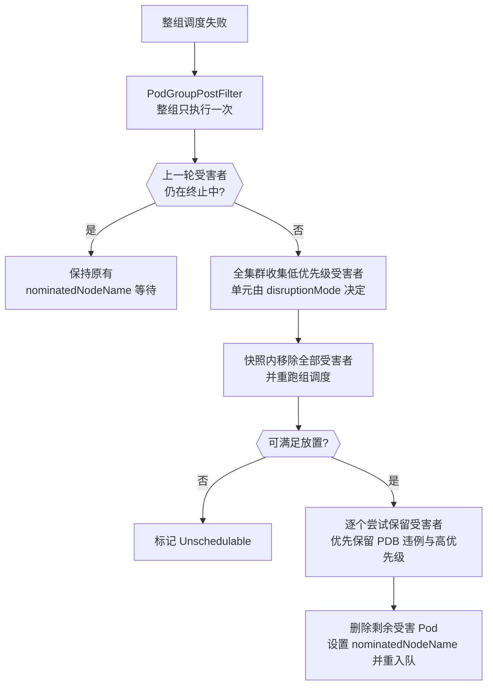

**Volcano 组级驱逐（`gangpreempt` Action）**：

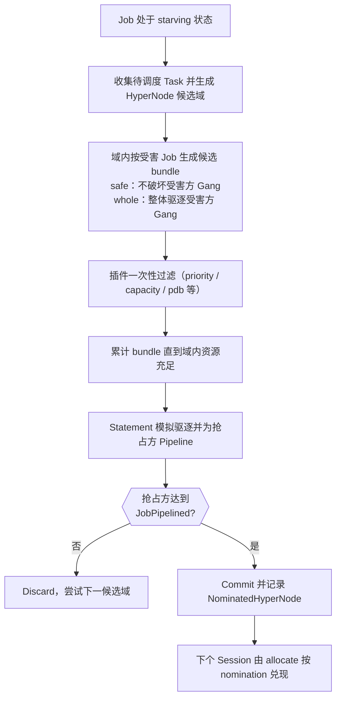

### 7.3 关键维度对比

| 维度 | 上游 WAP | Volcano 抢占 / 回收 |
|---|---|---|
| **执行入口** | 调度周期内，整组失败后立刻触发 | 独立 Action：`preempt` / `reclaim` / `gangpreempt` / `gangreclaim` |
| **触发驱动** | 仅优先级 | 优先级（抢占）+ 队列配额（跨队列回收） |
| **受害单元** | `single`（单 Pod）或 `all`（最高 `all` 祖先整组） | 传统模式为单 Task；Gang 模式为 safe bundle / whole bundle |
| **受害方 Gang 保护** | 默认不保护（`single`），需显式设 `all` | 默认保护 `minAvailable` |
| **搜索范围** | 全集群统一评估（结合 TAS 时重跑 placement） | 传统按节点；Gang 模式按 HyperNode 域逐域搜索 |
| **优先级与策略** | 取 PodGroup 优先级（忽略 Pod 自身优先级），整树一致；组级 `preemptionPolicy` | Job 级取 PodGroup 优先级，内部用 Task 优先级；Pod 级 `preemptionPolicy` |
| **PDB 处理** | 尽力而为（优先保留违反 PDB 的受害者，但不硬禁止） | 由 `pdb` 插件过滤（开启时生效） |
| **抢占后衔接** | Pod 带 `nominatedNodeName` 等待，受害者终止前不重复抢占 | 下个 Session 的 `allocate` 走 nomination 快速路径 |

---

## 8. Volcano 兼容上游 PodGroup：方案与工作量评估

> **一句话总结**：Volcano 目前尚未消费上游 PodGroup；由于上游 API 仍在 Beta 且默认关闭，建议走「**Controller 镜像转换先行、GA 后视生态决定是否原生化**」的务实路线。

### 8.1 Volcano 现状盘点

- **仅有接口占位**：Volcano 依赖的 Kubernetes 代码已包含上游 PodGroup 类型，但 `pkg/scheduler/plugins/util/k8s/snapshot.go` 中的查询均返回空/未找到，`Framework.PodGroupManager()` 返回 `nil`。
- **未读取 `schedulingGroup`**：调度器关联 Pod 与 Job 的唯一入口是 `getJobID`（读取 `scheduling.k8s.io/group-name` annotation），暂无任何代码读取 `pod.spec.schedulingGroup`。
- **尚无 Informer 与 RBAC**：若今天直接把带 `schedulerName: volcano` 和 `schedulingGroup` 的 Pod 提交到 Volcano，`pg-controller` 会按普通 Pod 补建 `minMember=1` 的 Volcano PodGroup，上游的 Gang、拓扑和 `disruptionMode` 语义都不会生效。

### 8.2 兼容目标分级

| 级别 | 能力范围 | 用户获得的价值 |
|---|---|---|
| **L1 · 扁平 PodGroup** | 识别 `schedulingGroup`，遵守 `minCount`、优先级、队列归属，并回写 `PodGroupInitiallyScheduled` | 原生 `Job.spec.scheduling` 可无缝接入 Volcano，叠加多租户队列能力 |
| **L2 · 两层语义对齐** | 补齐 `disruptionMode`、`preemptionPolicy`、拓扑 Label Key 映射与两层 `CompositePodGroup` | 覆盖 JobSet、LWS 等主流两层 AI 工作负载 |
| **L3 · 完整原生支持** | 任意层级 `CompositePodGroup` + PodGroup 级 DRA `ResourceClaim` | 与 kube-scheduler 在上游 WAS API 上行为全面对齐 |
| **L4 · 替换 Volcano PodGroup** | 废弃 Volcano PodGroup，全面切换上游对象 | **不建议**——上游缺失 `queue`、`minResources`、`minTaskMember`、软拓扑、完整 `phase` 等批调度核心能力 |

### 8.3 两条技术路径对比

**路径 A：Controller 镜像转换**（改动集中在 `pg-controller`，双向同步 spec 与 status）

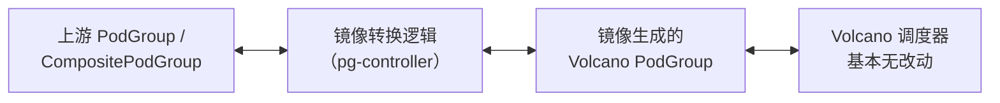

**路径 B：调度器原生支持**（Scheduler Cache 直接 watch 上游对象并回写 status）

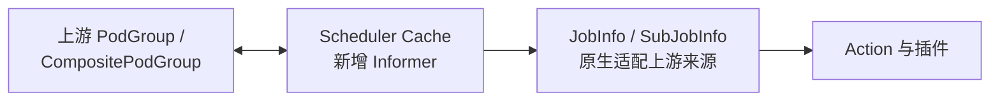

| 维度 | 路径 A：Controller 镜像转换 | 路径 B：调度器原生支持 |
|---|---|---|
| **核心做法** | Controller 将上游对象转为 Volcano PodGroup，并为 Pod 补打 `group-name` 与子组 Label | Cache 直接 watch 上游对象，`getJobID` 增加 `schedulingGroup` 分支并直接回写上游状态 |
| **调度器改动面** | 极小，隔离上游 API 变动风险 | 大（涉及 Cache、JobInfo、状态回写与队列统计） |
| **对象与一致性** | 每个组多一个镜像 PodGroup，存在同步延迟 | 单一数据源，无额外对象 |
| **能力上限** | 受 Volcano 两层 SubGroup 模型限制；无法支持组级 DRA | 可结合 SubJob 递归化支持任意层级与组级 DRA |
| **适用时机** | **当前推荐**：上游仍在 Beta、快速落地且风险可控 | 上游 API GA 且主流生态广泛采用后 |

### 8.4 需要优先拍板的核心设计缺口

| 设计问题 | 建议处理方式 |
|---|---|
| **队列与 `minResources` 缺失** | 队列复用 `scheduling.volcano.sh/queue-name` annotation 或命名空间默认队列；`minResources` 由 Controller 依据 Pod 模板/已创建 Pod 与 `minCount` 自动核算 |
| **同名资源与状态差异** | 镜像 PodGroup 加统一前缀避免 `namespace/name` 冲突；在 Volcano PodGroup 首次进入 `Running` 时向上游单向回写 `PodGroupInitiallyScheduled=True` |
| **入队准入与 Pod 创建时机** | 上游控制器会直接创建 Pod，沿用 Volcano 对普通 Pod 的处理方式：Pod 先创建，PodGroup 未 `Inqueue` 前不调度 |
| **`disruptionMode` 语义对齐** | `single` 保持 Volcano 默认的 Gang 保护（允许而非强制拆散）；`all` 在 bundle 生成时禁止产出 safe bundle |
| **拓扑 Key 映射** | 结合 `label` 发现器生成 HyperNode 并建立 Label Key → Tier 映射（与 [volcano#6161](https://github.com/volcano-sh/volcano/issues/6161) 方向一致） |
| **多层级与 API 兼容性** | 仅支持 `v1beta1` 及以上，不适配 Alpha；启动时通过 API Discovery 动态探测并配合 Volcano 独立 Feature Gate 控制；超出两层或跨模板部分计数在 L2 阶段明确拒绝并写入 condition |

### 8.5 工作量评估与分阶段路线

> 以下按熟悉 Volcano 调度器的工程师计，包含单元测试、E2E、集群验证与文档（不含社区评审周期）。代码盘点显示，调度器核心代码有 **44 个文件**（约 480 行）、Controller 有 **14 个文件**直接引用现有 PodGroup，这是路径 B 成本显著更高的主要原因。

**目标汇总**

| 兼容目标 | 推荐路径 | 包含工作项 | 预估工作量 |
|---|---|---|---|
| **L1 · 最小可用（扁平 Gang）** | 路径 A | W0 + W1 | **4–6 人周** |
| **L2 · 两层语义对齐** | 路径 A | W0–W3 + W5 + W8 | **12–20 人周** |
| **L3 · 完整原生支持** | 路径 B | W0–W8 | **33–51 人周（8–12 人月）** |

*另需考虑持续维护成本：在上游 API GA 之前，每个 Kubernetes 小版本预计需 1–2 人周跟进变更。*

**任务拆解明细（单位：人周）**

| 编号 | 工作项 | 涉及模块 | 路径 A | 路径 B |
|---|---|---|---|---|
| **W0** | 基础设施：API Discovery、Informer、RBAC、Feature Gate、E2E 环境 | controllers / scheduler / installer / hack | 1–2 | 1–2 |
| **W1** | 扁平 PodGroup：Pod 关联、`minCount`、优先级、队列来源、状态回写 | A：`controllers/podgroup`<br/>B：`scheduler/cache`、`api`、`framework`、队列指标 | 3–4 | 6–8 |
| **W2** | `preemptionPolicy` 与 `disruptionMode` 接入抢占/回收 | `scheduler/actions`（preempt / reclaim / gang*）、gang 插件 | 2–4 | 2–4 |
| **W3** | 拓扑 Label Key 到 HyperNode Tier 的映射 | hypernode controller、`network-topology-aware` | 2–3 | 2–3 |
| **W4** | 无 HyperNode 时直接按节点 Label 构建域 | `scheduler/api` HyperNode 缓存 | — | 3–4 |
| **W5** | 两层 `CompositePodGroup` 映射到 `subGroupPolicy` 及状态回写 | A：controller；B：cache 与 JobInfo | 3–5 | 4–6 |
| **W6** | 任意层级支持：SubJob 递归化 | allocate / gang / network-topology-aware / 组级驱逐 / `job_info` | 不适用 | 10–16 |
| **W7** | PodGroup 级 DRA：实现 `PodGroupManager` 与 `PodGroupState` | `plugins/util/k8s`、predicates | 不适用 | 4–6 |
| **W8** | 用户文档与语义差异说明 | docs | 1–2 | 1–2 |

**建议演进路线**

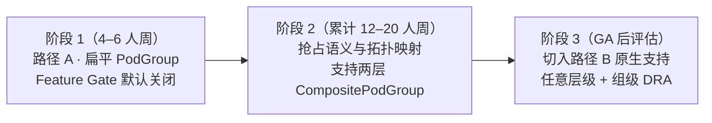

### 8.6 关键风险

- **API 变动风险**：三个版本内已发生两次不兼容修改且 GA 推迟，过早深度耦合调度器内核会导致反复返工。
- **短期受益面有限**：上游 Feature Gate 默认关闭期间，实际开启该特性的生产集群有限，适合先轻量化试点。
- **生态迁移压力**：若 KubeRay、Kubeflow Trainer、Spark Operator、JobSet 逐步将上游 WAS API 作为默认集成方式，Volcano 需要提前具备兼容承接能力，避免这些工作负载退化为逐 Pod 调度。
- **社区对标参考**：Kueue 已启动 WAS 集成规划（[kueue#8871](https://github.com/kubernetes-sigs/kueue/issues/8871)），其目标与 Volcano 的 L1 / L2 高度相近，可作为设计与演进参照。

---

## 9. 参考资料

**核心 KEP 与官方博客**

- [Kubernetes v1.37: Advancing Workload-Aware Scheduling](https://kubernetes.io/blog/2026/09/08/kubernetes-v1-37-advancing-workload-aware-scheduling/)
- [KEP-4671 Gang Scheduling](https://github.com/kubernetes/enhancements/tree/master/keps/sig-scheduling/4671-gang-scheduling) / [KEP-5832 Decouple PodGroup API](https://github.com/kubernetes/enhancements/tree/master/keps/sig-scheduling/5832-decouple-podgroup-api) / [KEP-6012 CompositePodGroup API](https://github.com/kubernetes/enhancements/tree/master/keps/sig-scheduling/6012-composite-podgroup-api)
- [KEP-5732 Topology-aware workload scheduling](https://github.com/kubernetes/enhancements/tree/master/keps/sig-scheduling/5732-topology-aware-workload-scheduling) / [KEP-5710 Workload-aware preemption](https://github.com/kubernetes/enhancements/tree/master/keps/sig-scheduling/5710-workload-aware-preemption)
- [KEP-6089 WAS Controller APIs](https://github.com/kubernetes/enhancements/tree/master/keps/sig-scheduling/6089-was-controller-apis) / [KEP-5729 DRA ResourceClaim for Workloads](https://github.com/kubernetes/enhancements/tree/master/keps/sig-scheduling/5729-resourceclaim-support-for-workloads)
- [KEP-5547 Job 集成](https://github.com/kubernetes/enhancements/tree/master/keps/sig-apps/5547-integrate-workload-with-job) / [KEP-6276 Deployment 集成](https://github.com/kubernetes/enhancements/tree/master/keps/sig-apps/6276-integrate-workload-with-deployment)

**相关设计文档与 Issue**

- Volcano 设计文档：[Network Topology Aware Scheduling](../design/Network%20Topology%20Aware%20Scheduling.md)、[gang-aware-eviction-design](../design/gang-aware-eviction-design.md)
- 社区跟踪：[kueue#8871](https://github.com/kubernetes-sigs/kueue/issues/8871)、[jobset#1365](https://github.com/kubernetes-sigs/jobset/issues/1365)、[lws#891](https://github.com/kubernetes-sigs/lws/issues/891)、[volcano#6161](https://github.com/volcano-sh/volcano/issues/6161)

<details>
<summary>核心源码路径索引（点击展开）</summary>

**Kubernetes（`kubernetes/kubernetes`）**

| 模块 | 路径 |
|---|---|
| API 与 `schedulingGroup` | `staging/src/k8s.io/api/scheduling/v1beta1/types.go`、`staging/src/k8s.io/api/core/v1/types.go` |
| Feature Gate | `pkg/features/kube_features.go` |
| 组调度与队列 | `pkg/scheduler/schedule_one_podgroup.go`、`pkg/scheduler/algorithm_podgroup.go`、`pkg/scheduler/backend/queue/scheduling_queue.go` |
| Gang / TAS / WAP 插件 | `pkg/scheduler/framework/plugins/gangscheduling/`、`topologyaware/`、`podgrouppodscount/`、`pkg/scheduler/framework/preemption/podgrouppreemption.go` |
| Job 集成 | `pkg/controller/job/job_scheduling_manager.go` |

**Volcano（`volcano-sh/volcano`）**

| 模块 | 路径 |
|---|---|
| PodGroup API 与 Job 关联 | `staging/src/volcano.sh/apis/pkg/apis/scheduling/v1beta1/types.go`、`pkg/scheduler/api/job_info.go`、`sub_job_info.go` |
| 调度与 Gang / 拓扑 / 驱逐 | `pkg/scheduler/actions/allocate/`、`gangpreempt/`、`gangreclaim/`、`pkg/scheduler/plugins/gang/`、`network-topology-aware/` |
| 上游接口占位与 Controller | `pkg/scheduler/plugins/util/k8s/snapshot.go`、`framework.go`、`pkg/controllers/podgroup/` |

</details>
