# Kubernetes 上游 Workload-Aware Scheduling 与 Volcano 对比调研

[English](./k8s-workload-aware-scheduling-vs-volcano.md) | 简体中文

本文回答五个问题：

1. 上游 Kubernetes 的 PodGroup 现在是什么状态；
2. kube-scheduler 在 v1.37 和 v1.38 中如何调度一个 PodGroup；
3. 上游 PodGroup 与 Volcano PodGroup 的差异，以及 CompositePodGroup 与 Volcano「PodGroup + SubGroup」的差异；
4. 上游的 WAS、TAS、WAP 与 Volcano 中对应能力的对比；
5. Volcano 如果要兼容上游 PodGroup，需要做什么、工作量多大。

## 调研基线与方法

| 对象 | 版本 |
|---|---|
| Kubernetes v1.37 | tag `v1.37.2` |
| Kubernetes v1.38（开发中，未发布） | `master` @ `d17192c`（2026-11-19），并对照 `v1.38.0-beta.0`（2026-11-06） |
| KEP | `kubernetes/enhancements` @ `ebf3757`（2026-11-18） |
| Volcano | `master` @ `993abc8de`，依赖 `k8s.io/kubernetes v1.37.1` |

- 所有结论来自阅读源码、KEP 和官方博客，**没有在真实集群上运行验证**。标注「推断」的内容是根据代码逻辑推出的，没有文档或注释直接说明。
- v1.38 尚未发布，本文描述的是上述 commit 的状态，正式版本可能仍有变化。
- 工作量一节是基于代码依赖盘点的工程估算，没有经过原型验证。

## 1. 结论速览

| 主题 | 结论 |
|---|---|
| 上游成熟度 | `Workload` / `PodGroup` 在 v1.37 进入 Beta（`scheduling.k8s.io/v1beta1`），但所有相关 feature gate **默认关闭**，v1.38 仍是如此。GA 目标在 2026-11 从 v1.38 推迟到 v1.39，CompositePodGroup 的 GA 目标是 v1.40。 |
| 上游定位 | 只做「一个工作负载如何放置」：gang、拓扑、组级抢占。**队列、配额、公平性是明确的非目标**，KEP 原文写明由 Kueue 和 Volcano 继续提供。 |
| 调度流程 | 从 v1.37 起，PodGroup 作为一个整体进入调度队列，在一个调度周期内为全组 Pod 做出放置决策；不满足 `minCount` 就整组不绑定，并只触发一次组级抢占。 |
| PodGroup 差异 | 上游 PodGroup 是不可变的运行时对象，由工作负载控制器创建，Pod 通过 `spec.schedulingGroup` 关联。Volcano PodGroup 多出 `queue`、`minResources`、`minTaskMember`、`phase` 和入队准入。两者同名但 API group 不同，语义不能直接互换。 |
| 层级模型 | CompositePodGroup 是独立对象组成的树，最多 5 层（v1.37 为 4 层）。Volcano 是 PodGroup 内嵌 `subGroupPolicy`，严格两层。两层以内大多可以互相表达，三层及以上 Volcano 目前无法表达。 |
| TAS | 上游用一个节点 label key 表达硬约束，没有软约束，没有拓扑发现。Volcano 用 HyperNode CRD 描述拓扑树，支持 hard / soft 和自动发现。 |
| 抢占 | 上游只有基于优先级的抢占，用 `disruptionMode` 定义受害单元。Volcano 除优先级抢占外还有跨队列回收，`gangpreempt` / `gangreclaim` 已实现组级驱逐。 |
| Volcano 现状 | Volcano 已经编译了上游 PodGroup 类型，但全部用空实现占位，没有任何地方读取 `pod.spec.schedulingGroup`。 |
| 兼容工作量 | 最小可用（扁平 gang）约 4–6 人周；两层语义对齐约 12–20 人周；调度器原生支持任意层级和 PodGroup 级 DRA 约 8–12 人月。详见第 9 节。 |

## 2. 名词对照

上游与 Volcano 的名字不同，但解决的问题相近：

| 上游名称 | 含义 | Volcano 中对应的能力 |
|---|---|---|
| WAS（Workload-Aware Scheduling） | 以工作负载而不是单个 Pod 为单位调度的整套工作 | Volcano 的批调度模型整体（PodGroup、Job、Queue） |
| `Workload` | 静态模板，描述工作负载由哪些组构成 | 没有独立对象，信息在 Volcano Job 或其他工作负载的 spec 中 |
| `PodGroup` | 一组 Pod 的运行时调度单元 | `PodGroup`（`scheduling.volcano.sh`） |
| `CompositePodGroup`（CPG） | 由 PodGroup 或 CPG 组成的组 | `PodGroup.spec.subGroupPolicy`（SubGroup） |
| Gang scheduling | all-or-nothing | `gang` 插件，`minMember` / `minTaskMember` |
| TAS（Topology-Aware Scheduling） | 拓扑感知放置 | Network Topology Aware Scheduling（HyperNode） |
| WAP（Workload-Aware Preemption） | 组级抢占 | `preempt` / `reclaim`，以及 `gangpreempt` / `gangreclaim` |

## 3. 上游 PodGroup 现状

### 3.1 演进时间线

| 版本 | API 版本 | 主要变化 |
|---|---|---|
| v1.35 | `v1alpha1` | 首次引入 Workload API（`GenericWorkload` Alpha）。PodGroup 内嵌在 Workload 中，Pod 用 `spec.workloadRef` 关联。 |
| v1.36 | `v1alpha2` | PodGroup 拆成独立的运行时对象；Pod 改用 `spec.schedulingGroup`。TAS、WAP、Job 集成、PodGroup 级 DRA ResourceClaim 以 Alpha 引入。 |
| v1.37 | `v1beta1` + `v1alpha3` | Workload / PodGroup、WAP、DRA ResourceClaim 升 Beta。`v1alpha2` 被 `v1alpha3` 取代，不提供转换。PodGroup 成为调度队列中的实体；`minCount` 变为可修改。新增 CompositePodGroup（Alpha）和 `Job.spec.scheduling`。 |
| v1.38（开发中） | `v1beta1` + `v1alpha3` | CompositePodGroup、TAS、Job 集成升 Beta；新增 Deployment 集成（Alpha）。核心 API 的 GA 计划被撤回，继续停留在 Beta。 |
| v1.39 及以后（计划） | `v1` | KEP 中 Workload / PodGroup、WAP、TAS 的 GA 目标为 v1.39，CompositePodGroup 为 v1.40。 |

两点值得注意：

- API 在三个版本内经历了两次不兼容变更（`workloadRef` → `schedulingGroup`，`v1alpha2` → `v1alpha3`）。
- GA 目标在 2026 年 11 月从 v1.38 推迟到 v1.39，KEP 没有说明原因。

### 3.2 对象模型

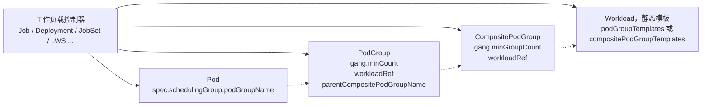

图中实线表示「创建」，虚线表示「引用」。

- `Workload` 只是模板，kube-scheduler 不 watch 它。调度器只读 `PodGroup`、`CompositePodGroup` 和 Pod 上的 `spec.schedulingGroup`。
- 这些对象都由工作负载控制器创建，创建顺序是 Workload → PodGroup → Pod。调度器不创建对象，只写 status。
- PodGroup 可以不引用任何 Workload（独立 PodGroup）；CompositePodGroup 必须引用 Workload。

### 3.3 PodGroup 的字段

以 `master` 上的 `scheduling.k8s.io/v1beta1` 为准，v1.37.2 的 PodGroup 字段与之相同。

| 字段 | 含义 | 可变性 |
|---|---|---|
| `spec.workloadRef` | 来源 Workload 及模板名，可选 | 不可变 |
| `spec.parentCompositePodGroupName` | 父 CompositePodGroup，为空表示是根 | 不可变 |
| `spec.schedulingPolicy.basic` | 不要求 all-or-nothing，但仍按组调度 | 策略类型不可变 |
| `spec.schedulingPolicy.gang.minCount` | 至少多少个 Pod 同时可调度才放行 | **可变** |
| `spec.schedulingConstraints.topology[]` | 拓扑约束，最多 1 项，只有一个 `key`（节点 label key） | 不可变 |
| `spec.disruptionMode` | `single`（默认）或 `all`，定义被抢占时的单元 | 不可变 |
| `spec.priorityClassName` / `priority` / `preemptionPolicy` | 组的优先级和抢占策略，由 Priority 准入插件解析 | 不可变 |
| `spec.resourceClaims[]` | 组内共享的 DRA ResourceClaim，最多 4 个 | 不可变 |
| `status.conditions` | `PodGroupInitiallyScheduled`、`DisruptionTarget` | 调度器写入 |
| `status.resourceClaimStatuses` | 由模板生成的 ResourceClaim 名字 | 控制面写入 |

`PodGroupInitiallyScheduled` 一旦为 True 就不会再回退，即使之后 Pod 被驱逐。它表达的是「首次调度成功」，不是「当前是否满足 gang」。

### 3.4 Feature gate

| Feature gate | v1.36 | v1.37 | v1.38（master） |
|---|---|---|---|
| `GenericWorkload` | Alpha | **Beta，默认关** | Beta，默认关 |
| `GangScheduling` | Alpha | 已并入 `GenericWorkload` | — |
| `WorkloadAwarePreemption` | Alpha | 已并入 `GenericWorkload` | — |
| `TopologyAwareWorkloadScheduling` | Alpha | Alpha | **Beta，默认关** |
| `CompositePodGroup` | — | Alpha | **Beta，默认关** |
| `PodGroupPreemptionPolicy` | — | Alpha | gate 移除，字段直接生效 |
| `DRAWorkloadResourceClaims` | Alpha | Beta，默认关 | Beta，默认关 |
| `WorkloadWithJob` | Alpha | Alpha | **Beta，默认关** |
| `WorkloadWithDeployment` | — | — | Alpha |

在 v1.37 和 v1.38 中，没有任何一个与工作负载调度相关的 gate 默认开启。要使用这套能力，需要在 kube-apiserver、kube-controller-manager、kube-scheduler 上显式开启。

### 3.5 谁来创建 PodGroup

- **Job**：`Job.spec.scheduling` 声明策略、拓扑约束、`disruptionMode` 和共享 ResourceClaim。开启 `WorkloadWithJob` 后，Job controller 为 Job 创建一个 Workload 和一个 PodGroup，并给 Pod 设置 `schedulingGroup`。不写 `spec.scheduling` 时默认是 `basic` 策略。`gang` 的 `minCount` 省略时默认等于 `parallelism`。
- **Deployment**（v1.38 Alpha）：Deployment controller 创建一个 Workload，ReplicaSet controller 为每个 ReplicaSet 创建一个 PodGroup。使用 gang 时要求 `strategy.type: Recreate`。
- **生态控制器**：KEP-6089 列出 JobSet、LeaderWorkerSet、Kubeflow Trainer、Spark Operator、KubeRay 已设计或正在实现集成。这是 KEP 作者的描述，本文没有逐个核实这些项目的进度。
- **controller building blocks**：`scheduling.k8s.io/v1` 中带 `Workload` 前缀的类型（如 `WorkloadPodGroupSchedulingPolicy`）不是独立的 API 对象，而是供各控制器嵌入自己 API 的公共结构，`Job.spec.scheduling` 用的就是它们。

### 3.6 上游明确不做的事

以下均为 KEP 原文中的非目标：

- KEP-4671：“Bring fairness or multiple workload queues in kube-scheduler. Kueue and Volcano.sh will continue to provide this.”
- KEP-5732：“To implement Workload-level queueing, fairness, or resource quotas within kube-scheduler.”
- KEP-5732：不做网络拓扑的自动发现，拓扑信息依赖节点 label。
- KEP-5710：不处理 PodGroup 之间优先级不一致的情况；不设计被抢占后的重调度。
- KEP-6012：不支持 preferred 拓扑约束；不保证多层调度结果最优。

上游调度器内部只有一个按优先级排序的调度队列。没有租户队列、没有 capacity / deserved、没有跨队列回收。

## 4. kube-scheduler 的 PodGroup 调度流程

### 4.1 整体流程

本节以开启 `GenericWorkload` 为前提。下图适用于 v1.37 和 v1.38，两个版本的差异见 4.4。

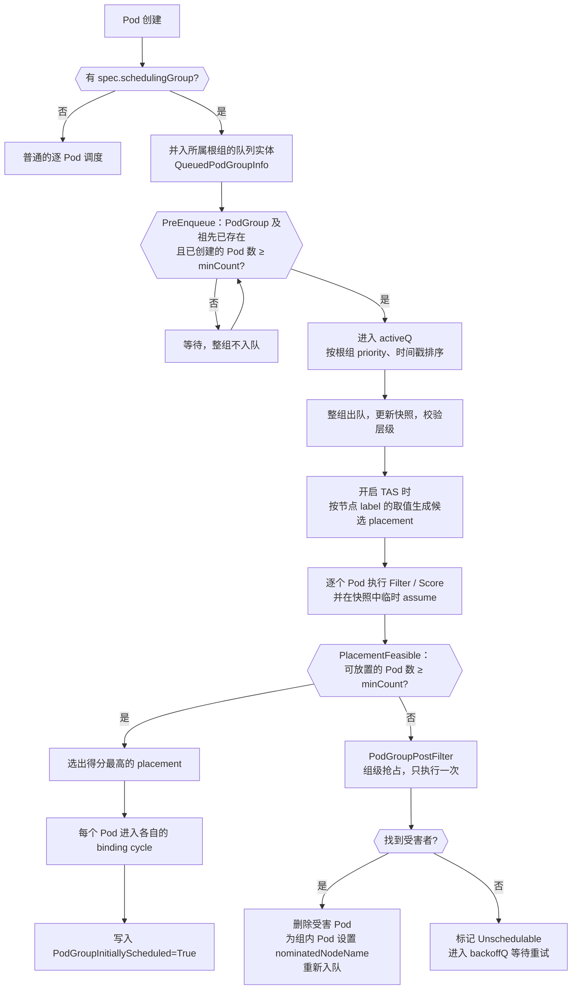

### 4.2 v1.38 时序图

以一个 `gang.minCount = N` 的 PodGroup、N 个同构 Pod、资源充足为例。

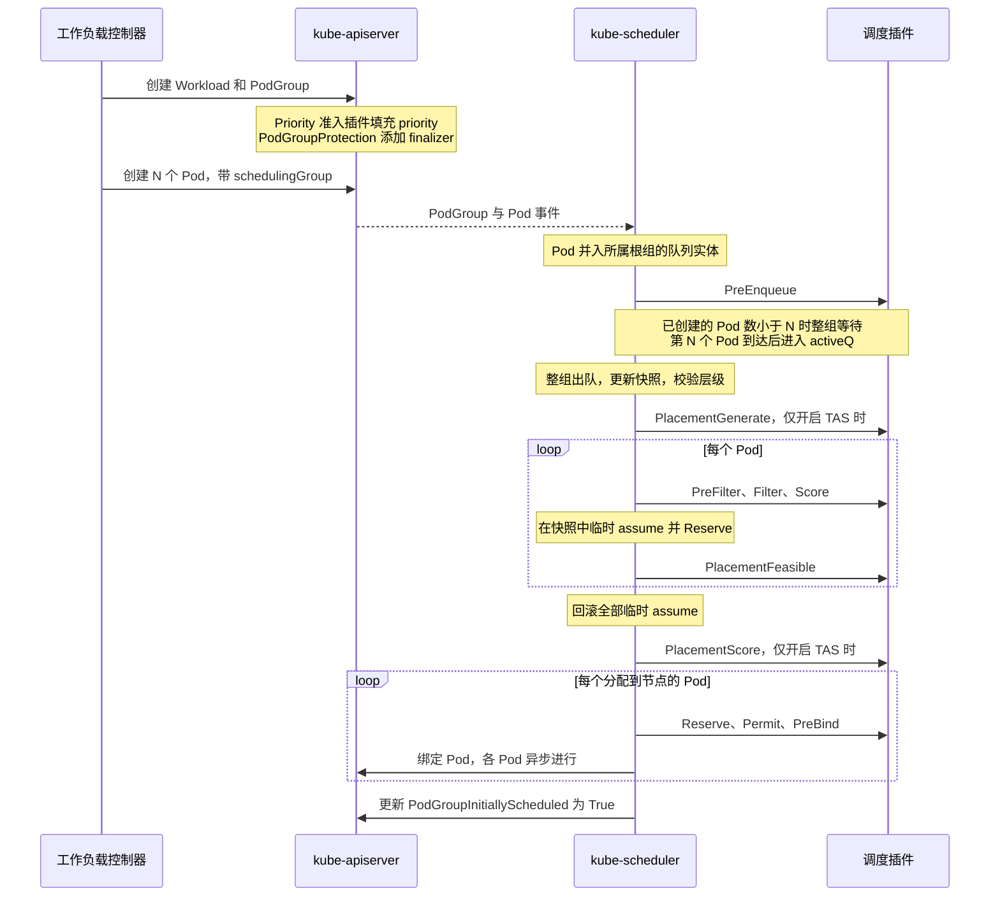

### 4.3 关键机制

**入队。** 只要 Pod 带有 `spec.schedulingGroup`，无论策略是 basic 还是 gang，都不再作为单个 Pod 排队，而是并入所属根组的队列实体。一个根（独立 PodGroup，或一棵 CompositePodGroup 树的根）对应一个实体。实体之间按根组的 `priority` 排序，相同则按时间戳。

**PreEnqueue。** 整组可以进入调度的条件是：PodGroup 及其所有祖先对象已经存在，并且已经**创建**的 Pod 数达到 `minCount`（basic 策略视为 1）。组内任意一个 Pod 被 scheduling gate 卡住，整组都不入队。

**调度周期。** 调度循环是单协程。一个组的周期内，按固定顺序逐个 Pod 执行完整的 Filter / Score，结果临时 assume 到快照里供后面的 Pod 参考；周期结束时全部回滚，评估过程不触碰真实缓存。组的周期内不执行逐 Pod 的 PostFilter。已经在运行的组成员计入 `minCount`。

**PlacementFeasible。** gang 规则集中在 `GangScheduling.PlacementFeasible`：

| 条件 | 结果 |
|---|---|
| 已放置 + 未评估 < `minCount` | Unschedulable，提前结束循环 |
| 已放置 < `minCount`，但还有未评估的 Pod | Wait，继续评估 |
| 已放置 ≥ `minCount` | 通过 |

**不满足 minCount 时。** 整组不绑定任何 Pod，执行一次组级抢占（见第 8 节），然后重新入队。当 `minCount` 小于 Pod 总数且至少有 `minCount` 个 Pod 可放置时，能放置的 Pod 先绑定，其余重新入队。

**绑定。** 绑定仍是逐 Pod 的异步 binding cycle。代码中没有组级的绑定回滚：某个成员绑定失败不会撤销其他成员（推断）。all-or-nothing 保证的是调度决策，而不是绑定结果。

**状态。** 调度器只写 `PodGroupInitiallyScheduled`（及 v1.38 中 CPG 的对应 condition）。API 注释中定义了 PodGroup 上的 `DisruptionTarget` condition，但在这两个版本的调度器代码里没有找到写入它的地方。

**重试。** 调度失败的组进入 backoffQ，退避到期后重试，而不是等待集群事件触发（推断，依据是 `AddAttemptedPodGroupIfNeeded` 的分支逻辑；代码里有 TODO 说明 PodGroup 尚未支持 queueing hints）。退避上限为 `podMaxBackoff × √组内Pod数`，默认 `podMaxBackoff` 为 10 秒。

### 4.4 v1.37 与 v1.38 的差异

| 项目 | v1.37（v1.37.2） | v1.38（master，开发中） |
|---|---|---|
| Workload / PodGroup API | `v1beta1`（新增），`v1alpha3` | `v1beta1`，GA 推迟到 v1.39 |
| CompositePodGroup | Alpha，只在 `v1alpha3` 中提供 | Beta，进入 `v1beta1` |
| Gang 的 Permit 屏障 | 保留，超时固定 5 分钟 | 移除，只靠 PlacementFeasible |
| PlacementFeasible | 调度器内部钩子，固定使用 GangScheduling | 公开、可配置的扩展点 |
| Placement 搜索 | 评估所有候选；只使用第一个 PlacementGenerate 插件 | 新增 `percentageOfPlacementsToScore`（自适应，下限 5%）；随机打散；优先尝试 nominated placement；多个插件的结果求交 |
| 层级校验 | 只校验 Pod 的 schedulerName、优先级、抢占策略 | 每个周期校验整棵树，新增 `PodGroupError` / `CompositePodGroupError` |
| CPG 状态 | 不写 | 写 `CompositePodGroupInitiallyScheduled` |
| CPG 删除保护 | 无 | 有 finalizer |
| 最大树深 | 4 | 5（`v1.38.0-beta.0` 中仍为 4） |
| 抢占 | 组级一次决策 | 新增 `PreemptionManager` 抽象、`RankNodes`、跨 Pod 的受害者状态 |
| `preemptionPolicy` | 受 `PodGroupPreemptionPolicy` gate 控制 | gate 移除，字段直接生效 |
| Job 集成 | Alpha | Beta，默认关；suspend 时删除 PodGroup |
| Deployment 集成 | 无 | Alpha |
| controller building blocks | 位于 `v1alpha3` | 进入 `scheduling.k8s.io/v1` |
| 代码结构 | 集中在 `schedule_one_podgroup.go`（1448 行） | 拆出 `algorithm.go`、`algorithm_podgroup.go` |

### 4.5 新增的调度框架扩展点

| 扩展点 | 作用 | 内置实现 | 出现版本 |
|---|---|---|---|
| `PlacementGenerate` | 生成候选 placement（节点子集） | `TopologyPlacement` | v1.36 |
| `PlacementScore` | 给可行的 placement 打分 | `PodGroupPodsCount`、`NodeResourcesFit` | v1.36 |
| `PlacementFeasible` | 判断当前进度是否满足组策略 | `GangScheduling` | v1.37 内部，v1.38 公开 |
| `PodGroupPostFilter` | 整组调度失败后执行一次 | `DefaultPreemption`、`DynamicResources` | v1.36 内部，v1.37 公开 |

### 4.6 代码中可见的限制

- 没有队列、配额、公平性和回收。
- 调度循环单协程，一个大组的周期（所有 Pod × 所有候选 placement，抢占时还要再跑一遍）会阻塞其他调度。
- 贪心、固定顺序、不回溯。异构组可以提交，但不保证能找到可行解。
- 同一层级内所有 Pod 必须使用相同的 schedulerName、优先级和抢占策略。
- gang 保证只在调度时生效：`minCount` 之后不再强制；`disruptionMode: single` 下运行中的 gang 可以被部分抢占。
- DRA 的组级 PostFilter 不支持带拓扑约束的 PodGroup 和 CompositePodGroup。
- 没有找到针对 Cluster Autoscaler 的组级集成；KEP 把它列为后续工作。

## 5. 上游 PodGroup 与 Volcano PodGroup

### 5.1 对象模型对比

上游的模型见 3.2。Volcano 的模型如下：


图中实线表示「创建」，虚线表示「引用」。最直观的三处不同：

1. 上游有 Workload 模板和独立的 CompositePodGroup 对象；Volcano 只有一个 PodGroup，子组内嵌其中。
2. Volcano 的 PodGroup 归属于一个 Queue；上游没有队列。
3. 上游用 Pod spec 字段关联组；Volcano 用 annotation。

### 5.2 字段对照

| 维度 | 上游 PodGroup<br/>`scheduling.k8s.io/v1beta1` | Volcano PodGroup<br/>`scheduling.volcano.sh/v1beta1` |
|---|---|---|
| Pod 如何关联 | `pod.spec.schedulingGroup.podGroupName`，不可变 | annotation `scheduling.k8s.io/group-name` |
| 最小成员数 | `schedulingPolicy.gang.minCount` | `minMember` |
| 按角色的最小数 | 无，需要拆成多个 PodGroup 放到 CPG 下 | `minTaskMember` |
| 最小资源量 | 无 | `minResources` |
| 队列 | 无 | `queue` |
| 优先级 | `priorityClassName` / `priority` / `preemptionPolicy` | `priorityClassName` |
| 拓扑约束 | `schedulingConstraints.topology[0].key`，节点 label，只有硬约束 | `networkTopology{mode, highestTierAllowed, highestTierName}`，基于 HyperNode，hard / soft |
| 子组 | 独立的 CompositePodGroup 对象，通过 `parentCompositePodGroupName` 关联 | 内嵌的 `subGroupPolicy[]` |
| 被抢占的单元 | `disruptionMode: single / all` | 没有专门字段，由 gang 插件和驱逐 action 决定；`volcano.sh/preemptable` 控制是否可被抢占 |
| 组级 DRA | `resourceClaims[]` | 无 |
| 组间反亲和 | 无 | `topologyAffinity.podGroupAntiAffinity` |
| 状态 | condition `PodGroupInitiallyScheduled`、`DisruptionTarget` | `phase`（Pending / Inqueue / Running / Unknown / Completed）、condition `Scheduled` / `Unschedulable`、Pod 计数 |
| status 子资源 | 有 | 无，调度器整对象 `Update` |
| 可变性 | 只有 `minCount` 可变 | 字段可修改 |
| 删除保护 | finalizer，Pod 全部终止后才移除 | 无，依赖 ownerReference |

### 5.3 语义与生命周期差异

| 维度 | 上游 | Volcano |
|---|---|---|
| 谁创建 PodGroup | 工作负载控制器；用户也可手工创建 | Volcano Job controller；对普通 Pod、Deployment、StatefulSet 由 pg-controller 自动创建（`minMember=1`） |
| 入队准入 | 无。PodGroup 存在且已创建 `minCount` 个 Pod 即可调度 | 有。`enqueue` action 根据 `minResources` 和队列容量把 PodGroup 从 Pending 置为 Inqueue |
| Pod 创建时机 | 控制器直接创建 | Volcano Job 在 PodGroup 离开 Pending 后才创建 Pod |
| 组间排序 | 优先级，其次时间 | Queue 顺序 → Job 顺序（priority、gang、drf、sla 等插件）→ SubJob 顺序 → Task 顺序 |
| gang 判定 | 一个 `minCount` | 三重检查：Job 级 `minMember`、角色级 `minTaskMember`、子组级 `subGroupSize` 与 `minSubGroups` |
| gang 生效范围 | 只在调度决策时 | 调度时强制；每个 session 重新计算 phase；legacy 抢占不会把受害 Job 压到 `minAvailable` 以下 |
| 状态表达 | 「是否曾经调度成功」 | 「当前处于哪个阶段」 |
| 弹性 | `minCount` 可变，后加入的 Pod 走同一个组周期 | `minMember` 小于副本数时，剩余 Pod 在后续 session 继续分配 |

### 5.4 调度流程对比

Volcano 调度一个 gang 的 Volcano Job 的流程如下。对普通 Pod，顺序略有不同：Pod 先存在，再由 pg-controller 创建 PodGroup。

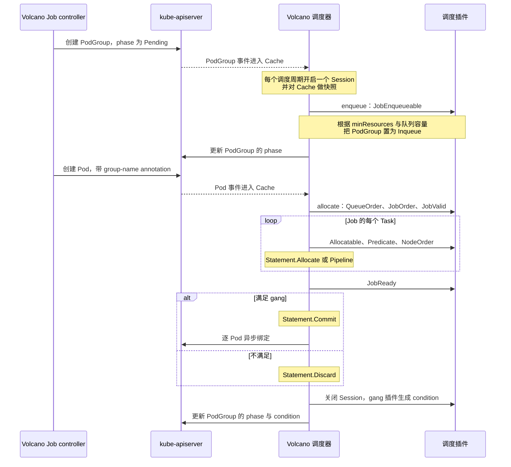

| 维度 | kube-scheduler | Volcano |
|---|---|---|
| 调度触发 | 事件驱动，每次从队列取出一个实体 | 周期性 session，每次处理快照中的全部 Job |
| 一次决策的范围 | 一个根组 | 一个 session 内按队列和 Job 顺序处理多个 Job |
| 事务机制 | 快照内临时 assume，周期结束全部回滚，再逐 Pod 提交 | `Statement`：Allocate / Pipeline / Evict，`JobReady` 时 Commit，否则 Discard |
| 资源预留 | `nominatedNodeName` | Pipelined 状态占用 session 内的未来空闲资源，另有 `nominatedNodeName` 和 `NominatedHyperNode` |
| 资源不足时 | 同一周期内触发组级抢占 | 由后续的 `preempt` / `reclaim` / `gangpreempt` / `gangreclaim` action 处理 |
| 失败重试 | backoff 后重新入队 | 下一个 session 重新评估，可用 unschedulable-job cache 跳过 |
| 绑定 | 逐 Pod 异步，无组级回滚 | 逐 Pod 异步，无组级回滚（推断） |

## 6. CompositePodGroup 与 Volcano PodGroup + SubGroup

### 6.1 结构对比

上游：由独立对象组成的树，叶子是 PodGroup。

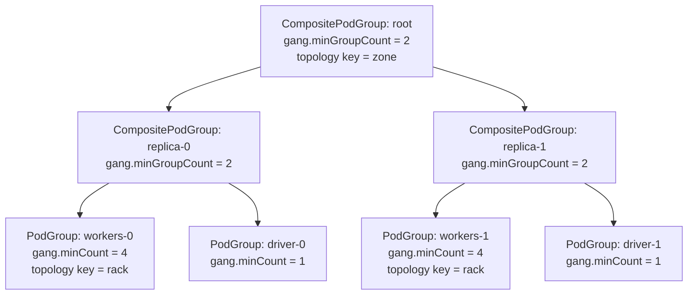

Volcano：一个 PodGroup 对象，子组由 `subGroupPolicy` 按 Pod label 划分，固定两层。上图那样的三层结构无法直接表达，下图是 Volcano 能表达的两层形态。

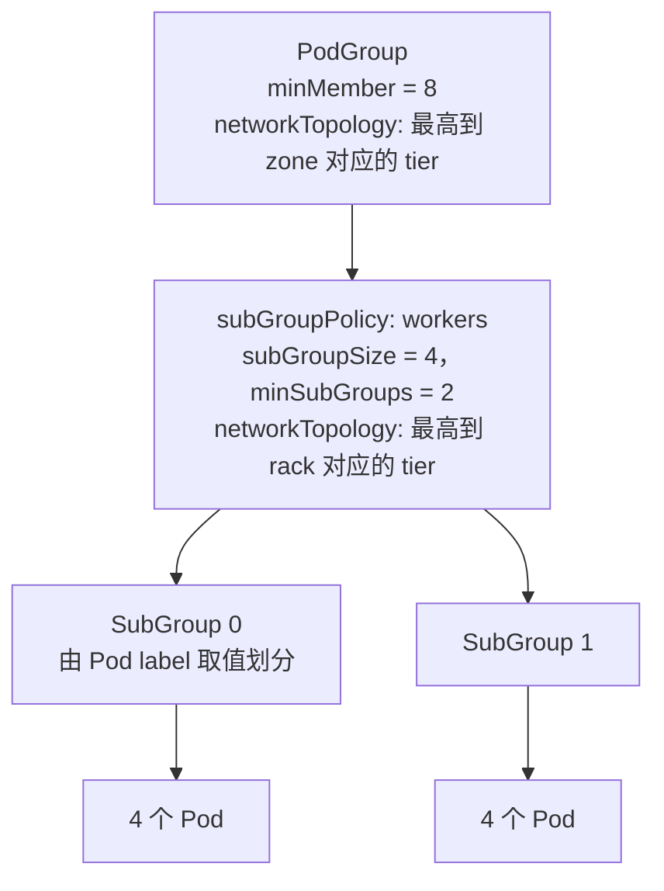

### 6.2 能力对比

| 维度 | CompositePodGroup | Volcano PodGroup + SubGroup |
|---|---|---|
| 形态 | 独立 API 对象，子指向父 | PodGroup spec 内的列表，子组没有独立对象 |
| 层数 | 最多 5 层（v1.37 为 4 层） | 固定两层：PodGroup → SubGroup |
| 子组如何划分 | 每个子组是一个 PodGroup 对象，Pod 显式引用它 | `labelSelector` 选中 Pod，再按 `matchLabelKeys` 的取值分组 |
| 父级 gang | `gang.minGroupCount`：至少多少个子组可调度，不区分子组来自哪个模板 | `minSubGroups`：每个 policy 各自计数 |
| 子级 gang | 每个叶子 PodGroup 自己的 `minCount`，可以各不相同 | `subGroupSize`：同一 policy 下所有子组大小相同 |
| 多层拓扑 | 每一层可以带一个拓扑 key，自上而下逐层收窄 | Job 级和 SubGroup 级各一个 `networkTopology` |
| 优先级 | 整棵树必须相同 | Job 级来自 PodGroup；SubJob 取其 Task 的最高优先级 |
| 抢占单元 | 每层可设 `disruptionMode`；`all` 的父节点下不能有 `single` 的子节点 | 没有声明式字段 |
| 状态 | 每个对象有自己的 condition | 只有 PodGroup 级状态，没有子组状态 |
| 调度方式 | 整棵树在一个周期内自上而下递归调度，兄弟节点按创建时间顺序，不回溯 | 先为 Job 选 HyperNode，再为每个 SubJob 在其范围内选 HyperNode；每个候选都试分配后丢弃，取得分最高者 |
| 弹性 | `minGroupCount` 在 Beta 变为可变 | PodGroup 可修改 |
| 使用方 | JobSet、LWS 等（设计或实现中） | Volcano Job 的 `partitionPolicy`；Kthena 文档中也有使用 |

### 6.3 同一个需求的两种写法

需求：2 个副本组，每组 4 个 Pod 必须在同一个机架内，整个工作负载在同一个可用区内，2 组都就绪才启动。

上游，控制器先创建 Workload，再据此创建 1 个 CompositePodGroup 和 2 个 PodGroup：

```yaml
apiVersion: scheduling.k8s.io/v1beta1
kind: Workload
metadata:
  name: serving
spec:
  compositePodGroupTemplates:
  - name: root
    schedulingPolicy:
      gang:
        minGroupCount: 2
    schedulingConstraints:
      topology:
      - key: topology.kubernetes.io/zone
    podGroupTemplates:
    - name: replica
      schedulingPolicy:
        gang:
          minCount: 4
      schedulingConstraints:
        topology:
        - key: topology.example.com/rack
```

Volcano，一个 PodGroup 即可，前提是集群中已有对应层级的 HyperNode：

```yaml
apiVersion: scheduling.volcano.sh/v1beta1
kind: PodGroup
metadata:
  name: serving
spec:
  queue: default
  minMember: 8
  networkTopology:
    mode: hard
    highestTierAllowed: 2        # 假设 tier 2 对应可用区
  subGroupPolicy:
  - name: replica
    subGroupSize: 4
    minSubGroups: 2
    labelSelector:
      matchLabels:
        app: serving
    matchLabelKeys:
    - group-index                # 取值相同的 Pod 属于同一个子组
    networkTopology:
      mode: hard
      highestTierAllowed: 1      # 假设 tier 1 对应机架
```

### 6.4 互相映射的可行性

| 上游结构 | 能否用 Volcano 现有模型表达 |
|---|---|
| 单个 PodGroup（gang 或 basic） | 可以。`minCount` 对应 `minMember` |
| 一个 CPG + 同模板的多个 PodGroup | 可以。一个 `subGroupPolicy`，`subGroupSize = minCount`，`minSubGroups = minGroupCount` |
| 一个 CPG + 不同模板的 PodGroup（如 driver + workers），且全部必需 | 可以。每个模板一个 policy，或使用 `minTaskMember` |
| 一个 CPG + 不同模板的 PodGroup，`minGroupCount` 小于子组总数 | 不能精确表达。上游是「任意若干个子组」，Volcano 只能按 policy 分别计数 |
| 三层及以上（如 JobSet → ReplicatedJob → Job） | 不能。需要把 SubGroup 模型扩展为递归结构 |
| 每层不同的 `disruptionMode` | 不能。Volcano 没有对应字段 |

反过来，Volcano 的 `minResources`、`queue`、软拓扑、`minTaskMember` 在上游没有对应字段。

## 7. TAS 对比

### 7.1 拓扑如何描述

上游：拓扑域由节点 label 的取值隐式构成，没有拓扑对象。约束 `key = rack` 时，每个 rack 取值是一个候选 placement。

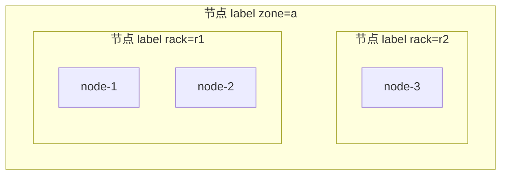

Volcano：拓扑是显式的 HyperNode 对象树，tier 越小越靠近节点。


### 7.2 对比

| 维度 | 上游 TAS | Volcano Network Topology Aware Scheduling |
|---|---|---|
| 拓扑来源 | 节点 label，没有拓扑对象 | HyperNode CRD，成员可按名字、正则、label 选择 |
| 拓扑发现 | 不做（非目标） | HyperNode controller 支持 `ufm` 和 `label` 两种自动发现 |
| 约束表达 | 一个 label key：全组 Pod 落在该 label 的同一个取值内 | `highestTierAllowed` 或 `highestTierName`：全组 Pod 的最近公共祖先不高于该层 |
| 硬 / 软 | 只有硬约束，preferred 是后续工作 | `hard` 和 `soft` |
| 多层约束 | 一个对象只能一个 key；多层靠 CompositePodGroup 嵌套 | Job 级和 SubGroup 级各一个，共两层 |
| 候选生成 | 每个 label 取值一个 placement | 从最低层级开始逐层尝试，层级越低越优先 |
| 可行性判断 | 把节点限制在 placement 内，跑一遍完整的组调度 | 对每个 HyperNode 试分配，保存结果后丢弃 |
| 打分 | `PodGroupPodsCount`（能放下的 Pod 越多越好）加 `NodeResourcesFit` 的 MostAllocated | HyperNode 级 binpack，加上基于层级的节点打分 |
| 搜索范围 | v1.37 评估全部候选；v1.38 可按比例截断 | 找到有解的最低层级即停止 |
| 已运行的 Pod | 新 Pod 只能进入已占用的域 | 用已分配 HyperNode 的最近公共祖先限定搜索范围 |
| 与抢占结合 | 组级抢占时重跑带 placement 的调度算法 | `gangpreempt` / `gangreclaim` 按 HyperNode 域搜索；带网络拓扑的 Job 不会作为抢占方进入 legacy `preempt` |
| 没有拓扑对象时 | 直接可用，只要节点有 label | 需要先有 HyperNode（可由 `label` 发现器从节点 label 生成） |

小结：上游的模型更轻，节点有 label 就能用，但只能表达「同一个域」这一种硬约束。Volcano 的模型更重，需要维护 HyperNode，但能表达「尽量靠近、不超过某层」、软约束和自动发现。Volcano 设计文档中记录过当初不选 label 方案的原因：用 label 构建拓扑树较复杂。

## 8. 抢占对比（WAP）

### 8.1 上游的组级抢占

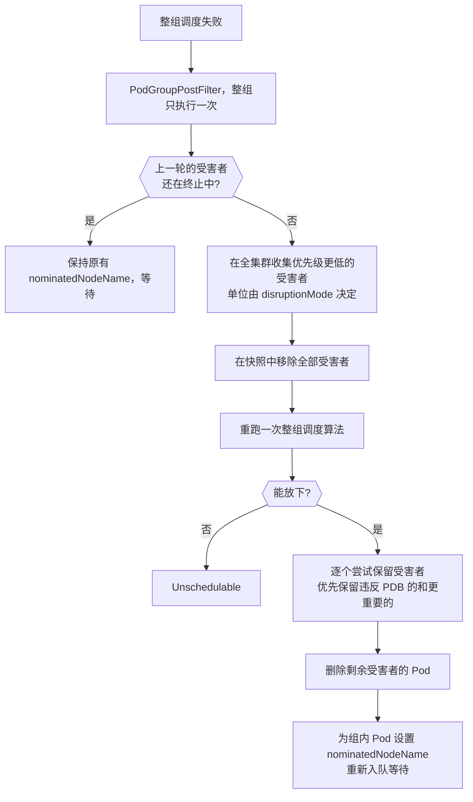

### 8.2 Volcano 的组级驱逐（gangpreempt）

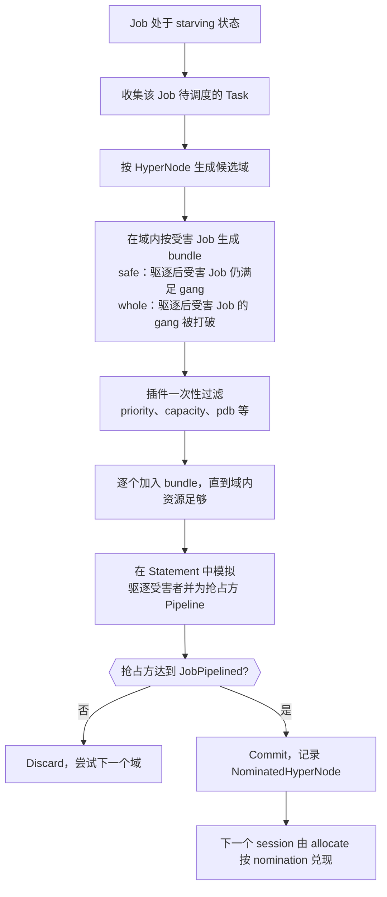

### 8.3 对比

| 维度 | 上游 WAP | Volcano |
|---|---|---|
| 入口 | 调度周期内，整组失败后立即执行 | 独立的 action：`preempt`、`reclaim`、`gangpreempt`、`gangreclaim`，按配置启用 |
| 驱动因素 | 只有优先级 | 优先级（队列内抢占）和队列的 deserved / guarantee（跨队列回收） |
| 抢占方单元 | 根组，一次决策 | Job；只有达到 `JobPipelined` 才提交 |
| 受害单元 | `disruptionMode`：`single` 为单个 Pod，`all` 为整组（取最高的 `all` 祖先） | legacy：单个 Task，且不会把受害 Job 压到 `minAvailable` 以下；gang：safe bundle 与 whole bundle |
| 是否保护受害方的 gang | 默认不保护。`single` 是默认值，运行中的 gang 可被部分抢占 | 默认保护。只有 `allowWholeBundle` 开启且插件全部允许时才整体打破 |
| 搜索范围 | 全集群一个域 | legacy 按节点；gang 按 HyperNode 域（无拓扑时退化为全集群） |
| 优先级来源 | PodGroup 的 `priority`，Pod 自身的优先级被忽略；整棵树必须一致 | Job 优先级来自 PodGroup 的 `priorityClassName`；Job 内部用 Task 优先级 |
| `preemptionPolicy: Never` | 组级字段 | 按 Pod 级判断 |
| PDB | 尽力而为：优先保留违反 PDB 的受害者，但不禁止 | `pdb` 插件过滤受害者（需开启） |
| 驱逐方式 | 删除 Pod，并写 Pod 的 `DisruptionTarget` condition | 删除 Pod，并写 Pod 的 `DisruptionTarget` condition |
| 抢占后 | 组内 Pod 带 `nominatedNodeName` 等待；受害者终止前不发起新的抢占 | 下一个 session 的 `allocate` 走 nomination 快速路径 |
| 拓扑感知 | 与 TAS 集成，重跑带 placement 的调度 | gang action 按 HyperNode 搜索；带网络拓扑的 Job 不会作为抢占方进入 legacy `preempt` |
| 被抢占后的重调度 | 非目标，留给后续 KEP | 由工作负载控制器重建 Pod 后重新调度 |

小结：两边的共同点是「抢占方按整组决策、失败不驱逐」。主要区别有两点。第一，Volcano 有跨队列回收，上游没有。第二，默认行为相反：上游默认可以拆散受害方的 gang，需要显式设置 `disruptionMode: all`；Volcano 默认保护受害方的 `minAvailable`。

## 9. Volcano 兼容上游 PodGroup：方案与工作量

### 9.1 现状

- Volcano 依赖的 Kubernetes 版本已包含上游 PodGroup 类型，但只为满足接口而编译：`pkg/scheduler/plugins/util/k8s/snapshot.go` 中 `PodGroupStates()` 返回空状态，`PodGroups()` 和 `CompositePodGroups()` 的查询一律返回 not found；`Framework.PodGroupManager()` 返回 nil。
- 调度器识别 Pod 所属 Job 只有一个入口：`pkg/scheduler/api/job_info.go` 的 `getJobID`，读取 annotation `scheduling.k8s.io/group-name`。没有任何代码读取 `pod.spec.schedulingGroup`。
- 没有上游 Workload / PodGroup / CompositePodGroup 的 informer、client 和 RBAC。
- 今天如果一个 Pod 同时设置了 `schedulerName: volcano` 和 `schedulingGroup`，pg-controller 会按普通 Pod 处理，为它创建 `minMember=1` 的 Volcano PodGroup，上游的 gang、拓扑、`disruptionMode` 语义都不会生效（推断）。
- 仓库里没有关于兼容上游 Workload / PodGroup API 的设计文档或 TODO。

### 9.2 「兼容」的几个层次

| 层次 | 含义 | 用户能得到什么 |
|---|---|---|
| L0 共存 | 不做任何事，两套 API 互不影响 | 现状 |
| L1 扁平 PodGroup | Volcano 能调度带 `schedulingGroup` 的 Pod，遵守 `minCount`、优先级，并回写状态 | 开启 `spec.scheduling` 的原生 Job 可以直接用 Volcano 调度，并使用 Volcano 的队列能力 |
| L2 语义对齐 | 支持 `disruptionMode`、`preemptionPolicy`、拓扑 key，以及两层 CompositePodGroup | JobSet、LWS 等使用上游 API 的两层工作负载可用 Volcano 调度 |
| L3 完整支持 | 任意层级的 CompositePodGroup、PodGroup 级 DRA ResourceClaim | 与 kube-scheduler 在这套 API 上行为对齐 |
| L4 替换 | 用上游 PodGroup 取代 Volcano PodGroup | 不建议。上游没有 `queue`、`minResources`、`minTaskMember`、软拓扑、`phase` 等字段 |

### 9.3 两条实现路径

路径 A：镜像转换，改动集中在 controller。从左到右同步 spec，从右到左回写状态。

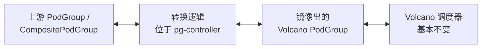

路径 B：调度器原生读取上游对象，并直接回写它的 status。

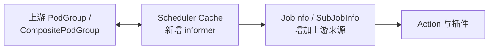

| 维度 | 路径 A：镜像转换 | 路径 B：调度器原生 |
|---|---|---|
| 做法 | controller 把上游 PodGroup 转成 Volcano PodGroup，并给 Pod 打上 group-name annotation 和子组 label | 调度器 cache 直接 watch 上游对象，`getJobID` 增加 `schedulingGroup` 分支 |
| 调度器改动 | 很小 | 较大：cache、JobInfo、状态回写、队列统计 |
| 额外对象 | 每个上游组多一个 Volcano PodGroup | 无 |
| 一致性 | 有转换延迟，需要处理两个对象不同步 | 单一数据源 |
| 可表达的层级 | 受 Volcano 两层模型限制 | 可以配合 SubJob 递归化支持任意层级 |
| PodGroup 级 DRA | 做不了 | 可以，需要实现 `PodGroupManager` |
| 适用阶段 | 快速验证，上游 API 尚未 GA 时风险小 | 上游 GA 且生态采用后 |

建议先走路径 A。原因是上游 API 仍在 Beta、默认关闭且有过不兼容变更，把适配隔离在 controller 里，调度器核心不必跟着 API 版本变化。

### 9.4 语义缺口与需要先做的决策

| 问题 | 说明 | 可选做法 |
|---|---|---|
| 队列从哪来 | 上游 PodGroup 没有队列字段 | 复用现有的 `scheduling.volcano.sh/queue-name` annotation 或命名空间默认队列 |
| `minResources` | 上游没有，Volcano 的入队准入和队列统计依赖它 | 由 controller 根据 Pod 模板和 `minCount` 计算；Pod 已创建时可直接累加 |
| 入队准入 | 上游控制器直接创建 Pod，Volcano 的「延迟创建 Pod」不适用 | 与现在处理普通 Pod 一样：Pod 先存在，PodGroup 未 Inqueue 时不调度 |
| 状态回写 | 上游只有 `PodGroupInitiallyScheduled`，且不回退 | Volcano PodGroup 首次进入 Running 时写 True；`phase` 只保留在 Volcano 侧 |
| 同名冲突 | 两种 PodGroup 的资源名都是 `podgroups`，Job 的 key 都是 `namespace/name` | 镜像对象使用带前缀的名字；文档提示用户使用完整资源名或 Volcano 的短名 `pg` |
| `disruptionMode: single` | 上游默认允许拆散 gang，Volcano 默认保护 | 保持 Volcano 的保护行为：`single` 是允许而不是要求 |
| `disruptionMode: all` | 要求整组一起被驱逐 | 在 bundle 生成时禁止为这类 Job 产生 safe bundle |
| 拓扑 key | 上游是 label key，Volcano 是 HyperNode 层级 | 用 `label` 发现器生成 HyperNode，并建立 label key 到 tier 的映射；与 volcano-sh/volcano#6161 的方向一致 |
| `minGroupCount` 跨模板计数 | Volcano 的 `minSubGroups` 按 policy 计数 | 「全部必需」的情况可精确映射；其余情况需要扩展模型，或明确标为不支持 |
| 三层以上 | Volcano 只有两层 | 路径 B 加 SubJob 递归化；在此之前明确拒绝并写入 condition |
| API 可用性 | 上游 API 只在开启 gate 的 v1.37+ 集群上存在 | 启动时通过 discovery 判断，不存在则不启动相关 informer；用 Volcano 自己的 feature gate 控制 |
| 多版本 | `v1beta1` 之后还会有 `v1`，CompositePodGroup 在 v1.37 只有 `v1alpha3` | 只支持 `v1beta1` 及以后，不适配 alpha 版本 |

### 9.5 工作量拆解

单位是人周，假设由熟悉 Volcano 调度器的工程师完成，包含单元测试、e2e 和文档，不包含社区评审周期。按仓库要求，每个运行时行为变更都需要在真实集群上验证，这部分已计入。

| 编号 | 工作项 | 主要涉及 | 路径 A | 路径 B |
|---|---|---|---|---|
| W0 | 基础设施：API discovery、informer、RBAC、feature gate、e2e 集群开启上游 gate | controllers、scheduler、installer、hack | 1–2 | 1–2 |
| W1 | 扁平 PodGroup：Pod 关联、`minCount`、优先级、队列来源、状态回写 | A：`pkg/controllers/podgroup`<br/>B：`pkg/scheduler/cache`、`pkg/scheduler/api`、`pkg/scheduler/framework`、队列 controller 与指标 | 3–4 | 6–8 |
| W2 | `preemptionPolicy` 与 `disruptionMode` 接入抢占和回收 | `pkg/scheduler/actions`（preempt、reclaim、gangpreempt、gangreclaim）、gang 插件 | 2–4 | 2–4 |
| W3 | 拓扑 key 到 HyperNode tier 的映射 | hypernode controller、network-topology-aware 插件 | 2–3 | 2–3 |
| W4 | 没有 HyperNode 时直接按节点 label 构建域 | `pkg/scheduler/api` 的 HyperNode 缓存 | — | 3–4 |
| W5 | 两层 CompositePodGroup 映射到 `subGroupPolicy`，含状态 | A：controller<br/>B：cache 与 JobInfo | 3–5 | 4–6 |
| W6 | 任意层级：SubJob 递归化 | allocate、gang、network-topology-aware、gang 驱逐、`job_info.go` | 不适用 | 10–16 |
| W7 | PodGroup 级 DRA ResourceClaim：实现 `PodGroupManager` 与 `PodGroupState` | `pkg/scheduler/plugins/util/k8s`、predicates | 不适用 | 4–6 |
| W8 | 用户文档、兼容性说明 | docs | 1–2 | 1–2 |

汇总：

| 目标 | 包含的工作项 | 估算 |
|---|---|---|
| L1 最小可用 | 路径 A 的 W0 + W1 | 约 4–6 人周 |
| L2 两层语义对齐 | 路径 A 的 W0–W3、W5、W8 | 约 12–20 人周 |
| L3 完整原生支持 | 路径 B 的 W0–W8 | 约 33–51 人周，即 8–12 人月 |

此外还有持续成本：上游 API 到 GA 之前，每个 Kubernetes 版本预计需要 1–2 人周跟进变更。

依赖盘点可以作为估算的参照：调度器中直接引用 PodGroup 的非测试代码有 44 个文件、约 480 行，测试代码约 1340 行；controller 中 14 个文件、约 210 行；e2e 中约 420 行。路径 B 需要逐一确认这些位置对上游来源的 PodGroup 是否成立。

### 9.6 建议路线

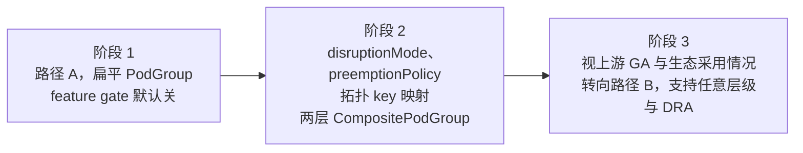

1. **阶段 1**：用路径 A 支持扁平 PodGroup，放在 Volcano 的 feature gate 后面，默认关闭。目标场景是带 `spec.scheduling` 的原生 Job 由 Volcano 调度并享受队列能力。
2. **阶段 2**：补齐抢占语义和拓扑映射，支持两层 CompositePodGroup。这一步之后能覆盖 LWS、JobSet 的常见形态。
3. **阶段 3**：等上游 API GA（目前目标 v1.39）并观察 JobSet、LWS、Trainer、KubeRay 的实际采用情况后，再决定是否投入路径 B。

### 9.7 风险

- **API 仍在变化。** 三个版本内两次不兼容变更，GA 已推迟一次。过早深度绑定会带来重复适配。
- **默认关闭。** 在上游 gate 默认开启之前，能用上这套 API 的集群有限，适配的受益面小。
- **生态走向。** 如果 KubeRay、Trainer、Spark Operator 等项目逐步以上游 API 作为默认集成方式，Volcano 不兼容就意味着这些工作负载在 Volcano 上只能得到逐 Pod 调度。这是判断而非事实，需要持续跟踪。
- **Kueue 的方向。** Kueue 已有 WAS 集成的总体计划（kubernetes-sigs/kueue#8871），包括读取标准 API 和复用上游调度库。它与 Volcano 的 L1 / L2 目标相近，可以作为参照。
- **语义偏差。** 上游的 `PodGroupInitiallyScheduled`、`single` 默认值等语义与 Volcano 的习惯不同，映射时需要在文档中写清楚差异，避免用户按上游语义预期行为。

## 10. 参考

**KEP**

- [KEP-4671 Gang Scheduling](https://github.com/kubernetes/enhancements/tree/master/keps/sig-scheduling/4671-gang-scheduling)
- [KEP-5832 Decouple PodGroup API](https://github.com/kubernetes/enhancements/tree/master/keps/sig-scheduling/5832-decouple-podgroup-api)
- [KEP-6012 CompositePodGroup API](https://github.com/kubernetes/enhancements/tree/master/keps/sig-scheduling/6012-composite-podgroup-api)
- [KEP-5732 Topology-aware workload scheduling](https://github.com/kubernetes/enhancements/tree/master/keps/sig-scheduling/5732-topology-aware-workload-scheduling)
- [KEP-5710 Workload-aware preemption](https://github.com/kubernetes/enhancements/tree/master/keps/sig-scheduling/5710-workload-aware-preemption)
- [KEP-6089 WAS Controller APIs](https://github.com/kubernetes/enhancements/tree/master/keps/sig-scheduling/6089-was-controller-apis)
- [KEP-5729 DRA: ResourceClaim Support for Workloads](https://github.com/kubernetes/enhancements/tree/master/keps/sig-scheduling/5729-resourceclaim-support-for-workloads)
- [KEP-5547 Integrate Workload APIs with Job controller](https://github.com/kubernetes/enhancements/tree/master/keps/sig-apps/5547-integrate-workload-with-job)
- [KEP-6276 Integrate Workload APIs with Deployment controller](https://github.com/kubernetes/enhancements/tree/master/keps/sig-apps/6276-integrate-workload-with-deployment)

**官方博客**

- [Kubernetes v1.37: Advancing Workload-Aware Scheduling](https://kubernetes.io/blog/2026/09/08/kubernetes-v1-37-advancing-workload-aware-scheduling/)

**上游代码（kubernetes/kubernetes）**

| 内容 | 路径 |
|---|---|
| API 类型 | `staging/src/k8s.io/api/scheduling/v1beta1/types.go` |
| Pod 上的 `schedulingGroup` | `staging/src/k8s.io/api/core/v1/types.go` |
| Feature gate | `pkg/features/kube_features.go` |
| 组调度周期 | `pkg/scheduler/schedule_one_podgroup.go`、`pkg/scheduler/algorithm_podgroup.go`（v1.38） |
| 调度队列 | `pkg/scheduler/backend/queue/scheduling_queue.go` |
| gang 插件 | `pkg/scheduler/framework/plugins/gangscheduling/` |
| 拓扑插件 | `pkg/scheduler/framework/plugins/topologyaware/`、`podgrouppodscount/` |
| 组级抢占 | `pkg/scheduler/framework/preemption/podgrouppreemption.go` |
| Job 集成 | `pkg/controller/job/job_scheduling_manager.go` |

**Volcano 代码与文档**

| 内容 | 路径 |
|---|---|
| PodGroup API | `staging/src/volcano.sh/apis/pkg/apis/scheduling/v1beta1/types.go` |
| Pod 到 Job 的关联 | `pkg/scheduler/api/job_info.go`（`getJobID`） |
| SubGroup | `pkg/scheduler/api/sub_job_info.go` |
| allocate | `pkg/scheduler/actions/allocate/allocate.go` |
| gang 插件 | `pkg/scheduler/plugins/gang/gang.go` |
| 拓扑插件 | `pkg/scheduler/plugins/network-topology-aware/` |
| 组级驱逐 | `pkg/scheduler/actions/gangpreempt/`、`pkg/scheduler/actions/gangreclaim/`、`pkg/scheduler/actions/utils/bundle.go` |
| 上游类型的占位实现 | `pkg/scheduler/plugins/util/k8s/snapshot.go`、`framework.go` |
| PodGroup 自动创建 | `pkg/controllers/podgroup/` |
| 设计文档 | [Network Topology Aware Scheduling](../design/Network%20Topology%20Aware%20Scheduling.md)、[gang-aware-eviction-design](../design/gang-aware-eviction-design.md) |

**相关 issue**

- kubernetes-sigs/kueue#8871：Kueue 与 WAS 集成的总体跟踪
- kubernetes-sigs/jobset#1365、kubernetes-sigs/lws#891：JobSet、LWS 对 CompositePodGroup 的集成跟踪
- volcano-sh/volcano#6161：提供可发现、可校验的网络拓扑层级定义
