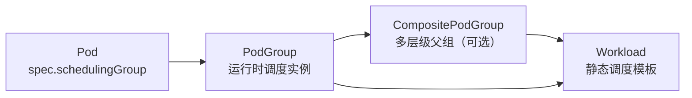
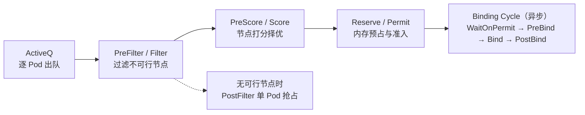
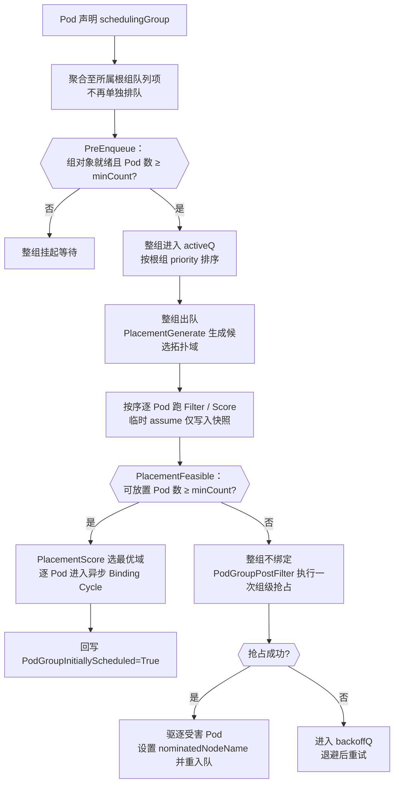
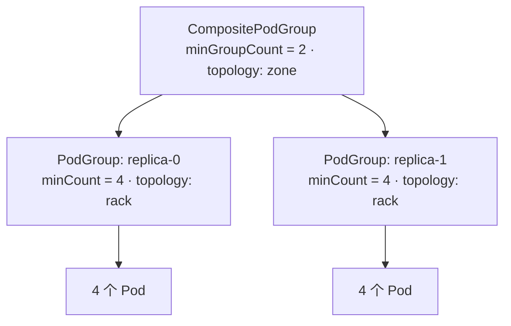
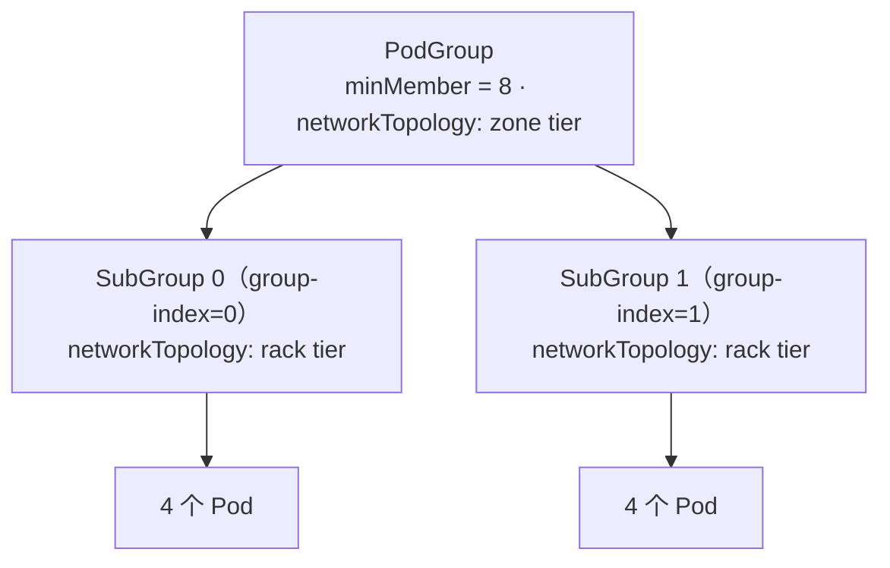
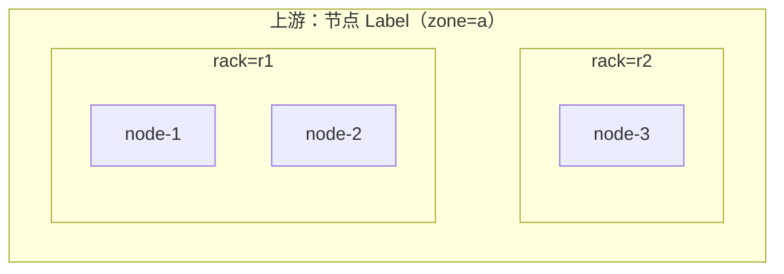
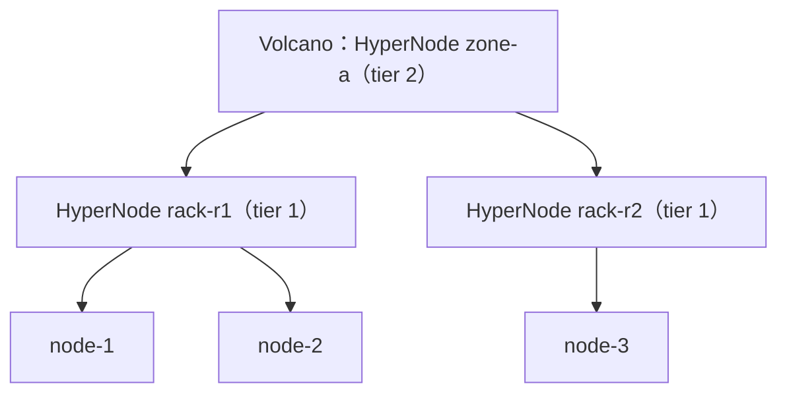
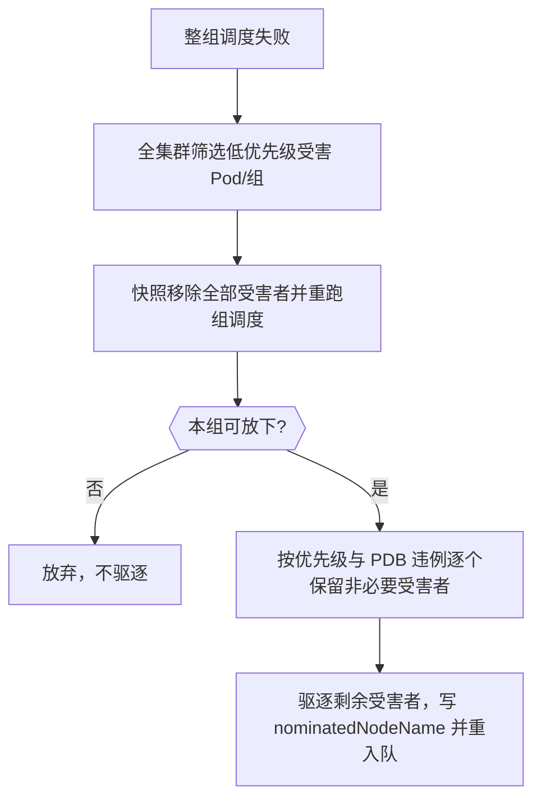
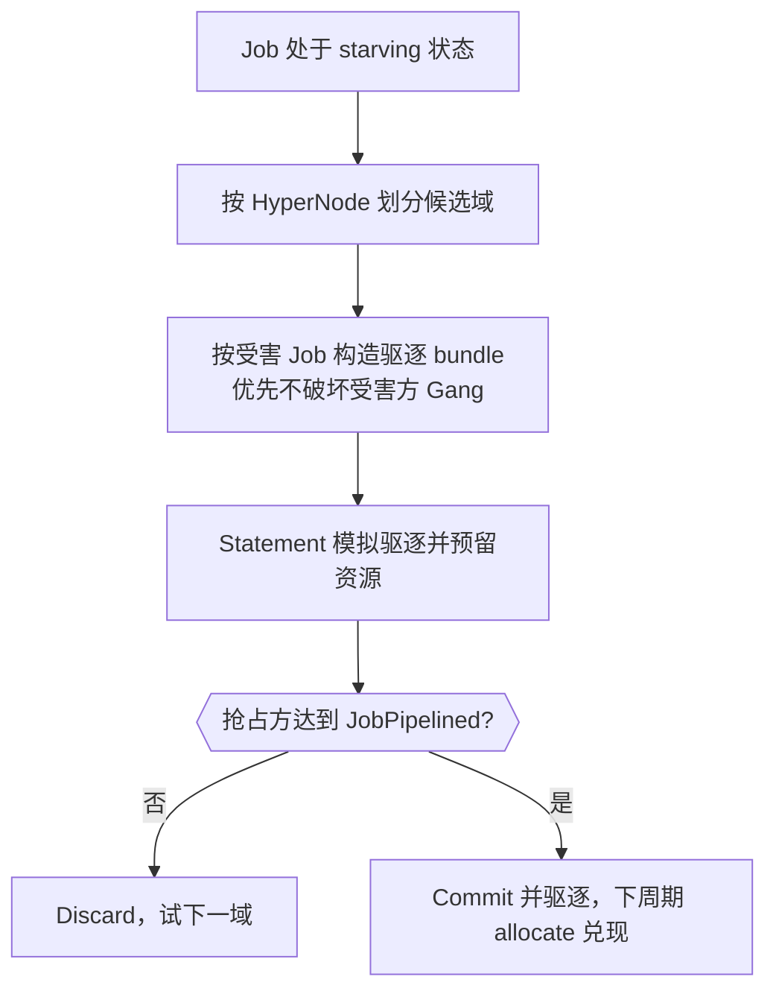
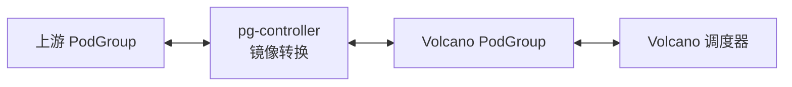

# Kubernetes 上游 PodGroup（WAS）与 Volcano 对比分析

[English](./k8s-workload-aware-scheduling-vs-volcano.md) | 简体中文

> 基于 Kubernetes v1.37.2 / v1.38（2026-11 master）与 Volcano master 源码整理。

Kubernetes 自 v1.35 起在 kube-scheduler 中原生引入 Workload-Aware Scheduling（WAS），新增 `scheduling.k8s.io` 下的 `PodGroup`、`Workload`、`CompositePodGroup` 等对象，用于支持 Gang 调度、拓扑感知调度（TAS）和组级抢占（WAP）。

---

## 1. 上游 PodGroup：API 模型与使用方式

### 1.1 两层架构：`Workload` 与 `PodGroup`

上游采用类似 `Deployment`（模板）与 `ReplicaSet`（实例）的分层设计，所有对象均由工作负载控制器创建：



*箭头表示引用关系。*

- **`Workload`（静态模板）**：描述工作负载由哪些组模板构成（`podGroupTemplates` / `compositePodGroupTemplates`），通过 `controllerRef` 关联业务对象。无 `status`，**kube-scheduler 不 watch 它**，主要供控制器、CLI 与外部编排/队列系统（如 Kueue）统一识别工作负载意图。
- **`PodGroup`（运行时实例）**：调度器直接消费的调度单元。创建时从模板复制策略，避免大对象写竞争与 etcd 体积限制；可作为组级附属资源（如 DRA `ResourceClaim`）的独立 Owner，配合 finalizer 在 Pod 全终止后释放资源。
- **`pod.spec.schedulingGroup`**：Pod 关联 `PodGroup` 的不可变字段，从 API 层禁止 Pod 在调度中途切换或脱离所属组。

### 1.2 核心 API 字段（`scheduling.k8s.io/v1beta1`）

| 字段 | 作用 | 可变性 |
|---|---|---|
| `spec.workloadRef` | 指向来源 `Workload` 与模板名（可选） | 不可变 |
| `spec.parentCompositePodGroupName` | 指向父 `CompositePodGroup`（为空表示根组） | 不可变 |
| `spec.schedulingPolicy` | `basic`（按组调度不强求 all-or-nothing）或 `gang.minCount` | 仅 `minCount` 可变 |
| `spec.schedulingConstraints.topology[]` | 拓扑约束（最多 1 项，指定节点 label key，仅硬约束） | 不可变 |
| `spec.disruptionMode` | 被抢占时的受害单元：`single`（默认，单 Pod）或 `all`（整组） | 不可变 |
| `spec.priorityClassName` / `priority` / `preemptionPolicy` | 组级优先级与抢占策略（忽略 Pod 自身优先级） | 不可变 |
| `spec.resourceClaims[]` | PodGroup 级共享 DRA ResourceClaim（最多 4 项） | 不可变 |
| `status.conditions` | `PodGroupInitiallyScheduled`（置 `True` 后不可逆） | 调度器写入 |

> **什么是 PodGroup 级 DRA（`resourceClaims`）？**
> 常规 DRA 由各 Pod 各自声明 `ResourceClaim` 申请设备；PodGroup 级 DRA 将 `ResourceClaim` 声明在 `PodGroup` 上，按组生成并随组生命周期释放，使组内所有 Pod 共享同一份设备分配（同时突破单 Claim `reservedFor` 256 个 Pod 的限制）。

### 1.3 使用方式示例

以 4 Pod 的 Gang 训练任务为例，在开启 `GenericWorkload` 与 `WorkloadWithJob` 的集群中，用户只需在原生 `Job` 中声明 `spec.scheduling`：

```yaml
apiVersion: batch/v1
kind: Job
metadata:
  name: train
spec:
  parallelism: 4
  completions: 4
  scheduling:
    schedulingPolicy:
      gang: {}          # 省略 minCount 时默认等于 parallelism
  template:
    ...
```

Job controller 自动生成 `Workload`、`PodGroup` 并为每个 `Pod` 注入 `schedulingGroup`：

```yaml
apiVersion: scheduling.k8s.io/v1beta1
kind: Workload
metadata:
  name: train
spec:
  podGroupTemplates:
  - name: workers
    schedulingPolicy:
      gang:
        minCount: 4
---
apiVersion: scheduling.k8s.io/v1beta1
kind: PodGroup
metadata:
  name: train-workers
spec:
  workloadRef:
    workloadName: train
    templateName: workers
  schedulingPolicy:
    gang:
      minCount: 4
---
apiVersion: v1
kind: Pod
metadata:
  name: train-0
spec:
  schedulingGroup:
    podGroupName: train-workers
```

### 1.4 当前成熟度与 Feature Gate

- **版本进展**：v1.35 引入 Alpha → v1.36 拆分独立 `PodGroup` → v1.37 核心 API 升至 `v1beta1` → v1.38 `CompositePodGroup` / TAS / Job 集成升 Beta（新增 Deployment Alpha）。GA 目标已推迟至 **v1.39**（`CompositePodGroup` 为 v1.40）。
- **启用方式**：截至 v1.38，**所有 WAS 核心 Feature Gate 均默认关闭（`default: false`）**，需在 apiserver / controller-manager / scheduler 上显式开启：
  - 核心 Gang 与 WAP：`GenericWorkload`（v1.37 起已合并原 `GangScheduling` / `WorkloadAwarePreemption`）
  - 拓扑调度：`TopologyAwareWorkloadScheduling`（依赖 `GenericWorkload`）
  - 多层嵌套：`CompositePodGroup`（同时依赖前两项）
  - 控制器与 DRA：`WorkloadWithJob`、`WorkloadWithDeployment`、`DRAWorkloadResourceClaims`
- **明确非目标**：KEP-4671 明确不做多租户队列、配额与公平性，明确指出这部分继续由 **Volcano 和 Kueue** 提供；也不做拓扑自动发现和软拓扑约束。

---

## 2. kube-scheduler 调度流程：从单 Pod 到 PodGroup

### 2.1 回顾：经典单 Pod 调度流程

标准的 kube-scheduler 采用「同步 Scheduling Cycle（单协程）+ 异步 Binding Cycle（并发）」两阶段流水线：



### 2.2 演进：PodGroup 调度流程（v1.37 / v1.38）

开启 `GenericWorkload` 后，带 `schedulingGroup` 的 Pod 不再走单 Pod 排队，而是以**根组**为单位进入队列，在单次调度周期内完成全组评估：



对比单 Pod 流程，核心变化体现在四点：

1. **四个新增框架扩展点**：
   - `PlacementGenerate`（内置 `TopologyPlacement`）：按拓扑约束生成候选节点子集。
   - `PlacementScore`（内置 `PodGroupPodsCount`、`NodeResourcesFit`）：对可行拓扑域打分。
   - `PlacementFeasible`（内置 `GangScheduling`）：逐 Pod 校验进度，若「已放置 + 未评估 < `minCount`」立即提前剪枝。
   - `PodGroupPostFilter`（内置 `DefaultPreemption`、`DynamicResources`）：整组失败后只触发一次组级抢占/清理。
2. **快照内试排、周期末回滚**：逐 Pod 的 Filter/Score 结果仅临时 assume 到快照中供后续 Pod 感知资源变化，不污染真实缓存；周期结束统一回滚后，再为分配成功的 Pod 各自发起异步绑定。
3. **仅决策层 all-or-nothing**：绑定仍是逐 Pod 异步执行，无组级绑定回滚；`PodGroupInitiallyScheduled` 置 `True` 后不再回退（后续驱逐恢复交给工作负载控制器）。
4. **单协程串行与贪心策略**：大组评估（Pod 数 × 候选域）会阻塞调度循环；逐 Pod 按固定顺序贪心决策、不回溯，且同层级内所有 Pod 必须共享相同的 `schedulerName`、优先级和抢占策略。

**v1.37 → v1.38 主要变化**：
- 移除 Gang 的 5 分钟 Permit 屏障，完全由公开扩展点 `PlacementFeasible` 驱动；
- `CompositePodGroup` 升 Beta（树深上限 4 → 5），补齐运行时整树校验、condition 回写与 finalizer 删除保护；
- 候选拓扑域支持按比例截断打分（`percentageOfPlacementsToScore`，下限 5%）、nominated placement 快速路径与多插件求交。

---

## 3. 上游 PodGroup / CompositePodGroup vs Volcano

### 3.1 PodGroup 核心对比

| 对比维度 | 上游 PodGroup（`scheduling.k8s.io`） | Volcano PodGroup（`scheduling.volcano.sh`） |
|---|---|---|
| 定位 | 纯粹的放置单元（只管单个工作负载） | 承载队列、准入与状态机的批作业调度载体 |
| Pod 关联 | 不可变字段 `pod.spec.schedulingGroup` | annotation `scheduling.k8s.io/group-name` |
| Gang 规则 | 单一 `minCount` | Job 级 `minMember` + 角色级 `minTaskMember` + 子组约束 |
| 队列与入队准入 | 无队列、无 `minResources`，控制器直接创建 Pod | 绑定 `queue`，经 `enqueue` 按 `minResources` 准入 |
| 调度驱动方式 | 事件驱动，单次弹出单个根组 | 周期性 Session，单快照内跨队列批量决策（`Statement` 事务） |
| 拓扑与子组 | 单节点 label key（硬约束）+ 独立 `CompositePodGroup` | HyperNode（`hard`/`soft`）+ 内嵌 `subGroupPolicy` |
| 抢占声明与 DRA | 声明式 `disruptionMode`、PodGroup 级 `resourceClaims` | 由 action/插件控制；仅支持 Pod 级 DRA |
| 状态语义 | 单向 `PodGroupInitiallyScheduled`（有 status 子资源） | 动态 `phase` + conditions + 计数（无 status 子资源） |

### 3.2 CompositePodGroup vs Volcano SubGroup

以两层推理服务为例：**2 个副本组 × 每组 4 个 Pod**，要求每组同机架（rack）、整体同可用区（zone），2 组均就绪才启动。

上游通过独立对象组成树状结构（最多 5 层）：



Volcano 在单 `PodGroup` 内通过 `subGroupPolicy` 按 label 划分子组（固定 2 层，无独立子组对象）：



同一需求的 YAML 对比：

```yaml
# 上游：声明 Workload，由控制器展开为 1 个 CompositePodGroup + 2 个 PodGroup
apiVersion: scheduling.k8s.io/v1beta1
kind: Workload
metadata:
  name: serving
spec:
  compositePodGroupTemplates:
  - name: root
    schedulingPolicy: { gang: { minGroupCount: 2 } }
    schedulingConstraints:
      topology: [{ key: topology.kubernetes.io/zone }]
    podGroupTemplates:
    - name: replica
      schedulingPolicy: { gang: { minCount: 4 } }
      schedulingConstraints:
        topology: [{ key: topology.example.com/rack }]
```

```yaml
# Volcano：单 PodGroup 配合已有 HyperNode 层级
apiVersion: scheduling.volcano.sh/v1beta1
kind: PodGroup
metadata:
  name: serving
spec:
  queue: default
  minMember: 8
  networkTopology: { mode: hard, highestTierAllowed: 2 }   # tier 2 = zone
  subGroupPolicy:
  - name: replica
    subGroupSize: 4
    minSubGroups: 2
    labelSelector: { matchLabels: { app: serving } }
    matchLabelKeys: [group-index]
    networkTopology: { mode: hard, highestTierAllowed: 1 } # tier 1 = rack
```

**映射兼容性**：

| 上游结构 | Volcano 现有模型能否表达 |
|---|---|
| 单 `PodGroup` / 两层同构 `CompositePodGroup` | ✅ 直接对应（`minMember` / 单条 `subGroupPolicy`） |
| 两层异构 `CompositePodGroup`（全部子组必需） | ✅ 可表达（多条 `subGroupPolicy` 或 `minTaskMember`） |
| 两层异构且 `minGroupCount < 子组总数` | ❌ 无法精确表达（上游跨模板计数，Volcano 按 policy 计数） |
| 3 层及以上嵌套（如 `JobSet → ReplicatedJob → Job`） | ❌ 不支持（Volcano 固定两层） |

---

## 4. TAS 与 WAP 对比

### 4.1 TAS（拓扑感知调度）vs Volcano Network Topology

上游无拓扑 CRD，以节点 label 取值隐式划分域；Volcano 维护显式 HyperNode 拓扑树：





| 对比维度 | 上游 TAS | Volcano Network Topology |
|---|---|---|
| 拓扑来源 | 节点 label（零额外对象，无自动发现） | HyperNode CRD（支持手工及 `ufm`/`label` 自动发现） |
| 约束模式 | 单 label key，**仅硬约束** | `highestTierAllowed`/`Name`，支持 **`hard` / `soft`** |
| 多层约束 | 靠 `CompositePodGroup` 逐层嵌套 | Job 级 + SubGroup 级两层 |
| 选域策略 | 评估候选取值域，取最高分（v1.38 支持截断） | 自底向上搜索，**找到首个可行最低层即停**（天然最紧凑） |
| 已有运行成员 | 新 Pod 仅限落入已占用拓扑域 | 收敛至已分配 HyperNode 的最近公共祖先范围 |

### 4.2 WAP（组级抢占）vs Volcano 抢占与回收

上游 WAP 在组调度失败后同周期触发一次 `PodGroupPostFilter`：



Volcano 通过独立 action 实现抢占与跨队列回收（`preempt`/`reclaim`/`gangpreempt`/`gangreclaim`），以 `gangpreempt` 为例：



| 对比维度 | 上游 WAP | Volcano 抢占 / 回收 |
|---|---|---|
| 触发驱动 | 仅优先级 | 优先级（抢占）+ **队列配额（跨队列回收）** |
| 受害单元 | `disruptionMode`：`single`（单 Pod）或 `all`（最高 `all` 祖先整组） | `preempt` 为单 Task；`gang*` 为 safe / whole bundle |
| **默认是否保护受害方 Gang** | **否**（默认 `single`，允许拆散运行中 Gang） | **是**（默认保护 `minAvailable`） |
| 搜索与 PDB | 全集群（结合 TAS 重跑 placement）；PDB 尽力而为 | 按节点 / HyperNode 域；由 `pdb` 插件过滤 |
| 优先级来源 | 取 `PodGroup.spec.priority`，整树一致 | Job 取 PodGroup 优先级，内部 Task 各自优先 |

---

## 5. Volcano 的优势与短板

| 维度 | Volcano 的优势（上游缺失或不做） | Volcano 的短板（上游已具备） |
|---|---|---|
| **多租户与队列** | 完整的 Queue 体系（配额、公平性、跨队列 `reclaim`），上游明确为 Non-goal | — |
| **资源准入与状态** | `minResources` 入队准入 + 完整动态生命周期 `phase`；支持角色级 `minTaskMember` | 无 `status` 子资源（整对象 Update） |
| **层级嵌套** | 单对象管理开销小，适合两层场景 | 固定两层，**不支持 3 层及以上嵌套**（上游支持至 5 层） |
| **网络拓扑** | 支持 **`soft` 软约束**、最低层就近优选及 `ufm`/`label` 自动发现 | 需预先维护 HyperNode，不如节点 label 开箱即用 |
| **抢占保护** | 默认保护受害方 Gang，支持跨队列回收 | 缺少声明式 **`disruptionMode`** 字段 |
| **设备与生态** | — | 缺少 **PodGroup 级共享 DRA**；尚未识别原生 `pod.spec.schedulingGroup` |

---

## 6. Volcano 兼容上游 PodGroup：方案与工作量

### 6.1 现状

Volcano 虽已编译上游 `PodGroup` 类型，但 `PodGroupStates` / `PodGroupManager` 均为空实现；调度器 `getJobID` 仅读取 `scheduling.k8s.io/group-name` annotation，未读取 `pod.spec.schedulingGroup`，也无 informer 和 RBAC。直接提交带 `schedulingGroup` 的 Pod 给 Volcano，会被退化为 `minMember=1` 的逐 Pod 调度。

### 6.2 两种实现方案

**方案 A（`pg-controller` 镜像转换）**：controller watch 上游对象，生成镜像 Volcano PodGroup 并补充 annotation / 子组 label，调度后回写上游状态。调度器基本无改动。



**方案 B（调度器原生支持）**：Scheduler Cache 直接 watch 上游对象并构建 `JobInfo`，调度器直接回写状态。


| 对比维度 | 方案 A：Controller 镜像转换 | 方案 B：调度器原生支持 |
|---|---|---|
| 调度器改动 | 极小（隔离上游 API 变动风险） | 大（44 个核心非测试文件引用现有 PodGroup） |
| 能力上限 | 覆盖扁平 Gang 与两层子组 | 可配合 SubJob 递归化支持任意层级与 PodGroup 级 DRA |
| 数据一致性 | 存在双对象同步延迟与命名防冲突 | 单一数据源，无额外对象 |

### 6.3 关键语义映射

| 缺口 | 推荐处理 |
|---|---|
| 队列与 `minResources` | 沿用 `scheduling.volcano.sh/queue-name`（缺省 `default`）；controller 汇总已创建 Pod 资源填充 `minResources` |
| 资源同名 | 同为 `podgroups`；方案 A 镜像对象加统一前缀防冲突 |
| `disruptionMode` | `all` 禁用 safe bundle 走整组驱逐；`single` 保持 Volcano 默认 Gang 保护 |
| 拓扑 label key | 结合 HyperNode `label` 发现器建立 label key → tier 映射（与 [#6161](https://github.com/volcano-sh/volcano/issues/6161) 一致） |
| 不支持结构与版本隔离 | 仅适配 `v1beta1+`，通过 API Discovery 探测并置于默认关闭的 Volcano gate 后；3 层+ 或跨模板计数明确写 condition 拒绝 |

### 6.4 分阶段工作量与建议

> 注：按熟悉 Volcano 调度器的工程师计（含单测、e2e、集群验证与文档，不含评审周期）。上游 GA 前每个 K8s 版本预计另需 1–2 人周跟进变更。

| 阶段 | 范围 | 推荐方案 | 预估工作量 | 建议时机 |
|---|---|---|---|---|
| **阶段 1** | 识别 `schedulingGroup`、`minCount`、优先级、队列与状态回写（覆盖原生 Job / Deployment） | 方案 A | **4–6 人周** | **近期可落地**（默认关 gate，低风险试点） |
| **阶段 2** | 补齐 `disruptionMode`、拓扑映射与两层 `CompositePodGroup`（覆盖主流 LWS / JobSet） | 方案 A | **累计 12–20 人周** | 视用户采用上游 API 需求推进 |
| **阶段 3** | 任意层级（SubJob 递归化）+ PodGroup 级 DRA（与 kube-scheduler 全面对齐） | 方案 B（从头实现） | **33–51 人周（8–12 人月）** | 待上游 GA（v1.39+）且生态格局明朗后评估 |

*不建议用上游 PodGroup 替代 Volcano PodGroup（会丢失队列、准入、软拓扑等核心能力）。建议持续跟踪 JobSet、LWS、Kubeflow Trainer、KubeRay、Spark Operator 以及 Kueue（[kubernetes-sigs/kueue#8871](https://github.com/kubernetes-sigs/kueue/issues/8871)）的集成进展。*

---

## 7. 参考资料

- **上游 KEP**：[KEP-4671 Gang Scheduling](https://github.com/kubernetes/enhancements/tree/master/keps/sig-scheduling/4671-gang-scheduling)、[KEP-6012 CompositePodGroup](https://github.com/kubernetes/enhancements/tree/master/keps/sig-scheduling/6012-composite-podgroup-api)、[KEP-5732 TAS](https://github.com/kubernetes/enhancements/tree/master/keps/sig-scheduling/5732-topology-aware-workload-scheduling)、[KEP-5710 WAP](https://github.com/kubernetes/enhancements/tree/master/keps/sig-scheduling/5710-workload-aware-preemption)、[KEP-6089 Controller APIs](https://github.com/kubernetes/enhancements/tree/master/keps/sig-scheduling/6089-was-controller-apis)、[KEP-5547 Job Integration](https://github.com/kubernetes/enhancements/tree/master/keps/sig-apps/5547-integrate-workload-with-job)
- **官方博客**：[Kubernetes v1.37: Advancing Workload-Aware Scheduling](https://kubernetes.io/blog/2026/09/08/kubernetes-v1-37-advancing-workload-aware-scheduling/)
- **Volcano 设计文档**：[Network Topology Aware Scheduling](../design/Network%20Topology%20Aware%20Scheduling.md)、[gang-aware-eviction-design](../design/gang-aware-eviction-design.md)
- **核心代码入口**：
  - Kubernetes：`staging/src/k8s.io/api/scheduling/v1beta1/types.go`、`pkg/scheduler/schedule_one_podgroup.go`、`pkg/scheduler/framework/plugins/gangscheduling/`、`pkg/scheduler/framework/preemption/podgrouppreemption.go`
  - Volcano：`staging/src/volcano.sh/apis/pkg/apis/scheduling/v1beta1/types.go`、`pkg/scheduler/api/job_info.go`（`getJobID`）、`pkg/controllers/podgroup/`、`pkg/scheduler/actions/gangpreempt/`
