# Upstream Kubernetes PodGroup (WAS) vs. Volcano

English | [简体中文](./k8s-workload-aware-scheduling-vs-volcano-cn.md)

## Background

kube-scheduler schedules one pod at a time: it pops a pod from the queue and picks a node for it. AI training and inference workloads need scheduling semantics for a set of pods:

- The pods are scheduled all together or not at all (gang scheduling).
- The pods land on nodes that are close to each other in the network (topology-aware scheduling).
- Preemption is decided for the whole set, not to make room for a single pod.

These capabilities have long been provided outside kube-scheduler, for example by Volcano, Kueue and the coscheduling plugin in scheduler-plugins. Each project has its own API, so workload controllers such as Kubeflow, KubeRay and Spark Operator have to integrate with each of them separately.

Since v1.35, upstream Kubernetes has supported scheduling by workload natively in kube-scheduler. The effort is called Workload-Aware Scheduling (WAS). It adds three APIs under `scheduling.k8s.io`, `Workload`, `PodGroup` and `CompositePodGroup`, and builds gang scheduling, topology-aware scheduling (TAS) and workload-aware preemption (WAP) on top of them. The native Job and Deployment controllers, as well as JobSet, LeaderWorkerSet and others, are integrating with these APIs.

The upstream `PodGroup` shares its name with Volcano's `PodGroup` and overlaps with it in function, but the two are designed quite differently. This document introduces the upstream PodGroup API and how kube-scheduler schedules it, compares the two in terms of PodGroup, subgroups, TAS and WAP, and gives a plan and an effort estimate for supporting the upstream PodGroup in Volcano.

The upstream part is based on Kubernetes v1.37.2 and the master branch as of November 2026 (v1.38 in development). The Volcano part is based on the current master branch.

## 1. Upstream PodGroup: Usage and API

### 1.1 Starting from an example

Take a training job with 4 pods that must be scheduled together. On a cluster with the `GenericWorkload` and `WorkloadWithJob` feature gates enabled, the user declares `spec.scheduling` on a native `Job`:

```yaml
apiVersion: batch/v1
kind: Job
metadata:
  name: train
spec:
  parallelism: 4
  completions: 4
  scheduling:
    schedulingPolicy:
      gang: {}          # minCount defaults to parallelism when omitted
  template:
    ...
```

The Job controller creates a `Workload` and a `PodGroup` from it, then creates the pods and sets the PodGroup on each of them (object names are illustrative):

```yaml
apiVersion: scheduling.k8s.io/v1beta1
kind: Workload
metadata:
  name: train
spec:
  podGroupTemplates:
  - name: workers
    schedulingPolicy:
      gang:
        minCount: 4
---
apiVersion: scheduling.k8s.io/v1beta1
kind: PodGroup
metadata:
  name: train-workers
spec:
  workloadRef:
    workloadName: train
    templateName: workers
  schedulingPolicy:       # copied from the template at creation
    gang:
      minCount: 4
---
apiVersion: v1
kind: Pod
metadata:
  name: train-0
spec:
  schedulingGroup:
    podGroupName: train-workers
  ...
```

The user only writes `Job.spec.scheduling`. The controller generates everything else:

- `Workload` is a template. It describes which groups make up the workload and the scheduling policy of each kind of group.
- `PodGroup` is one concrete group created from a template. It is the object kube-scheduler works with.
- `pod.spec.schedulingGroup` is a new pod field that points to the PodGroup. It is immutable, so that a pod cannot change or leave its group while it is being scheduled.

Multi-level workloads such as JobSet and LeaderWorkerSet also use `CompositePodGroup`, which groups several PodGroups together (section 3). The objects refer to each other as follows (an arrow means "refers to"):

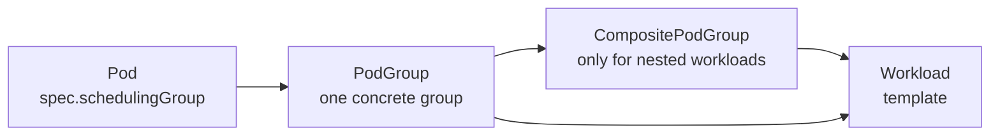

### 1.2 Why Workload and PodGroup are two layers

`Workload` and `PodGroup` relate as template and instance, and one template can have several PodGroups. A Deployment, for example, has one Workload, and each of its ReplicaSets has its own PodGroup.

In v1.35 a PodGroup was only a field inside Workload. It became a separate object in v1.36, and the KEP gives three reasons:

- Different lifecycles. A Workload expresses long-lived intent, while PodGroups come and go as replicas are created and deleted. Keeping both in one object mixes intent with runtime state.
- Status and resources belong to a concrete group. The scheduling result is written per group, and devices shared by a group need the group as their owner so that they are released when the group is deleted.
- Scale. With the spec and status of every group in one object, the etcd object size limit and write conflicts on status updates become a problem.

After the split, the two objects divide the work like this:

| | Workload | PodGroup |
|---|---|---|
| Content | Templates of groups | One concrete group: scheduling policy and scheduling status |
| Used by | Controllers and tools such as CLIs | kube-scheduler |
| Read by kube-scheduler | No | Yes |
| Status | None | Yes |
| How many | One per workload | One per group |

When a PodGroup is created, the policy in the template is copied into its own spec, and later changes to the Workload only affect PodGroups created afterwards. The scheduler therefore gets everything it needs from the PodGroup alone.

### 1.3 PodGroup fields

The example in 1.1 only uses `schedulingPolicy`. Here is a PodGroup that uses all the main fields:

```yaml
apiVersion: scheduling.k8s.io/v1beta1
kind: PodGroup
metadata:
  name: train-workers
spec:
  workloadRef:
    workloadName: train
    templateName: workers
  schedulingPolicy:
    gang:
      minCount: 4
  schedulingConstraints:
    topology:
    - key: topology.kubernetes.io/zone
  disruptionMode:
    all: {}
  priorityClassName: high-priority
  resourceClaims:
  - name: gpu
    resourceClaimTemplateName: gpu-template
status:
  conditions:
  - type: PodGroupInitiallyScheduled
    status: "True"
```

| Field | Meaning | Mutable after creation |
|---|---|---|
| `workloadRef` | The source Workload and template name. Optional: a PodGroup can stand alone | No |
| `parentCompositePodGroupName` | The parent CompositePodGroup. Empty means there is no group above | No |
| `schedulingPolicy` | `gang.minCount`: at least this many pods must be schedulable. `basic`: scheduled as a group without requiring them to succeed together | Only `minCount` |
| `schedulingConstraints.topology` | Topology constraint, at most one item, whose value is a node label key (section 4) | No |
| `disruptionMode` | The unit in which this group is preempted: `single` (default) per pod, `all` as a whole group (section 5) | No |
| `priorityClassName`, `priority`, `preemptionPolicy` | Priority and preemption policy of the group. Pods must have the same priority as their group | No |
| `resourceClaims` | DRA ResourceClaims shared by the pods of the group, at most 4 | No |
| `status.conditions` | `PodGroupInitiallyScheduled`, written by the scheduler | — |

`PodGroupInitiallyScheduled` records whether the group was scheduled successfully the first time, and never reverts once it is True. Upstream scopes PodGroup to coordinating the initial placement: `minCount` is checked only at scheduling time, and recovering from later evictions or node failures is left to the workload controller.

### 1.4 Maturity and how to enable it

- Release progress: introduced as Alpha in v1.35; PodGroup became a separate object in v1.36; the core API moved to `v1beta1` in v1.37; in v1.38, CompositePodGroup, TAS and Job integration move to Beta and Deployment integration is added as Alpha. GA is targeted for v1.39, and v1.40 for CompositePodGroup.
- Off by default: through v1.38, all related feature gates are disabled by default and have to be enabled on kube-apiserver, kube-controller-manager and kube-scheduler.
  - `GenericWorkload`: the core switch, covering gang scheduling and WAP.
  - `TopologyAwareWorkloadScheduling`: TAS. Depends on `GenericWorkload`.
  - `CompositePodGroup`: multi-level nesting. Depends on the two above.
  - `WorkloadWithJob`, `WorkloadWithDeployment`: Job and Deployment integration.
  - `DRAWorkloadResourceClaims`: `resourceClaims` on PodGroup.
- Non-goals: KEP-4671 explicitly excludes multiple queues and fairness from kube-scheduler and states that Kueue and Volcano will continue to provide them. Upstream also does not discover topology automatically and does not support soft topology constraints.

## 2. kube-scheduler Flow: Single Pod vs. PodGroup

### 2.1 Recap: Classic Single-Pod Scheduling Flow

Standard kube-scheduler runs a two-phase pipeline—a single-goroutine Scheduling Cycle followed by an asynchronous Binding Cycle:

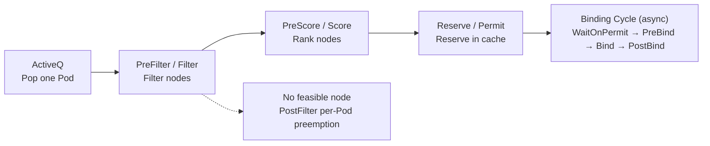

### 2.2 Extension: PodGroup Scheduling Flow (v1.37 / v1.38)

With `GenericWorkload` enabled, pods with `schedulingGroup` bypass single-pod queueing and are evaluated as one **root group** per scheduling cycle:

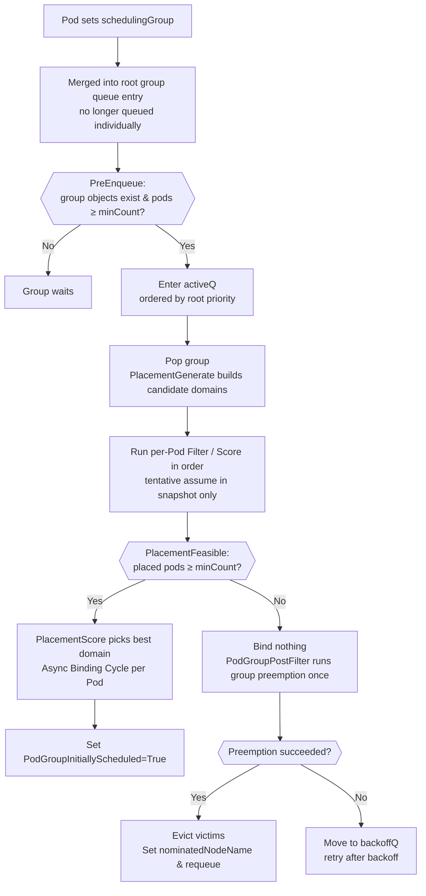

Four key differences from single-pod scheduling:

1. **Four new framework extension points**:
   - `PlacementGenerate` (`TopologyPlacement`): generates candidate node subsets by topology constraint.
   - `PlacementScore` (`PodGroupPodsCount`, `NodeResourcesFit`): scores feasible domains.
   - `PlacementFeasible` (`GangScheduling`): checks progress per pod and short-circuits once `placed + remaining < minCount`.
   - `PodGroupPostFilter` (`DefaultPreemption`, `DynamicResources`): runs once on whole-group failure.
2. **Snapshot simulation with full revert**: Per-pod Filter/Score results are tentatively assumed in the snapshot so sibling pods see resource usage without mutating live cache; all assumes revert before per-pod async binding starts.
3. **Decision-only all-or-nothing**: Binding remains per-pod and asynchronous with no group bind rollback; `PodGroupInitiallyScheduled` never reverts once `True` (post-eviction recovery stays with workload controllers).
4. **Single-goroutine & greedy**: Large group cycles (`pods × domains`) block the scheduling loop; sequential greedy evaluation does not backtrack, and all pods in a hierarchy must share the same `schedulerName`, priority, and preemption policy.

**Key v1.37 → v1.38 changes**:
- Removed the 5-minute Gang Permit barrier, relying solely on the public `PlacementFeasible` extension point.
- Promoted `CompositePodGroup` to Beta (max depth 4 → 5) with runtime hierarchy validation, status conditions, and finalizer protection.
- Added adaptive domain search cutoff (`percentageOfPlacementsToScore`, 5% floor), nominated-placement fast path, and multi-plugin intersection.

## 3. Upstream PodGroup / CompositePodGroup vs. Volcano

### 3.1 PodGroup Comparison

| Dimension | Upstream PodGroup (`scheduling.k8s.io`) | Volcano PodGroup (`scheduling.volcano.sh`) |
|---|---|---|
| Scope | Pure placement unit (single workload) | Batch job carrier with queue, admission & lifecycle |
| Pod binding | Immutable `pod.spec.schedulingGroup` | annotation `scheduling.k8s.io/group-name` |
| Gang rules | Single `minCount` | Job `minMember` + role `minTaskMember` + subgroup rules |
| Queue & admission | No queue or `minResources`; pods created eagerly | Bound to `queue`; `enqueue` checks `minResources` |
| Trigger model | Event-driven, one root group per cycle | Periodic Session batching queues/jobs (`Statement` txn) |
| Topology & hierarchy | Single node label key (hard) + `CompositePodGroup` | HyperNode (`hard`/`soft`) + embedded `subGroupPolicy` |
| Preemption & DRA | Declarative `disruptionMode`, PodGroup-level `resourceClaims` | Action/plugin driven; pod-level DRA only |
| Status | One-way `PodGroupInitiallyScheduled` (`status` subresource) | Dynamic `phase` + conditions + counts (no `status` subresource) |

### 3.2 CompositePodGroup vs. Volcano SubGroup

Scenario: **2 replica groups × 4 pods each**—each replica group within one rack, entire workload within one zone, starting only when both groups are ready.

Upstream builds a tree of standalone objects (up to 5 levels):

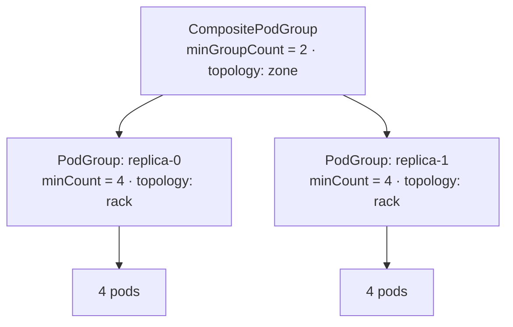

Volcano embeds `subGroupPolicy` in one `PodGroup` (fixed 2 levels, no standalone subgroup objects):

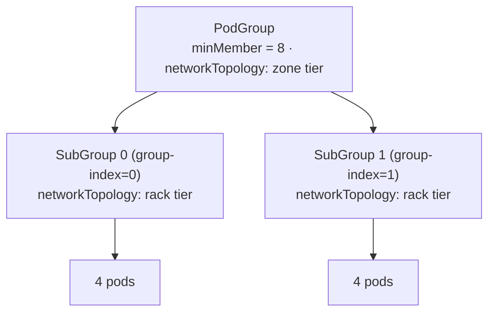

Side-by-side YAML:

```yaml
# Upstream: Workload template expanded into 1 CompositePodGroup + 2 PodGroups
apiVersion: scheduling.k8s.io/v1beta1
kind: Workload
metadata:
  name: serving
spec:
  compositePodGroupTemplates:
  - name: root
    schedulingPolicy: { gang: { minGroupCount: 2 } }
    schedulingConstraints:
      topology: [{ key: topology.kubernetes.io/zone }]
    podGroupTemplates:
    - name: replica
      schedulingPolicy: { gang: { minCount: 4 } }
      schedulingConstraints:
        topology: [{ key: topology.example.com/rack }]
```

```yaml
# Volcano: single PodGroup against existing HyperNode tiers
apiVersion: scheduling.volcano.sh/v1beta1
kind: PodGroup
metadata:
  name: serving
spec:
  queue: default
  minMember: 8
  networkTopology: { mode: hard, highestTierAllowed: 2 }   # tier 2 = zone
  subGroupPolicy:
  - name: replica
    subGroupSize: 4
    minSubGroups: 2
    labelSelector: { matchLabels: { app: serving } }
    matchLabelKeys: [group-index]
    networkTopology: { mode: hard, highestTierAllowed: 1 } # tier 1 = rack
```

**Mapping compatibility**:

| Upstream Shape | Volcano Model Compatibility |
|---|---|
| Single `PodGroup` / two-level homogeneous `CompositePodGroup` | ✅ Direct fit (`minMember` / single `subGroupPolicy`) |
| Two-level heterogeneous `CompositePodGroup` (all required) | ✅ Expressible (multiple `subGroupPolicy` or `minTaskMember`) |
| Two-level heterogeneous with `minGroupCount < total` | ❌ Cannot map accurately (cross-template vs. per-policy count) |
| 3+ levels (e.g., `JobSet → ReplicatedJob → Job`) | ❌ Unsupported (Volcano fixed at 2 levels) |

## 4. Topology-Aware Scheduling: TAS vs. Volcano Network Topology

Both have the same goal: place the pods of a group on nodes that are close to each other in the network. They differ in how topology is described and how candidate domains are searched.

### 4.1 How topology is described

Upstream has no topology object and uses node labels directly. Nodes with the same value of a label form a domain:

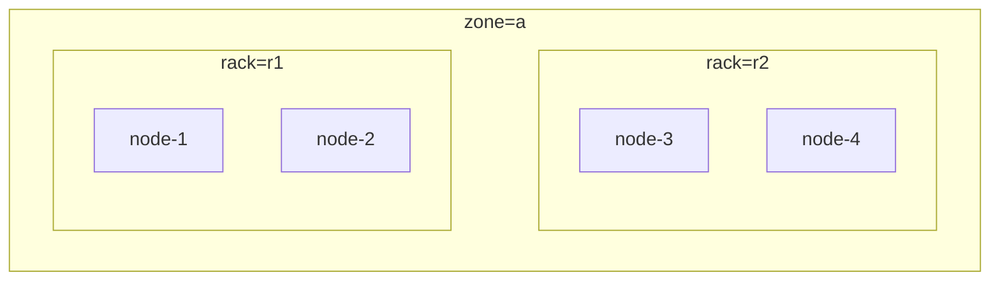

Volcano models the same topology explicitly as a tree of HyperNodes, where a lower tier is closer to the nodes. HyperNodes can be created by hand or discovered by a controller from UFM or node labels:

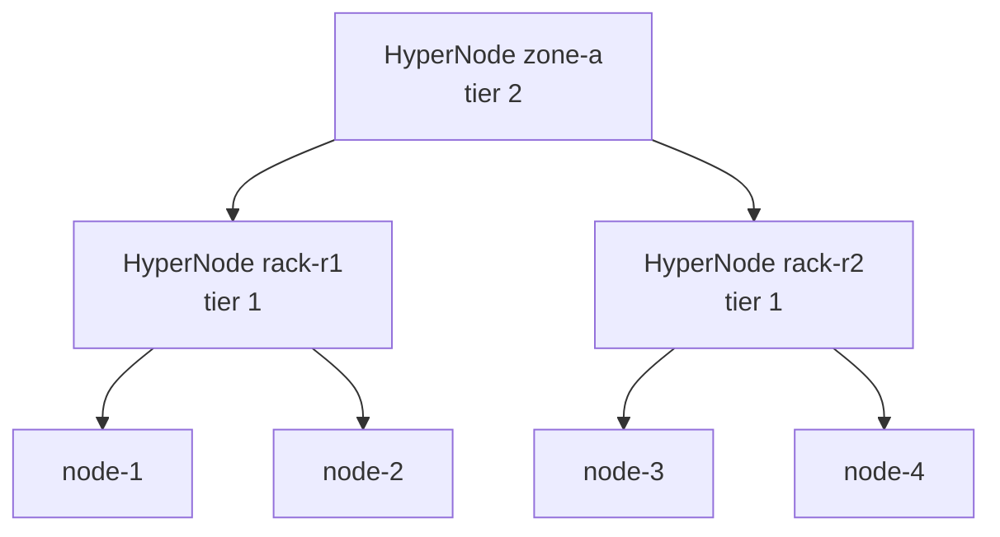

### 4.2 How upstream TAS schedules

A PodGroup names one node label key, at most one item:

```yaml
schedulingConstraints:
  topology:
  - key: topology.example.com/rack
```

It is a hard constraint: all pods of the group must be on nodes with the same value of this label. Scheduling goes like this:

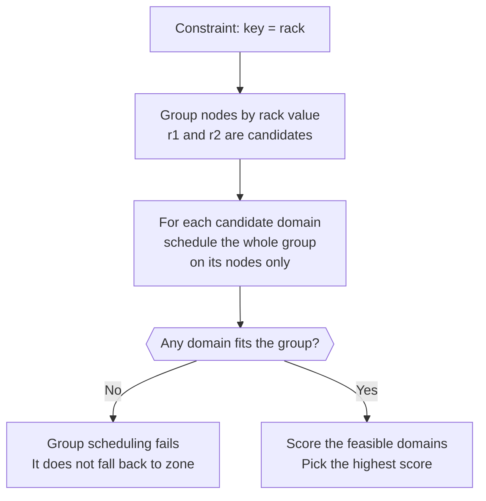

1. Generate candidate domains. The `TopologyPlacement` plugin groups nodes by the value of the label, and each value is a candidate domain. All candidates are at the same level, for example all racks, with no order among them. Nodes without the label belong to no domain.
2. Evaluate each one. For each candidate domain, the usable nodes are limited to that domain and the whole-group scheduling of section 2 runs in full: Filter and Score for each pod, then the gang check.
3. Score and pick. Among the domains that fit the whole group, one is picked by score. There are two default scorers: `PodGroupPodsCount`, where more pods placed means a higher score, and `NodeResourcesFit` with the MostAllocated strategy, where a domain with higher resource usage scores higher.
4. v1.37 evaluates every candidate domain. v1.38 evaluates only a share when there are many, controlled by `percentageOfPlacementsToScore`, which is adaptive by default with a floor of 5%.

Two more points:

- When the group already has running pods, the only candidate is the domain they are in, so new pods have to join the same domain.
- A PodGroup can carry only one level of constraint. Multiple levels need nested CompositePodGroups: the parent has `key: zone`, the child has `key: rack`, and the child picks a rack inside the zone chosen for the parent. Every level is a hard constraint.

### 4.3 How Volcano schedules

A PodGroup states the highest tier allowed, not the key of one level:

```yaml
networkTopology:
  mode: hard
  highestTierAllowed: 2        # tier 2 is the zone
```

It means the lowest common HyperNode of all pods of the group must not be above tier 2. Scheduling tries one tier at a time, starting from the lowest:

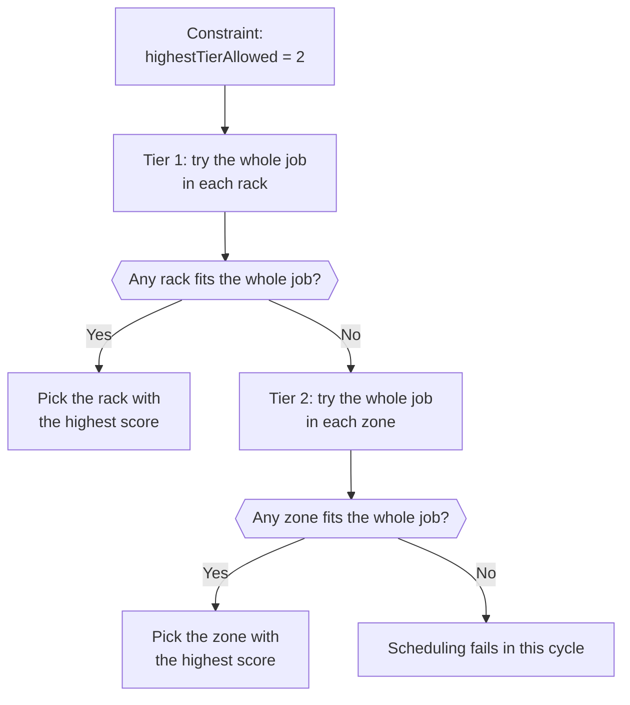

1. Candidate HyperNodes are grouped by tier, from tier 1 up to `highestTierAllowed`. HyperNodes whose aggregate idle resources cannot hold `minResources` are filtered out first.
2. The search starts from the lowest tier. For each HyperNode in that tier, the whole job is trial-allocated once using only the nodes under it, and the result is recorded and then undone.
3. As soon as any HyperNode in the tier fits the whole job, the one with the highest score is picked and higher tiers are not considered. The score is bin-packing at the HyperNode level: the higher the resource usage after adding this job, the higher the score.
4. Only when nothing in the tier fits does the search move one tier up and repeat.
5. `soft` mode is handled internally as `hard` with the highest tier allowed set to the whole cluster, so it searches bottom-up in the same way and, at worst, ends up with no topology restriction.

A subgroup can also carry `networkTopology`. After a HyperNode is picked for the job, the same tier-by-tier search runs for each subgroup inside that HyperNode. When the job already has running pods, the search is limited to the subtree under the lowest common ancestor of the HyperNodes they occupy.

### 4.4 The difference: can a lower tier be preferred

Take one requirement: a job of 4 pods that should be in the same rack if possible, and may be spread within one zone when no rack can hold it.

| Cluster state | Upstream `key: rack` | Upstream `key: zone` | Volcano `hard`, up to zone |
|---|---|---|---|
| Some rack can hold 4 pods | Same rack | Same zone, possibly across racks | Same rack |
| No rack can, the zone can | Scheduling fails | Same zone | Same zone |
| The zone cannot either | Scheduling fails | Scheduling fails | Scheduling fails. `soft` mode goes on to the whole cluster |

Upstream cannot express this requirement, for two reasons:

- Candidate domains are all at one level, and there is no search that tries a lower level first and a higher one next. With `key: rack`, the group fails when no rack fits and does not fall back to the zone.
- With `key: zone`, the constraint only guarantees that the 4 pods are in the same zone. Nodes inside the domain are chosen by the ordinary per-pod scoring, which has no preference for the same rack, so the pods can end up in several racks of the zone.

Volcano searches tier by tier from the bottom, so a single configuration covers both "same rack first" and "same zone otherwise".

| | Upstream TAS | Volcano |
|---|---|---|
| Source of topology | Node labels. No extra objects, no discovery | HyperNodes, created by hand or discovered |
| How a constraint is written | One node label key | `highestTierAllowed` or `highestTierName` |
| Candidate domains | The values of that label, all at one level | HyperNodes of every tier within the allowed range |
| Search order | None. Evaluate, then pick by score | From the lowest tier to the highest allowed, stopping at the first tier with a fit |
| When the current level does not fit | Scheduling fails | Go one tier up, until the highest allowed |
| Soft constraints | Not supported | `soft` mode, at worst the whole cluster |
| Domain scoring | Number of pods placed; resource usage of the domain | Bin-packing at the HyperNode level |
| Multi-level constraints | Nested CompositePodGroups, one key per level | One at job level and one at subgroup level |
| Search cost | One whole-group scheduling pass per candidate domain. v1.38 can evaluate only a share | One trial allocation per candidate HyperNode, after filtering by idle resources |

The upstream approach is lighter: it works as soon as nodes are labelled and needs no extra objects. Volcano needs HyperNodes first, and in return offers tier-by-tier closest placement, soft constraints and topology discovery.

## 5. Group-Level Preemption: WAP vs. Volcano Preemption and Reclaim

### 5.1 How upstream WAP works

After a whole group fails to schedule, kube-scheduler runs group-level preemption once in the same scheduling cycle, through the `PodGroupPostFilter` extension point:

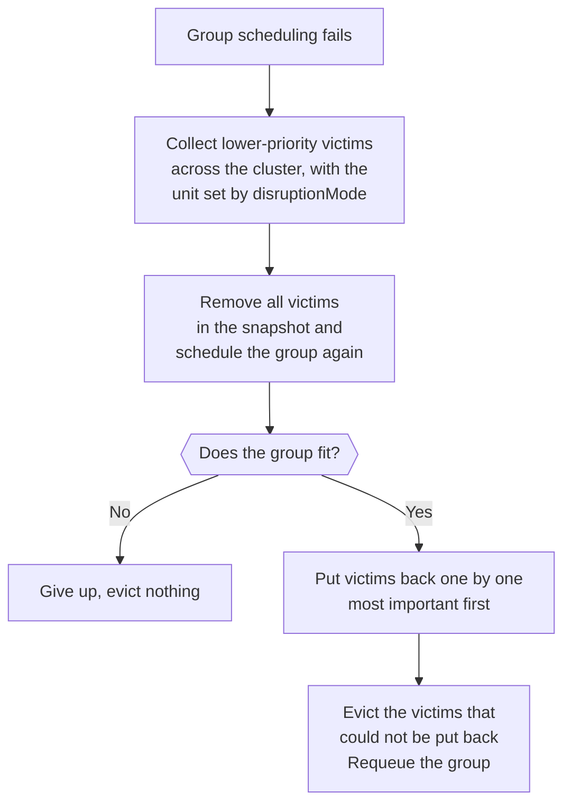

1. Collect victims. The scope is every pod in the cluster with a lower priority than the group. The victim unit depends on the victim's own `disruptionMode`:
   - `single` (default): each pod is a separate victim.
   - `all`: the whole group is one victim, kept or evicted as a whole. With nesting, the highest group that sets `all` is used.
2. Remove all, then place. All candidate victims are removed in the snapshot and the whole group is scheduled once more, including domain selection when TAS is on. If it still does not fit, preemption gives up.
3. Put back one by one. Victims are put back on their nodes in order of importance, most important first. A victim is kept if every pod of the group still passes Filter on its chosen node. Importance is compared in this order: higher priority is more important; at the same priority, a whole group is more important than a single pod; a larger group is more important; an earlier start is more important.
4. The victims that could not be put back are the final victims, and the scheduler deletes their pods. The pods of the group record `nominatedNodeName` and are requeued until the victims are gone. No new preemption starts while victims of the previous round are still terminating.

The victim's `minCount` plays no part in this process. A gang group running with the default `single` is treated as a number of independent pods. It can lose only some of them, and the rest keep running below `minCount`. A group is kept intact only if it sets `disruptionMode: all` itself. PDBs are best effort: victims that would violate a PDB are tried first when putting victims back, but they can still be evicted.

### 5.2 How Volcano works

Volcano preemption and reclaim are separate actions, enabled by configuration:

| Action | Trigger | Victim scope | Victim unit | Treatment of the victim's gang |
|---|---|---|---|---|
| `preempt` | Priority | Same queue | A task | Evicts only what exceeds `minAvailable`. Never breaks a gang |
| `reclaim` | Queue quota | Other queues | A task | Same as above |
| `gangpreempt` | Priority | Same queue | A bundle | Evicts what does not affect the gang first, and breaks a gang as a whole when that is not enough |
| `gangreclaim` | Queue quota | Other queues | A bundle | Same as above |

`preempt` and `reclaim` pick victims task by task and the gang plugin filters them: a task may be evicted only while its job has more ready pods than `minAvailable`. These two actions therefore never take a victim job below `minAvailable`. `preempt` does not handle jobs with network topology constraints. Preemption for those jobs is done by `gangpreempt`.

`gangpreempt` and `gangreclaim` pick victims bundle by bundle. `gangpreempt` works like this:

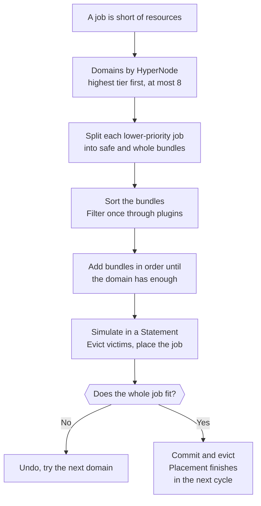

1. Candidate domains. The cluster is split by HyperNode, from the highest tier down so that larger domains are tried first, with at most `maxDomains` domains, 8 by default. When the cluster has no HyperNodes, the whole cluster is one domain.
2. Split into bundles. Jobs in the domain that are in the same queue, preemptable and of lower priority than the preemptor are candidates. The tasks of each victim job inside the domain are split into two bundles:
   - Safe bundle: the victim job still satisfies its gang after these tasks are evicted. This requires a surplus on all three checks: `minAvailable` at job level, `minTaskMember` at role level and `minSubGroups` at subgroup level.
   - Whole bundle: the remaining tasks. Evicting them breaks the victim job's gang.
3. Sort. Safe bundles come before whole bundles. Bundles of the same kind follow the reverse of the job scheduling order, so jobs with lower priority are evicted first.
4. Filter through plugins. Plugins such as `priority`, `capacity` and `pdb` filter the candidate tasks once. A whole bundle is kept only if all of its tasks are allowed.
5. Accumulate and simulate. Bundles are added in order until the idle resources of the domain plus the freed resources are enough. The eviction and the placement of the preemptor are then simulated in a Statement. The result is committed only if the whole preemptor job fits. Otherwise it is undone and the next domain is tried.

`gangreclaim` works the same way with two differences: victims come from other queues, and sorting compares the queue order first and a gain-to-cost ratio within the same queue. The gain is what the bundle frees inside the domain that the reclaimer can use, and the cost is the total resources of the victim job. So when a gang has to be broken, a job that is small and concentrated in the current domain is preferred.

### 5.3 Results in the same scenario

The cluster has no idle resources and each node holds one pod. There are two low-priority gang jobs:

- Job A: `minAvailable` is 4 and 6 pods are running, so it has a surplus of 2.
- Job B: `minAvailable` is 4 and 4 pods are running, so it has no surplus.

A high-priority Job P needs 3 pods scheduled together.

| Scheduler | Result |
|---|---|
| Upstream WAP, A and B both with the default `single` | 3 pods are evicted. Which 3 depends on the nodes P's pods chose in the trial placement, not on the `minCount` of A and B. B can lose 1 to 3 pods, with the rest still running below `minCount` |
| Upstream WAP, B sets `disruptionMode: all` | B's 4 pods are one unit, all kept or all evicted. A's pods are still handled one by one |
| Volcano `preempt` | Only A's 2 surplus pods can be evicted, which is not enough for P. P's preemption is not committed and nothing is evicted |
| Volcano `gangpreempt` | A's safe bundle (2 pods) is picked first and is not enough. One whole bundle (4 pods) is then added according to the job order. 6 pods are evicted in total: one job is evicted as a whole and the other still satisfies its gang |

### 5.4 Comparison

| | Upstream WAP | Volcano |
|---|---|---|
| Trigger | Priority | Priority, and queue quota |
| When it runs | Once in the same cycle after a group fails to schedule | Separate actions, enabled by configuration |
| Preemptor | The whole group in one decision. Nothing is evicted if it does not fit | The whole job. Nothing is evicted if it does not fit |
| Victim unit | A pod by default. A whole group with `all` | A task or a bundle |
| Is the victim's gang considered | `minCount` is ignored. Only groups with `all` are kept intact | Yes: the surplus is evicted first, then a gang is broken as a whole |
| How victims are determined | Remove all, place the preemptor, then put victims back one by one | Add bundles in order until resources are enough, then simulate the placement |
| Victim order | Put back by importance: priority, group over single pod, group size, start time | Safe before whole, then job order or queue order |
| Search scope | The whole cluster, once | Per node, or per HyperNode domain |
| PDB | Kept if possible, not guaranteed | Filtered by the `pdb` plugin |
| After preemption | Preemptor pods record `nominatedNodeName` | `NominatedHyperNode` is recorded and honoured in the next cycle |

What the two have in common is that the preemptor is decided as a whole: if the whole group does not fit, no pod is evicted. They differ mainly in three ways:

- Trigger. Upstream only has priority preemption. Volcano also has cross-queue reclaim, which has no upstream counterpart because upstream has no queues.
- The victim's gang. Upstream does not protect it by default and leaves it to the victim to declare `disruptionMode: all`. Volcano uses the victim job's gang to select and order victims, and by default evicts what does not affect the gang first.
- Number of victims. Upstream has the put-back step, so what is finally evicted is the minimal set that could not be put back. Volcano's gang actions add up bundles without a put-back step, so more pods can be evicted than strictly needed. In exchange, fewer victim jobs are left partially evicted.

Volcano has no exact equivalent of `disruptionMode: all`: a whole bundle only contains the victim job's tasks inside the current domain, whereas upstream `all` applies to all pods of the group across the cluster.

## 6. Volcano Strengths & Gaps

| Area | Volcano strengths (missing or out of scope upstream) | Volcano gaps (present upstream) |
|---|---|---|
| Multi-tenancy and queues | A full Queue model: quota, fairness, cross-queue reclaim. An explicit upstream non-goal | — |
| Admission and status | `minResources` enqueue admission; a `phase` that reflects the current state; role-level `minTaskMember` | PodGroup has no status subresource, so the scheduler updates the whole object |
| Hierarchy | One object is enough for a two-level structure | Fixed at two levels. No nesting of three or more levels, while upstream allows up to 5 |
| Network topology | Searches tier by tier from the bottom and prefers the lower tier; supports `soft` constraints; HyperNodes can be discovered automatically | Needs HyperNodes first, unlike node labels that work out of the box |
| Preemption | Considers the victim's gang when selecting victims; supports cross-queue reclaim | No declarative `disruptionMode`; evicts by bundle, so more pods can be evicted than strictly needed |
| Devices and ecosystem | — | No PodGroup-level DRA; does not recognise `pod.spec.schedulingGroup` |

PodGroup-level DRA refers to the `resourceClaims` field on the upstream PodGroup. With DRA (Dynamic Resource Allocation), each pod normally refers to its own ResourceClaim to request devices such as GPUs. This field declares the ResourceClaim on the PodGroup instead: one ResourceClaim is generated per PodGroup, all pods of the group share the same device allocation, and the claim is created and deleted with the PodGroup. Volcano only supports pod-level ResourceClaims today.

## 7. Volcano Compatibility Plan & Effort Estimate

### 7.1 Current State

Volcano compiles against upstream `PodGroup` types, but `PodGroupStates` and `PodGroupManager` are stubs; `getJobID` only reads `scheduling.k8s.io/group-name` and never checks `pod.spec.schedulingGroup`, with no informers or RBAC. Submitting a `schedulingGroup` pod to Volcano degrades to `minMember=1` per-pod scheduling.

### 7.2 Implementation Options

**Option A (`pg-controller` mirroring)**: Controller watches upstream objects, mirrors them into Volcano PodGroups, stamps annotations/subgroup labels, and writes status back. Minimal scheduler changes.


**Option B (Native scheduler support)**: Scheduler Cache watches upstream objects directly into `JobInfo` and writes status back directly.

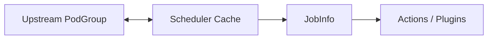

| Dimension | Option A: Controller Mirroring | Option B: Native Scheduler |
|---|---|---|
| Scheduler impact | Minimal (insulates core from upstream API churn) | Broad (44 non-test scheduler files reference PodGroup) |
| Capability ceiling | Flat gang + two-level subgroups | Arbitrary depth (recursive SubJob) + PodGroup-level DRA |
| Consistency | Sync lag & naming prefix needed | Single source of truth, no duplicate objects |

### 7.3 Key Semantic Mappings

| Gap | Recommended Handling |
|---|---|
| Queue & `minResources` | Reuse `scheduling.volcano.sh/queue-name` (default: `default`); aggregate created pods' requests for `minResources` |
| Name collision | Both use resource `podgroups`; prefix mirrored Volcano PodGroups in Option A |
| `disruptionMode` | `all`: build no safe bundle for the job and include its tasks outside the domain in the whole bundle. `single`: keep Volcano's default gang protection |
| Topology label key | Pair HyperNode `label` discoverer with label-key → tier mapping (aligned with [#6161](https://github.com/volcano-sh/volcano/issues/6161)) |
| Unsupported shapes & gating | Target `v1beta1+` via API discovery behind an off-by-default Volcano gate; explicitly reject 3+ levels / partial cross-template counts in status |

### 7.4 Phased Effort & Recommendation

> Estimates assume engineers familiar with the Volcano scheduler (including unit/e2e tests, cluster verification, and docs; excluding review cycles). Budget ~1–2 person-weeks per K8s release to track upstream changes prior to GA.

| Phase | Scope | Option | Effort | Timing |
|---|---|---|---|---|
| **Phase 1** | Recognize `schedulingGroup`, `minCount`, priority, queue, status sync (native Job / Deployment) | Option A | **4–6 person-weeks** | **Start now** (behind off-by-default gate, low risk) |
| **Phase 2** | Add `disruptionMode`, topology mapping, two-level `CompositePodGroup` (common LWS / JobSet) | Option A | **12–20 person-weeks total** | Driven by user demand |
| **Phase 3** | Arbitrary depth (recursive SubJob) + PodGroup-level DRA (full parity) | Option B (from scratch) | **33–51 person-weeks (8–12 person-months)** | Re-evaluate after upstream GA (v1.39+) |

*Replacing Volcano's PodGroup is not recommended (would lose queues, admission, and soft topology). Keep tracking upstream adoption across JobSet, LWS, Kubeflow Trainer, KubeRay, Spark Operator, and Kueue ([kubernetes-sigs/kueue#8871](https://github.com/kubernetes-sigs/kueue/issues/8871)).*

## 8. References

- **Upstream KEPs**: [KEP-4671 Gang Scheduling](https://github.com/kubernetes/enhancements/tree/master/keps/sig-scheduling/4671-gang-scheduling), [KEP-6012 CompositePodGroup](https://github.com/kubernetes/enhancements/tree/master/keps/sig-scheduling/6012-composite-podgroup-api), [KEP-5732 TAS](https://github.com/kubernetes/enhancements/tree/master/keps/sig-scheduling/5732-topology-aware-workload-scheduling), [KEP-5710 WAP](https://github.com/kubernetes/enhancements/tree/master/keps/sig-scheduling/5710-workload-aware-preemption), [KEP-6089 Controller APIs](https://github.com/kubernetes/enhancements/tree/master/keps/sig-scheduling/6089-was-controller-apis), [KEP-5547 Job Integration](https://github.com/kubernetes/enhancements/tree/master/keps/sig-apps/5547-integrate-workload-with-job)
- **Official Blog**: [Kubernetes v1.37: Advancing Workload-Aware Scheduling](https://kubernetes.io/blog/2026/09/08/kubernetes-v1-37-advancing-workload-aware-scheduling/)
- **Volcano Design Docs**: [Network Topology Aware Scheduling](../design/Network%20Topology%20Aware%20Scheduling.md), [gang-aware-eviction-design](../design/gang-aware-eviction-design.md)
- **Key Code Paths**:
  - Kubernetes: `staging/src/k8s.io/api/scheduling/v1beta1/types.go`, `pkg/scheduler/schedule_one_podgroup.go`, `pkg/scheduler/framework/plugins/gangscheduling/`, `pkg/scheduler/framework/preemption/podgrouppreemption.go`
  - Volcano: `staging/src/volcano.sh/apis/pkg/apis/scheduling/v1beta1/types.go`, `pkg/scheduler/api/job_info.go` (`getJobID`), `pkg/controllers/podgroup/`, `pkg/scheduler/actions/gangpreempt/`
