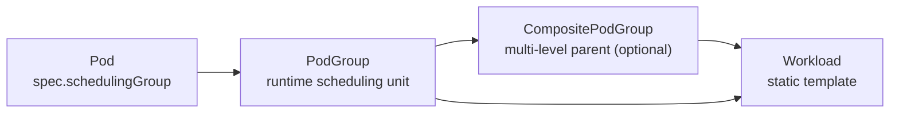
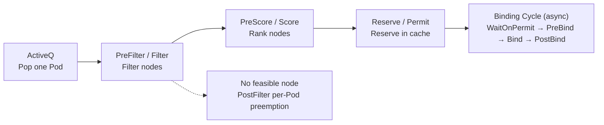
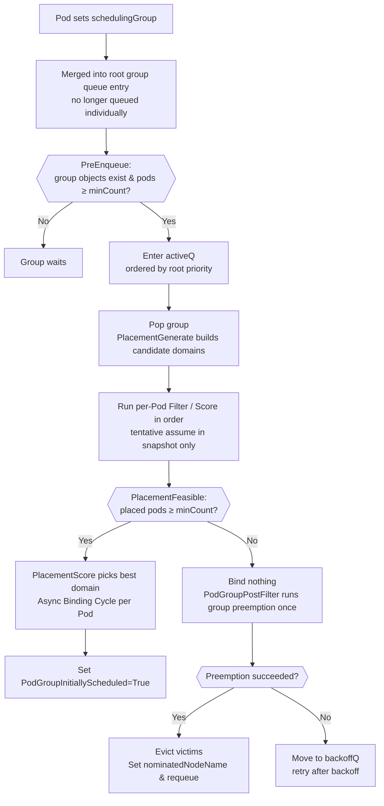
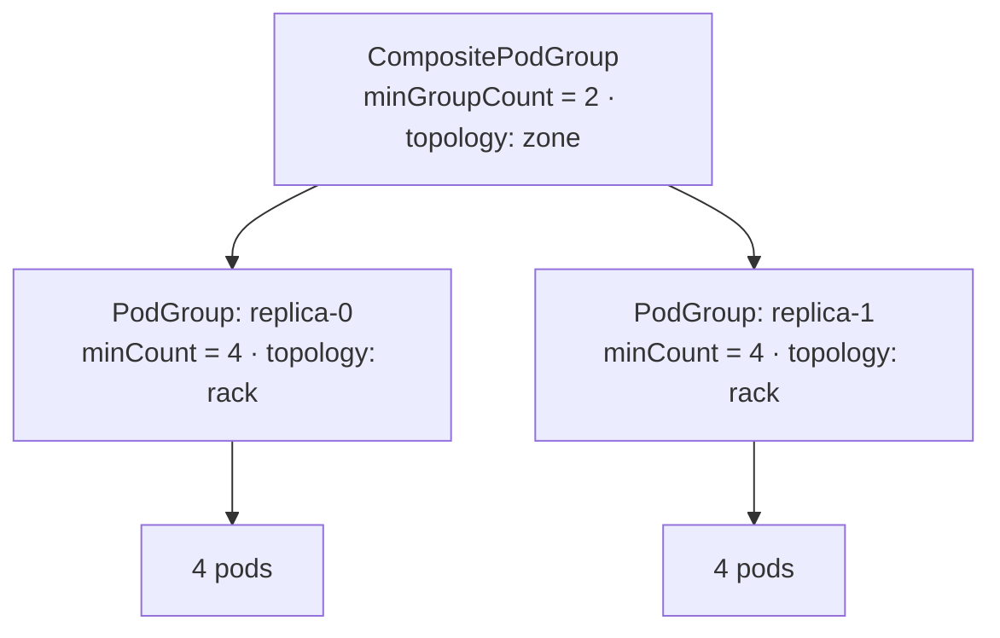
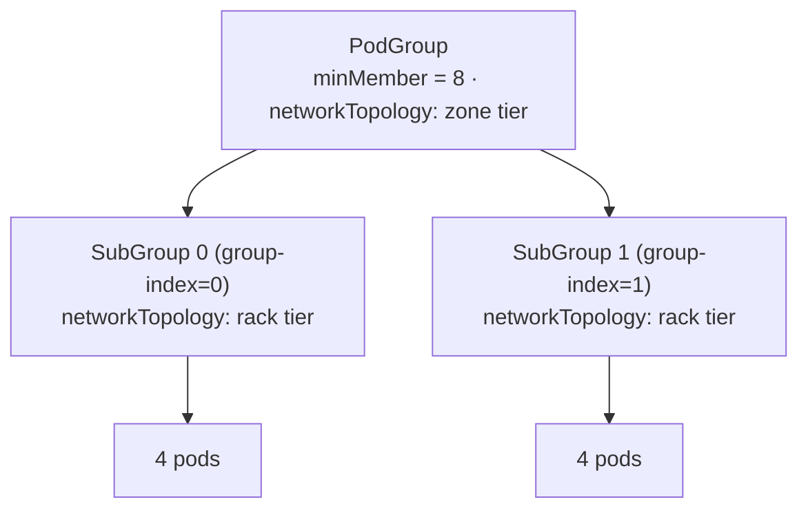
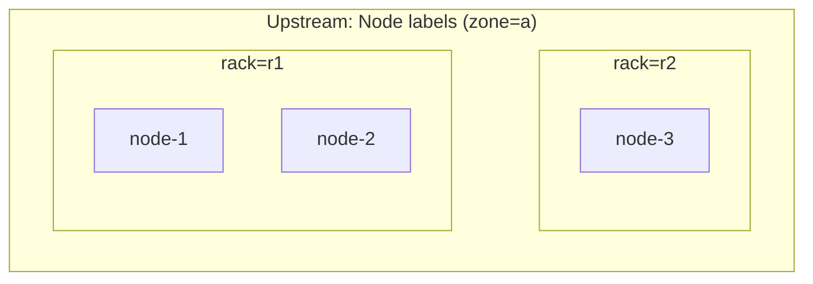
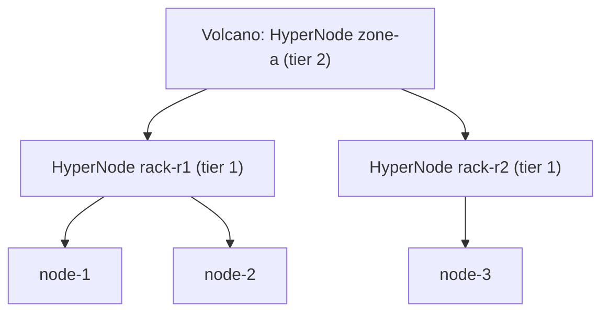
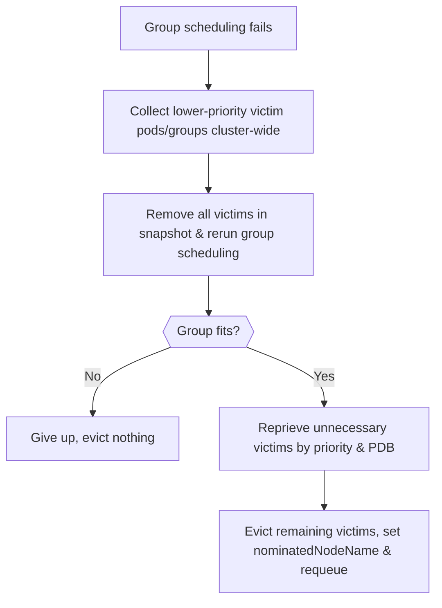
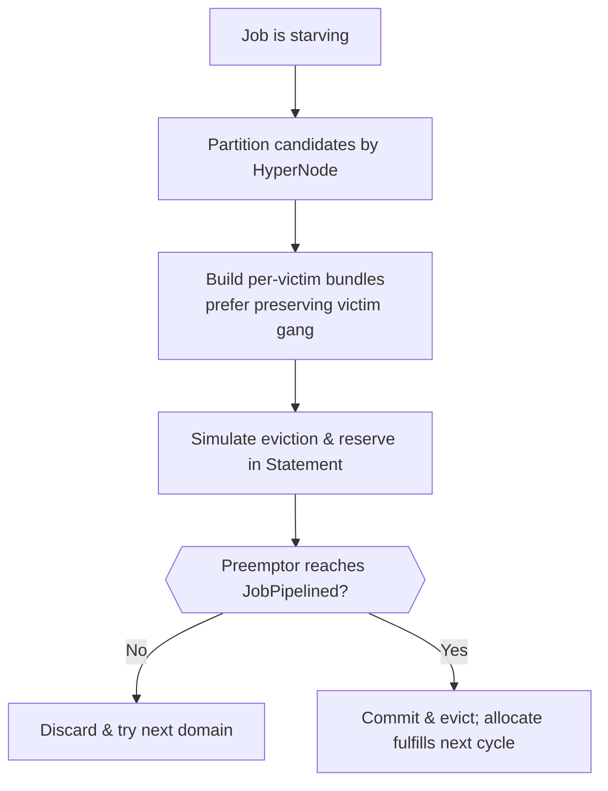
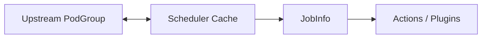

# Upstream Kubernetes PodGroup (WAS) vs. Volcano

English | [简体中文](./k8s-workload-aware-scheduling-vs-volcano-cn.md)

> Based on Kubernetes v1.37.2 / v1.38 (2026-11 master) and Volcano master source code.

Since v1.35, Kubernetes has been adding Workload-Aware Scheduling (WAS) natively to kube-scheduler with `PodGroup`, `Workload`, and `CompositePodGroup` under `scheduling.k8s.io`, covering gang scheduling, topology-aware scheduling (TAS), and workload-aware preemption (WAP).

---

## 1. Upstream PodGroup: API Model & Usage

### 1.1 Two-Layer Design: `Workload` & `PodGroup`

Upstream separates static intent from runtime instances—similar to `Deployment` and `ReplicaSet`—with all objects created by workload controllers:



*Arrows denote references.*

- **`Workload` (static template)**: Defines the workload's group templates (`podGroupTemplates` / `compositePodGroupTemplates`) and links back via `controllerRef`. It has no `status` and **kube-scheduler never watches it**; it provides a uniform workload abstraction for controllers, CLIs, and external queueing/orchestration systems (such as Kueue).
- **`PodGroup` (runtime instance)**: The unit consumed by kube-scheduler. Policies are copied from the template at creation time, avoiding write contention and etcd size limits on a single object. Each `PodGroup` can own group-scoped resources (e.g., DRA `ResourceClaim`s) with a protection finalizer for clean teardown.
- **`pod.spec.schedulingGroup`**: Immutable pod field referencing its `PodGroup`, preventing pods from leaving or switching groups mid-scheduling.

### 1.2 Core API Fields (`scheduling.k8s.io/v1beta1`)

| Field | Purpose | Mutability |
|---|---|---|
| `spec.workloadRef` | Owning `Workload` and template name (optional) | Immutable |
| `spec.parentCompositePodGroupName` | Parent `CompositePodGroup` (empty if root) | Immutable |
| `spec.schedulingPolicy` | `basic` (grouped without gang) or `gang.minCount` | Only `minCount` mutable |
| `spec.schedulingConstraints.topology[]` | Topology constraint (max 1 node label key, hard only) | Immutable |
| `spec.disruptionMode` | Preemption victim unit: `single` (default, pod) or `all` (whole group) | Immutable |
| `spec.priorityClassName` / `priority` / `preemptionPolicy` | Group priority & preemption policy (pod priority ignored) | Immutable |
| `spec.resourceClaims[]` | Shared PodGroup-level DRA ResourceClaims (max 4) | Immutable |
| `status.conditions` | `PodGroupInitiallyScheduled` (terminal once `True`) | Written by scheduler |

> **What is PodGroup-level DRA (`resourceClaims`)?**
> Standard DRA attaches `ResourceClaim`s per pod. PodGroup-level DRA declares claims on the `PodGroup` itself—generated per group and deleted with it—so all pods in the group share one device allocation (bypassing the 256-pod `reservedFor` limit per claim).

### 1.3 Usage Example

For a 4-pod gang training job on a cluster with `GenericWorkload` and `WorkloadWithJob` enabled, users declare `spec.scheduling` directly on a native `Job`:

```yaml
apiVersion: batch/v1
kind: Job
metadata:
  name: train
spec:
  parallelism: 4
  completions: 4
  scheduling:
    schedulingPolicy:
      gang: {}          # defaults to parallelism when omitted
  template:
    ...
```

The Job controller automatically generates `Workload`, `PodGroup`, and injects `schedulingGroup` into each `Pod`:

```yaml
apiVersion: scheduling.k8s.io/v1beta1
kind: Workload
metadata:
  name: train
spec:
  podGroupTemplates:
  - name: workers
    schedulingPolicy:
      gang:
        minCount: 4
---
apiVersion: scheduling.k8s.io/v1beta1
kind: PodGroup
metadata:
  name: train-workers
spec:
  workloadRef:
    workloadName: train
    templateName: workers
  schedulingPolicy:
    gang:
      minCount: 4
---
apiVersion: v1
kind: Pod
metadata:
  name: train-0
spec:
  schedulingGroup:
    podGroupName: train-workers
```

### 1.4 Current Maturity & Feature Gates

- **Timeline**: v1.35 Alpha → v1.36 standalone `PodGroup` → v1.37 core API in `v1beta1` → v1.38 `CompositePodGroup` / TAS / Job integration in Beta (Deployment Alpha). Core GA slipped to **v1.39** (`CompositePodGroup` targets v1.40).
- **Opt-in only**: Through v1.38, **all core WAS feature gates default to `false`** and must be explicitly enabled on apiserver / controller-manager / scheduler:
  - Core gang & WAP: `GenericWorkload` (merged `GangScheduling` & `WorkloadAwarePreemption` in v1.37)
  - Topology: `TopologyAwareWorkloadScheduling` (depends on `GenericWorkload`)
  - Multi-level hierarchy: `CompositePodGroup` (depends on both above)
  - Controllers & DRA: `WorkloadWithJob`, `WorkloadWithDeployment`, `DRAWorkloadResourceClaims`
- **Explicit non-goals**: KEP-4671 explicitly excludes multi-tenant queues, quotas, and fairness—stating **Volcano and Kueue** will continue to provide them—as well as topology auto-discovery and soft constraints.

---

## 2. kube-scheduler Flow: Single Pod vs. PodGroup

### 2.1 Recap: Classic Single-Pod Scheduling Flow

Standard kube-scheduler runs a two-phase pipeline—a single-goroutine Scheduling Cycle followed by an asynchronous Binding Cycle:



### 2.2 Extension: PodGroup Scheduling Flow (v1.37 / v1.38)

With `GenericWorkload` enabled, pods with `schedulingGroup` bypass single-pod queueing and are evaluated as one **root group** per scheduling cycle:



Four key differences from single-pod scheduling:

1. **Four new framework extension points**:
   - `PlacementGenerate` (`TopologyPlacement`): generates candidate node subsets by topology constraint.
   - `PlacementScore` (`PodGroupPodsCount`, `NodeResourcesFit`): scores feasible domains.
   - `PlacementFeasible` (`GangScheduling`): checks progress per pod and short-circuits once `placed + remaining < minCount`.
   - `PodGroupPostFilter` (`DefaultPreemption`, `DynamicResources`): runs once on whole-group failure.
2. **Snapshot simulation with full revert**: Per-pod Filter/Score results are tentatively assumed in the snapshot so sibling pods see resource usage without mutating live cache; all assumes revert before per-pod async binding starts.
3. **Decision-only all-or-nothing**: Binding remains per-pod and asynchronous with no group bind rollback; `PodGroupInitiallyScheduled` never reverts once `True` (post-eviction recovery stays with workload controllers).
4. **Single-goroutine & greedy**: Large group cycles (`pods × domains`) block the scheduling loop; sequential greedy evaluation does not backtrack, and all pods in a hierarchy must share the same `schedulerName`, priority, and preemption policy.

**Key v1.37 → v1.38 changes**:
- Removed the 5-minute Gang Permit barrier, relying solely on the public `PlacementFeasible` extension point.
- Promoted `CompositePodGroup` to Beta (max depth 4 → 5) with runtime hierarchy validation, status conditions, and finalizer protection.
- Added adaptive domain search cutoff (`percentageOfPlacementsToScore`, 5% floor), nominated-placement fast path, and multi-plugin intersection.

---

## 3. Upstream PodGroup / CompositePodGroup vs. Volcano

### 3.1 PodGroup Comparison

| Dimension | Upstream PodGroup (`scheduling.k8s.io`) | Volcano PodGroup (`scheduling.volcano.sh`) |
|---|---|---|
| Scope | Pure placement unit (single workload) | Batch job carrier with queue, admission & lifecycle |
| Pod binding | Immutable `pod.spec.schedulingGroup` | annotation `scheduling.k8s.io/group-name` |
| Gang rules | Single `minCount` | Job `minMember` + role `minTaskMember` + subgroup rules |
| Queue & admission | No queue or `minResources`; pods created eagerly | Bound to `queue`; `enqueue` checks `minResources` |
| Trigger model | Event-driven, one root group per cycle | Periodic Session batching queues/jobs (`Statement` txn) |
| Topology & hierarchy | Single node label key (hard) + `CompositePodGroup` | HyperNode (`hard`/`soft`) + embedded `subGroupPolicy` |
| Preemption & DRA | Declarative `disruptionMode`, PodGroup-level `resourceClaims` | Action/plugin driven; pod-level DRA only |
| Status | One-way `PodGroupInitiallyScheduled` (`status` subresource) | Dynamic `phase` + conditions + counts (no `status` subresource) |

### 3.2 CompositePodGroup vs. Volcano SubGroup

Scenario: **2 replica groups × 4 pods each**—each replica group within one rack, entire workload within one zone, starting only when both groups are ready.

Upstream builds a tree of standalone objects (up to 5 levels):



Volcano embeds `subGroupPolicy` in one `PodGroup` (fixed 2 levels, no standalone subgroup objects):



Side-by-side YAML:

```yaml
# Upstream: Workload template expanded into 1 CompositePodGroup + 2 PodGroups
apiVersion: scheduling.k8s.io/v1beta1
kind: Workload
metadata:
  name: serving
spec:
  compositePodGroupTemplates:
  - name: root
    schedulingPolicy: { gang: { minGroupCount: 2 } }
    schedulingConstraints:
      topology: [{ key: topology.kubernetes.io/zone }]
    podGroupTemplates:
    - name: replica
      schedulingPolicy: { gang: { minCount: 4 } }
      schedulingConstraints:
        topology: [{ key: topology.example.com/rack }]
```

```yaml
# Volcano: single PodGroup against existing HyperNode tiers
apiVersion: scheduling.volcano.sh/v1beta1
kind: PodGroup
metadata:
  name: serving
spec:
  queue: default
  minMember: 8
  networkTopology: { mode: hard, highestTierAllowed: 2 }   # tier 2 = zone
  subGroupPolicy:
  - name: replica
    subGroupSize: 4
    minSubGroups: 2
    labelSelector: { matchLabels: { app: serving } }
    matchLabelKeys: [group-index]
    networkTopology: { mode: hard, highestTierAllowed: 1 } # tier 1 = rack
```

**Mapping compatibility**:

| Upstream Shape | Volcano Model Compatibility |
|---|---|
| Single `PodGroup` / two-level homogeneous `CompositePodGroup` | ✅ Direct fit (`minMember` / single `subGroupPolicy`) |
| Two-level heterogeneous `CompositePodGroup` (all required) | ✅ Expressible (multiple `subGroupPolicy` or `minTaskMember`) |
| Two-level heterogeneous with `minGroupCount < total` | ❌ Cannot map accurately (cross-template vs. per-policy count) |
| 3+ levels (e.g., `JobSet → ReplicatedJob → Job`) | ❌ Unsupported (Volcano fixed at 2 levels) |

---

## 4. TAS & WAP Comparison

### 4.1 TAS vs. Volcano Network Topology

Upstream derives topology domains implicitly from node label values; Volcano uses an explicit HyperNode tree:





| Dimension | Upstream TAS | Volcano Network Topology |
|---|---|---|
| Topology source | Node labels (zero extra CRDs, no discovery) | HyperNode CRD (manual or `ufm`/`label` discovery) |
| Constraints | Single label key, **hard only** | `highestTierAllowed`/`Name`, **`hard` & `soft`** |
| Multi-level | Nested `CompositePodGroup`s | Job-level + SubGroup-level (2 levels) |
| Domain selection | Evaluates candidate domains, picks best score (cutoff in v1.38) | Bottom-up search, **stops at lowest feasible tier** |
| Running pods | New pods restricted to occupied domain | Narrowed to LCA of allocated HyperNodes |

### 4.2 WAP vs. Volcano Preemption & Reclaim

Upstream WAP runs inline via `PodGroupPostFilter` once per failed group cycle:



Volcano runs separate preemption and cross-queue reclaim actions (`preempt`/`reclaim`/`gangpreempt`/`gangreclaim`); `gangpreempt` flow:



| Dimension | Upstream WAP | Volcano Preemption / Reclaim |
|---|---|---|
| Driver | Priority only | Priority (preempt) + **queue quota (cross-queue reclaim)** |
| Victim unit | `disruptionMode`: `single` (pod) or `all` (highest `all` ancestor) | `preempt`: single task; `gang*`: safe or whole bundle |
| **Default victim gang protection** | **No** (`single` default allows splitting running gangs) | **Yes** (protects `minAvailable` by default) |
| Scope & PDB | Cluster-wide (reruns TAS placements); PDB best-effort | Per node / HyperNode domain; filtered by `pdb` plugin |
| Priority source | `PodGroup.spec.priority`, uniform across tree | Job uses PodGroup priority; tasks keep task priority |

---

## 5. Volcano Strengths & Gaps

| Area | Volcano Strengths (Missing or Out of Scope Upstream) | Volcano Gaps (Present Upstream) |
|---|---|---|
| **Multi-tenancy & Queues** | Full Queue model (quotas, fairness, cross-queue `reclaim`)—explicit upstream non-goal | — |
| **Admission & Lifecycle** | `minResources` enqueue admission, dynamic `phase`, role-level `minTaskMember` | No `status` subresource (full-object Update) |
| **Hierarchy** | Lower object overhead for 2-level workloads | Fixed at 2 levels; **no 3+ level nesting** (upstream supports 5) |
| **Network Topology** | **`soft` constraints**, tightest-tier preference, `ufm`/`label` discovery | Requires HyperNode setup vs. zero-CRD node labels |
| **Preemption** | Protects victim gang by default; supports cross-queue reclaim | No declarative **`disruptionMode`** field |
| **Devices & Ecosystem** | — | No **PodGroup-level shared DRA**; does not read `pod.spec.schedulingGroup` |

---

## 6. Volcano Compatibility Plan & Effort Estimate

### 6.1 Current State

Volcano compiles against upstream `PodGroup` types, but `PodGroupStates` and `PodGroupManager` are stubs; `getJobID` only reads `scheduling.k8s.io/group-name` and never checks `pod.spec.schedulingGroup`, with no informers or RBAC. Submitting a `schedulingGroup` pod to Volcano degrades to `minMember=1` per-pod scheduling.

### 6.2 Implementation Options

**Option A (`pg-controller` mirroring)**: Controller watches upstream objects, mirrors them into Volcano PodGroups, stamps annotations/subgroup labels, and writes status back. Minimal scheduler changes.


**Option B (Native scheduler support)**: Scheduler Cache watches upstream objects directly into `JobInfo` and writes status back directly.



| Dimension | Option A: Controller Mirroring | Option B: Native Scheduler |
|---|---|---|
| Scheduler impact | Minimal (insulates core from upstream API churn) | Broad (44 non-test scheduler files reference PodGroup) |
| Capability ceiling | Flat gang + two-level subgroups | Arbitrary depth (recursive SubJob) + PodGroup-level DRA |
| Consistency | Sync lag & naming prefix needed | Single source of truth, no duplicate objects |

### 6.3 Key Semantic Mappings

| Gap | Recommended Handling |
|---|---|
| Queue & `minResources` | Reuse `scheduling.volcano.sh/queue-name` (default: `default`); aggregate created pods' requests for `minResources` |
| Name collision | Both use resource `podgroups`; prefix mirrored Volcano PodGroups in Option A |
| `disruptionMode` | `all` disables safe bundles for whole-job eviction; `single` preserves Volcano's default gang protection |
| Topology label key | Pair HyperNode `label` discoverer with label-key → tier mapping (aligned with [#6161](https://github.com/volcano-sh/volcano/issues/6161)) |
| Unsupported shapes & gating | Target `v1beta1+` via API discovery behind an off-by-default Volcano gate; explicitly reject 3+ levels / partial cross-template counts in status |

### 6.4 Phased Effort & Recommendation

> Estimates assume engineers familiar with the Volcano scheduler (including unit/e2e tests, cluster verification, and docs; excluding review cycles). Budget ~1–2 person-weeks per K8s release to track upstream changes prior to GA.

| Phase | Scope | Option | Effort | Timing |
|---|---|---|---|---|
| **Phase 1** | Recognize `schedulingGroup`, `minCount`, priority, queue, status sync (native Job / Deployment) | Option A | **4–6 person-weeks** | **Start now** (behind off-by-default gate, low risk) |
| **Phase 2** | Add `disruptionMode`, topology mapping, two-level `CompositePodGroup` (common LWS / JobSet) | Option A | **12–20 person-weeks total** | Driven by user demand |
| **Phase 3** | Arbitrary depth (recursive SubJob) + PodGroup-level DRA (full parity) | Option B (from scratch) | **33–51 person-weeks (8–12 person-months)** | Re-evaluate after upstream GA (v1.39+) |

*Replacing Volcano's PodGroup is not recommended (would lose queues, admission, and soft topology). Keep tracking upstream adoption across JobSet, LWS, Kubeflow Trainer, KubeRay, Spark Operator, and Kueue ([kubernetes-sigs/kueue#8871](https://github.com/kubernetes-sigs/kueue/issues/8871)).*

---

## 7. References

- **Upstream KEPs**: [KEP-4671 Gang Scheduling](https://github.com/kubernetes/enhancements/tree/master/keps/sig-scheduling/4671-gang-scheduling), [KEP-6012 CompositePodGroup](https://github.com/kubernetes/enhancements/tree/master/keps/sig-scheduling/6012-composite-podgroup-api), [KEP-5732 TAS](https://github.com/kubernetes/enhancements/tree/master/keps/sig-scheduling/5732-topology-aware-workload-scheduling), [KEP-5710 WAP](https://github.com/kubernetes/enhancements/tree/master/keps/sig-scheduling/5710-workload-aware-preemption), [KEP-6089 Controller APIs](https://github.com/kubernetes/enhancements/tree/master/keps/sig-scheduling/6089-was-controller-apis), [KEP-5547 Job Integration](https://github.com/kubernetes/enhancements/tree/master/keps/sig-apps/5547-integrate-workload-with-job)
- **Official Blog**: [Kubernetes v1.37: Advancing Workload-Aware Scheduling](https://kubernetes.io/blog/2026/09/08/kubernetes-v1-37-advancing-workload-aware-scheduling/)
- **Volcano Design Docs**: [Network Topology Aware Scheduling](../design/Network%20Topology%20Aware%20Scheduling.md), [gang-aware-eviction-design](../design/gang-aware-eviction-design.md)
- **Key Code Paths**:
  - Kubernetes: `staging/src/k8s.io/api/scheduling/v1beta1/types.go`, `pkg/scheduler/schedule_one_podgroup.go`, `pkg/scheduler/framework/plugins/gangscheduling/`, `pkg/scheduler/framework/preemption/podgrouppreemption.go`
  - Volcano: `staging/src/volcano.sh/apis/pkg/apis/scheduling/v1beta1/types.go`, `pkg/scheduler/api/job_info.go` (`getJobID`), `pkg/controllers/podgroup/`, `pkg/scheduler/actions/gangpreempt/`
