# Upstream Kubernetes Workload-Aware Scheduling vs. Volcano

English | [简体中文](./k8s-workload-aware-scheduling-vs-volcano-cn.md)

This report answers five questions:

1. What is the current state of the upstream Kubernetes PodGroup?
2. How does kube-scheduler schedule a PodGroup in v1.37 and v1.38?
3. How does the upstream PodGroup differ from the Volcano PodGroup, and how does CompositePodGroup differ from Volcano's "PodGroup + SubGroup"?
4. How do upstream WAS, TAS and WAP compare with the corresponding Volcano features?
5. What would it take for Volcano to be compatible with the upstream PodGroup, and how much work is it?

## Baseline and method

| Subject | Version |
|---|---|
| Kubernetes v1.37 | tag `v1.37.2` |
| Kubernetes v1.38 (in development, not released) | `master` @ `d17192c` (2026-11-19), cross-checked against `v1.38.0-beta.0` (2026-11-06) |
| KEPs | `kubernetes/enhancements` @ `ebf3757` (2026-11-18) |
| Volcano | `master` @ `993abc8de`, built against `k8s.io/kubernetes v1.37.1` |

- Every finding comes from reading source code, KEPs and the official blog. **Nothing was run on a real cluster.** Statements marked "inferred" are deduced from the code and are not stated in any doc or comment.
- v1.38 is not released. This report describes the commits above, and the final release may differ.
- The effort section is an engineering estimate based on a dependency inventory. It has not been validated with a prototype.

## 1. Summary

| Topic | Finding |
|---|---|
| Upstream maturity | `Workload` and `PodGroup` reached Beta in v1.37 (`scheduling.k8s.io/v1beta1`), but every related feature gate is **off by default**, and still is in v1.38. The GA target moved from v1.38 to v1.39 in November 2026. CompositePodGroup targets GA in v1.40. |
| Upstream scope | Upstream covers how one workload is placed: gang, topology and group-level preemption. **Queues, quota and fairness are explicit non-goals**; the KEP says Kueue and Volcano will continue to provide them. |
| Scheduling flow | Since v1.37 a PodGroup enters the scheduling queue as one entity, and one scheduling cycle decides placement for all its pods. If `minCount` is not met, nothing is bound and group-level preemption runs once. |
| PodGroup differences | The upstream PodGroup is a mostly immutable runtime object created by workload controllers, and pods join it through `spec.schedulingGroup`. The Volcano PodGroup adds `queue`, `minResources`, `minTaskMember`, `phase` and enqueue admission. The two share a name but live in different API groups and are not interchangeable. |
| Hierarchy | CompositePodGroup is a tree of separate objects, up to 5 levels deep (4 in v1.37). Volcano embeds `subGroupPolicy` in the PodGroup and has exactly two levels. Most two-level shapes map between the two; Volcano cannot express three or more levels today. |
| TAS | Upstream expresses one hard constraint with a node label key. It has no soft constraint and no topology discovery. Volcano describes the topology tree with the HyperNode CRD and supports hard and soft modes and auto-discovery. |
| Preemption | Upstream has priority-based preemption only, with `disruptionMode` defining the victim unit. Volcano also has cross-queue reclaim, and `gangpreempt` / `gangreclaim` already implement group-level eviction. |
| Volcano today | Volcano already compiles against the upstream PodGroup types but stubs them all out. Nothing reads `pod.spec.schedulingGroup`. |
| Compatibility effort | Minimum viable (flat gang): about 4–6 person-weeks. Two-level semantic alignment: about 12–20 person-weeks. Native scheduler support for arbitrary depth and PodGroup-level DRA: about 8–12 person-months. See section 9. |

## 2. Terminology

The names differ, but the problems are similar:

| Upstream term | Meaning | Volcano counterpart |
|---|---|---|
| WAS (Workload-Aware Scheduling) | The overall effort to schedule workloads rather than single pods | Volcano's batch scheduling model as a whole (PodGroup, Job, Queue) |
| `Workload` | A static template describing which groups make up a workload | No separate object; the information lives in the Volcano Job or other workload spec |
| `PodGroup` | The runtime scheduling unit for a group of pods | `PodGroup` (`scheduling.volcano.sh`) |
| `CompositePodGroup` (CPG) | A group of PodGroups or CPGs | `PodGroup.spec.subGroupPolicy` (SubGroup) |
| Gang scheduling | All-or-nothing | The `gang` plugin, `minMember` / `minTaskMember` |
| TAS (Topology-Aware Scheduling) | Topology-aware placement | Network Topology Aware Scheduling (HyperNode) |
| WAP (Workload-Aware Preemption) | Group-level preemption | `preempt` / `reclaim`, and `gangpreempt` / `gangreclaim` |

## 3. State of the upstream PodGroup

### 3.1 Timeline

| Release | API version | Main changes |
|---|---|---|
| v1.35 | `v1alpha1` | Workload API introduced (`GenericWorkload` Alpha). PodGroups are embedded in the Workload and pods reference it through `spec.workloadRef`. |
| v1.36 | `v1alpha2` | PodGroup becomes a standalone runtime object; pods switch to `spec.schedulingGroup`. TAS, WAP, Job integration and PodGroup-level DRA ResourceClaims arrive as Alpha. |
| v1.37 | `v1beta1` + `v1alpha3` | Workload / PodGroup, WAP and DRA ResourceClaims reach Beta. `v1alpha3` replaces `v1alpha2` with no conversion. PodGroup becomes an entity in the scheduling queue; `minCount` becomes mutable. CompositePodGroup (Alpha) and `Job.spec.scheduling` are added. |
| v1.38 (in development) | `v1beta1` + `v1alpha3` | CompositePodGroup, TAS and Job integration reach Beta; Deployment integration is added (Alpha). The plan to take the core API to GA was withdrawn, so it stays in Beta. |
| v1.39 and later (planned) | `v1` | The KEPs target GA in v1.39 for Workload / PodGroup, WAP and TAS, and in v1.40 for CompositePodGroup. |

Two things stand out:

- The API went through two incompatible changes in three releases (`workloadRef` → `schedulingGroup`, `v1alpha2` → `v1alpha3`).
- The GA target moved from v1.38 to v1.39 in November 2026. The KEP gives no reason.

### 3.2 Object model

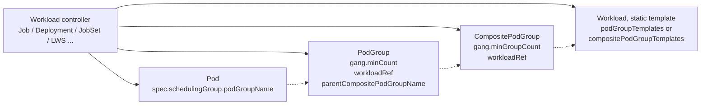

Solid lines mean "creates"; dashed lines mean "references".

- `Workload` is only a template, and kube-scheduler does not watch it. The scheduler reads `PodGroup`, `CompositePodGroup` and `spec.schedulingGroup` on pods.
- Workload controllers create all of these objects, in the order Workload → PodGroup → Pod. The scheduler creates nothing and only writes status.
- A PodGroup may reference no Workload (a standalone PodGroup). A CompositePodGroup must reference one.

### 3.3 PodGroup fields

Based on `scheduling.k8s.io/v1beta1` on `master`. The PodGroup fields in v1.37.2 are the same.

| Field | Meaning | Mutability |
|---|---|---|
| `spec.workloadRef` | Source Workload and template name, optional | Immutable |
| `spec.parentCompositePodGroupName` | Parent CompositePodGroup; empty means this is a root | Immutable |
| `spec.schedulingPolicy.basic` | No all-or-nothing requirement, but pods are still scheduled as a group | Policy type is immutable |
| `spec.schedulingPolicy.gang.minCount` | Minimum number of pods that must be schedulable together | **Mutable** |
| `spec.schedulingConstraints.topology[]` | Topology constraint, at most one item, with a single `key` (a node label key) | Immutable |
| `spec.disruptionMode` | `single` (default) or `all`; the unit used when the group is preempted | Immutable |
| `spec.priorityClassName` / `priority` / `preemptionPolicy` | Group priority and preemption policy, resolved by the Priority admission plugin | Immutable |
| `spec.resourceClaims[]` | DRA ResourceClaims shared by the group, at most 4 | Immutable |
| `status.conditions` | `PodGroupInitiallyScheduled`, `DisruptionTarget` | Written by the scheduler |
| `status.resourceClaimStatuses` | Names of ResourceClaims generated from templates | Written by the control plane |

Once `PodGroupInitiallyScheduled` is True it never reverts, even if pods are evicted later. It means "was scheduled successfully once", not "currently satisfies the gang".

### 3.4 Feature gates

| Feature gate | v1.36 | v1.37 | v1.38 (master) |
|---|---|---|---|
| `GenericWorkload` | Alpha | **Beta, off by default** | Beta, off by default |
| `GangScheduling` | Alpha | Merged into `GenericWorkload` | — |
| `WorkloadAwarePreemption` | Alpha | Merged into `GenericWorkload` | — |
| `TopologyAwareWorkloadScheduling` | Alpha | Alpha | **Beta, off by default** |
| `CompositePodGroup` | — | Alpha | **Beta, off by default** |
| `PodGroupPreemptionPolicy` | — | Alpha | Gate removed; the field always applies |
| `DRAWorkloadResourceClaims` | Alpha | Beta, off by default | Beta, off by default |
| `WorkloadWithJob` | Alpha | Alpha | **Beta, off by default** |
| `WorkloadWithDeployment` | — | — | Alpha |

In v1.37 and v1.38 no workload-scheduling gate is on by default. Using these features requires enabling them explicitly on kube-apiserver, kube-controller-manager and kube-scheduler.

### 3.5 Who creates PodGroups

- **Job**: `Job.spec.scheduling` declares the policy, topology constraint, `disruptionMode` and shared ResourceClaims. With `WorkloadWithJob` enabled, the Job controller creates one Workload and one PodGroup for the Job and sets `schedulingGroup` on its pods. Without `spec.scheduling` the policy defaults to `basic`. When `gang.minCount` is omitted it defaults to `parallelism`.
- **Deployment** (v1.38 Alpha): the Deployment controller creates one Workload, and the ReplicaSet controller creates one PodGroup per ReplicaSet. Gang requires `strategy.type: Recreate`.
- **Ecosystem controllers**: KEP-6089 lists JobSet, LeaderWorkerSet, Kubeflow Trainer, Spark Operator and KubeRay as having designed or started integrations. This is the KEP authors' description; this report did not check the status of each project.
- **Controller building blocks**: the `Workload`-prefixed types in `scheduling.k8s.io/v1` (such as `WorkloadPodGroupSchedulingPolicy`) are not standalone API objects. They are shared structs for controllers to embed in their own APIs, and `Job.spec.scheduling` uses them.

### 3.6 What upstream explicitly does not do

All of the following are non-goals stated in the KEPs:

- KEP-4671: "Bring fairness or multiple workload queues in kube-scheduler. Kueue and Volcano.sh will continue to provide this."
- KEP-5732: "To implement Workload-level queueing, fairness, or resource quotas within kube-scheduler."
- KEP-5732: no automatic discovery of network topology; topology information must be present as node labels.
- KEP-5710: no handling of non-uniform priorities across PodGroups; no design for rescheduling after preemption.
- KEP-6012: no preferred topology constraints; no guarantee of an optimal result for multi-level scheduling.

The upstream scheduler has a single internal queue ordered by priority. There is no tenant queue, no capacity or deserved share, and no cross-queue reclaim.

## 4. How kube-scheduler schedules a PodGroup

### 4.1 Overall flow

This section assumes `GenericWorkload` is enabled. The diagram applies to both v1.37 and v1.38; section 4.4 lists the differences.

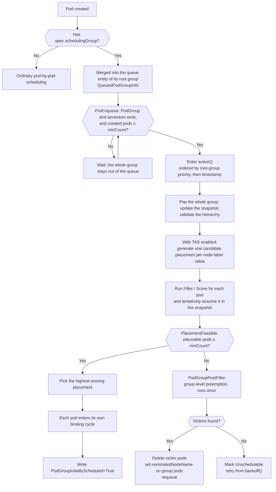

### 4.2 Sequence in v1.38

Example: one PodGroup with `gang.minCount = N`, N identical pods, enough capacity.

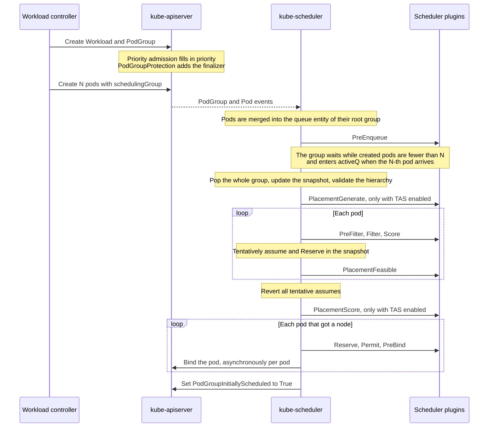

### 4.3 Key mechanisms

**Queueing.** Any pod with `spec.schedulingGroup`, whether the policy is basic or gang, is no longer queued on its own. It is merged into the queue entity of its root group. There is one entity per root: a standalone PodGroup, or the root of a CompositePodGroup tree. Entities are ordered by the root group's `priority`, then by timestamp.

**PreEnqueue.** A group can enter scheduling when the PodGroup and all its ancestors exist and the number of pods **created** so far reaches `minCount` (1 for the basic policy). If any pod in the group is held by a scheduling gate, the whole group stays out.

**Scheduling cycle.** The scheduling loop runs on a single goroutine. Within a group cycle, pods are tried one by one in a fixed order with a full Filter / Score, and each result is tentatively assumed in the snapshot so later pods see it. Everything is reverted at the end of the cycle; evaluation never touches the live cache. Per-pod PostFilter does not run in a group cycle. Group members that are already running count toward `minCount`.

**PlacementFeasible.** The gang rule lives in `GangScheduling.PlacementFeasible`:

| Condition | Result |
|---|---|
| placed + not yet evaluated < `minCount` | Unschedulable; stop the loop early |
| placed < `minCount`, with pods still to evaluate | Wait; keep evaluating |
| placed ≥ `minCount` | Pass |

**When minCount is not met.** No pod in the group is bound, group-level preemption runs once (section 8), and the group is requeued. When `minCount` is lower than the number of pods and at least `minCount` pods can be placed, those pods are bound and the rest are requeued.

**Binding.** Binding is still an asynchronous per-pod binding cycle. The code has no group-level bind rollback: a failed bind of one member does not undo the others (inferred). All-or-nothing covers the scheduling decision, not the binding outcome.

**Status.** The scheduler writes only `PodGroupInitiallyScheduled` (and, in v1.38, the matching condition on CPGs). The API comments define a `DisruptionTarget` condition on PodGroups, but no code that writes it was found in the scheduler in either version.

**Retry.** A group that fails scheduling goes to backoffQ and is retried when the backoff expires, rather than waiting for a cluster event (inferred from the branches in `AddAttemptedPodGroupIfNeeded`; a TODO in the code says PodGroups do not yet support queueing hints). The backoff cap is `podMaxBackoff × √(pods in the group)`, with `podMaxBackoff` defaulting to 10 seconds.

### 4.4 Differences between v1.37 and v1.38

| Item | v1.37 (v1.37.2) | v1.38 (master, in development) |
|---|---|---|
| Workload / PodGroup API | `v1beta1` (new), `v1alpha3` | `v1beta1`; GA moved to v1.39 |
| CompositePodGroup | Alpha, served only from `v1alpha3` | Beta, in `v1beta1` |
| Gang Permit barrier | Present, with a fixed 5-minute timeout | Removed; PlacementFeasible is the only gate |
| PlacementFeasible | Internal hook, hard-wired to GangScheduling | Public, configurable extension point |
| Placement search | Evaluates every candidate; uses only the first PlacementGenerate plugin | Adds `percentageOfPlacementsToScore` (adaptive, 5% floor), shuffling, and a nominated-placement fast path; results of multiple plugins are intersected |
| Hierarchy validation | Checks only the pods' schedulerName, priority and preemption policy | Validates the whole tree every cycle; adds `PodGroupError` / `CompositePodGroupError` |
| CPG status | Not written | Writes `CompositePodGroupInitiallyScheduled` |
| CPG deletion protection | None | Finalizer |
| Maximum tree depth | 4 | 5 (still 4 in `v1.38.0-beta.0`) |
| Preemption | One decision per group | Adds the `PreemptionManager` abstraction, `RankNodes`, and victim state shared across the group's pods |
| `preemptionPolicy` | Behind the `PodGroupPreemptionPolicy` gate | Gate removed; the field always applies |
| Job integration | Alpha | Beta, off by default; the PodGroup is deleted on suspend |
| Deployment integration | None | Alpha |
| Controller building blocks | In `v1alpha3` | In `scheduling.k8s.io/v1` |
| Code layout | Concentrated in `schedule_one_podgroup.go` (1448 lines) | Split into `algorithm.go` and `algorithm_podgroup.go` |

### 4.5 New scheduling framework extension points

| Extension point | Purpose | In-tree implementation | Introduced |
|---|---|---|---|
| `PlacementGenerate` | Generate candidate placements (node subsets) | `TopologyPlacement` | v1.36 |
| `PlacementScore` | Score feasible placements | `PodGroupPodsCount`, `NodeResourcesFit` | v1.36 |
| `PlacementFeasible` | Decide whether current progress satisfies the group policy | `GangScheduling` | Internal in v1.37, public in v1.38 |
| `PodGroupPostFilter` | Runs once after the whole group fails | `DefaultPreemption`, `DynamicResources` | Internal in v1.36, public in v1.37 |

### 4.6 Limitations visible in the code

- No queue, quota, fairness or reclaim.
- The scheduling loop is single-threaded. A large group's cycle (all pods × all candidate placements, plus a second pass during preemption) blocks all other scheduling.
- Greedy, fixed order, no backtracking. Heterogeneous groups are accepted, but a feasible placement is not guaranteed to be found.
- All pods in one hierarchy must share the same schedulerName, priority and preemption policy.
- The gang guarantee applies only at scheduling time: `minCount` is not enforced afterwards, and with `disruptionMode: single` a running gang can be partially preempted.
- DRA's group-level PostFilter does not support PodGroups with topology constraints or CompositePodGroups.
- No group-level Cluster Autoscaler integration was found; the KEP lists it as follow-up work.

## 5. Upstream PodGroup vs. Volcano PodGroup

### 5.1 Object models

Section 3.2 shows the upstream model. The Volcano model:

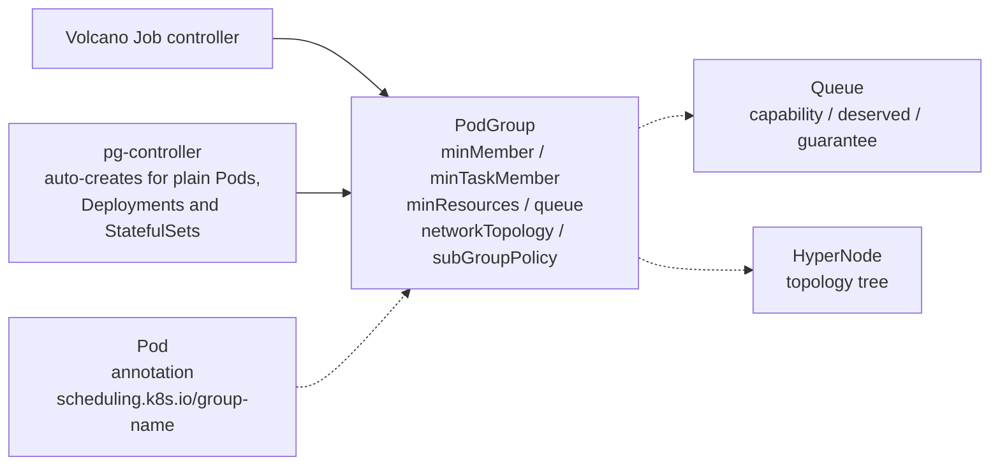

Solid lines mean "creates"; dashed lines mean "references". The three most visible differences:

1. Upstream has a Workload template and separate CompositePodGroup objects. Volcano has a single PodGroup with sub-groups embedded in it.
2. A Volcano PodGroup belongs to a Queue. Upstream has no queue.
3. Upstream links a pod to its group with a pod spec field. Volcano uses an annotation.

### 5.2 Field mapping

| Aspect | Upstream PodGroup<br/>`scheduling.k8s.io/v1beta1` | Volcano PodGroup<br/>`scheduling.volcano.sh/v1beta1` |
|---|---|---|
| How a pod joins | `pod.spec.schedulingGroup.podGroupName`, immutable | Annotation `scheduling.k8s.io/group-name` |
| Minimum members | `schedulingPolicy.gang.minCount` | `minMember` |
| Minimum per role | None; split into several PodGroups under a CPG | `minTaskMember` |
| Minimum resources | None | `minResources` |
| Queue | None | `queue` |
| Priority | `priorityClassName` / `priority` / `preemptionPolicy` | `priorityClassName` |
| Topology constraint | `schedulingConstraints.topology[0].key`, a node label, hard only | `networkTopology{mode, highestTierAllowed, highestTierName}`, HyperNode-based, hard / soft |
| Sub-groups | Separate CompositePodGroup objects linked by `parentCompositePodGroupName` | Embedded `subGroupPolicy[]` |
| Victim unit | `disruptionMode: single / all` | No dedicated field; decided by the gang plugin and the eviction actions. `volcano.sh/preemptable` controls whether pods may be preempted |
| Group-level DRA | `resourceClaims[]` | None |
| Anti-affinity between groups | None | `topologyAffinity.podGroupAntiAffinity` |
| Status | Conditions `PodGroupInitiallyScheduled`, `DisruptionTarget` | `phase` (Pending / Inqueue / Running / Unknown / Completed), conditions `Scheduled` / `Unschedulable`, pod counters |
| Status subresource | Yes | No; the scheduler does a full-object `Update` |
| Mutability | Only `minCount` is mutable | Fields can be changed |
| Deletion protection | Finalizer, removed once all pods are terminal | None; relies on ownerReferences |

### 5.3 Semantics and lifecycle

| Aspect | Upstream | Volcano |
|---|---|---|
| Who creates the PodGroup | The workload controller; users may also create one by hand | The Volcano Job controller; for plain Pods, Deployments and StatefulSets the pg-controller creates one automatically (`minMember=1`) |
| Enqueue admission | None. A group is schedulable once the PodGroup exists and `minCount` pods are created | Yes. The `enqueue` action moves a PodGroup from Pending to Inqueue based on `minResources` and queue capacity |
| When pods are created | The controller creates them directly | A Volcano Job creates pods only after its PodGroup leaves Pending |
| Ordering between groups | Priority, then time | Queue order → Job order (priority, gang, drf, sla and other plugins) → SubJob order → Task order |
| Gang check | One `minCount` | Three checks: job-level `minMember`, role-level `minTaskMember`, sub-group-level `subGroupSize` and `minSubGroups` |
| Where the gang rule applies | Only at the scheduling decision | Enforced at scheduling; phase is recomputed every session; legacy preemption never takes a victim job below `minAvailable` |
| What status expresses | "Was it ever scheduled successfully" | "Which phase is it in now" |
| Elasticity | `minCount` is mutable; pods added later go through the same group cycle | When `minMember` is below the replica count, remaining pods are allocated in later sessions |

### 5.4 Scheduling flow

How Volcano schedules a gang Volcano Job. For plain pods the order differs slightly: the pod exists first, and the pg-controller then creates the PodGroup.

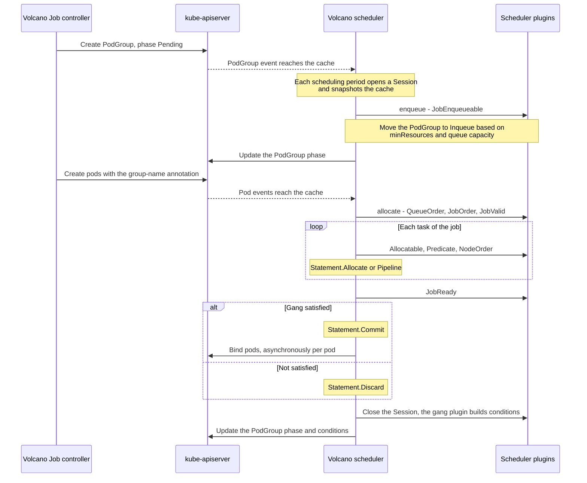

| Aspect | kube-scheduler | Volcano |
|---|---|---|
| Trigger | Event-driven; pops one entity at a time | Periodic session; each one processes all jobs in the snapshot |
| Scope of one decision | One root group | Many jobs per session, in queue and job order |
| Transaction mechanism | Tentative assumes in the snapshot, all reverted at the end of the cycle, then committed pod by pod | `Statement`: Allocate / Pipeline / Evict, committed when `JobReady`, discarded otherwise |
| Resource reservation | `nominatedNodeName` | The Pipelined state holds future-idle resources within the session, plus `nominatedNodeName` and `NominatedHyperNode` |
| When resources are short | Group-level preemption in the same cycle | Handled by the later `preempt` / `reclaim` / `gangpreempt` / `gangreclaim` actions |
| Retry after failure | Requeued after backoff | Re-evaluated in the next session; the unschedulable-job cache can skip it |
| Binding | Asynchronous per pod, no group rollback | Asynchronous per pod, no group rollback (inferred) |

## 6. CompositePodGroup vs. Volcano PodGroup + SubGroup

### 6.1 Structure

Upstream: a tree of separate objects whose leaves are PodGroups.

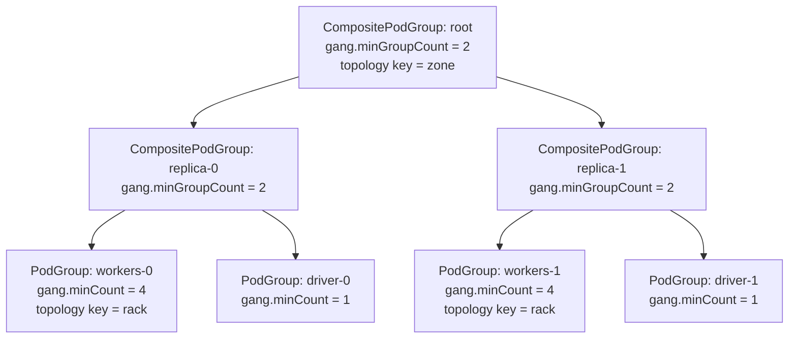

Volcano: one PodGroup object whose sub-groups are derived from pod labels by `subGroupPolicy`, always two levels. A three-level structure like the one above cannot be expressed directly; the diagram below shows the two-level shape Volcano can express.

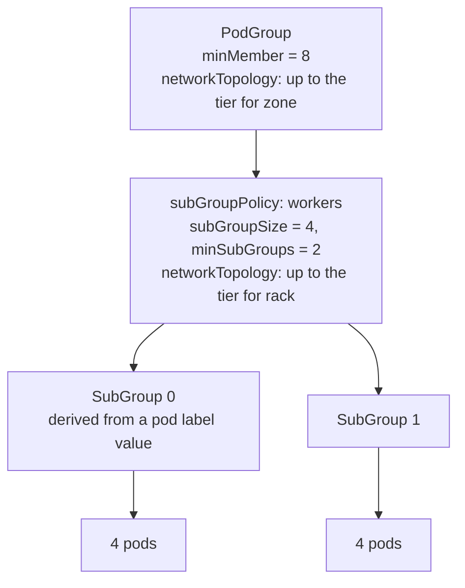

### 6.2 Capabilities

| Aspect | CompositePodGroup | Volcano PodGroup + SubGroup |
|---|---|---|
| Form | Separate API objects; children point to parents | A list inside the PodGroup spec; sub-groups have no object of their own |
| Depth | Up to 5 levels (4 in v1.37) | Exactly two: PodGroup → SubGroup |
| How sub-groups are formed | Each sub-group is a PodGroup object that pods reference explicitly | `labelSelector` selects pods, which are then grouped by the values of `matchLabelKeys` |
| Parent-level gang | `gang.minGroupCount`: at least this many child groups, regardless of which template they come from | `minSubGroups`: counted separately per policy |
| Child-level gang | Each leaf PodGroup has its own `minCount`, which may differ | `subGroupSize`: every sub-group of a policy has the same size |
| Multi-level topology | Each level may carry one topology key, narrowed top-down | One `networkTopology` at job level and one at sub-group level |
| Priority | Must be the same across the tree | Job level from the PodGroup; a SubJob takes the highest priority of its tasks |
| Victim unit | `disruptionMode` per level; an `all` parent cannot have a `single` child | No declarative field |
| Status | Each object has its own conditions | PodGroup-level status only; no sub-group status |
| Scheduling | The whole tree in one cycle, recursively top-down; siblings in creation order, no backtracking | Pick a HyperNode for the job, then one for each SubJob within it; every candidate is trial-allocated and discarded, and the best-scoring one is kept |
| Elasticity | `minGroupCount` becomes mutable in Beta | The PodGroup can be changed |
| Users | JobSet, LWS and others (designed or in progress) | The Volcano Job `partitionPolicy`; also used in the Kthena docs |

### 6.3 One requirement, two ways to write it

Requirement: 2 replica groups; the 4 pods of each group must be in the same rack; the whole workload must be in one zone; start only when both groups are ready.

Upstream: the controller creates a Workload, then one CompositePodGroup and two PodGroups from it:

```yaml
apiVersion: scheduling.k8s.io/v1beta1
kind: Workload
metadata:
  name: serving
spec:
  compositePodGroupTemplates:
  - name: root
    schedulingPolicy:
      gang:
        minGroupCount: 2
    schedulingConstraints:
      topology:
      - key: topology.kubernetes.io/zone
    podGroupTemplates:
    - name: replica
      schedulingPolicy:
        gang:
          minCount: 4
      schedulingConstraints:
        topology:
        - key: topology.example.com/rack
```

Volcano: one PodGroup is enough, provided HyperNodes for those levels already exist in the cluster:

```yaml
apiVersion: scheduling.volcano.sh/v1beta1
kind: PodGroup
metadata:
  name: serving
spec:
  queue: default
  minMember: 8
  networkTopology:
    mode: hard
    highestTierAllowed: 2        # assuming tier 2 is the zone level
  subGroupPolicy:
  - name: replica
    subGroupSize: 4
    minSubGroups: 2
    labelSelector:
      matchLabels:
        app: serving
    matchLabelKeys:
    - group-index                # pods with the same value form one sub-group
    networkTopology:
      mode: hard
      highestTierAllowed: 1      # assuming tier 1 is the rack level
```

### 6.4 Can one be mapped to the other?

| Upstream structure | Expressible with Volcano's current model? |
|---|---|
| A single PodGroup (gang or basic) | Yes. `minCount` maps to `minMember` |
| One CPG + several PodGroups from the same template | Yes. One `subGroupPolicy` with `subGroupSize = minCount` and `minSubGroups = minGroupCount` |
| One CPG + PodGroups from different templates (such as driver + workers), all required | Yes. One policy per template, or `minTaskMember` |
| One CPG + PodGroups from different templates, with `minGroupCount` below the number of children | Not exactly. Upstream means "any N child groups"; Volcano can only count per policy |
| Three or more levels (such as JobSet → ReplicatedJob → Job) | No. The SubGroup model would have to become recursive |
| A different `disruptionMode` per level | No. Volcano has no matching field |

In the other direction, Volcano's `minResources`, `queue`, soft topology and `minTaskMember` have no upstream field.

## 7. TAS comparison

### 7.1 How topology is described

Upstream: topology domains are implied by node label values, and there is no topology object. With the constraint `key = rack`, each rack value is one candidate placement.

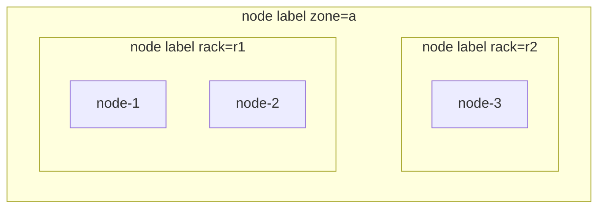

Volcano: topology is an explicit tree of HyperNode objects; a lower tier is closer to the nodes.


### 7.2 Comparison

| Aspect | Upstream TAS | Volcano Network Topology Aware Scheduling |
|---|---|---|
| Topology source | Node labels; no topology object | The HyperNode CRD; members selected by name, regex or label |
| Topology discovery | None (non-goal) | The HyperNode controller supports `ufm` and `label` auto-discovery |
| Constraint | One label key: all pods of the group land in the same value of that label | `highestTierAllowed` or `highestTierName`: the lowest common ancestor of the group's pods must not be above that tier |
| Hard / soft | Hard only; preferred constraints are future work | `hard` and `soft` |
| Multi-level | One key per object; multiple levels come from nesting CompositePodGroups | One at job level and one at sub-group level, two in total |
| Candidate generation | One placement per label value | Tries tier by tier from the lowest; lower tiers are preferred |
| Feasibility | Restricts nodes to the placement and runs the full group algorithm | Trial-allocates on each HyperNode, saves the result and discards it |
| Scoring | `PodGroupPodsCount` (more pods placed is better) plus MostAllocated from `NodeResourcesFit` | HyperNode-level binpack plus tier-based node scoring |
| Search bound | v1.37 evaluates every candidate; v1.38 can stop after a percentage | Stops at the lowest tier that has a solution |
| Pods already running | New pods may only enter the domain already in use | The lowest common ancestor of allocated HyperNodes bounds the search |
| With preemption | Group preemption reruns the algorithm with placements | `gangpreempt` / `gangreclaim` search by HyperNode domain; a job with network topology never enters legacy `preempt` as a preemptor |
| Without topology objects | Works as soon as nodes carry labels | Needs HyperNodes first (the `label` discoverer can build them from node labels) |

In short, the upstream model is lighter: it works once nodes have labels, but it can express only one hard constraint, "the same domain". The Volcano model is heavier because HyperNodes must be maintained, but it can express "as close as possible, no higher than a given tier", soft constraints and auto-discovery. The Volcano design doc records why labels were not chosen at the time: building a topology tree from labels was considered complicated.

## 8. Preemption comparison (WAP)

### 8.1 Upstream group-level preemption

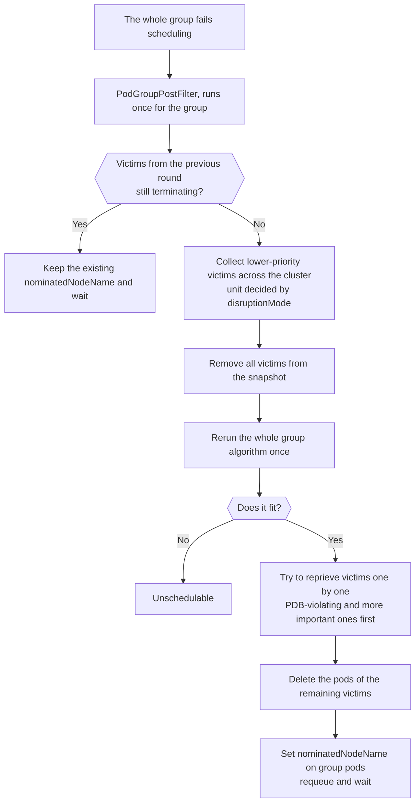

### 8.2 Volcano group-level eviction (gangpreempt)

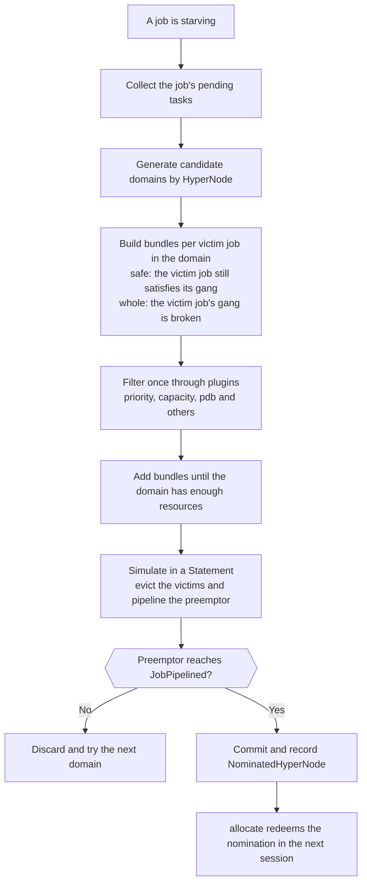

### 8.3 Comparison

| Aspect | Upstream WAP | Volcano |
|---|---|---|
| Entry point | Inside the scheduling cycle, right after the group fails | Separate actions: `preempt`, `reclaim`, `gangpreempt`, `gangreclaim`, enabled by configuration |
| Driver | Priority only | Priority (preemption within a queue) and queue deserved / guarantee (reclaim across queues) |
| Preemptor unit | The root group, one decision | The job; committed only when it reaches `JobPipelined` |
| Victim unit | `disruptionMode`: `single` is one pod, `all` is the whole group (at the highest `all` ancestor) | Legacy: one task, never taking the victim job below `minAvailable`. Gang: safe and whole bundles |
| Protects the victim's gang? | Not by default. `single` is the default, so a running gang can be partially preempted | By default. The gang is broken as a whole only when `allowWholeBundle` is on and every plugin allows it |
| Search scope | One cluster-wide domain | Legacy: per node. Gang: per HyperNode domain (the whole cluster when there is no topology) |
| Priority source | The PodGroup's `priority`; the pod's own priority is ignored, and the whole tree must agree | Job priority from the PodGroup's `priorityClassName`; task priority within a job |
| `preemptionPolicy: Never` | Group-level field | Checked per pod |
| PDB | Best effort: PDB-violating victims are reprieved first, but violations are not forbidden | The `pdb` plugin filters victims (must be enabled) |
| Eviction mechanism | Deletes the pod and sets the pod's `DisruptionTarget` condition | Deletes the pod and sets the pod's `DisruptionTarget` condition |
| After preemption | Group pods wait with `nominatedNodeName`; no new preemption starts until victims terminate | `allocate` takes the nomination fast path in the next session |
| Topology awareness | Integrated with TAS; reruns scheduling with placements | Gang actions search by HyperNode; a job with network topology never enters legacy `preempt` as a preemptor |
| Rescheduling after preemption | Non-goal, left to a later KEP | The workload controller recreates pods, which are then rescheduled |

In short, both sides decide for the preemptor as a whole group and evict nothing when that fails. There are two main differences. First, Volcano has cross-queue reclaim and upstream does not. Second, the defaults are opposite: upstream may split a victim gang unless `disruptionMode: all` is set, while Volcano protects the victim's `minAvailable` by default.

## 9. Making Volcano compatible with the upstream PodGroup

### 9.1 Current state

- The Kubernetes version Volcano depends on already contains the upstream PodGroup types, but they are compiled only to satisfy interfaces. In `pkg/scheduler/plugins/util/k8s/snapshot.go`, `PodGroupStates()` returns an empty state, and lookups through `PodGroups()` and `CompositePodGroups()` always return not found. `Framework.PodGroupManager()` returns nil.
- The scheduler maps a pod to its job in exactly one place: `getJobID` in `pkg/scheduler/api/job_info.go`, which reads the annotation `scheduling.k8s.io/group-name`. No code reads `pod.spec.schedulingGroup`.
- There are no informers, clients or RBAC rules for the upstream Workload, PodGroup or CompositePodGroup.
- Today, if a pod sets both `schedulerName: volcano` and `schedulingGroup`, the pg-controller treats it as a plain pod and creates a Volcano PodGroup with `minMember=1`. None of the upstream gang, topology or `disruptionMode` semantics take effect (inferred).
- The repository has no design doc or TODO about compatibility with the upstream Workload / PodGroup API.

### 9.2 Levels of "compatible"

| Level | Meaning | What users get |
|---|---|---|
| L0 Coexistence | Do nothing; the two APIs do not affect each other | Today's state |
| L1 Flat PodGroup | Volcano schedules pods that carry `schedulingGroup`, honours `minCount` and priority, and writes status back | A native Job with `spec.scheduling` can be scheduled by Volcano and use Volcano queues |
| L2 Semantic alignment | Supports `disruptionMode`, `preemptionPolicy`, topology keys and two-level CompositePodGroups | Two-level workloads from JobSet, LWS and others that use the upstream API can be scheduled by Volcano |
| L3 Full support | CompositePodGroups of any depth, PodGroup-level DRA ResourceClaims | Behaviour on this API matches kube-scheduler |
| L4 Replacement | Replace the Volcano PodGroup with the upstream one | Not recommended. Upstream has no `queue`, `minResources`, `minTaskMember`, soft topology or `phase` |

### 9.3 Two implementation paths

Path A: mirror translation, with changes concentrated in the controller. Spec is synced left to right, and status is written back right to left.

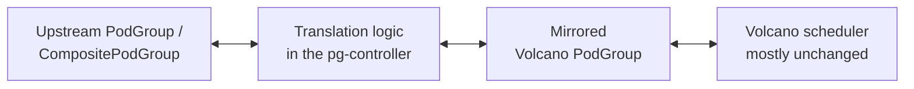

Path B: the scheduler reads the upstream objects natively and writes their status directly.

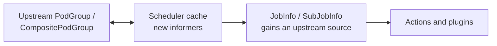

| Aspect | Path A: mirror translation | Path B: native in the scheduler |
|---|---|---|
| Approach | A controller translates the upstream PodGroup into a Volcano PodGroup and stamps pods with the group-name annotation and a sub-group label | The scheduler cache watches the upstream objects, and `getJobID` gains a `schedulingGroup` branch |
| Scheduler changes | Small | Larger: cache, JobInfo, status write-back, queue statistics |
| Extra objects | One more Volcano PodGroup per upstream group | None |
| Consistency | Translation lag; the two objects can drift and must be reconciled | Single source of truth |
| Expressible depth | Limited by Volcano's two-level model | Any depth, together with a recursive SubJob model |
| PodGroup-level DRA | Not possible | Possible, by implementing `PodGroupManager` |
| When it fits | Quick validation; low risk while the upstream API is not GA | After upstream GA and ecosystem adoption |

Path A is the recommended starting point. The upstream API is still Beta, off by default, and has had incompatible changes. Isolating the adaptation in a controller keeps the scheduler core from having to follow each API version.

### 9.4 Semantic gaps and decisions to make first

| Question | Explanation | Options |
|---|---|---|
| Where does the queue come from? | The upstream PodGroup has no queue field | Reuse the existing `scheduling.volcano.sh/queue-name` annotation or the namespace default queue |
| `minResources` | Absent upstream; Volcano's enqueue admission and queue accounting rely on it | The controller computes it from the pod template and `minCount`; once pods exist it can be summed directly |
| Enqueue admission | Upstream controllers create pods directly, so Volcano's delayed pod creation does not apply | Same as for plain pods today: pods exist first and are not scheduled until the PodGroup is Inqueue |
| Status write-back | Upstream has only `PodGroupInitiallyScheduled`, which never reverts | Set it to True when the Volcano PodGroup first reaches Running; keep `phase` on the Volcano side only |
| Name clashes | Both kinds use the resource name `podgroups`, and both job keys are `namespace/name` | Give mirrored objects a prefixed name; tell users to use the fully qualified resource name or Volcano's short name `pg` |
| `disruptionMode: single` | Upstream allows splitting a gang by default; Volcano protects it by default | Keep Volcano's protective behaviour: `single` permits splitting but does not require it |
| `disruptionMode: all` | The whole group must be evicted together | Do not generate safe bundles for such jobs |
| Topology key | Upstream uses a label key; Volcano uses HyperNode tiers | Build HyperNodes with the `label` discoverer and map label keys to tiers; in line with volcano-sh/volcano#6161 |
| `minGroupCount` across templates | Volcano's `minSubGroups` counts per policy | "All required" maps exactly; other cases need a model extension or must be marked unsupported |
| Three or more levels | Volcano has two | Path B plus a recursive SubJob model; until then, reject explicitly and report it in a condition |
| API availability | The upstream API exists only on v1.37+ clusters with the gates enabled | Detect it through discovery at startup and skip the informers when absent; guard with a Volcano feature gate |
| Multiple versions | `v1` will follow `v1beta1`, and CompositePodGroup is `v1alpha3`-only in v1.37 | Support `v1beta1` and later only; do not adapt alpha versions |

### 9.5 Work breakdown

The unit is person-weeks, assuming engineers who know the Volcano scheduler, and including unit tests, e2e tests and docs. Community review time is not included. The repository requires every runtime behaviour change to be verified on a real cluster; that is included.

| ID | Work item | Main areas | Path A | Path B |
|---|---|---|---|---|
| W0 | Foundations: API discovery, informers, RBAC, feature gate, e2e cluster with the upstream gates enabled | controllers, scheduler, installer, hack | 1–2 | 1–2 |
| W1 | Flat PodGroup: pod association, `minCount`, priority, queue source, status write-back | A: `pkg/controllers/podgroup`<br/>B: `pkg/scheduler/cache`, `pkg/scheduler/api`, `pkg/scheduler/framework`, queue controller and metrics | 3–4 | 6–8 |
| W2 | Wire `preemptionPolicy` and `disruptionMode` into preemption and reclaim | `pkg/scheduler/actions` (preempt, reclaim, gangpreempt, gangreclaim), gang plugin | 2–4 | 2–4 |
| W3 | Map topology keys to HyperNode tiers | hypernode controller, network-topology-aware plugin | 2–3 | 2–3 |
| W4 | Build domains directly from node labels when no HyperNode exists | HyperNode cache in `pkg/scheduler/api` | — | 3–4 |
| W5 | Map two-level CompositePodGroups to `subGroupPolicy`, including status | A: controller<br/>B: cache and JobInfo | 3–5 | 4–6 |
| W6 | Any depth: recursive SubJob model | allocate, gang, network-topology-aware, gang eviction, `job_info.go` | n/a | 10–16 |
| W7 | PodGroup-level DRA ResourceClaims: implement `PodGroupManager` and `PodGroupState` | `pkg/scheduler/plugins/util/k8s`, predicates | n/a | 4–6 |
| W8 | User docs and compatibility notes | docs | 1–2 | 1–2 |

Totals:

| Target | Work items | Estimate |
|---|---|---|
| L1 minimum viable | W0 + W1 on path A | About 4–6 person-weeks |
| L2 two-level semantic alignment | W0–W3, W5, W8 on path A | About 12–20 person-weeks |
| L3 full native support | W0–W8 on path B | About 33–51 person-weeks, or 8–12 person-months |

There is also an ongoing cost: until the upstream API is GA, expect 1–2 person-weeks per Kubernetes release to follow changes.

The dependency inventory gives a sense of scale. In the scheduler, non-test code references PodGroup directly in 44 files (about 480 lines), and test code in about 1340 lines. Controllers have 14 files (about 210 lines), and e2e tests about 420 lines. Path B has to confirm that each of these places still holds for a PodGroup that comes from upstream.

### 9.6 Suggested roadmap

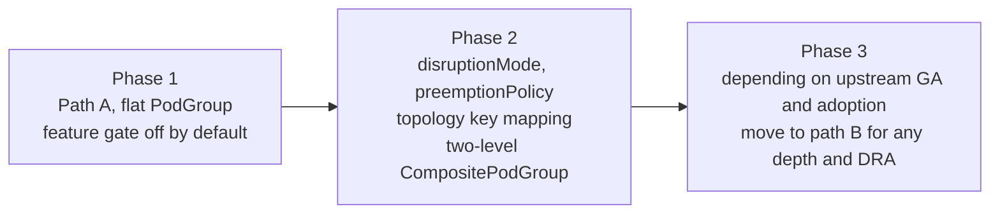

1. **Phase 1**: support flat PodGroups through path A, behind a Volcano feature gate that is off by default. The target scenario is a native Job with `spec.scheduling` scheduled by Volcano with queue support.
2. **Phase 2**: add preemption semantics and topology mapping, and support two-level CompositePodGroups. This covers the common shapes of LWS and JobSet.
3. **Phase 3**: after the upstream API reaches GA (currently targeted at v1.39), look at actual adoption by JobSet, LWS, Trainer and KubeRay, then decide whether to invest in path B.

### 9.7 Risks

- **The API is still changing.** Two incompatible changes in three releases, and GA has slipped once. Binding deeply too early means adapting more than once.
- **Off by default.** Until the upstream gates are on by default, few clusters can use this API, so the adaptation benefits few users.
- **Ecosystem direction.** If KubeRay, Trainer, Spark Operator and similar projects make the upstream API their default integration, an incompatible Volcano could offer those workloads only pod-by-pod scheduling. This is a judgement, not a fact, and needs to be tracked.
- **Kueue's direction.** Kueue has an umbrella plan for WAS integration (kubernetes-sigs/kueue#8871), including reading the standard APIs and reusing the upstream scheduler library. Its goals are close to L1 / L2 here and are a useful reference.
- **Semantic drift.** `PodGroupInitiallyScheduled`, the `single` default and other upstream semantics differ from what Volcano users are used to. The mapping must document the differences so users do not expect upstream behaviour.

## 10. References

**KEPs**

- [KEP-4671 Gang Scheduling](https://github.com/kubernetes/enhancements/tree/master/keps/sig-scheduling/4671-gang-scheduling)
- [KEP-5832 Decouple PodGroup API](https://github.com/kubernetes/enhancements/tree/master/keps/sig-scheduling/5832-decouple-podgroup-api)
- [KEP-6012 CompositePodGroup API](https://github.com/kubernetes/enhancements/tree/master/keps/sig-scheduling/6012-composite-podgroup-api)
- [KEP-5732 Topology-aware workload scheduling](https://github.com/kubernetes/enhancements/tree/master/keps/sig-scheduling/5732-topology-aware-workload-scheduling)
- [KEP-5710 Workload-aware preemption](https://github.com/kubernetes/enhancements/tree/master/keps/sig-scheduling/5710-workload-aware-preemption)
- [KEP-6089 WAS Controller APIs](https://github.com/kubernetes/enhancements/tree/master/keps/sig-scheduling/6089-was-controller-apis)
- [KEP-5729 DRA: ResourceClaim Support for Workloads](https://github.com/kubernetes/enhancements/tree/master/keps/sig-scheduling/5729-resourceclaim-support-for-workloads)
- [KEP-5547 Integrate Workload APIs with Job controller](https://github.com/kubernetes/enhancements/tree/master/keps/sig-apps/5547-integrate-workload-with-job)
- [KEP-6276 Integrate Workload APIs with Deployment controller](https://github.com/kubernetes/enhancements/tree/master/keps/sig-apps/6276-integrate-workload-with-deployment)

**Official blog**

- [Kubernetes v1.37: Advancing Workload-Aware Scheduling](https://kubernetes.io/blog/2026/09/08/kubernetes-v1-37-advancing-workload-aware-scheduling/)

**Upstream code (kubernetes/kubernetes)**

| Content | Path |
|---|---|
| API types | `staging/src/k8s.io/api/scheduling/v1beta1/types.go` |
| `schedulingGroup` on Pod | `staging/src/k8s.io/api/core/v1/types.go` |
| Feature gates | `pkg/features/kube_features.go` |
| Group scheduling cycle | `pkg/scheduler/schedule_one_podgroup.go`, `pkg/scheduler/algorithm_podgroup.go` (v1.38) |
| Scheduling queue | `pkg/scheduler/backend/queue/scheduling_queue.go` |
| Gang plugin | `pkg/scheduler/framework/plugins/gangscheduling/` |
| Topology plugins | `pkg/scheduler/framework/plugins/topologyaware/`, `podgrouppodscount/` |
| Group preemption | `pkg/scheduler/framework/preemption/podgrouppreemption.go` |
| Job integration | `pkg/controller/job/job_scheduling_manager.go` |

**Volcano code and docs**

| Content | Path |
|---|---|
| PodGroup API | `staging/src/volcano.sh/apis/pkg/apis/scheduling/v1beta1/types.go` |
| Pod-to-job mapping | `pkg/scheduler/api/job_info.go` (`getJobID`) |
| SubGroup | `pkg/scheduler/api/sub_job_info.go` |
| allocate | `pkg/scheduler/actions/allocate/allocate.go` |
| Gang plugin | `pkg/scheduler/plugins/gang/gang.go` |
| Topology plugin | `pkg/scheduler/plugins/network-topology-aware/` |
| Group eviction | `pkg/scheduler/actions/gangpreempt/`, `pkg/scheduler/actions/gangreclaim/`, `pkg/scheduler/actions/utils/bundle.go` |
| Stubs for the upstream types | `pkg/scheduler/plugins/util/k8s/snapshot.go`, `framework.go` |
| Automatic PodGroup creation | `pkg/controllers/podgroup/` |
| Design docs | [Network Topology Aware Scheduling](../design/Network%20Topology%20Aware%20Scheduling.md), [gang-aware-eviction-design](../design/gang-aware-eviction-design.md) |

**Related issues**

- kubernetes-sigs/kueue#8871: umbrella issue for Kueue's WAS integration
- kubernetes-sigs/jobset#1365, kubernetes-sigs/lws#891: tracking CompositePodGroup integration in JobSet and LWS
- volcano-sh/volcano#6161: discoverable and verifiable network topology level definitions
