# Upstream Kubernetes Workload-Aware Scheduling vs. Volcano

English | [简体中文](./k8s-workload-aware-scheduling-vs-volcano-cn.md)

> Based on Kubernetes v1.37 / v1.38 (in development), SIG Scheduling KEPs, and Volcano `master`, focusing on architecture comparison, scheduling mechanics, and compatibility trade-offs.

**Contents**

- [1. Key Takeaways & Terminology](#1-key-takeaways--terminology)
- [2. Upstream PodGroup Status & Evolution](#2-upstream-podgroup-status--evolution)
- [3. kube-scheduler PodGroup Scheduling Flow (v1.37 vs v1.38)](#3-kube-scheduler-podgroup-scheduling-flow-v137-vs-v138)
- [4. Upstream PodGroup vs. Volcano PodGroup](#4-upstream-podgroup-vs-volcano-podgroup)
- [5. CompositePodGroup vs. Volcano SubGroup](#5-compositepodgroup-vs-volcano-subgroup)
- [6. TAS (Topology-Aware Scheduling) Comparison](#6-tas-topology-aware-scheduling-comparison)
- [7. WAP (Workload-Aware Preemption) vs. Volcano Preemption & Reclaim](#7-wap-workload-aware-preemption-vs-volcano-preemption--reclaim)
- [8. Volcano Compatibility Plan & Effort Estimate](#8-volcano-compatibility-plan--effort-estimate)
- [9. References](#9-references)

---

## 1. Key Takeaways & Terminology

### Key Takeaways

- **Complementary scope, not a drop-in replacement**: Upstream Kubernetes WAS (Workload-Aware Scheduling) focuses strictly on **how a single workload is placed** (gang scheduling, topology constraints, group preemption). **Multi-tenant queues, quotas, fairness, and cross-queue reclaim are explicit non-goals**—the KEPs state that Volcano and Kueue will continue to provide them.
- **Still in Beta and off by default**: `Workload` and `PodGroup` entered `v1beta1` in v1.37, and `CompositePodGroup` and TAS reached Beta in v1.38, but **every related feature gate remains off by default**. Core GA has been pushed to v1.39, with `CompositePodGroup` targeting v1.40.
- **Fundamentally different models**: Upstream uses immutable object trees (`Workload` / `CompositePodGroup` / `PodGroup`) and node-label topology domains. Volcano centers on queue-bound PodGroups, two-level SubGroups, and an explicit HyperNode tree—offering stronger multi-tenant queueing, soft topology, and victim gang protection.
- **Pragmatic compatibility path ("adapter first, native later")**: Volcano does not yet consume upstream `PodGroup` or `pod.spec.schedulingGroup`. Before upstream reaches GA, mirroring upstream objects in `pg-controller` can deliver flat gang support (4–6 person-weeks) and two-level alignment (12–20 person-weeks) with minimal risk; full native scheduler support (8–12 person-months) can wait until GA and ecosystem adoption mature.

### Terminology Mapping

Upstream and Volcano use different names for closely related concepts:

| Upstream Concept | Role | Volcano Equivalent |
|---|---|---|
| **WAS** (Workload-Aware Scheduling) | Scheduling workloads as units instead of individual Pods | Volcano batch scheduling model (PodGroup / Job / Queue) |
| **Workload** | Static template describing the group structure of a workload | No standalone object; defined in Volcano Job or workload specs |
| **PodGroup** (`scheduling.k8s.io`) | Runtime scheduling unit for a group of Pods | **PodGroup** (`scheduling.volcano.sh`) |
| **CompositePodGroup** (CPG) | Hierarchical group composed of PodGroups or child CPGs | `PodGroup.spec.subGroupPolicy` (SubGroup) |
| **TAS** (Topology-Aware Scheduling) | Topology-aware group placement | Network Topology Aware Scheduling (HyperNode) |
| **WAP** (Workload-Aware Preemption) | Group-level preemption | `preempt` / `reclaim` and `gangpreempt` / `gangreclaim` |

---

## 2. Upstream PodGroup Status & Evolution

> **TL;DR**: Kubernetes introduced native workload-level scheduling in v1.35. After two breaking API iterations, core APIs reached Beta in v1.37–v1.38, but all feature gates are still off by default.

### 2.1 Evolution Timeline & Maturity

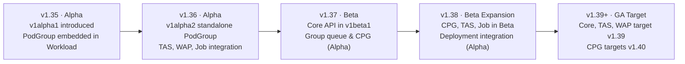

Three signals summarize current maturity:

1. **Two breaking API revisions**: Pod association changed from `workloadRef` to `schedulingGroup`, and `v1alpha2` was replaced by `v1alpha3` without conversion. The shape largely stabilized with `v1beta1` in v1.37.
2. **Cautious GA schedule**: Core API, TAS, and WAP GA targets moved from v1.38 to v1.39 in November 2026; v1.38 stays in Beta.
3. **All feature gates off by default**: Using WAS in v1.37 or v1.38 requires explicitly enabling feature gates on kube-apiserver, kube-controller-manager, and kube-scheduler.

| Feature Gate | v1.37 | v1.38 | Purpose |
|---|---|---|---|
| `GenericWorkload` | Beta (off) | Beta (off) | Core switch (includes Gang and WAP) |
| `TopologyAwareWorkloadScheduling` | Alpha | Beta (off) | Topology-aware placement (TAS) |
| `CompositePodGroup` | Alpha | Beta (off) | Multi-level group tree (requires the two above) |
| `DRAWorkloadResourceClaims` | Beta (off) | Beta (off) | Shared PodGroup-level DRA claims |
| `WorkloadWithJob` | Alpha | Beta (off) | Native Job controller integration |
| `WorkloadWithDeployment` | — | Alpha | Deployment / ReplicaSet integration |

### 2.2 Object Model & Scope Boundaries

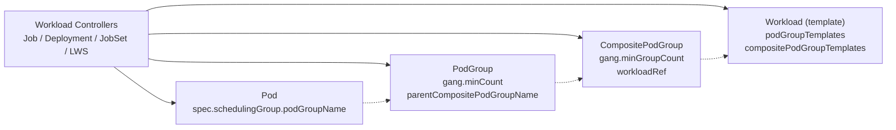

*Solid arrows denote creation; dashed arrows denote references.*

Three core design principles define the upstream model:

- **Template vs. runtime separation**: Workload controllers create objects in order: `Workload → PodGroup → Pod`. `Workload` is a static template—**kube-scheduler never watches it**, consuming only runtime `PodGroup`, `CompositePodGroup`, and `Pod.spec.schedulingGroup`.
- **Minimal and mostly immutable PodGroup**: Only placement-essential fields exist—`schedulingPolicy` (`basic` or `gang.minCount`), `schedulingConstraints.topology` (at most 1 node label key), `disruptionMode` (`single` / `all`), priority and preemption policy, and up to 4 shared DRA `resourceClaims`. **Only `minCount` is mutable**; status records a one-way `PodGroupInitiallyScheduled` condition that never reverts once `True`.
- **Open controller ecosystem, strict scheduler scope**:
  - **Ecosystem integration**: `scheduling.k8s.io/v1` provides embeddable building-block types (used by `Job.spec.scheduling`). Alongside native Job and Deployment, KEP-6089 tracks integration with JobSet, LeaderWorkerSet, Kubeflow Trainer, Spark Operator, and KubeRay.
  - **Explicit non-goals**: KEP-4671, 5732, 5710, and 6012 explicitly exclude **multi-tenant queues, fairness, resource quotas, topology auto-discovery, preferred (soft) topology constraints, and post-preemption rescheduling**—kube-scheduler keeps a single priority-ordered queue.

---

## 3. kube-scheduler PodGroup Scheduling Flow (v1.37 vs v1.38)

> **TL;DR**: Since v1.37, Pods with `schedulingGroup` are queued together by root group and evaluated in a single scheduling cycle. If `minCount` cannot be satisfied, nothing is bound and group-level preemption runs once.

### 3.1 End-to-End Scheduling Flow

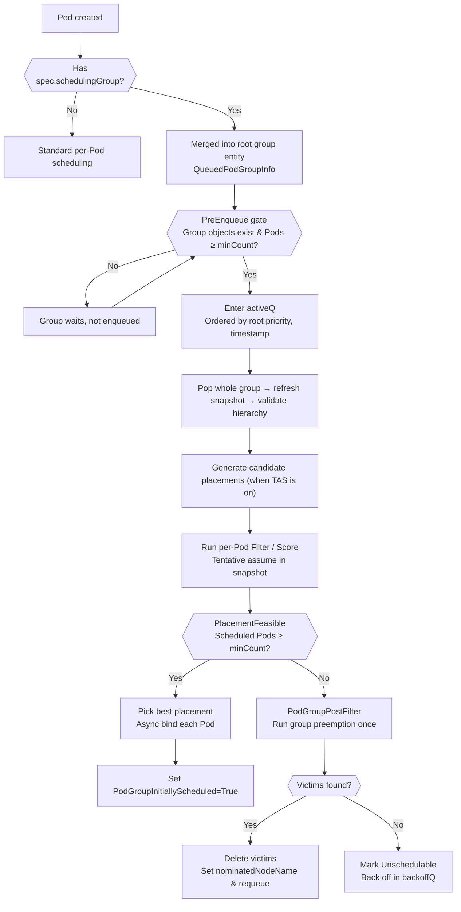

The flow breaks down into four key mechanisms:

1. **Group enqueue & PreEnqueue gate**: Regardless of `basic` or `gang` policy, any Pod with `spec.schedulingGroup` joins its root group's `QueuedPodGroupInfo` (a standalone PodGroup or root CPG). The group enters `activeQ` only when the PodGroup and all ancestors exist, created Pods reach `minCount`, and no member is blocked by a scheduling gate.
2. **Single-cycle sandbox evaluation & pruning**: The scheduling loop is single-goroutine. Members are evaluated sequentially via full Filter / Score with tentative assumes in the snapshot (all reverted at cycle end). After each Pod, `GangScheduling.PlacementFeasible` checks feasibility and short-circuits immediately if `scheduled + remaining < minCount`.
3. **Decision, async binding, and backoff**: Once `minCount` is met, the highest-scoring placement is selected and each placed Pod enters its own async binding cycle (all-or-nothing applies to the scheduling decision; there is no group-level bind rollback). If `minCount < total Pods`, placed Pods bind first and the rest requeue. Unschedulable groups run group preemption once, then enter `backoffQ` (capped at `podMaxBackoff × √groupSize`, without PodGroup queueing hints yet).
4. **Four new scheduling framework extension points**:
   - `PlacementGenerate`: Generates candidate node subsets (built-in: `TopologyPlacement`).
   - `PlacementScore`: Scores feasible placements (built-in: `PodGroupPodsCount`, `NodeResourcesFit`).
   - `PlacementFeasible`: Evaluates group policy progress (built-in: `GangScheduling`).
   - `PodGroupPostFilter`: Runs once after whole-group failure (built-in: `DefaultPreemption`, `DynamicResources`).

### 3.2 Normal Scheduling Sequence (v1.38)

Example with `gang.minCount = N` and sufficient cluster capacity:

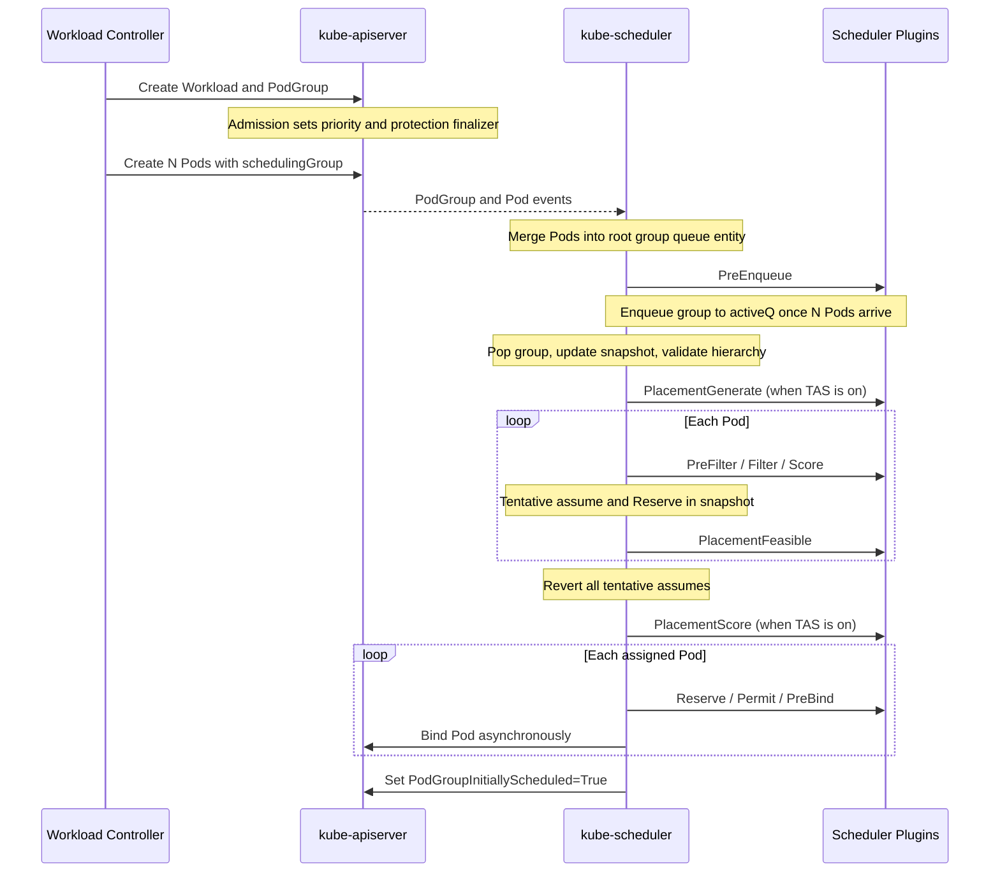

### 3.3 Key Changes from v1.37 to v1.38

v1.38 focuses on **removing transitional shortcuts, scaling placement search, completing hierarchy lifecycle, and expanding controller integration**:

| Theme | v1.37 | v1.38 (in development) |
|---|---|---|
| **Cleaner gang mechanism** | Kept a 5-minute Permit barrier; `PlacementFeasible` was an internal hook | **Permit barrier removed**; driven solely by the public, configurable `PlacementFeasible` extension point |
| **Placement search scaling** | Evaluated all candidates; used only the first `PlacementGenerate` plugin | Added **`percentageOfPlacementsToScore`** (adaptive, 5% floor), shuffling, nominated-placement fast path, and multi-plugin intersection |
| **CompositePodGroup maturity** | Alpha (`v1alpha3` only), max depth 4, no status write or delete protection | Promoted to **Beta (`v1beta1`)**, max depth **5**, full-tree runtime validation, condition write-back, and finalizer protection |
| **Preemption & refactoring** | Concentrated in a 1400+ line file | Split out `algorithm_podgroup.go`; added `PreemptionManager` and `RankNodes`; removed `PodGroupPreemptionPolicy` gate |
| **Workload integration** | Job integration Alpha; controller building blocks in `v1alpha3` | Job integration **Beta** (deletes PodGroup on suspend), Deployment integration (Alpha), building blocks in `scheduling.k8s.io/v1` |

> **Current Known Limitations**
> - **Single-goroutine head-of-line blocking**: A large group cycle (`Pods × candidate placements`, repeated during preemption) blocks other scheduling work in the same loop.
> - **Greedy, no backtracking**: Sequential per-Pod decisions do not guarantee a feasible solution for heterogeneous groups; all Pods in a hierarchy must share the same `schedulerName`, priority, and preemption policy.
> - **Runtime & ecosystem gaps**: Gang is enforced only at scheduling time; DRA group PostFilter does not yet support topology-constrained PodGroups or CPGs; no group-level Cluster Autoscaler integration yet.

---

## 4. Upstream PodGroup vs. Volcano PodGroup

> **TL;DR**: Despite sharing a name, the two objects serve different roles—upstream PodGroup is a pure **placement unit**, while Volcano PodGroup is a **batch job carrier** holding queue membership, admission budgets, lifecycle phases, and topology policies.

### 4.1 Architecture Comparison

Compare Volcano's object graph below with the upstream model in [Section 2.2](#22-object-model--scope-boundaries):

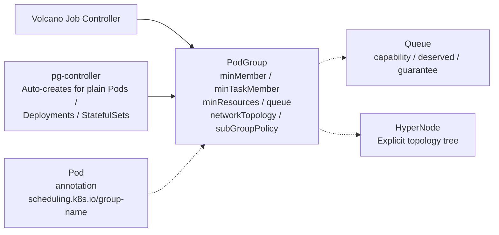

*Solid arrows denote creation; dashed arrows denote references.*

Three immediate structural differences stand out:

1. **Queue ownership**: Every Volcano PodGroup belongs to a `Queue` with capacity and fairness rules; upstream has no queue concept.
2. **Hierarchy layout**: Upstream splits out `Workload` and standalone `CompositePodGroup` objects; Volcano embeds `subGroupPolicy` inside a single PodGroup.
3. **Pod binding**: Upstream uses an immutable `pod.spec.schedulingGroup` field; Volcano uses the `scheduling.k8s.io/group-name` annotation.

### 4.2 Fields & Semantics Comparison

| Dimension | Upstream PodGroup (`scheduling.k8s.io/v1beta1`) | Volcano PodGroup (`scheduling.volcano.sh/v1beta1`) |
|---|---|---|
| **Pod association** | `pod.spec.schedulingGroup.podGroupName` (immutable) | annotation `scheduling.k8s.io/group-name` |
| **Gang rules** | Single `schedulingPolicy.gang.minCount` | Three-tier check: Job `minMember`, role `minTaskMember`, and SubGroup `subGroupSize` / `minSubGroups` |
| **Resources & admission** | No `minResources` or enqueue admission; controllers create Pods immediately | `enqueue` action checks `minResources` vs. queue capacity (`Pending → Inqueue`); Volcano Job creates Pods only after enqueue |
| **Queueing & ordering** | Single queue ordered by root priority, then timestamp | Queue order → Job order (priority / gang / drf / sla) → SubJob → Task |
| **Topology** | 1 node label key, hard only | HyperNode-based `networkTopology` (`hard` / `soft`) + inter-group anti-affinity `topologyAffinity` |
| **Preemption config** | `disruptionMode: single / all`, `preemptionPolicy` | Controlled by preemption/reclaim actions & plugins; `volcano.sh/preemptable` annotation |
| **Group DRA** | `resourceClaims[]` (up to 4) | Not supported |
| **Status semantics** | One-way `PodGroupInitiallyScheduled` condition (has `status` subresource) | Full lifecycle `phase` (`Pending` / `Inqueue` / `Running` / `Unknown` / `Completed`) + conditions + Pod counts (no `status` subresource) |
| **Mutability & deletion** | Only `minCount` mutable; finalizer held until all Pods terminate | Spec fields mutable; cleanup via `ownerReference` |

### 4.3 Scheduling Execution Model

Volcano's scheduling sequence for a gang Volcano Job (for plain Pods, Pods exist first and `pg-controller` creates the PodGroup):

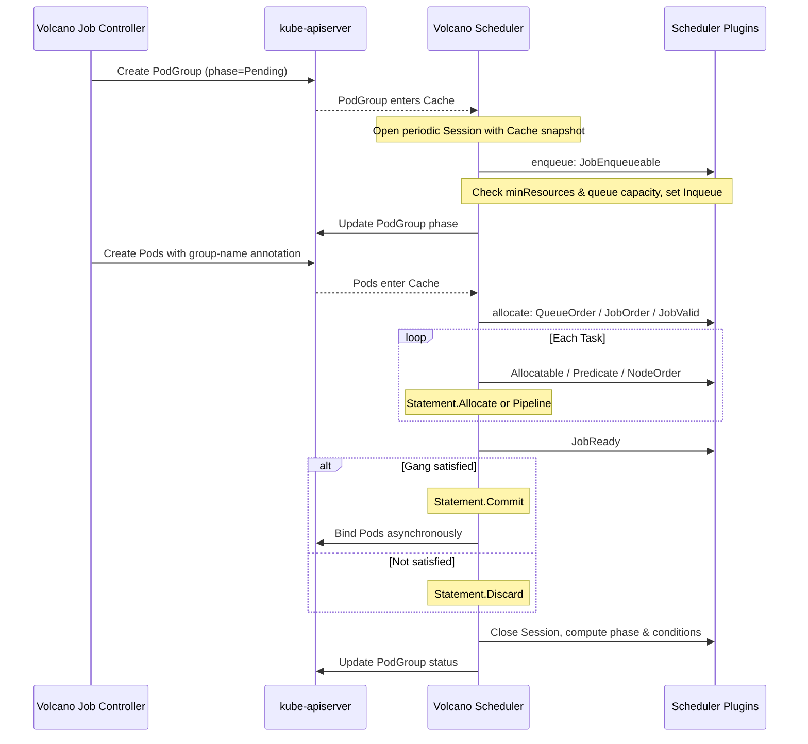

| Dimension | kube-scheduler | Volcano Scheduler |
|---|---|---|
| **Trigger model** | Event-driven, popping one root group at a time | Periodic Session processing queues and Jobs in batch over a snapshot |
| **Transaction model** | Tentative assumes in snapshot, fully reverted before per-Pod binding | `Statement` (Allocate / Pipeline / Evict): Commit on `JobReady`, otherwise Discard |
| **Preemption timing** | Runs inline once per failed group cycle | Separate actions (`preempt` / `reclaim` / `gangpreempt` / `gangreclaim`) |
| **Reservation** | Pod-level `nominatedNodeName` | In-session Pipelined reservations + `nominatedNodeName` and `NominatedHyperNode` |
| **Retry** | Requeued via `backoffQ` | Re-evaluated next Session (with optional unschedulable-job cache) |
| **Binding** | Per-Pod async bind, no group rollback | Per-Pod async bind, no group rollback |

---

## 5. CompositePodGroup vs. Volcano SubGroup

> **TL;DR**: Upstream models hierarchies as a **tree of standalone objects (up to 5 levels)**; Volcano embeds **`subGroupPolicy` in one PodGroup (fixed 2 levels)** for lower API overhead. Most two-level layouts map cleanly, while 3+ levels cannot be expressed in Volcano today.

### 5.1 Structural Comparison

Upstream builds a tree of standalone `CompositePodGroup` and leaf `PodGroup` objects (up to 5 levels in v1.38):

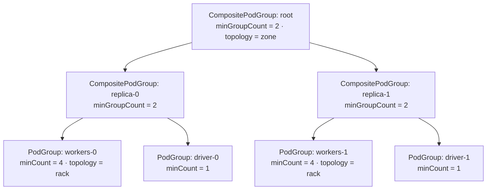

Volcano partitions Pods into a fixed two-level hierarchy inside a single PodGroup via `subGroupPolicy` and Pod labels (a two-level equivalent is shown below):

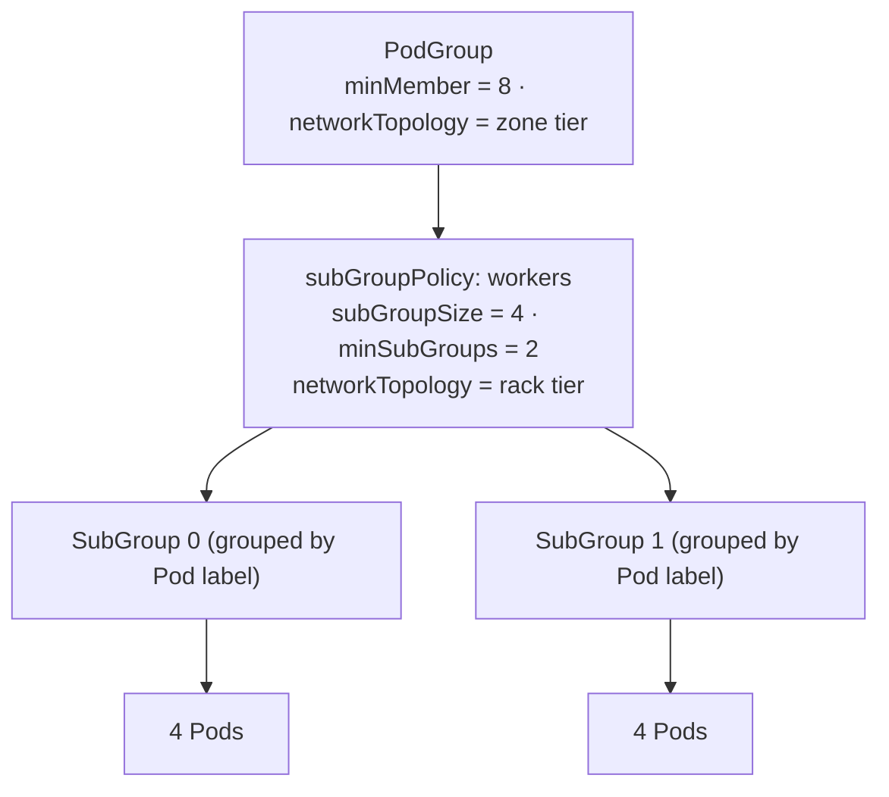

### 5.2 Side-by-Side YAML Example

> **Scenario**: Run 2 replica groups of 4 Pods each. Every replica group must stay within the same rack, the entire workload must stay within the same zone, and both groups must be ready to start.

**Upstream** (declare a `Workload`; the controller creates 1 `CompositePodGroup` and 2 `PodGroup`s):

```yaml
apiVersion: scheduling.k8s.io/v1beta1
kind: Workload
metadata:
  name: serving
spec:
  compositePodGroupTemplates:
  - name: root
    schedulingPolicy:
      gang:
        minGroupCount: 2
    schedulingConstraints:
      topology:
      - key: topology.kubernetes.io/zone
    podGroupTemplates:
    - name: replica
      schedulingPolicy:
        gang:
          minCount: 4
      schedulingConstraints:
        topology:
        - key: topology.example.com/rack
```

**Volcano** (single `PodGroup`, assuming matching HyperNode tiers exist in the cluster):

```yaml
apiVersion: scheduling.volcano.sh/v1beta1
kind: PodGroup
metadata:
  name: serving
spec:
  queue: default
  minMember: 8
  networkTopology:
    mode: hard
    highestTierAllowed: 2        # tier 2 maps to zone
  subGroupPolicy:
  - name: replica
    subGroupSize: 4
    minSubGroups: 2
    labelSelector:
      matchLabels:
        app: serving
    matchLabelKeys:
    - group-index                # Pods sharing a value form one SubGroup
    networkTopology:
      mode: hard
      highestTierAllowed: 1      # tier 1 maps to rack
```

### 5.3 Key Differences & Mapping Feasibility

| Dimension | CompositePodGroup | Volcano PodGroup + SubGroup |
|---|---|---|
| **Shape & depth** | Tree of standalone API objects, up to 5 levels (4 in v1.37) | Embedded list inside PodGroup, fixed 2 levels |
| **Grouping mechanism** | Explicit Pod reference to each leaf PodGroup | `labelSelector` + grouping by `matchLabelKeys` values |
| **Parent / child gang** | Parent `minGroupCount` counts across templates; each leaf sets its own `minCount` | Each policy counts `minSubGroups` independently; uniform `subGroupSize` per policy |
| **Multi-level topology** | One label key per level, narrowing top-down | One `networkTopology` at Job level + one at SubGroup level |
| **Priority & disruption** | Uniform priority across the tree; per-level `disruptionMode` (`all` cannot contain `single`) | Job uses PodGroup priority, SubJob uses highest Task priority; no `disruptionMode` |
| **Scheduling algorithm** | Top-down recursive evaluation in one cycle; siblings in creation order, no backtracking | Select Job HyperNode first, then trial-allocate each SubJob and pick highest score |

**Can upstream shapes map onto Volcano's current model?**

| Upstream Shape | Feasibility | Notes |
|---|---|---|
| Single PodGroup (`gang` / `basic`) | ✅ Full | `minCount` maps directly to `minMember` |
| 1 CPG + homogeneous leaf PodGroups | ✅ Full | Single `subGroupPolicy` (`subGroupSize = minCount`, `minSubGroups = minGroupCount`) |
| 1 CPG + multi-template PodGroups, all required | ✅ Full | One policy per template, or combine with `minTaskMember` |
| 1 CPG + multi-template with `minGroupCount < total` | ⚠️ Partial | Upstream allows "any M children across templates"; Volcano counts per policy |
| 3+ levels (e.g., JobSet → ReplicatedJob → Job) | ❌ Unsupported | Requires extending SubGroup into a recursive tree model |
| Mixed per-level `disruptionMode` | ❌ Unsupported | No declarative equivalent in Volcano today |

---

## 6. TAS (Topology-Aware Scheduling) Comparison

> **TL;DR**: Upstream TAS derives hard single-domain constraints directly from node labels—zero extra CRDs and very lightweight. Volcano uses an explicit HyperNode tree to deliver soft/hard modes, tightest-tier preference, and automatic topology discovery.

### 6.1 Topology Modeling

Upstream has no topology objects; identical node label values implicitly form candidate placements:

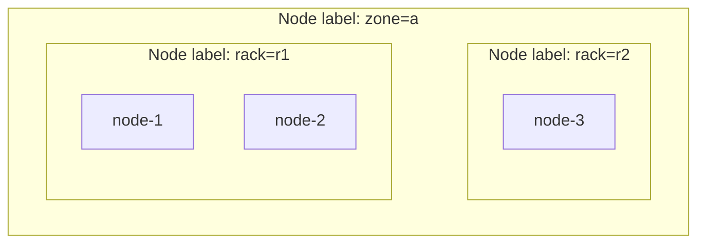

Volcano models topology explicitly with HyperNode CRDs (lower tier = closer to physical nodes):

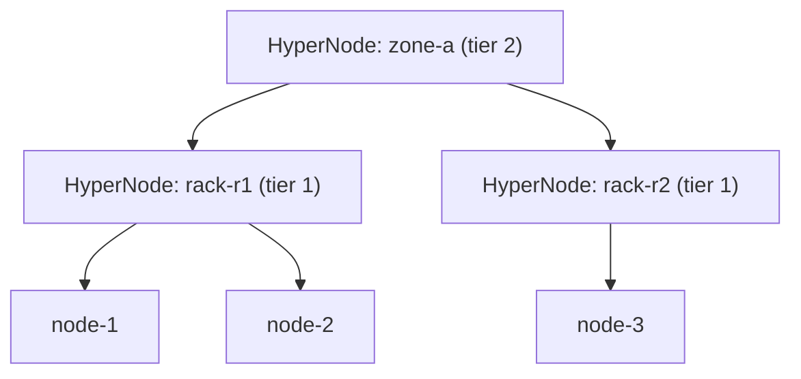

### 6.2 Capability Comparison

| Dimension | Upstream TAS | Volcano Network Topology Aware Scheduling |
|---|---|---|
| **Topology source** | Node labels, no topology CRDs | HyperNode CRD (node name, regex, or label selectors) |
| **Auto-discovery** | None (explicit non-goal) | HyperNode controller supports `ufm` and `label` discoverers |
| **Constraint model** | One label key: all Pods must land in the same value domain | `highestTierAllowed` / `highestTierName`: lowest common ancestor within that tier |
| **Hard vs. soft** | **Hard only** (preferred deferred) | Both **`hard` and `soft`** |
| **Multi-level topology** | Nested `CompositePodGroup` objects | Job-level + SubGroup-level (2 levels) |
| **Search & pruning** | Evaluates label value domains; v1.38 adds percentage cutoff | Searches bottom-up from lowest tier, **stopping at the lowest feasible tier** |
| **Scoring** | `PodGroupPodsCount` + `NodeResourcesFit` (MostAllocated) | HyperNode binpack + tier-aware node scoring |
| **Running Pods** | New Pods are restricted to the already occupied label domain | Search constrained by LCA of already allocated HyperNodes |
| **Preemption integration** | Reruns placement-aware group scheduling during WAP | `gangpreempt` / `gangreclaim` search per HyperNode domain (legacy `preempt` skips topology jobs) |

> **Trade-off**: For simple same-rack or same-zone hard constraints on labeled nodes, upstream TAS is lighter to operate. For large AI clusters needing multi-tier switch topologies, soft fallback, or IB/UFM auto-discovery, Volcano's HyperNode model is significantly richer.

---

## 7. WAP (Workload-Aware Preemption) vs. Volcano Preemption & Reclaim

> **TL;DR**: Both sides make whole-group preemption decisions for the preemptor and avoid partial evictions on failure. They diverge in two major ways: Volcano adds cross-queue reclaim, and the two take opposite default stances on protecting a victim's gang.

### 7.1 Two Headline Differences

1. **Priority-only vs. Priority + Cross-Queue Reclaim**: Upstream WAP is purely priority-driven. Volcano supports both intra-queue priority preemption (`preempt` / `gangpreempt`) and cross-queue quota reclaim (`reclaim` / `gangreclaim` based on `deserved` / `guarantee`).
2. **Opposite defaults for victim gang protection**:
   - **Upstream breaks victim gangs by default**: `disruptionMode` defaults to `single`, allowing individual Pods to be evicted from a running lower-priority gang. Users must opt in to `disruptionMode: all` to treat the group (at the highest `all` ancestor) as an atomic victim unit.
   - **Volcano protects victim gangs by default**: Legacy `preempt` never drops a victim below `minAvailable`; `gangpreempt` prefers safe bundles that preserve the victim's gang, evicting a whole gang only when `allowWholeBundle` is enabled and all plugins allow it.

### 7.2 Execution Flow Comparison

**Upstream WAP (`PodGroupPostFilter`, runs once per failed group cycle)**:

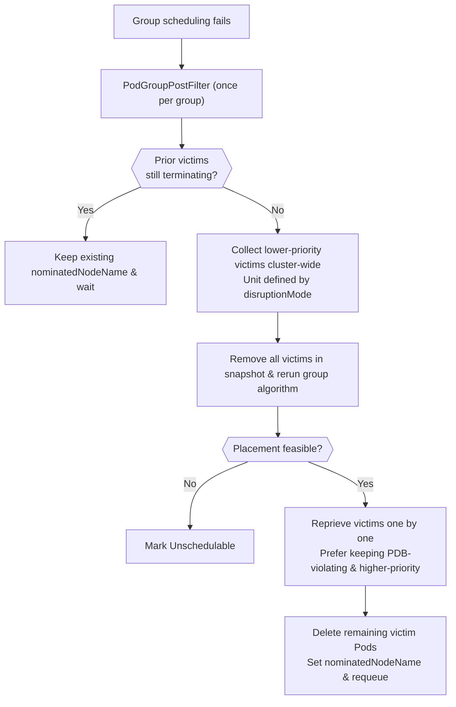

**Volcano Group Eviction (`gangpreempt` Action)**:

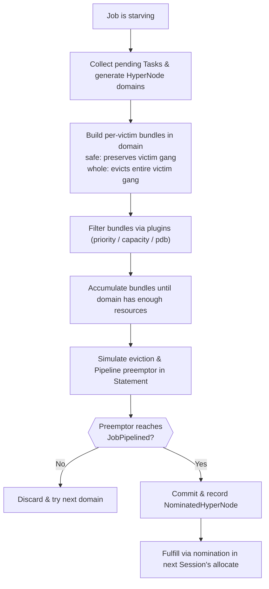

### 7.3 Comparison Summary

| Dimension | Upstream WAP | Volcano Preemption / Reclaim |
|---|---|---|
| **Trigger point** | Inline right after group scheduling fails | Separate actions: `preempt` / `reclaim` / `gangpreempt` / `gangreclaim` |
| **Driver** | Priority only | Priority (preempt) + queue quota (cross-queue reclaim) |
| **Victim unit** | `single` (Pod) or `all` (highest `all` ancestor group) | Legacy: single Task; Gang actions: safe bundle or whole bundle |
| **Victim gang protection** | Off by default (`single`); opt in via `all` | Protected by default (`minAvailable`) |
| **Search scope** | Cluster-wide (with TAS placements when enabled) | Legacy: per node; Gang actions: per HyperNode domain |
| **Priority & policy** | PodGroup priority (Pod priority ignored), uniform across tree; group-level `preemptionPolicy` | Job uses PodGroup priority, internal Tasks use Task priority; Pod-level `preemptionPolicy` |
| **PDB handling** | Best-effort (prefers reprieving PDB-violating victims, does not block) | Enforced by `pdb` plugin when enabled |
| **Post-preemption** | Pods wait with `nominatedNodeName`; no new preemption while victims terminate | Next Session's `allocate` uses nomination fast path |

---

## 8. Volcano Compatibility Plan & Effort Estimate

> **TL;DR**: Volcano does not yet read upstream PodGroups. Because upstream APIs are still Beta and off by default, the recommended strategy is **controller-side mirroring first, evaluating native scheduler support after upstream GA**.

### 8.1 Where Volcano Stands Today

- **Stubbed interfaces only**: Volcano compiles against upstream PodGroup types, but `pkg/scheduler/plugins/util/k8s/snapshot.go` returns empty/not-found results and `Framework.PodGroupManager()` returns `nil`.
- **No `schedulingGroup` lookup**: `getJobID` in `pkg/scheduler/api/job_info.go` only inspects the `scheduling.k8s.io/group-name` annotation and never reads `pod.spec.schedulingGroup`.
- **No informers or RBAC**: Today, a Pod specifying both `schedulerName: volcano` and `schedulingGroup` falls back to `pg-controller` creating a `minMember=1` Volcano PodGroup—ignoring upstream gang, topology, and `disruptionMode` semantics.

### 8.2 Compatibility Levels

| Level | Scope | User Value |
|---|---|---|
| **L1 · Flat PodGroup** | Recognize `schedulingGroup`, honor `minCount`, priority, queue assignment, and write back `PodGroupInitiallyScheduled` | Native `Job.spec.scheduling` works seamlessly on Volcano with multi-tenant queues |
| **L2 · Two-Level Alignment** | Add `disruptionMode`, `preemptionPolicy`, topology label mapping, and two-level `CompositePodGroup` | Covers common two-level AI workloads such as JobSet and LWS |
| **L3 · Full Native Support** | Arbitrary-depth `CompositePodGroup` + PodGroup-level DRA `ResourceClaim` | Full behavioral parity with kube-scheduler on upstream WAS APIs |
| **L4 · Replace Volcano PodGroup** | Deprecate Volcano PodGroup in favor of upstream | **Not recommended**—upstream lacks `queue`, `minResources`, `minTaskMember`, soft topology, and full lifecycle `phase` |

### 8.3 Two Implementation Paths

**Path A: Controller-side mirroring** (concentrated in `pg-controller`, syncing spec forward and status back)

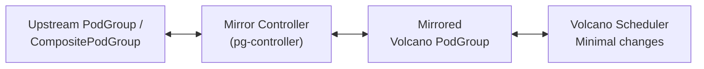

**Path B: Native scheduler support** (Scheduler Cache watches upstream objects and updates status directly)

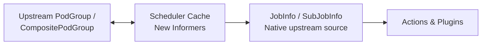

| Dimension | Path A: Controller Mirroring | Path B: Native Scheduler |
|---|---|---|
| **Approach** | Controller mirrors upstream objects to Volcano PodGroup and stamps `group-name` / subgroup labels on Pods | Cache watches upstream objects directly; `getJobID` handles `schedulingGroup`; scheduler writes upstream status |
| **Scheduler impact** | Minimal; insulates scheduler core from upstream API churn | Broad (Cache, JobInfo, status sync, queue metrics) |
| **Object overhead** | Extra mirrored PodGroup per group; sync lag to handle | Single source of truth, no duplicate objects |
| **Capability ceiling** | Bounded by Volcano's two-level SubGroup model; no group DRA | Supports recursive arbitrary-depth SubJobs and group DRA |
| **When to use** | **Recommended now**: low risk while upstream stays in Beta | After upstream GA and broad ecosystem adoption |

### 8.4 Core Design Gaps to Resolve First

| Design Gap | Recommended Approach |
|---|---|
| **Missing queue & `minResources`** | Reuse `scheduling.volcano.sh/queue-name` annotation or namespace default queue; compute `minResources` in controller from Pod templates/created Pods × `minCount` |
| **Resource name collision & status** | Prefix mirrored Volcano PodGroup names to avoid `namespace/name` collisions; set upstream `PodGroupInitiallyScheduled=True` when the Volcano PodGroup first reaches `Running` |
| **Enqueue vs. Pod creation order** | Upstream controllers create Pods eagerly; follow Volcano's plain-Pod pattern—Pods exist first and wait until the PodGroup becomes `Inqueue` |
| **`disruptionMode` alignment** | Keep Volcano's gang protection for `single` (permitted, not required); disable safe bundles when `disruptionMode: all` |
| **Topology label key mapping** | Use the `label` HyperNode discoverer and map label keys to HyperNode tiers (aligned with [volcano#6161](https://github.com/volcano-sh/volcano/issues/6161)) |
| **Depth limits & API versions** | Support `v1beta1+` only (skip alpha); detect availability via API discovery behind a Volcano feature gate; explicitly reject 3+ levels or cross-template partial counts with a clear condition in L2 |

### 8.5 Effort Estimate & Phased Roadmap

> Estimates assume engineers familiar with the Volcano scheduler and include unit tests, E2E, cluster verification, and docs (excluding community review time). Across the codebase, **44 non-test scheduler files** (~480 lines) and **14 controller files** directly reference Volcano PodGroups, which drives the higher cost of Path B.

**Summary**

| Target | Recommended Path | Work Items | Estimated Effort |
|---|---|---|---|
| **L1 · Minimum Viable (Flat Gang)** | Path A | W0 + W1 | **4–6 person-weeks** |
| **L2 · Two-Level Alignment** | Path A | W0–W3 + W5 + W8 | **12–20 person-weeks** |
| **L3 · Full Native Support** | Path B | W0–W8 | **33–51 person-weeks (8–12 person-months)** |

*Ongoing maintenance before upstream GA: plan ~1–2 person-weeks per Kubernetes minor release to track API changes.*

**Task Breakdown (person-weeks)**

| ID | Work Item | Primary Areas | Path A | Path B |
|---|---|---|---|---|
| **W0** | Foundation: API discovery, informers, RBAC, feature gate, E2E setup | controllers / scheduler / installer / hack | 1–2 | 1–2 |
| **W1** | Flat PodGroup: Pod binding, `minCount`, priority, queue source, status sync | A: `controllers/podgroup`<br/>B: `scheduler/cache`, `api`, `framework`, queue metrics | 3–4 | 6–8 |
| **W2** | Wire `preemptionPolicy` and `disruptionMode` into preemption/reclaim | `scheduler/actions` (preempt / reclaim / gang*), gang plugin | 2–4 | 2–4 |
| **W3** | Map topology label keys to HyperNode tiers | hypernode controller, `network-topology-aware` | 2–3 | 2–3 |
| **W4** | Build label-based domains directly when no HyperNodes exist | `scheduler/api` HyperNode cache | — | 3–4 |
| **W5** | Two-level `CompositePodGroup` mapping to `subGroupPolicy` + status | A: controller; B: cache & JobInfo | 3–5 | 4–6 |
| **W6** | Arbitrary depth: recursive SubJob model | allocate / gang / network-topology-aware / group eviction / `job_info` | N/A | 10–16 |
| **W7** | PodGroup-level DRA: implement `PodGroupManager` & `PodGroupState` | `plugins/util/k8s`, predicates | N/A | 4–6 |
| **W8** | User docs & semantic difference guide | docs | 1–2 | 1–2 |

**Recommended Phased Roadmap**

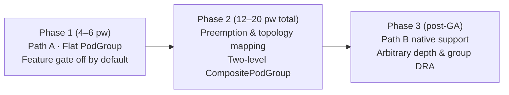

### 8.6 Key Risks

- **API churn**: Two breaking revisions in three releases plus a GA slip mean early deep coupling into the scheduler core carries high rework risk.
- **Limited near-term reach**: While upstream feature gates remain off by default, real cluster adoption will be narrow—favoring a lightweight Phase 1.
- **Ecosystem shift**: If KubeRay, Kubeflow Trainer, Spark Operator, and JobSet standardize on upstream WAS APIs, Volcano will need compatibility to keep those workloads from degrading to per-Pod scheduling.
- **Peer reference**: Kueue's WAS integration plan ([kueue#8871](https://github.com/kubernetes-sigs/kueue/issues/8871)) shares goals closely aligned with Volcano L1 / L2 and is a useful design reference.

---

## 9. References

**KEPs & Official Blog**

- [Kubernetes v1.37: Advancing Workload-Aware Scheduling](https://kubernetes.io/blog/2026/09/08/kubernetes-v1-37-advancing-workload-aware-scheduling/)
- [KEP-4671 Gang Scheduling](https://github.com/kubernetes/enhancements/tree/master/keps/sig-scheduling/4671-gang-scheduling) / [KEP-5832 Decouple PodGroup API](https://github.com/kubernetes/enhancements/tree/master/keps/sig-scheduling/5832-decouple-podgroup-api) / [KEP-6012 CompositePodGroup API](https://github.com/kubernetes/enhancements/tree/master/keps/sig-scheduling/6012-composite-podgroup-api)
- [KEP-5732 Topology-aware workload scheduling](https://github.com/kubernetes/enhancements/tree/master/keps/sig-scheduling/5732-topology-aware-workload-scheduling) / [KEP-5710 Workload-aware preemption](https://github.com/kubernetes/enhancements/tree/master/keps/sig-scheduling/5710-workload-aware-preemption)
- [KEP-6089 WAS Controller APIs](https://github.com/kubernetes/enhancements/tree/master/keps/sig-scheduling/6089-was-controller-apis) / [KEP-5729 DRA ResourceClaim for Workloads](https://github.com/kubernetes/enhancements/tree/master/keps/sig-scheduling/5729-resourceclaim-support-for-workloads)
- [KEP-5547 Job Integration](https://github.com/kubernetes/enhancements/tree/master/keps/sig-apps/5547-integrate-workload-with-job) / [KEP-6276 Deployment Integration](https://github.com/kubernetes/enhancements/tree/master/keps/sig-apps/6276-integrate-workload-with-deployment)

**Design Docs & Tracking Issues**

- Volcano design docs: [Network Topology Aware Scheduling](../design/Network%20Topology%20Aware%20Scheduling.md), [gang-aware-eviction-design](../design/gang-aware-eviction-design.md)
- Community tracking: [kueue#8871](https://github.com/kubernetes-sigs/kueue/issues/8871), [jobset#1365](https://github.com/kubernetes-sigs/jobset/issues/1365), [lws#891](https://github.com/kubernetes-sigs/lws/issues/891), [volcano#6161](https://github.com/volcano-sh/volcano/issues/6161)

<details>
<summary>Source Code Index (click to expand)</summary>

**Kubernetes (`kubernetes/kubernetes`)**

| Component | Path |
|---|---|
| API & `schedulingGroup` | `staging/src/k8s.io/api/scheduling/v1beta1/types.go`, `staging/src/k8s.io/api/core/v1/types.go` |
| Feature gates | `pkg/features/kube_features.go` |
| Group scheduling & queue | `pkg/scheduler/schedule_one_podgroup.go`, `pkg/scheduler/algorithm_podgroup.go`, `pkg/scheduler/backend/queue/scheduling_queue.go` |
| Gang / TAS / WAP plugins | `pkg/scheduler/framework/plugins/gangscheduling/`, `topologyaware/`, `podgrouppodscount/`, `pkg/scheduler/framework/preemption/podgrouppreemption.go` |
| Job integration | `pkg/controller/job/job_scheduling_manager.go` |

**Volcano (`volcano-sh/volcano`)**

| Component | Path |
|---|---|
| PodGroup API & Job mapping | `staging/src/volcano.sh/apis/pkg/apis/scheduling/v1beta1/types.go`, `pkg/scheduler/api/job_info.go`, `sub_job_info.go` |
| Allocation, gang, topology, eviction | `pkg/scheduler/actions/allocate/`, `gangpreempt/`, `gangreclaim/`, `pkg/scheduler/plugins/gang/`, `network-topology-aware/` |
| Upstream stubs & controller | `pkg/scheduler/plugins/util/k8s/snapshot.go`, `framework.go`, `pkg/controllers/podgroup/` |

</details>
