# Upstream Kubernetes PodGroup vs. Volcano

English | [简体中文](./k8s-workload-aware-scheduling-vs-volcano-cn.md)

## Background

Since v1.35, Kubernetes has been adding Workload-Aware Scheduling (WAS) to kube-scheduler along with a native `PodGroup` API under `scheduling.k8s.io`, covering gang scheduling, topology-aware placement, and group-level preemption. While it shares its name and part of its scope with Volcano's `PodGroup`, the two differ substantially in positioning and data model.

> Note: Upstream details are based on Kubernetes v1.37.2 and the master branch as of November 2026 (v1.38 in development); Volcano details are based on current master.

## 1. Upstream PodGroup Status

### 1.1 API Model

Consider a 4-pod gang training job. On a cluster with `GenericWorkload` and `WorkloadWithJob` enabled (plus `TopologyAwareWorkloadScheduling` if topology constraints are used), a user declares `spec.scheduling` directly on a native `Job`:

```yaml
apiVersion: batch/v1
kind: Job
metadata:
  name: train
spec:
  parallelism: 4
  completions: 4
  scheduling:
    schedulingPolicy:
      gang: {}          # minCount defaults to parallelism when omitted
  template:
    ...
```

The Job controller then creates a `Workload`, a `PodGroup`, and the `Pod`s, linking each pod via `pod.spec.schedulingGroup` (object names are illustrative):

```yaml
apiVersion: scheduling.k8s.io/v1beta1
kind: Workload
metadata:
  name: train
spec:
  podGroupTemplates:
  - name: workers
    schedulingPolicy:
      gang:
        minCount: 4
---
apiVersion: scheduling.k8s.io/v1beta1
kind: PodGroup
metadata:
  name: train-workers
spec:
  workloadRef:
    workloadName: train
    templateName: workers
  schedulingPolicy:       # copied from the template at creation time
    gang:
      minCount: 4
---
apiVersion: v1
kind: Pod
metadata:
  name: train-0
spec:
  schedulingGroup:
    podGroupName: train-workers
  ...
```

Core object roles:

- `Workload`: Static template defining a workload's group structure. Consumed only by workload controllers; kube-scheduler does not watch it.
- `PodGroup`: Runtime scheduling unit consumed by kube-scheduler. Its spec is mostly immutable—only `minCount` can be modified after creation.
- `pod.spec.schedulingGroup`: Native pod field pointing to its `PodGroup`; immutable once created.
- `CompositePodGroup`: Used by multi-level workloads such as JobSet and LeaderWorkerSet to organize multiple `PodGroup`s into a tree (see Section 4).

All objects are created by the workload controller; reference relationships are shown below (arrows denote references):

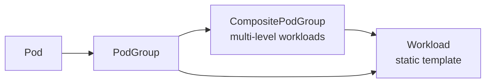

### 1.2 Terminology Mapping

| Upstream Term | Meaning | Volcano Equivalent |
|---|---|---|
| WAS | Workload-Aware Scheduling | Volcano batch scheduling model |
| `Workload` | Static workload scheduling template | No standalone object (embedded in workload spec) |
| `PodGroup` | Runtime group scheduling unit | `PodGroup` (`scheduling.volcano.sh`) |
| `CompositePodGroup` | Hierarchical parent group object | `PodGroup.spec.subGroupPolicy` |
| TAS | Topology-Aware Scheduling | Network Topology Aware Scheduling (HyperNode) |
| WAP | Workload-Aware Preemption | `preempt` / `reclaim` and `gangpreempt` / `gangreclaim` |

### 1.3 Release Progress & Feature Gates

| Release | Stage | Key Changes |
|---|---|---|
| v1.35 | Alpha | Introduced `v1alpha1` Workload API with `PodGroup` embedded in `Workload` |
| v1.36 | Alpha | `v1alpha2` decoupled `PodGroup` and switched pods to `schedulingGroup`; added TAS, WAP, and Job integration |
| v1.37 | Beta | Core API promoted to `v1beta1`; group-level queueing and scheduling; `CompositePodGroup` added (Alpha, `v1alpha3`) |
| v1.38 (in dev) | Beta | `CompositePodGroup`, TAS, and Job integration promoted to Beta; Deployment integration added (Alpha); embeddable controller structs moved to `scheduling.k8s.io/v1` |
| v1.39 (planned) | GA | `PodGroup`, TAS, and WAP target GA; `CompositePodGroup` targets v1.40 |

Through v1.38, every workload-scheduling feature gate is **off by default** and must be explicitly enabled on kube-apiserver, kube-controller-manager, and kube-scheduler:

| Feature Gate | v1.37 | v1.38 (in dev) | Dependencies & Notes |
|---|---|---|---|
| `GenericWorkload` | Beta (off) | Beta (off) | Core switch; merged `GangScheduling` and `WorkloadAwarePreemption` in v1.37 |
| `TopologyAwareWorkloadScheduling` | Alpha | Beta (off) | Topology-aware scheduling (TAS); depends on `GenericWorkload` |
| `CompositePodGroup` | Alpha | Beta (off) | Multi-level group tree; depends on `GenericWorkload` and `TopologyAwareWorkloadScheduling` |
| `PodGroupPreemptionPolicy` | Alpha | Removed | Removed in v1.38; `PodGroup.spec.preemptionPolicy` takes effect directly |
| `DRAWorkloadResourceClaims` | Beta (off) | Beta (off) | Shared PodGroup-level DRA ResourceClaims |
| `WorkloadWithJob` | Alpha | Beta (off) | Native Job controller integration; depends on `GenericWorkload` (still Alpha in `v1.38.0-beta.0`) |
| `WorkloadWithDeployment` | — | Alpha | Deployment / ReplicaSet integration; depends on `GenericWorkload`; gang requires `strategy.type: Recreate` |

In addition, two breaking revisions occurred between v1.35 and v1.37 (`workloadRef` → `schedulingGroup`, `v1alpha2` → `v1alpha3` without conversion), and core GA moved from v1.38 to v1.39 in November 2026.

### 1.4 Scope Boundaries (Non-Goals)

KEP-4671 explicitly excludes queues and fairness:

> Bring fairness or multiple workload queues in kube-scheduler. Kueue and Volcano.sh will continue to provide this.

kube-scheduler retains a single priority-ordered queue with no tenant queues, quotas, or cross-queue reclaim. Topology auto-discovery (relies on node labels) and soft/preferred topology constraints are also out of scope.

## 2. PodGroup Scheduling in kube-scheduler

### 2.1 Scheduling Flow

Using the 4-pod gang job from 1.1 with `GenericWorkload` enabled:

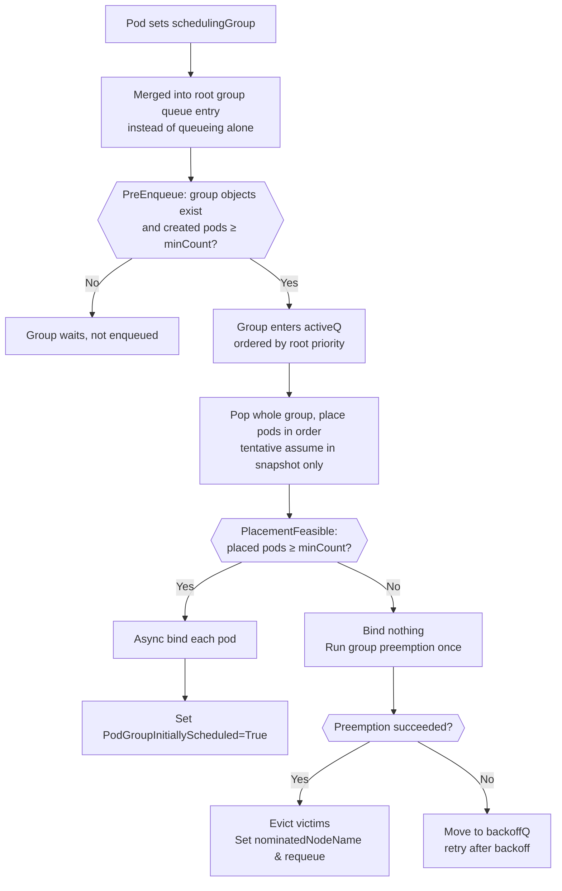

Key steps:

1. **Queue aggregation**: Any pod with `schedulingGroup` (whether `basic` or `gang`) joins its root group's queue entry (standalone `PodGroup` or root `CompositePodGroup`), ordered by root priority and timestamp.
2. **PreEnqueue gate**: The group enters `activeQ` once the `PodGroup` and all ancestor objects exist, created pods reach `minCount`, and no member is held by a scheduling gate.
3. **Snapshot placement & pruning**: Once popped, the scheduler runs Filter / Score per pod in fixed order, recording tentative assumes in the cycle snapshot (reverted at cycle end without touching real cache). `PlacementFeasible` runs after each pod and short-circuits if `placed + remaining < minCount`.
4. **Binding & preemption**: If `minCount` is satisfied, placed pods enter async binding cycles and `PodGroupInitiallyScheduled=True` is written (if `minCount < total pods`, placed pods bind first while the rest requeue; already running members count toward `minCount`). Otherwise nothing is bound, group preemption runs once (Section 6), and unschedulable groups move to `backoffQ` (capped at `podMaxBackoff × √groupSize`, default `podMaxBackoff` = 10s).

Four new scheduling framework extension points support this flow:

| Extension Point | Responsibility | Built-in Plugins |
|---|---|---|
| `PlacementGenerate` | Generates candidate topology domains (node subsets) | `TopologyPlacement` |
| `PlacementScore` | Scores feasible candidate placements | `PodGroupPodsCount`, `NodeResourcesFit` |
| `PlacementFeasible` | Checks group policy progress for early pruning | `GangScheduling` |
| `PodGroupPostFilter` | Runs once after whole-group scheduling failure | `DefaultPreemption`, `DynamicResources` |

Normal scheduling sequence:

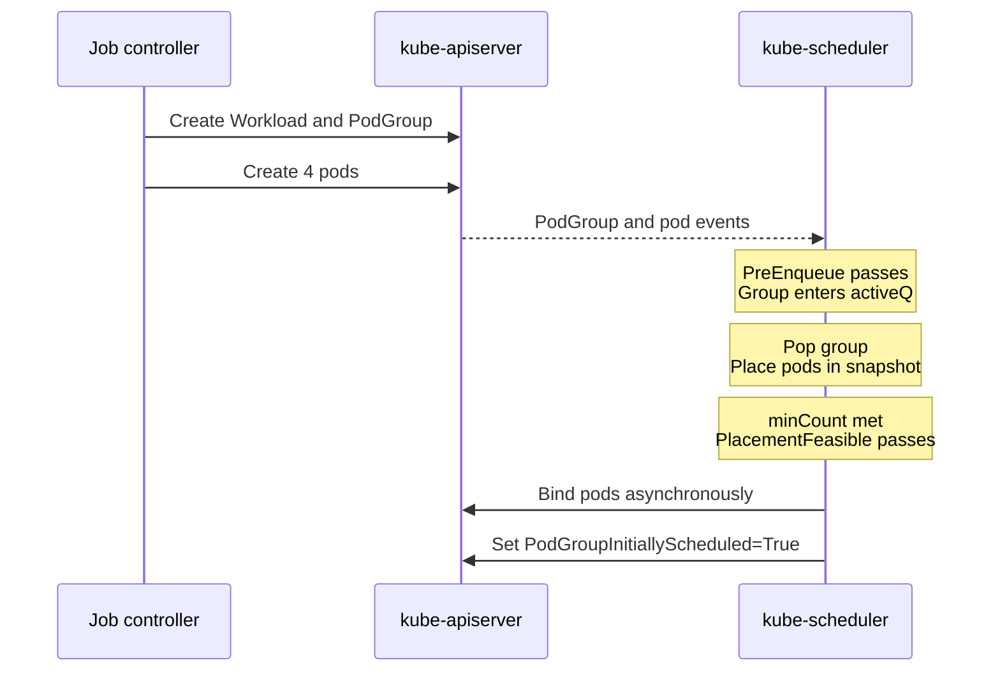

Five implementation constraints to note:

- **No group bind rollback**: All-or-nothing applies only to the scheduling decision; binding remains async and per pod, so a single bind failure does not undo sibling bindings.
- **One-way status condition**: `minCount` is enforced only at scheduling time; once `PodGroupInitiallyScheduled` becomes `True`, it never reverts even if members are later evicted.
- **Single-goroutine evaluation**: Evaluating a large group (`pods × candidate domains`, repeated during preemption) runs in the single scheduling loop and can block other pods/groups.
- **Greedy & uniform-hierarchy constraints**: Sequential placement in fixed order does not guarantee a valid solution for heterogeneous groups, and all pods in a hierarchy must share the same `schedulerName`, priority, and preemption policy.
- **DRA combination limit**: `DynamicResources`'s `PodGroupPostFilter` does not yet support topology-constrained `PodGroup`s or `CompositePodGroup`s.

### 2.2 Key Differences: v1.37 vs. v1.38

The core flow is unchanged; v1.38 (in development) removes transitional mechanisms and improves scaling:

| Area | v1.37 | v1.38 (in dev) |
|---|---|---|
| Gang enforcement | Kept a 5-minute Permit wait barrier alongside trial checks | Removed Permit barrier; driven solely by the public `PlacementFeasible` extension point |
| `CompositePodGroup` | Alpha (`v1alpha3` only), max depth 4, no status or delete protection | Beta (`v1beta1`), max depth 5, full-tree runtime validation (`PodGroupError`/`CompositePodGroupError`), condition write-back, and finalizer protection |
| Candidate domain search | Evaluates all candidates; uses only the first `PlacementGenerate` plugin | Adds `percentageOfPlacementsToScore` (adaptive, 5% floor), shuffling, nominated-placement fast path, and multi-plugin intersection |
| Preemption & structure | Concentrated in `schedule_one_podgroup.go` | Split out `algorithm_podgroup.go`; added `PreemptionManager` and `RankNodes` |
| Workload integration | `WorkloadWithJob` (Alpha) | `WorkloadWithJob` (Beta, deletes PodGroup on suspend), `WorkloadWithDeployment` (Alpha) |
| `preemptionPolicy` | Controlled by `PodGroupPreemptionPolicy` feature gate | Removed `PodGroupPreemptionPolicy` gate; field active directly |

## 3. Upstream PodGroup vs. Volcano PodGroup

### 3.1 Fields & Semantics

Although they share a name, upstream `PodGroup` is strictly a placement unit whereas Volcano's `PodGroup` also carries multi-tenant queue ownership, enqueue admission, and a dynamic lifecycle state machine.

| Dimension | Upstream PodGroup (`scheduling.k8s.io/v1beta1`) | Volcano PodGroup (`scheduling.volcano.sh/v1beta1`) |
|---|---|---|
| Pod association | `pod.spec.schedulingGroup` (immutable field) | annotation `scheduling.k8s.io/group-name` |
| Gang granularity | Single `schedulingPolicy.gang.minCount` | `minMember` + per-role `minTaskMember` + subgroup constraints |
| Queue & admission | No queue or `minResources`; controllers create pods directly | Bound to `queue`; `enqueue` admission via `minResources` |
| Priority & preemption | `priorityClassName` / `priority` / `preemptionPolicy` | `priorityClassName`, `volcano.sh/preemptable` |
| Topology | `schedulingConstraints.topology` (1 node label key, hard only) | `networkTopology` (HyperNode-based, hard / soft) |
| Subgroups | Standalone `CompositePodGroup` object tree | Embedded `subGroupPolicy` |
| Victim unit | `disruptionMode` (`single` / `all`) | No declarative field (governed by plugins & actions) |
| PodGroup-level DRA | `resourceClaims` (max 4) | Not supported (pod-level ResourceClaims only) |
| Status semantics | One-way `PodGroupInitiallyScheduled` (`status` subresource) | Dynamic `phase`, conditions, pod counts (no `status` subresource) |
| Mutability & protection | Only `minCount` mutable; protection finalizer | Spec mutable; cleanup via `ownerReference` |

Two upstream-only fields warrant note:

- **`disruptionMode`**: Declares the eviction unit when this group is preempted (`single` for individual pods, `all` for the whole group); see Section 6.
- **`resourceClaims` (PodGroup-level DRA)**: Requires the `DRAWorkloadResourceClaims` feature gate. Standard DRA attaches ResourceClaims per pod; this field declares shared ResourceClaims on the `PodGroup` (generated per group and cleaned up with it), letting all pods in the group share one device allocation and bypassing the 256-pod `reservedFor` limit per claim.

### 3.2 Scheduling Mechanics

| Dimension | kube-scheduler | Volcano Scheduler |
|---|---|---|
| Scheduling trigger | Event-driven, popping one root group per cycle | Periodic Session evaluating queues and jobs in batch over a snapshot |
| Transaction model | Snapshot tentative assumes reverted before async pod binding | `Statement` transaction (Commit on `JobReady`, else Discard) |
| Preemption timing | Inline once per failed group cycle | Separate `preempt` / `reclaim` / `gangpreempt` / `gangreclaim` actions |
| Retry mechanism | `backoffQ` with backoff (no group queueing hints yet) | Re-evaluated next Session (with optional unschedulable cache) |
| Binding | Per-pod async binding, no group rollback | Per-pod async binding, no group rollback |

The architectural divide is **event-driven single-group cycles** versus **periodic batch Sessions**: the latter enables cross-queue quota, fairness, and reclaim in one snapshot, while the former focuses on low-latency placement of individual workloads.

## 4. CompositePodGroup vs. Volcano SubGroup

Consider a two-level inference service: 2 replica groups of 4 pods each, where each replica group must stay within the same rack, the whole service within the same zone, and both replicas must be ready to start.

Upstream builds a tree of standalone objects (leaf `PodGroup`s under a `CompositePodGroup`):

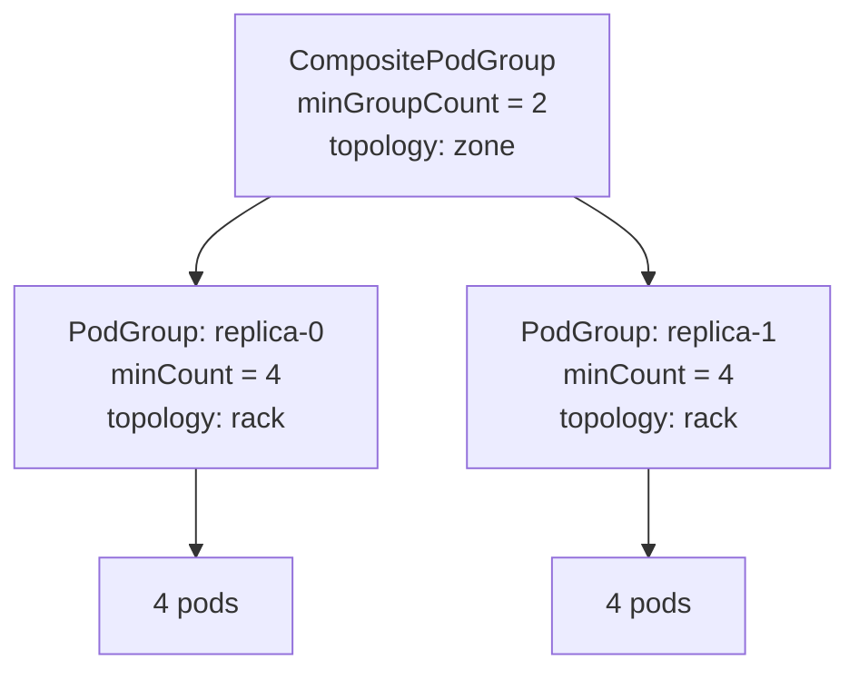

Volcano defines subgroups inside one `PodGroup` via `subGroupPolicy` and pod labels, with no standalone subgroup objects:

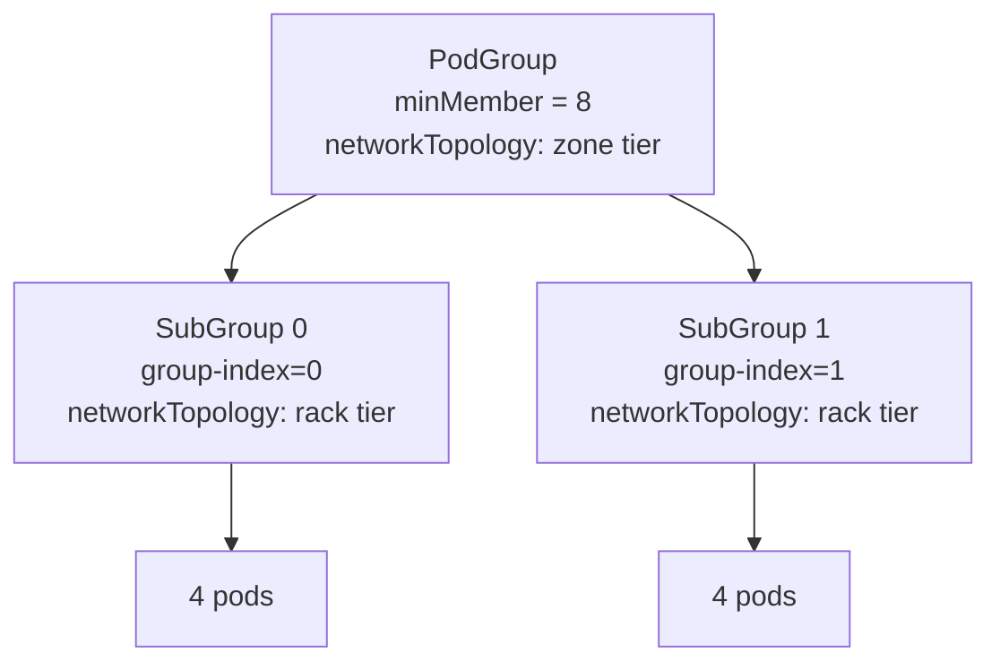

Side-by-side YAML comparison. Upstream declares a `Workload` template that the controller expands into 1 `CompositePodGroup` and 2 `PodGroup`s:

```yaml
apiVersion: scheduling.k8s.io/v1beta1
kind: Workload
metadata:
  name: serving
spec:
  compositePodGroupTemplates:
  - name: root
    schedulingPolicy:
      gang:
        minGroupCount: 2
    schedulingConstraints:
      topology:
      - key: topology.kubernetes.io/zone
    podGroupTemplates:
    - name: replica
      schedulingPolicy:
        gang:
          minCount: 4
      schedulingConstraints:
        topology:
        - key: topology.example.com/rack
```

Volcano uses a single `PodGroup` (assuming matching HyperNode tiers exist):

```yaml
apiVersion: scheduling.volcano.sh/v1beta1
kind: PodGroup
metadata:
  name: serving
spec:
  queue: default
  minMember: 8
  networkTopology:
    mode: hard
    highestTierAllowed: 2        # assuming tier 2 maps to zone
  subGroupPolicy:
  - name: replica
    subGroupSize: 4
    minSubGroups: 2
    labelSelector:
      matchLabels:
        app: serving
    matchLabelKeys:
    - group-index
    networkTopology:
      mode: hard
      highestTierAllowed: 1      # assuming tier 1 maps to rack
```

Key differences between the two hierarchy models:

- **Nesting depth**: `CompositePodGroup` (requires `CompositePodGroup`, `GenericWorkload`, and `TopologyAwareWorkloadScheduling`) nests recursively (up to 4 levels in v1.37, 5 on master), directly modeling 3-level trees like `JobSet → ReplicatedJob → Job`; Volcano is fixed at 2 levels.
- **Heterogeneous subgroups**: Each upstream child is an independent object with its own `minCount`; in Volcano, all subgroups under one `subGroupPolicy` share a uniform `subGroupSize`, requiring separate policies for different sizes.
- **Minimum child counting**: Upstream `minGroupCount` counts across all children of a parent regardless of template; Volcano `minSubGroups` counts per policy.
- **Priority & preemption constraints**: Upstream requires uniform priority across the entire tree, and a parent with `disruptionMode: all` cannot contain a `single` child; Volcano has no declarative `disruptionMode` field.

Mapping upstream shapes onto Volcano's current model:

| Upstream Shape | Volcano Compatibility |
|---|---|
| Single `PodGroup` | Supported (`minCount` → `minMember`) |
| Single-level `CompositePodGroup` + homogeneous `PodGroup`s | Supported (single `subGroupPolicy`) |
| Single-level `CompositePodGroup` + heterogeneous `PodGroup`s (all required) | Supported (one policy per template, or with `minTaskMember`) |
| Single-level `CompositePodGroup` + heterogeneous `PodGroup`s (partial count) | Cannot be expressed accurately (cross-template count mismatch) |
| Three or more levels | Unsupported |

## 5. Topology-Aware Scheduling (TAS) Comparison

Upstream TAS (requires `TopologyAwareWorkloadScheduling` and `GenericWorkload`) introduces no topology CRD; candidate domains are derived directly from node label values. A `PodGroup` names a single label key requiring all its pods to share the same label value, and the scheduler evaluates candidate values and picks the highest-scoring feasible domain (`PodGroupPodsCount` + `NodeResourcesFit` MostAllocated).

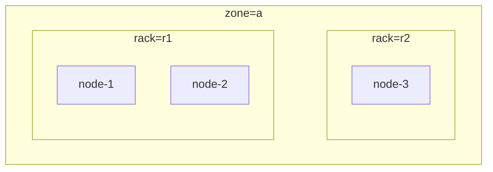

Volcano models topology explicitly as a HyperNode tree, supporting `hard`/`soft` constraints and bottom-up search for the lowest feasible tier:

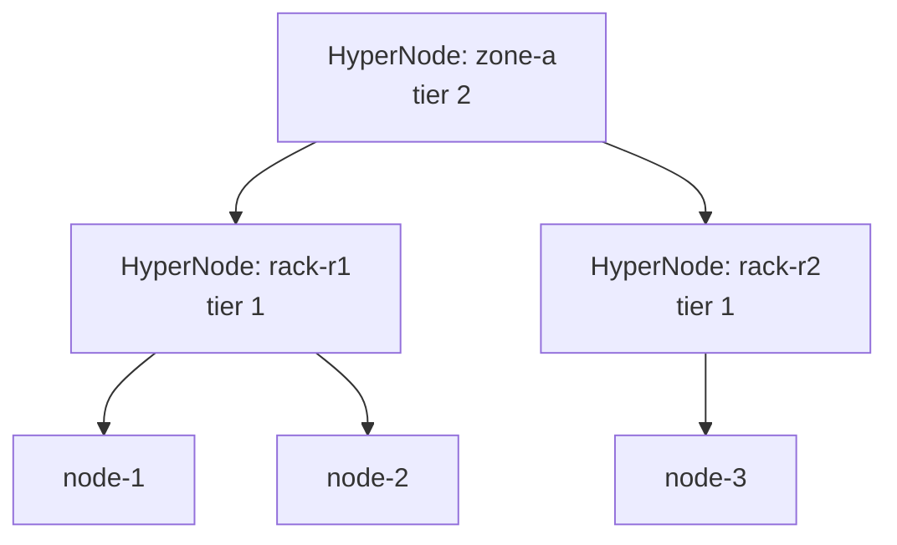

| Dimension | Upstream TAS | Volcano Network Topology |
|---|---|---|
| Topology source | Node labels (no extra objects) | HyperNode CRD (manual or `ufm`/`label` discovery) |
| Constraint syntax | Single node label key | `highestTierAllowed` / `highestTierName` |
| Hard vs. soft | Hard only | `hard` and `soft` |
| Multi-level constraints | Per-level keys on nested `CompositePodGroup`s | Job-level + SubGroup-level (2 levels) |
| Domain selection | Evaluates candidate domains, picks best score (v1.38 adds cutoff) | Bottom-up tier search, stopping at lowest feasible tier |
| Already-running pods | New pods are restricted to the already occupied topology domain | Search narrowed to LCA of already allocated HyperNodes |

Upstream TAS is lightweight—working out of the box on labeled nodes—but limited to single-key hard constraints. Volcano carries more setup overhead via HyperNodes in exchange for tightest-tier preference, soft fallback, and auto-discovery. For compatibility, the main gap is bridging upstream label keys to Volcano HyperNode tiers (see 7.4).

## 6. Preemption Comparison (WAP)

Upstream WAP (Workload-Aware Preemption, merged into `GenericWorkload` since v1.37 with no separate feature gate) triggers inline via `PodGroupPostFilter` once per failed group scheduling cycle:

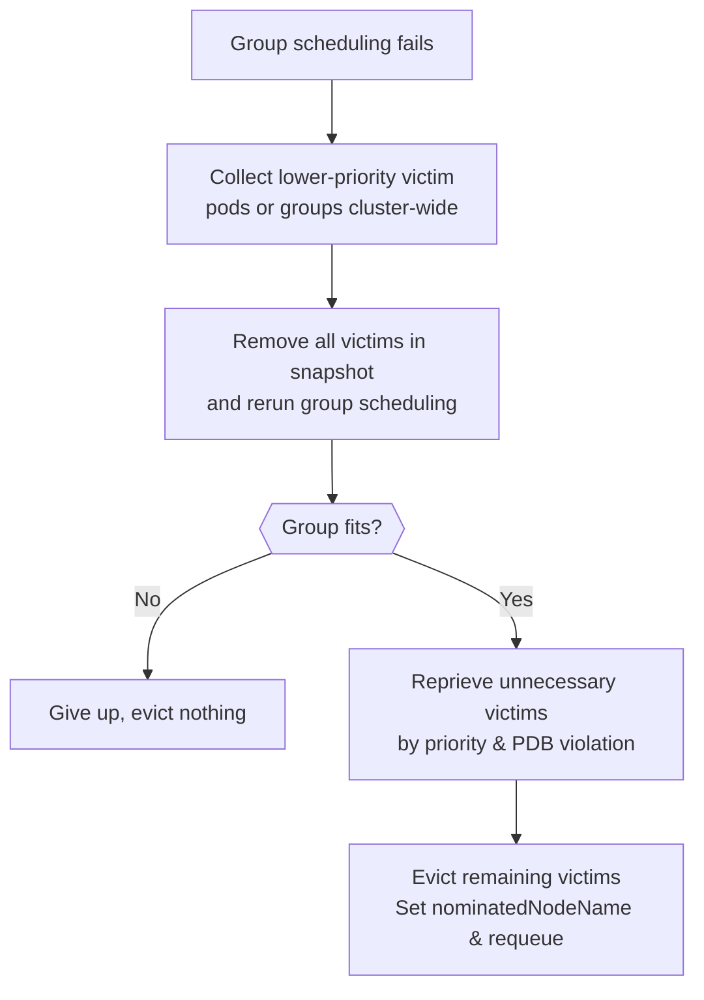

Alongside legacy `preempt`/`reclaim`, Volcano provides group-level eviction actions (`gangpreempt`/`gangreclaim`). The `gangpreempt` flow:

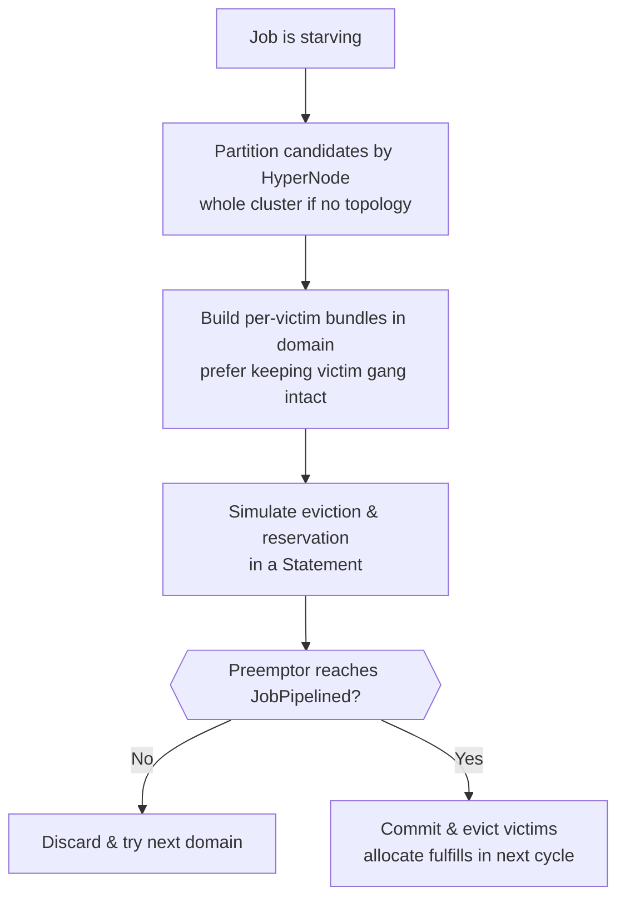

Both make whole-group decisions for the preemptor and avoid partial evictions on failure. Key differences:

| Dimension | Upstream WAP | Volcano Preemption / Reclaim |
|---|---|---|
| Trigger driver | Priority only | Priority (preemption) + queue quota (cross-queue reclaim) |
| Victim unit | `disruptionMode`: `single` (pod) or `all` (highest `all` ancestor) | Legacy: single task; `gang*`: safe or whole bundle |
| Default victim gang protection | **No** (`single` default allows splitting running gangs) | **Yes** (protects `minAvailable` by default) |
| Search scope | Cluster-wide (reruns TAS placements when enabled) | Per node; per HyperNode domain in `gang*` actions |
| Priority source | `PodGroup.spec.priority` (pod priority ignored), uniform across tree | Job uses PodGroup priority; tasks use per-task priority |
| Terminating victims | Keeps existing `nominatedNodeName` and waits without new preemption | Next Session's `allocate` uses nomination fast path |
| PDB handling | Best-effort (prefers reprieving, does not hard-block) | Filtered by `pdb` plugin |

Two semantic differences matter most for compatibility:

- **Cross-queue reclaim**: Upstream has no multi-tenant queues and thus only supports priority-based preemption.
- **Opposite defaults for victims**: Upstream allows splitting lower-priority running gangs by default unless `disruptionMode: all` is set; Volcano preserves victim `minAvailable` by default and evicts a whole gang only when explicitly enabled.

## 7. Volcano Compatibility Assessment

### 7.1 Current State

Volcano does not consume upstream `PodGroup`s today:

- Although its Kubernetes dependencies include the upstream types, `pkg/scheduler/plugins/util/k8s/snapshot.go` and `framework.go` stub out `PodGroupStates` and `PodGroupManager`.
- `getJobID` only inspects the `scheduling.k8s.io/group-name` annotation and never reads `pod.spec.schedulingGroup`; no informers or RBAC exist for upstream objects.
- Submitting a pod with `schedulingGroup` and `schedulerName: volcano` falls back to `pg-controller` creating a `minMember=1` Volcano PodGroup, ignoring upstream gang, topology, and preemption semantics.

### 7.2 Compatibility Phases

Because upstream lacks `queue`, `minResources`, `minTaskMember`, soft topology, and dynamic lifecycle phases, **replacing Volcano's PodGroup with the upstream one is not considered**. Compatibility can proceed in three deliverable phases:

| Phase | Scope | Workloads Enabled |
|---|---|---|
| Phase 1 | Recognize `schedulingGroup`, honor `minCount`, priority, and write back `PodGroupInitiallyScheduled` | Native Jobs / Deployments with `spec.scheduling` |
| Phase 2 | Support `disruptionMode`, `preemptionPolicy`, topology label mapping, and two-level `CompositePodGroup` | Common two-level LeaderWorkerSet and JobSet workloads |
| Phase 3 | Support arbitrary-depth `CompositePodGroup` and PodGroup-level DRA | All workloads using upstream WAS APIs |

### 7.3 Architectural Options

**Option A (Controller Mirroring)**: `pg-controller` watches upstream objects, mirrors them into Volcano `PodGroup`s, stamps `group-name` (and subgroup labels) on pods, and syncs status back. Scheduler core changes stay minimal.

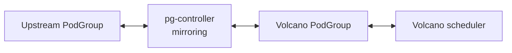

**Option B (Native Scheduler Support)**: Scheduler Cache watches upstream objects directly, converts them into internal `JobInfo`, and updates upstream status directly.

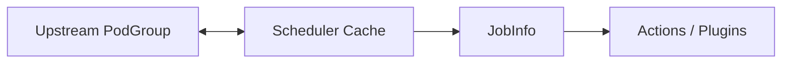

| Dimension | Option A: Controller Mirroring | Option B: Native Scheduler |
|---|---|---|
| Scheduler impact | Minimal | Broad (Cache, JobInfo, status sync, queue metrics) |
| Extra API objects | One mirrored Volcano PodGroup per upstream group | None |
| Consistency | Sync lag between mirrored objects | Single source of truth |
| Depth ceiling | Limited to two-level `subGroupPolicy` | Arbitrary depth with recursive SubJob |
| PodGroup-level DRA | Unsupported | Supported (requires implementing `PodGroupManager`) |

While upstream remains Beta, off by default, and subject to API churn, **Option A** isolates adaptation in the controller layer and protects the scheduler core from rework.

### 7.4 Key Design Questions

- **Queue assignment**: Reuse Volcano's plain-pod convention—read `scheduling.volcano.sh/queue-name` from the pod or owning workload, falling back to `default`.
- **Computing `minResources`**: Aggregate resource requests from created pods in the controller so Volcano's `enqueue` admission continues to work.
- **Resource name collision**: Both CRDs/resources are named `podgroups` (`kubectl get podgroups` is ambiguous); mirrored Volcano PodGroups in Option A need a naming prefix to avoid collisions.
- **Mapping `disruptionMode`**: Map `all` onto Volcano's whole-job eviction (disabling safe bundles); treat `single` as permitting rather than requiring splits, preserving Volcano's default gang protection.
- **Topology label key mapping**: Pair the `label` HyperNode discoverer with a label-key → tier mapping, aligned with [#6161](https://github.com/volcano-sh/volcano/issues/6161).
- **Unsupported structures**: Explicitly reject 3+ levels and cross-template partial `minGroupCount` in Phase 2 with a clear upstream status condition instead of silently downgrading.
- **Version & gate isolation**: Target `v1beta1+` only; detect API availability via discovery at startup and gate the feature behind a Volcano feature gate that is off by default.

### 7.5 Effort Estimate

Estimates are in person-weeks for engineers familiar with the Volcano scheduler, covering unit tests, e2e tests, cluster verification, and docs (excluding community review cycles).

| Target | Option | Estimated Effort |
|---|---|---|
| Phase 1: Flat gang scheduling for native Jobs | A | 4–6 person-weeks |
| Phase 2: Preemption, topology mapping, and two-level subgroups | A | 12–20 person-weeks total |
| Phase 3: Native scheduler support (any depth + PodGroup-level DRA) | B | 33–51 person-weeks (~8–12 person-months) |

*Note: Phase 3 reflects building Option B from scratch rather than an increment on Phase 2. Budget an additional 1–2 person-weeks per Kubernetes release to track upstream changes prior to GA.*

Breakdown (person-weeks):

| Work Item | Option A | Option B |
|---|---|---|
| Groundwork: API discovery, informers, RBAC, feature gate, e2e setup | 1–2 | 1–2 |
| Flat PodGroup: pod binding, `minCount`, priority, queue source, status sync | 3–4 | 6–8 |
| Wire `preemptionPolicy` and `disruptionMode` into preemption/reclaim | 2–4 | 2–4 |
| Topology label key to HyperNode tier mapping | 2–3 | 2–3 |
| Direct label-based domains when HyperNodes are absent | Optional | 3–4 |
| Two-level `CompositePodGroup` mapping to `subGroupPolicy` | 3–5 | 4–6 |
| Arbitrary depth: recursive SubJob model | N/A | 10–16 |
| PodGroup-level DRA (`PodGroupManager` / `PodGroupState`) | N/A | 4–6 |
| User documentation & semantic differences | 1–2 | 1–2 |

Two factors drive Option B's cost:
- 44 non-test scheduler files reference Volcano PodGroups directly and must be audited for multi-source support.
- Arbitrary depth requires refactoring the two-level SubJob model into a recursive tree across `allocate`, `gang`, `network-topology-aware`, and group eviction.

### 7.6 Recommendation

- **Short term**: Deliver Phase 1 (Option A) behind an off-by-default feature gate to enable native `Job.spec.scheduling` with Volcano queues at low cost.
- **Medium term**: Proceed to Phase 2 as user demand emerges for LeaderWorkerSet or JobSet via upstream APIs.
- **Long term**: Re-evaluate Option B once upstream reaches GA (currently targeting v1.39) and ecosystem adoption is clear.

Ecosystem momentum in JobSet, LeaderWorkerSet, Kubeflow Trainer, KubeRay, and Spark Operator is worth tracking—if upstream WAS APIs become their default gang interface, Volcano compatibility prevents those workloads from degrading to per-pod scheduling. Kueue's parallel integration plan provides a useful reference: [kubernetes-sigs/kueue#8871](https://github.com/kubernetes-sigs/kueue/issues/8871).

## 8. Summary

- **Complementary scope**: Upstream WAS covers single-workload placement (gang, hard topology, priority preemption); multi-tenant queues, fairness, and cross-queue reclaim remain with Volcano and Kueue.
- **Early maturity**: Core APIs are `v1beta1`, but all related feature gates stay off by default through v1.38, with GA targeting v1.39 at the earliest.
- **Capability delta**: Volcano already covers most upstream features while adding queue admission, soft topology, and reclaim; upstream adds 3+ level nesting, declarative `disruptionMode`, and PodGroup-level DRA.
- **Adoption strategy**: Volcano does not yet read `pod.spec.schedulingGroup`. Mirroring in `pg-controller` is the pragmatic path for flat gang (4–6 pw) and two-level support (12–20 pw), deferring native scheduler support (8–12 pm) until after GA.

## References

Upstream design docs:

- [KEP-4671 Gang Scheduling](https://github.com/kubernetes/enhancements/tree/master/keps/sig-scheduling/4671-gang-scheduling) (Workload & PodGroup API)
- [KEP-6012 CompositePodGroup API](https://github.com/kubernetes/enhancements/tree/master/keps/sig-scheduling/6012-composite-podgroup-api)
- [KEP-5732 Topology-aware workload scheduling](https://github.com/kubernetes/enhancements/tree/master/keps/sig-scheduling/5732-topology-aware-workload-scheduling)
- [KEP-5710 Workload-aware preemption](https://github.com/kubernetes/enhancements/tree/master/keps/sig-scheduling/5710-workload-aware-preemption)
- [KEP-6089 WAS Controller APIs](https://github.com/kubernetes/enhancements/tree/master/keps/sig-scheduling/6089-was-controller-apis) (embeddable types such as `Job.spec.scheduling`)
- [KEP-5547 Integrate Workload APIs with Job controller](https://github.com/kubernetes/enhancements/tree/master/keps/sig-apps/5547-integrate-workload-with-job)
- [Kubernetes v1.37: Advancing Workload-Aware Scheduling](https://kubernetes.io/blog/2026/09/08/kubernetes-v1-37-advancing-workload-aware-scheduling/)

Volcano design docs:

- [Network Topology Aware Scheduling](../design/Network%20Topology%20Aware%20Scheduling.md)
- [gang-aware-eviction-design](../design/gang-aware-eviction-design.md)

Code entry points:

| Component | Path |
|---|---|
| Upstream PodGroup API | kubernetes: `staging/src/k8s.io/api/scheduling/v1beta1/types.go` |
| Upstream group scheduling | kubernetes: `pkg/scheduler/schedule_one_podgroup.go` |
| Upstream gang plugin | kubernetes: `pkg/scheduler/framework/plugins/gangscheduling/` |
| Upstream group preemption | kubernetes: `pkg/scheduler/framework/preemption/podgrouppreemption.go` |
| Volcano PodGroup API | volcano: `staging/src/volcano.sh/apis/pkg/apis/scheduling/v1beta1/types.go` |
| Volcano pod-to-job mapping | volcano: `pkg/scheduler/api/job_info.go` (`getJobID`) |
| Volcano auto PodGroup controller | volcano: `pkg/controllers/podgroup/` |
| Volcano group-level eviction | volcano: `pkg/scheduler/actions/gangpreempt/`, `gangreclaim/` |
