# Upstream Kubernetes PodGroup vs. Volcano

English | [简体中文](./k8s-workload-aware-scheduling-vs-volcano-cn.md)

Since v1.35, Kubernetes has been teaching kube-scheduler to schedule whole workloads instead of single pods. The community calls this effort Workload-Aware Scheduling (WAS). It comes with a new `PodGroup` API that shares its name with Volcano's PodGroup and solves some of the same problems.

This document covers four things:

1. How far upstream has got.
2. How kube-scheduler schedules a PodGroup.
3. Where that differs from Volcano, including subgroups, topology-aware scheduling and preemption.
4. What Volcano would have to do to support the upstream PodGroup, and how much work it is.

The upstream material is based on Kubernetes v1.37.2 and the master branch as of November 2026 (v1.38 in development). The Volcano material is based on the current master.

## The short version

- Upstream only decides where the pods of one workload go: gang scheduling, topology constraints and group-level preemption. Queues, quota and fairness are out of scope, and the KEP says Kueue and Volcano will keep providing them.
- The upstream API is `v1beta1`, but every related feature gate is still off by default in v1.38. GA is planned for v1.39 at the earliest.
- Volcano already has an equivalent for almost everything upstream offers, plus queues, enqueue admission, soft topology constraints and cross-queue reclaim. Upstream has three things Volcano lacks: group nesting deeper than two levels, a declarative preemption unit (`disruptionMode`), and group-level DRA.
- Volcano does not recognise the upstream PodGroup today. A pod with `schedulingGroup` that is handed to Volcano is treated as an ordinary pod.
- Support can be added in steps. Translating upstream PodGroups into Volcano PodGroups in a controller takes 4–6 person-weeks and makes gang scheduling work for native Jobs on Volcano. Having the scheduler consume upstream objects directly takes 8–12 person-months, and that decision is better left until upstream reaches GA.

## 1. What upstream built

### 1.1 Starting from an example

Take a training job with 4 pods that must be scheduled all together or not at all. On a v1.38 cluster with the feature gates enabled, the user only adds a `scheduling` block to the Job:

```yaml
apiVersion: batch/v1
kind: Job
metadata:
  name: train
spec:
  parallelism: 4
  completions: 4
  scheduling:
    schedulingPolicy:
      gang: {}          # minCount defaults to parallelism when omitted
  template:
    ...
```

The Job controller then creates a Workload and a PodGroup, creates the pods, and records on each pod which PodGroup it belongs to (object names below are illustrative):

```yaml
apiVersion: scheduling.k8s.io/v1beta1
kind: Workload
metadata:
  name: train
spec:
  podGroupTemplates:
  - name: workers
    schedulingPolicy:
      gang:
        minCount: 4
---
apiVersion: scheduling.k8s.io/v1beta1
kind: PodGroup
metadata:
  name: train-workers
spec:
  workloadRef:
    workloadName: train
    templateName: workers
  schedulingPolicy:       # copied from the template
    gang:
      minCount: 4
---
apiVersion: v1
kind: Pod
metadata:
  name: train-0
spec:
  schedulingGroup:
    podGroupName: train-workers
  ...
```

Three new things appear here:

- `Workload` is a template that describes which groups make up the workload. Only controllers use it. kube-scheduler never reads it.
- `PodGroup` is the object the scheduler works with. It stands for a set of pods that are scheduled together. Its spec is mostly immutable: after creation only `minCount` can change.
- `pod.spec.schedulingGroup` is a new pod field that points to the PodGroup. It cannot be changed after the pod is created.

Workloads with more than one level, such as JobSet or LeaderWorkerSet, use a fourth object, `CompositePodGroup`, which groups several PodGroups together. Section 4 covers it.

All of these objects are created by the workload's controller. They refer to each other as follows, where an arrow means "refers to":

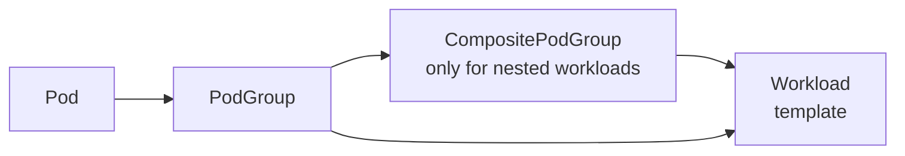

### 1.2 Upstream names and their Volcano counterparts

The upstream abbreviations come up throughout this document:

| Upstream | Meaning | Volcano counterpart |
|---|---|---|
| WAS | The overall effort to schedule by workload | Volcano's batch scheduling model |
| `Workload` | Static template of a workload | No separate object |
| `PodGroup` | A set of pods scheduled together | `PodGroup` |
| `CompositePodGroup` | A group of PodGroups | `subGroupPolicy` in `PodGroup` |
| TAS | Topology-aware scheduling | Network topology aware scheduling, based on HyperNode |
| WAP | Group-level preemption | `preempt` and `reclaim`, plus the group-level `gangpreempt` and `gangreclaim` |

### 1.3 Where it stands

| Release | Stage | Main changes |
|---|---|---|
| v1.35 | Alpha | Workload API introduced. PodGroup is only a field inside Workload |
| v1.36 | Alpha | PodGroup becomes its own object and pods join it through `schedulingGroup`. TAS, WAP and Job integration added |
| v1.37 | Beta | API moves to `v1beta1`. A PodGroup is queued and scheduled as a whole. CompositePodGroup added (Alpha) |
| v1.38 (in development) | Beta | CompositePodGroup, TAS and Job integration move to Beta. Deployment integration added (Alpha) |
| v1.39 (planned) | GA | PodGroup, TAS and WAP planned for GA. CompositePodGroup planned for v1.40 |

Two facts matter for how we follow this.

The API is not stable yet. It had two incompatible changes between v1.35 and v1.37, and in November 2026 the GA target moved from v1.38 to v1.39.

It is also off by default. Through v1.38, all the feature gates involved (`GenericWorkload`, `TopologyAwareWorkloadScheduling`, `CompositePodGroup`, `WorkloadWithJob` and others) are disabled by default and have to be turned on in kube-apiserver, kube-controller-manager and kube-scheduler.

### 1.4 What upstream leaves out

Upstream is explicit about its scope. One of the non-goals in KEP-4671 reads:

> Bring fairness or multiple workload queues in kube-scheduler. Kueue and Volcano.sh will continue to provide this.

kube-scheduler still has a single scheduling queue ordered by priority. It has no tenant queues, no quota and no reclaim between queues.

Upstream also does not discover topology automatically, so topology information can only come from node labels, and it does not yet support soft topology constraints such as "as close as possible".

## 2. How kube-scheduler schedules a PodGroup

### 2.1 The flow

We continue with the 4-pod example.

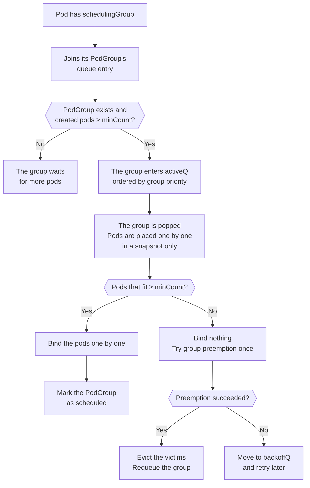

Step by step:

1. Queueing. A pod with `schedulingGroup` does not queue on its own. It joins the queue entry of its PodGroup. One entry stands for one PodGroup, or for the root of the tree when groups are nested. Entries are ordered by group priority, then by time.
2. Waiting for the pods. Before the group can be scheduled, the PodGroup object must exist and the number of created pods must reach `minCount`. In the example the group waits until all 4 pods have been created.
3. Trial placement. The scheduler pops the whole group and runs the normal Filter and Score for each pod in a fixed order. The results are recorded only in the snapshot of this cycle: later pods see what earlier pods took, but the real scheduler cache is untouched.
4. Gang check. The check runs after each pod. If the total cannot reach `minCount` even when every remaining pod fits, the cycle stops early.
5. Bind or preempt. If enough pods fit, each pod starts its own binding and the `PodGroupInitiallyScheduled` condition of the PodGroup is set to True. If not, no pod of the group is bound and the scheduler tries group-level preemption once (section 6). If that fails too, the group moves to backoffQ and is retried later.

A few details are worth knowing:

- Gang scheduling guarantees that the decision is made for the whole group. Binding is still asynchronous and per pod, and from the code there is no logic that undoes the other pods when one binding fails.
- `minCount` is checked only at scheduling time. Once the group has been scheduled, `PodGroupInitiallyScheduled` never goes back to False, even if pods are evicted later.
- The scheduling loop runs in a single goroutine. While a large group is being placed, all other pods and groups wait.
- Trial placement is greedy, runs in a fixed order and does not backtrack. When the pods of a group have different shapes, it can miss a placement that exists.

### 2.2 v1.37 compared with v1.38

The main flow is the same in both releases and the diagram above applies to both. They differ in these places:

| | v1.37 | v1.38 (in development) |
|---|---|---|
| Gang implementation | Besides the check during trial placement, pods also wait at Permit, with a 5-minute timeout | The Permit wait is gone. Only the check during trial placement remains |
| CompositePodGroup | Alpha, up to 4 levels | Beta, up to 5 levels, with status and deletion protection |
| Candidate topology domains | All are evaluated | Only a share is evaluated when there are many |
| Workload integration | Job (Alpha) | Job (Beta), Deployment (Alpha) |
| `preemptionPolicy` field | Behind its own feature gate | Always available |

## 3. Upstream PodGroup and Volcano PodGroup

### 3.1 The same job in Volcano

When the same job is submitted as a Volcano Job, the Volcano Job controller creates a PodGroup roughly like this, and pods refer to it through an annotation:

```yaml
apiVersion: scheduling.volcano.sh/v1beta1
kind: PodGroup
metadata:
  name: train
spec:
  queue: default
  minMember: 4
  minResources:
    cpu: "16"
    memory: 64Gi
---
apiVersion: v1
kind: Pod
metadata:
  name: train-worker-0
  annotations:
    scheduling.k8s.io/group-name: train
spec:
  schedulerName: volcano
  ...
```

Compared with the upstream PodGroup in 1.1, four things differ:

- A Volcano PodGroup always belongs to a Queue, and scheduling first decides whose turn it is based on queue quota and fairness. Upstream has no queues.
- Volcano has enqueue admission. A PodGroup starts as Pending. The scheduler moves it to Inqueue once the queue has room for `minResources`, and a Volcano Job creates its pods only after that. Upstream has no such step and the controller creates pods right away.
- Gang rules are finer in Volcano. Upstream has a single `minCount`. Volcano has `minMember` and also `minTaskMember`, which sets a minimum per role, for example "at least 1 ps and 2 workers".
- Status means different things. Upstream only records whether the group was ever scheduled. Volcano's `phase` reflects the current state (Pending, Inqueue, Running and so on) and is recomputed in every scheduling cycle.

The Volcano objects relate as follows. Solid arrows mean "creates" and dashed arrows mean "refers to". Compared with the diagram in 1.1, Workload and CompositePodGroup are gone and Queue and HyperNode are new:

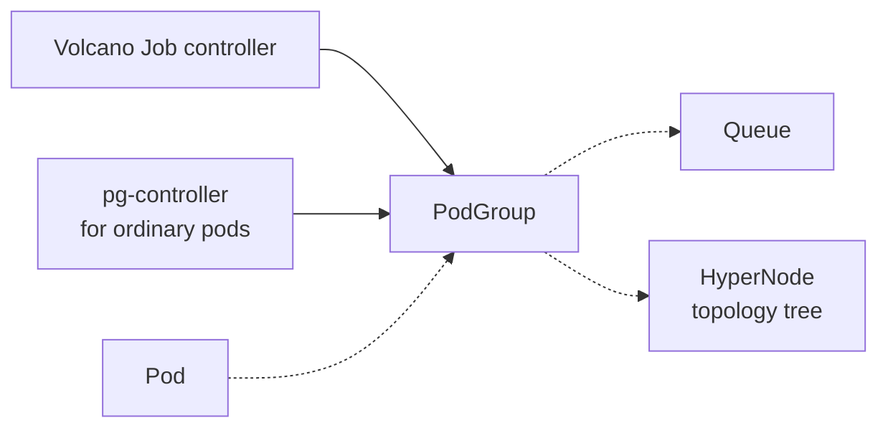

### 3.2 Field mapping

| Meaning | Upstream PodGroup | Volcano PodGroup |
|---|---|---|
| How a pod joins | `pod.spec.schedulingGroup` | annotation `scheduling.k8s.io/group-name` |
| Minimum pods | `schedulingPolicy.gang.minCount` | `minMember` |
| Minimum per role | none | `minTaskMember` |
| Minimum resources | none | `minResources` |
| Queue | none | `queue` |
| Priority | `priorityClassName`, `preemptionPolicy` | `priorityClassName` |
| Topology constraint | `schedulingConstraints.topology` | `networkTopology` |
| Subgroups | separate CompositePodGroup objects | `subGroupPolicy` |
| Unit of preemption | `disruptionMode` | none |
| Group-level DRA | `resourceClaims` | none |
| Status | condition `PodGroupInitiallyScheduled` | `phase`, conditions, pod counts |
| Mutable after creation | only `minCount` | yes |

### 3.3 How the scheduling process differs

Take the same 4-pod job on a cluster with enough resources. Upstream goes like this:

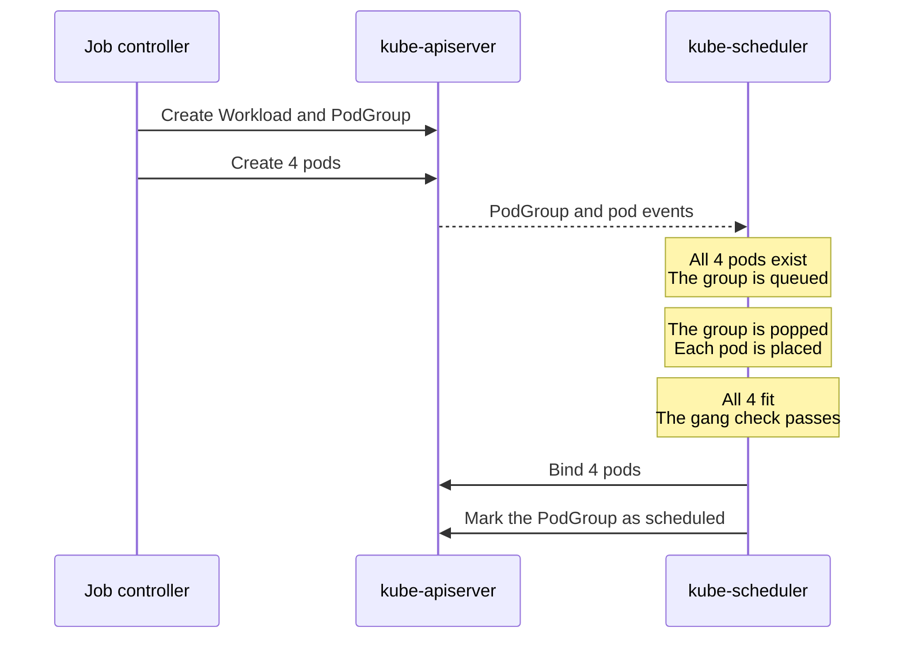

Volcano goes like this:

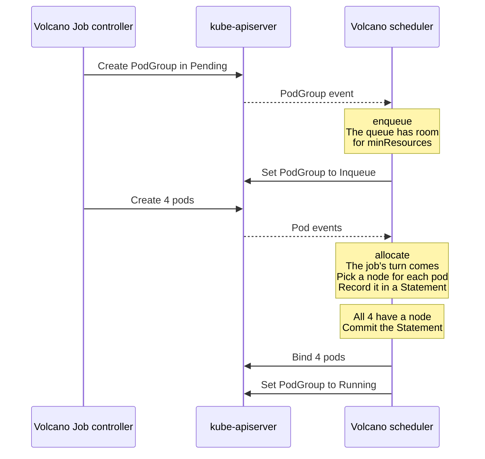

The biggest difference is the rhythm. kube-scheduler is event driven: it pops one group from the queue, decides for it, and then pops the next. Volcano is periodic: each cycle takes a snapshot of the cluster and walks through every job in it in queue order and job order, which is what lets it weigh fairness and quota across queues.

Two more differences:

- When resources are short, upstream tries preemption immediately in the same cycle. Volcano runs preemption and reclaim as separate actions after allocate, and they are enabled by configuration.
- After a failure, upstream puts the group into backoffQ to retry. Volcano needs no retry queue because the next cycle looks at every unscheduled job again.

Some things are the same on both sides. Both place the whole group on a snapshot first and commit only when the gang rule holds, and both bind pods asynchronously one at a time.

## 4. CompositePodGroup and Volcano SubGroup

Workloads such as LeaderWorkerSet and JobSet have two levels. For example, an inference service has 2 replicas of 4 pods each. The 4 pods of a replica must be scheduled together and sit in the same rack, the whole service must sit in the same zone, and the service only counts as scheduled when both replicas are.

The two sides model this differently.

Upstream uses separate objects. Each replica is a PodGroup, with a CompositePodGroup above them:

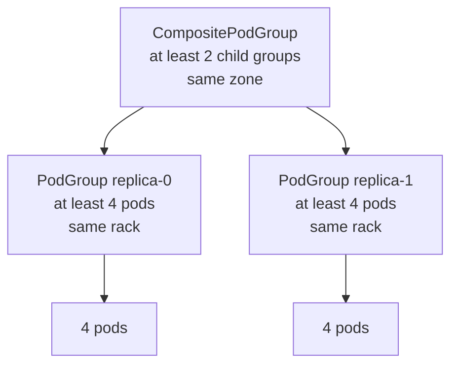

Volcano uses a single PodGroup. Its `subGroupPolicy` says how to split the pods into subgroups by pod label: here, one subgroup per 4 pods and at least 2 subgroups. A subgroup has no object of its own:

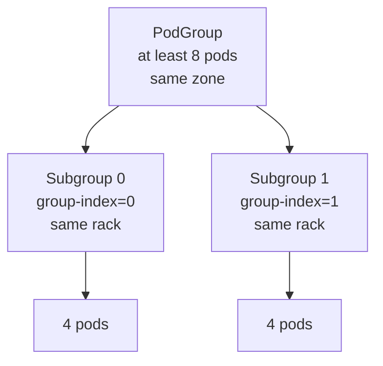

In YAML, upstream is a Workload template, from which the controller creates 1 CompositePodGroup and 2 PodGroups:

```yaml
apiVersion: scheduling.k8s.io/v1beta1
kind: Workload
metadata:
  name: serving
spec:
  compositePodGroupTemplates:
  - name: root
    schedulingPolicy:
      gang:
        minGroupCount: 2
    schedulingConstraints:
      topology:
      - key: topology.kubernetes.io/zone
    podGroupTemplates:
    - name: replica
      schedulingPolicy:
        gang:
          minCount: 4
      schedulingConstraints:
        topology:
        - key: topology.example.com/rack
```

In Volcano it is one PodGroup, provided the cluster already has HyperNodes for those levels:

```yaml
apiVersion: scheduling.volcano.sh/v1beta1
kind: PodGroup
metadata:
  name: serving
spec:
  queue: default
  minMember: 8
  networkTopology:
    mode: hard
    highestTierAllowed: 2        # assuming tier 2 is the zone
  subGroupPolicy:
  - name: replica
    subGroupSize: 4
    minSubGroups: 2
    labelSelector:
      matchLabels:
        app: serving
    matchLabelKeys:
    - group-index                # pods with the same value form one subgroup
    networkTopology:
      mode: hard
      highestTierAllowed: 1      # assuming tier 1 is the rack
```

The two models differ in three ways:

- Depth. Upstream can keep nesting, because a child of a CompositePodGroup can be another CompositePodGroup. The limit is 4 levels in v1.37 and 5 on master. A three-level shape such as JobSet → ReplicatedJob → Job can be expressed directly. Volcano always has two levels.
- Subgroup size. Upstream subgroups are separate objects and each can have its own `minCount`. In Volcano, all subgroups under one policy have the same size, so different sizes need several policies.
- Counting "at least N subgroups". Upstream `minGroupCount` counts all children of the parent together. Volcano `minSubGroups` counts per policy.

So not every upstream shape fits Volcano's current model:

| Upstream shape | Can Volcano's current model express it? |
|---|---|
| A single PodGroup | Yes. `minCount` maps to `minMember` |
| One CompositePodGroup over identical PodGroups | Yes. It maps to one `subGroupPolicy` |
| One CompositePodGroup over different PodGroups, all required | Yes. One policy per kind of PodGroup |
| The same, but only some of them required | Not exactly |
| Three or more levels | No |

## 5. Topology-aware scheduling (TAS)

Both sides want the same outcome: the pods of a group land on nodes that are close to each other in the network. They differ in how topology is described.

Upstream has no topology object and uses node labels directly. A PodGroup names one label key, which means "all pods of the group must be on nodes with the same value for this label". At scheduling time each value of the label is a candidate domain. The scheduler tries the group in each domain and picks the best-scoring domain among those where it fits.

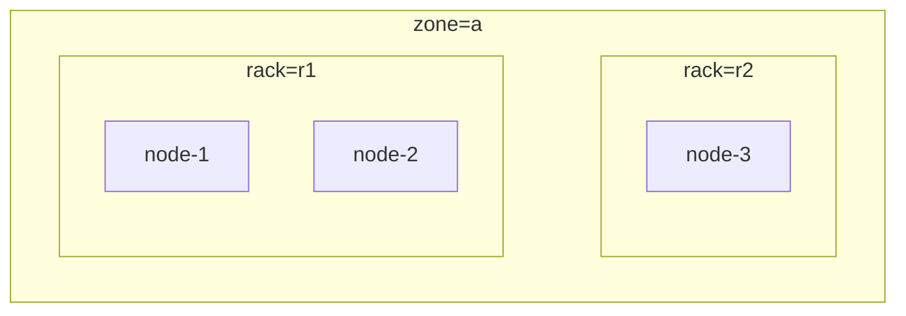

Volcano models topology explicitly as a tree, using the HyperNode CRD. A PodGroup states the highest tier it may spread to. At scheduling time the search starts from the lowest tier and stops at the lowest one where the whole group fits.


| | Upstream TAS | Volcano |
|---|---|---|
| Source of topology | Node labels | HyperNodes, created by hand or discovered from UFM or node labels |
| How a constraint is written | One label key | `highestTierAllowed` or `highestTierName` |
| Hard and soft constraints | Hard only | Both |
| Multi-level constraints | Nested CompositePodGroups, one key per level | One at job level and one at subgroup level |
| How a domain is chosen | Try each domain, take the best score | Search upward from the lowest tier and stop at the first fit |

The upstream approach is light. It works as soon as nodes are labelled and there are no extra objects to maintain. The price is that it can only say "must be in the same domain". Volcano needs HyperNodes first, but it can say "as close as possible, and go one tier up if that does not fit".

For compatibility, the awkward part is that the two are written differently. Upstream gives a label key and Volcano wants a tier, so a mapping is needed between them. Section 7.4 comes back to this.

## 6. Preemption (WAP)

Upstream group preemption runs after a whole group fails to schedule, and only once per group:

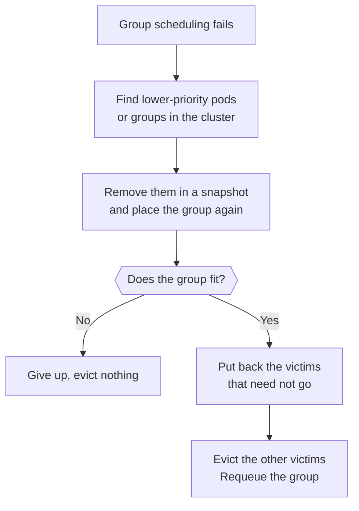

Volcano preemption runs as separate actions. Besides the original `preempt` and `reclaim`, there are now the group-level `gangpreempt` and `gangreclaim`. Here is `gangpreempt`. Without HyperNodes, the whole cluster is treated as one domain:

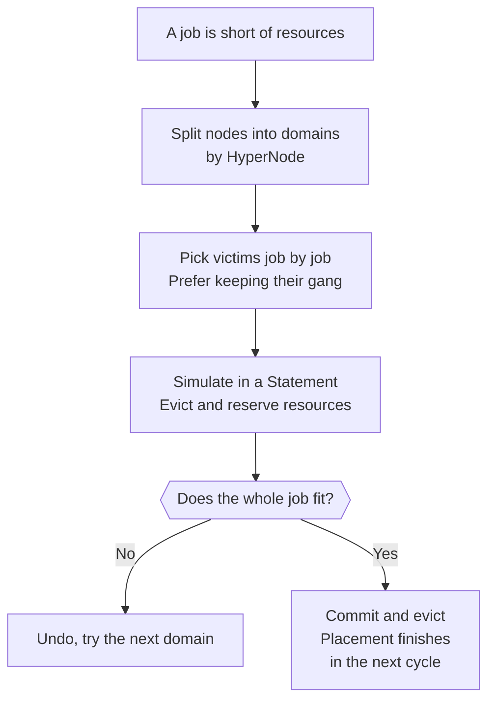

The idea is the same on both sides: simulate on a snapshot first, and evict only when the whole preempting group fits. The differences are:

| | Upstream WAP | Volcano |
|---|---|---|
| Trigger | Priority | Priority, and queue quota |
| Victim unit | A pod or a whole group, set by `disruptionMode` | A pod. In the group-level actions, a victim job |
| Protects the victim's gang by default | No | Yes |
| Search scope | The whole cluster | Per node. Per HyperNode domain in the group-level actions |
| When it runs | Right after scheduling fails | As a separate action, enabled by configuration |

Two of these deserve a few more words.

First, Volcano has one more reason to preempt. Upstream only knows "higher priority takes from lower priority". Volcano also reclaims across queues: when a queue uses more than its share, other queues can take the resources back when they need them. Upstream has no queues, so it has nothing like this.

Second, the two sides have opposite defaults for the victim. Upstream `disruptionMode` defaults to `single`, so the victim unit is a single pod and a running gang can lose some of its pods. To make it "take the whole group or nothing", `all` has to be set explicitly. Volcano protects the victim job by default: evictions do not take it below `minAvailable`, and a whole job is evicted only when that is explicitly allowed.

## 7. Supporting the upstream PodGroup in Volcano

### 7.1 Today

Volcano does not recognise the upstream PodGroup. To decide which job a pod belongs to, the scheduler only looks at the `scheduling.k8s.io/group-name` annotation. It does not read `pod.spec.schedulingGroup` and does not watch upstream PodGroups.

So if the Job in 1.1 is given `schedulerName: volcano`, the current code treats its pods as ordinary pods: pg-controller creates a Volcano PodGroup with `minMember=1` for them, the 4 pods are scheduled one by one, and the gang rule has no effect.

### 7.2 How far to go

There are three steps, and each can ship on its own:

| | What it covers | Workloads it enables |
|---|---|---|
| Step 1 | Recognise `schedulingGroup`, honour `minCount` and priority, write status back to the upstream PodGroup | Native Jobs and Deployments with `spec.scheduling` |
| Step 2 | `disruptionMode`, topology constraints and two-level CompositePodGroups | Common LeaderWorkerSet and JobSet setups |
| Step 3 | CompositePodGroups of any depth and group-level DRA | Every workload that uses the upstream API |

Replacing the Volcano PodGroup with the upstream one is not on the table. Upstream has no `queue`, `minResources` or `minTaskMember`, so replacing would mean losing features.

### 7.3 Two approaches

Approach A translates in a controller. pg-controller watches upstream PodGroups, creates a matching Volcano PodGroup for each, and adds the `group-name` annotation to the pods. After scheduling it writes the status back to the upstream PodGroup. The scheduler hardly changes.

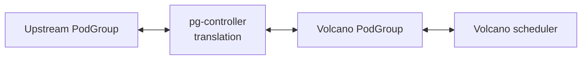

Approach B lets the scheduler read upstream objects directly. The scheduler cache watches upstream PodGroups, turns them into its internal JobInfo, and the scheduler writes the status back itself.

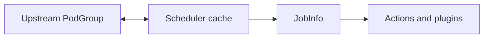

| | Approach A: translate in a controller | Approach B: support in the scheduler |
|---|---|---|
| Scheduler changes | Few | Many: cache, JobInfo, status updates, queue accounting |
| Extra objects | One Volcano PodGroup per upstream PodGroup | None |
| Consistency | The two objects can be briefly out of sync | A single source of data |
| Depth supported | Two levels | Any depth, once subgroups become recursive |
| Group-level DRA | Not possible | Possible |

We recommend starting with approach A. The upstream API is still Beta, off by default, and has already changed twice. With the adaptation in a controller, the scheduler does not have to change when upstream changes again.

### 7.4 Questions to settle first

Whichever approach is taken, these questions need an answer.

**Where does the queue come from?** The upstream PodGroup has no queue field. Volcano can do what it does for ordinary pods today: read the `scheduling.volcano.sh/queue-name` annotation on the pod or its owning workload, and fall back to the default queue.

**How is `minResources` computed?** Upstream has no such field, and Volcano's enqueue admission needs it. The controller can add up the resource requests of the pods that have been created.

**Name clashes.** Both kinds of PodGroup use the resource name `podgroups`, so `kubectl get podgroups` is ambiguous. The Volcano PodGroup created in approach A must also not collide with a PodGroup the user already has, so a naming rule is needed.

**How does `disruptionMode` map?** `all` requires the whole group to be evicted together. Volcano's group-level eviction can already evict by job, and this can build on it. `single` means the group may be split, not that it must be, so Volcano can keep protecting the victim job as it does today.

**How does a topology label key map to a HyperNode tier?** HyperNodes can already be generated from node labels. What is missing is a mapping that says which label key is which tier. This points in the same direction as [#6161](https://github.com/volcano-sh/volcano/issues/6161).

**What about shapes that cannot be expressed?** Volcano's current model cannot express more than two levels, or a `minGroupCount` that requires only some of the children. Those should be rejected with the reason written to the status of the upstream PodGroup, not scheduled quietly under different rules.

**What if the cluster does not have the upstream API?** The API only exists on v1.37 and later clusters with the feature gates on. Volcano has to detect it at startup, and the whole feature should sit behind a Volcano feature gate that is off by default.

### 7.5 Effort

The unit is person-weeks, for engineers who know the Volcano scheduler. Unit tests, e2e tests and docs are included. Community review time is not.

| Goal | Approach | Effort |
|---|---|---|
| Step 1: gang scheduling works for native Jobs on Volcano | A | 4–6 person-weeks |
| Step 2: add preemption semantics, topology constraints and two-level subgroups | A | 12–20 person-weeks in total |
| Step 3: support in the scheduler, any depth and group-level DRA | B | 33–51 person-weeks, about 8–12 person-months |

The figure for step 3 is for building approach B from scratch. It is not an increment on top of the first two steps.

The work breaks down like this:

| Work item | Approach A | Approach B |
|---|---|---|
| Groundwork: detect the upstream API, informers, RBAC, feature gate, e2e environment | 1–2 | 1–2 |
| Single PodGroup: pod association, `minCount`, priority, queue, status write-back | 3–4 | 6–8 |
| Wire `preemptionPolicy` and `disruptionMode` into preemption and reclaim | 2–4 | 2–4 |
| Map topology label keys to HyperNode tiers | 2–3 | 2–3 |
| Build domains straight from node labels when there are no HyperNodes | not planned | 3–4 |
| Map two-level CompositePodGroups to `subGroupPolicy` | 3–5 | 4–6 |
| Any depth: make subgroups recursive | not possible | 10–16 |
| Group-level DRA | not possible | 4–6 |
| User documentation | 1–2 | 1–2 |

Approach B is expensive for two reasons. The scheduler uses the Volcano PodGroup directly in many places, 44 non-test files in all, and each one has to be checked against upstream objects. And supporting any depth means turning today's two-level subgroup model into a recursive one, which touches allocate, gang, network topology and group-level eviction.

There is also a running cost. Until the upstream API reaches GA, expect 1–2 person-weeks per Kubernetes release to keep up with changes.

### 7.6 Recommendation

Step 1 can be done now, behind a feature gate that is off by default. It is a small investment, and it lets native Jobs with `spec.scheduling` be gang scheduled by Volcano and use Volcano queues.

Step 2 depends on demand. If users run LeaderWorkerSet or JobSet through the upstream API and want Volcano to schedule them, it is worth continuing.

Step 3 should be reassessed after upstream reaches GA. The risk of investing now is that the API will change again, and while it is off by default few clusters actually use it.

What needs watching is where the ecosystem goes. JobSet, LeaderWorkerSet, Kubeflow Trainer, KubeRay and Spark Operator are all integrating with the upstream Workload API. If they come to declare gang scheduling through the upstream API by default and Volcano does not recognise it, those workloads would be scheduled pod by pod on Volcano. Kueue is working on a similar integration, and its plan is a useful reference: [kubernetes-sigs/kueue#8871](https://github.com/kubernetes-sigs/kueue/issues/8871).

## References

Upstream design documents:

- [KEP-4671 Gang Scheduling](https://github.com/kubernetes/enhancements/tree/master/keps/sig-scheduling/4671-gang-scheduling): the Workload and PodGroup API
- [KEP-6012 CompositePodGroup API](https://github.com/kubernetes/enhancements/tree/master/keps/sig-scheduling/6012-composite-podgroup-api)
- [KEP-5732 Topology-aware workload scheduling](https://github.com/kubernetes/enhancements/tree/master/keps/sig-scheduling/5732-topology-aware-workload-scheduling)
- [KEP-5710 Workload-aware preemption](https://github.com/kubernetes/enhancements/tree/master/keps/sig-scheduling/5710-workload-aware-preemption)
- [KEP-6089 WAS Controller APIs](https://github.com/kubernetes/enhancements/tree/master/keps/sig-scheduling/6089-was-controller-apis): where `Job.spec.scheduling` and similar fields come from
- [KEP-5547 Integrate Workload APIs with Job controller](https://github.com/kubernetes/enhancements/tree/master/keps/sig-apps/5547-integrate-workload-with-job)
- [Kubernetes v1.37: Advancing Workload-Aware Scheduling](https://kubernetes.io/blog/2026/09/08/kubernetes-v1-37-advancing-workload-aware-scheduling/) (official blog)

Volcano design documents:

- [Network Topology Aware Scheduling](../design/Network%20Topology%20Aware%20Scheduling.md)
- [gang-aware-eviction-design](../design/gang-aware-eviction-design.md)

Good places to start reading the code:

| What | Where |
|---|---|
| Upstream PodGroup API | kubernetes: `staging/src/k8s.io/api/scheduling/v1beta1/types.go` |
| Upstream group scheduling | kubernetes: `pkg/scheduler/schedule_one_podgroup.go` |
| Upstream gang check | kubernetes: `pkg/scheduler/framework/plugins/gangscheduling/` |
| Upstream group preemption | kubernetes: `pkg/scheduler/framework/preemption/podgrouppreemption.go` |
| Volcano PodGroup API | volcano: `staging/src/volcano.sh/apis/pkg/apis/scheduling/v1beta1/types.go` |
| How Volcano maps a pod to a job | volcano: `getJobID` in `pkg/scheduler/api/job_info.go` |
| How Volcano creates PodGroups for ordinary pods | volcano: `pkg/controllers/podgroup/` |
| Volcano group-level eviction | volcano: `pkg/scheduler/actions/gangpreempt/`, `gangreclaim/` |
