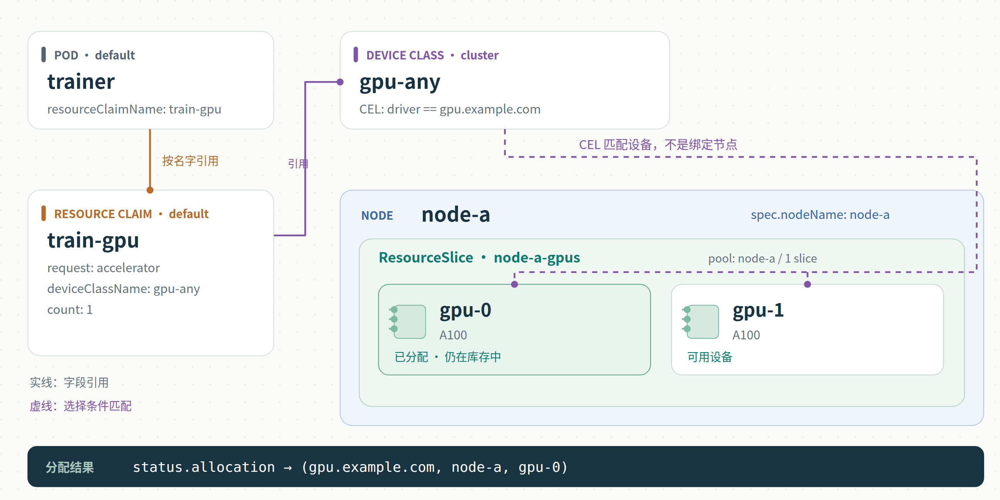
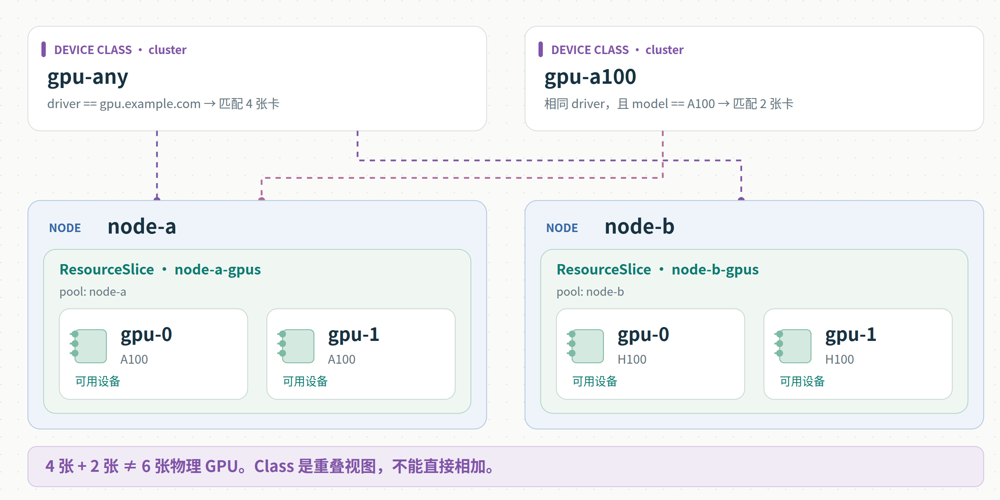
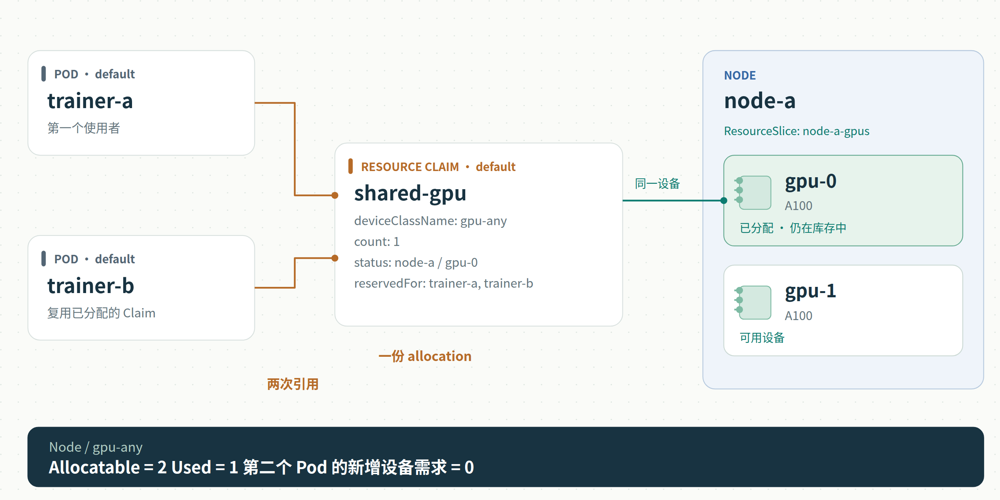
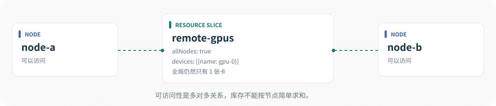

# DRA 关系图解

用三个典型场景理解 **Node、ResourceSlice、DeviceClass、ResourceClaim**。
示例使用 Kubernetes v1.36 的 `resource.k8s.io/v1` API，与 PR
[#6134](https://github.com/volcano-sh/volcano/pull/6134) 的分析基线一致。

## 打开图解

- [在线图解（Sites 私有预览，需所有者登录）](https://dra-field-guide-jesse.heartybread19.chatgpt.site)。
- 下载此目录后，用浏览器直接打开 [index.html](index.html)：无需安装依赖、启动服务或联网。
- GitHub 阅读本页即可看下方 PNG；SVG 可以下载后放大查看。
- HTML 页面包含场景切换、对应 YAML、复制和下载按钮。手机上可横向滚动查看大图。
- 页面中的 YAML 已内嵌；下载按钮需要保留本目录的 `examples/`、`observations/` 和 `assets/`。

也可以从当前目录运行 `python3 -m http.server 8000`，访问 `http://localhost:8000`。

## 先记住这四种关系

| 从哪里看 | 字段或机制 | 指向什么 |
|---|---|---|
| ResourceSlice | `spec.nodeName` | 本地设备可访问的 Node |
| ResourceSlice | `spec.devices[]` | 发布的设备条目 |
| ResourceClaim | `spec.devices.requests[].exactly.deviceClassName` | 按名字引用 DeviceClass |
| DeviceClass | `spec.selectors[].cel.expression` | 根据条件匹配设备 |
| Pod | `spec.resourceClaims[].resourceClaimName` | 同 namespace 的 ResourceClaim |
| ResourceClaim 分配结果 | `status.allocation.devices.results[]` | 实际分配的 `(driver, pool, device)` |

Node、ResourceSlice 和 DeviceClass 是集群级对象；ResourceClaim 和 Pod 有 namespace。
DeviceClass 也可以包含驱动配置，本页重点解释选择规则。

**DeviceClass 与设备是多对多的匹配关系。** Slice 没有 `deviceClassName` 字段。
一个 Claim 可以有多个设备请求，每个 `exactly` 请求引用一个 Class，且可以请求多张设备。
Pod 也可以引用多个 Claim；多个 Pod 可以共享同一个 Claim。

## 01 · 本地设备分配



[SVG](assets/01-node-local.svg) · [完整 YAML](examples/01-node-local.yaml) ·
[分配后的 status 节选](observations/01-allocation.yaml)

`node-a-gpus` 发布 node-a 上的两张 A100。`gpu-any` 匹配这个驱动的设备。
`train-gpu` 请求其中一张，Pod `trainer` 引用这个 Claim。
假设调度器选中 gpu-0，设备仍保留在 Slice 中，具体分配结果记录在 Claim status 中。

Pod 中 `gpu` 是局部引用别名，`train-gpu` 是 Claim 对象名，`accelerator` 是 Claim 内的请求名。
三个名字不同，但字段将它们连接起来。`observations/` 仅展示读取结果，不能作为创建对象的输入。

## 02 · 多个 Class 匹配同一设备



[SVG](assets/02-overlapping-classes.svg) · [完整 YAML](examples/02-overlapping-classes.yaml)

node-a 有两张 A100，node-b 有两张 H100。`gpu-any` 匹配四张卡，`gpu-a100` 只匹配两张 A100。
物理设备总数仍是四张，不能把两个 Class 的计数相加得到六张。

两边都有 `gpu-0`，但 pool 不同，因此是不同设备。设备身份是
`(driver, pool, device)`，不是设备名、节点名或 ResourceSlice 名单独决定的。

## 03 · 多个 Pod 共用一个 Claim



[SVG](assets/03-shared-claim.svg) · [完整 YAML](examples/03-shared-claim.yaml)

示意 trainer-a 已经通过 `shared-gpu` 获得 node-a 的 gpu-0，trainer-b 随后引用同一 Claim。
两个 Pod 复用同一份 allocation，因此 Used 为 1，第二个 Pod 的新增设备需求为 0。
两者都必须满足设备可访问性约束；本例中都需要在 node-a。

这表示共享访问，不保证驱动自动提供时间片、显存隔离或应用级并发安全。
设备允许多个独立 Claim 分配、consumable capacity 属于另外的机制。
另外，Pod 删除不等于设备立即空闲：统计应以 Claim 的 allocation 及调度器跟踪状态为准。

## Node、Pool 与 ResourceSlice 的补充关系

Pool 是驱动定义的资源分组，不是独立 Kubernetes API 对象。
一个 pool 可以有多个 ResourceSlice；`resourceSliceCount` 是同代 Slice 数量，不是设备数量。
`pool.name` 在例子中与节点同名只是命名选择，并非强制关联。
`pool.generation` 用于区分库存版本；消费方应忽略旧代，并按分配要求处理不完整的 pool。

本地设备用 `nodeName` 描述可访问性；跨节点设备也可以用 `allNodes` 或 `nodeSelector`。
两个节点都能访问一张卡，不表示集群有两张卡。



## 和 Binpack / Cache 的关系

本地、独占设备的数量模型中：

- Allocatable：节点可访问、匹配某个 Class 的设备集合大小。
- Used：上述集合与已分配设备集合的交集大小。
- 新增需求：当前任务尚需分配的 Claim 请求；已分配共享 Claim 不重复累加。

设备库存、归属及 Class 匹配可以缓存；Used 要及时反映 Reserve / Unreserve，
不能只等 ResourceClaim informer 看见 API 更新。
按 Class 的统计可能重叠，不代表各 Class 都拥有独立的一份物理库存。

## 示例范围与维护

这些是教学示例，使用假想驱动 `gpu.example.com`。Node 通常由 kubelet 注册，ResourceSlice
由真实 DRA 驱动发布。手工创建示例对象不会产生 GPU，也不会安装驱动。
三个场景是独立场景，部分对象同名，不应混合批量应用。
实际运行还需要匹配的 DRA 驱动、真实设备及
[Volcano DRA 配置](../how_to_enable_dra.md)。本页未在真实 GPU 集群执行。

编辑 `page.template.html`、`build.py` 或 YAML 后执行：

```sh
python3 build.py
```

此命令仅依赖 Python 标准库，会重新生成 HTML 与 SVG。PNG 是 SVG 在浏览器中的渲染导出；
修改图后需同步重新导出 PNG。页面无需外部字体、脚本或 CDN，SVG 保留可编辑文字。

## 依据

- [Kubernetes v1.36 DRA 概念](https://v1-36.docs.kubernetes.io/docs/concepts/scheduling-eviction/dynamic-resource-allocation/)
- [ResourceSlice API](https://v1-36.docs.kubernetes.io/docs/reference/kubernetes-api/resource/resource-slice-v1/)
- [DeviceClass API](https://v1-36.docs.kubernetes.io/docs/reference/kubernetes-api/resource/device-class-v1/)
- [ResourceClaim API](https://v1-36.docs.kubernetes.io/docs/reference/kubernetes-api/resource/resource-claim-v1/)
